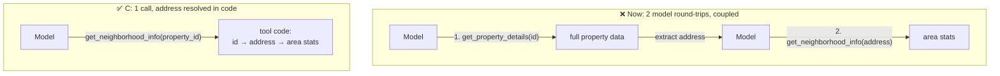

# Q19 — A tool that forces a lookup first: change its input

**Domain / lesson:** D2 › 2.1 Tool Interface Design
**Also touches:** D2 › 2.2 Structured Error Responses (fewer failure points) · D1 › 1.1 Agentic Loops (fewer round-trips)
**Scenario:** real-estate agent with property tools

## Question

Your agent uses three tools: `get_property_details(property_id)` returns data including street address, `get_price_history(property_id)` returns historical pricing, and `get_neighborhood_info(address)` returns area statistics. You observe that `get_neighborhood_info` always requires `get_property_details` first just to extract the address, even when users specify the property by ID. This creates unnecessary latency and failure coupling – if the first call fails, the neighborhood request also fails. What tool design change best addresses this?

- **A.** Create a `lookup_address(property_id)` helper tool for retrieving addresses.
- **B.** Add retry logic and timeout handling to `get_property_details`.
- **C.** Change `get_neighborhood_info` to accept `property_id`, resolving the address internally.
- **D.** Consolidate into a single `get_property_with_neighborhood(property_id)` tool returning both datasets.

## Answer: **C**

## Diagram

## Concept

The tool's **input contract** doesn't match what the agent **has**. Users name properties by **ID**, but `get_neighborhood_info` only takes an **address**. So the model is forced into a detour:
1. Call `get_property_details` (fetches a lot of data it doesn't need),
2. Read the result and pull out the address,
3. Call `get_neighborhood_info`.

That's **two model round-trips**, an **extra failure point**, and an extra reasoning step where the model could make a mistake.

**Fix the interface:** let `get_neighborhood_info` accept `property_id` and resolve the address **inside the tool, in code**. One call, one failure point, and no work left for the model.

> Design tool inputs around **the identifiers the agent actually has**, not the ones the backend happens to use.

(The guide, 2.1: tools need *"defined input and output contracts."* The guide doesn't use this exact example; this is the design principle applied.)

## Why the others are wrong

| Option | Why not |
|---|---|
| **A** New `lookup_address(property_id)` helper tool | **Still two calls, still coupled.** A lighter first call is still a first call. If `lookup_address` fails, the neighborhood request still fails. It also adds a tool, which means more for the model to choose between (Q04). |
| **B** Retries + timeouts on `get_property_details` | **Treats the symptom, not the design.** Fewer failures, but the extra call, the extra latency (now with retries) and the dependency all remain. Retries are a good **addition**, not the fix. |
| **D** Merge into `get_property_with_neighborhood(property_id)` | **Over-fetches and over-merges.** A user who only wants area stats now pulls full property data too. If the property part fails, the whole thing fails. Guide trap (2.1): *"Consolidating similar tools into one as the first step."* |

## Pattern to remember

> **When a tool needs a lookup just to get its input, change the tool to accept the identifier the agent already has, and resolve the rest internally.** Don't add helper tools, retries or mega-tools around a mismatched interface.

**Exam signal:** "always calls X first just to get Y" → the answer **changes the second tool's input**. Reject:
- **helper tool** (A): same chain, smaller link
- **retry / timeout** (B): symptom treatment
- **merge into one** (D): over-fetching, broader failure, a listed trap

### Where this comes from in the guide

**D2 › 2.1 Tool Interface Design:**
- *"Split them into purpose-specific tools with defined input and output contracts."* C keeps the tool purpose-specific (neighborhood only) and fixes its input contract.
- Trap: *"Consolidating similar tools into one as the first step."* That's option D.

## How this connects to earlier questions

| Question | Link |
|---|---|
| [Q17](../Q17-split-unified-tool/question.md) | Also tool **interface** design. Q17: split a tool doing too much. Q19: fix a tool asking for the wrong input. Both reject "merge everything" |
| [Q04](../Q04-tool-scoping-per-subagent/question.md) | Adding helper tools (A) grows the tool list, which makes selection less reliable |
| [Q13](../Q13-agentic-loop-model-decides-next-tool/question.md) | Each extra tool call = another loop iteration (round-trip + model reasoning) |
| [extract-first concept](../../concepts/extract-first-summarize-second.md) | Moving deterministic steps (id → address) from the model into code |

## Check question

**With C, the tool still looks up the address internally, so it still depends on the property data. Hasn't the failure coupling just moved? Why is C still better?**

*My answer:* "Because it is done within a single call." 🟡 **True, but that's half the reason.** One call fixes the **latency**. The bigger gain is **who** handles the dependency.

**Honest part first:** yes, the dependency still exists. C doesn't remove it; it moves it **from the model into code**, and that changes everything:

| | **Before** (model handles the chain) | **After C** (code handles it) |
|---|---|---|
| Who extracts the address | The **model** reads the property data and copies the address (probabilistic: could pick the wrong field or mistype) | **Code**: `address = db.get_address(id)` (deterministic) |
| What's fetched | Full property details (big response in the context) | Just the address, internally. Nothing extra in the context |
| Round-trips | 2 model calls | 1 model call |
| If the lookup fails | Model gets a raw failure, has to reason about it | Tool can retry internally, use a cache, or return **one structured error** (2.2) |

**Why it's better in one line:** deterministic steps (id → address) belong in **code**, not in the model's reasoning. Same rule as extract-first and the gates in Q13.

> **C doesn't remove the dependency. It moves it from probabilistic model reasoning into deterministic code inside the tool.**

## Glossary

- **Failure coupling:** when one operation can't succeed unless another one does first; a failure in the first breaks the second.
- **Input contract:** what a tool requires as input (parameter names, types, required fields).
- **Round-trip:** one request to the model and back. Each tool call in an agentic loop costs one.
- **Over-fetching:** returning more data than the caller needs, which wastes tokens and context.

## Related course lessons

### Udemy A (primary): Claude Certified Architect (CCAR-F) - 2026 Exam Prep
| # | Lecture | Part | Why |
|---|---|---|---|
| **34** | **Designing Tool Input Schemas** | 2A | ⭐ Exactly this: choosing a tool's inputs |
| 33 | Writing Tool Descriptions That Route Correctly | 2A | The input decides what the description promises |
| 35 | Required vs. Optional Parameters, Enums, and Constraints | 2A | `property_id` as the required input (optionally keep `address`) |
| 40 | Selection Heuristics and Tool-Selection Failures | 2A | Why extra helper tools (A) hurt selection |
| Quiz 5 | 2A quiz | | Self-test |

**▶ Watch in this order (~28 min, est.):** #34 → #35 → #33 → #40, then do **Quiz 5**.

### Udemy B: Claude Certified Architect Foundations: Complete Course (Voroniuk)
| # | Lecture | Section | Why |
|---|---|---|---|
| **42** | **Renaming, Splitting and Keyword Triggers** | S5 Tools & MCP | ⭐ Reshaping tool interfaces |
| 41 | How Claude Chooses a Tool | S5 Tools & MCP | Fewer, clearer tools |
| 25 | Functions, JSON and Schemas | S4 Structured Output | Defining tool inputs |
| Quiz 5 | Tools & MCP quiz | S5 | Self-test |

**▶ Watch in this order (~20 min, est.):** #25 → #41 → #42, then do **Quiz 5**.

### CBT Nuggets: CCA-F course
| Skill | Why |
|---|---|
| **19. Explain Tool Use and Tool Schemas** | ⭐ Designing tool parameters |
| 34. Build MCP Tools Resources and Prompts | Tools with clear input contracts |
| 21. Build Multi Turn Tool Conversations | The cost of chained tool calls |
