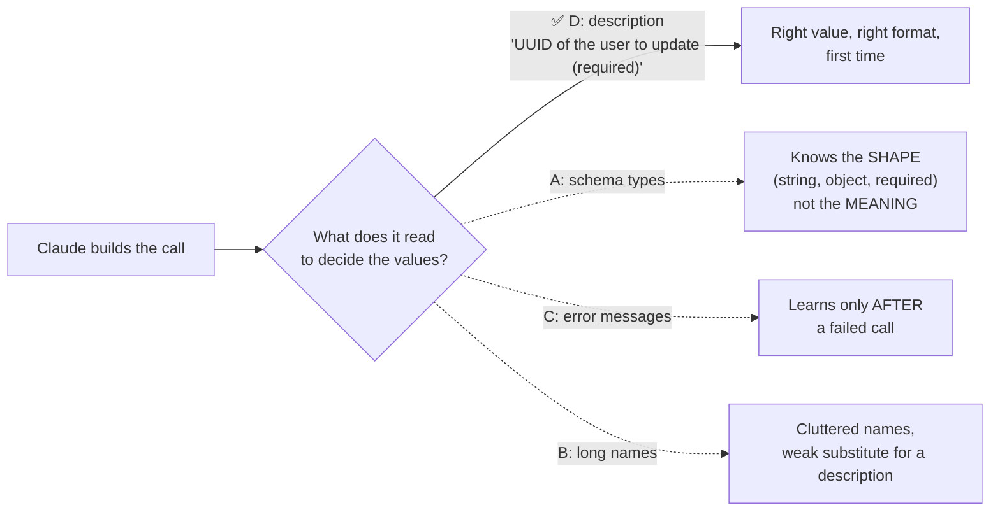

# Q20 — What helps Claude provide the right parameter values?

**Domain / lesson:** D2 › 2.1 Tool Interface Design
**Also touches:** D2 › 2.2 Structured Error Responses (why C is second-best) · D4 › 4.3 Structured Output with Tool Use (strict schemas)

## Question

Your `update_user_profile` tool accepts a `user_id` (required) and an optional `fields_to_update` object. In testing, Claude frequently omits `user_id` or passes incorrectly structured data. What is most critical for helping Claude understand what parameter values to provide?

- **A.** Strict JSON Schema type constraints marking `user_id` as required and defining `fields_to_update` as an object type.
- **B.** Verbose parameter names encoding format hints, such as `user_id_string_uuid_format`.
- **C.** Detailed error responses explaining why invalid parameter values were rejected.
- **D.** Clear parameter descriptions explaining expected format, such as "user_id: UUID of the user to update (required)".

## Answer: **D**

## Diagram

## Concept

The key word in the question is **"understand"**. Claude decides what to pass by **reading the tool definition**, and the part that carries **meaning** is the **description** (of the tool and of each parameter).

Guide (2.1): *"Tool descriptions are the primary mechanism LLMs use for tool selection."* A good description states the inputs: *"data types, formats, constraints, and required versus optional fields."*

| Layer | Tells Claude | Example |
|---|---|---|
| **Schema type** (A) | The **shape** | `user_id: string`, required |
| **Description** (D) | The **meaning + format** | "UUID of the user to update, e.g. `3f2a…`. Not the email. Required." |

A schema can say `user_id` is a required **string**. Only the description can say **which** string: a UUID, not an email or a username, and of **which** user.

## Why the others are wrong

| Option | Why not |
|---|---|
| **A** Strict schema types | **Necessary, but not what helps Claude *understand*.** Note the question already says `user_id` is required, and Claude still omits it. Types define the shape (string, object) but not the meaning or format. Schema + description work together; the description is what explains. |
| **B** Verbose names like `user_id_string_uuid_format` | **A hack.** Cramming documentation into the name is unreadable and limited. That's what the description field is **for**. |
| **C** Detailed error responses | **Helps after the mistake, not before.** Good practice (2.2) for recovery: the model can retry correctly. But the question asks what helps Claude provide the right values, i.e. **first time**. Same shape as Q17: detection vs prevention. |

## Pattern to remember

> **Parameter descriptions are how Claude understands what to pass.** State the meaning, format, an example and whether it's required. Schemas give the shape; descriptions give the meaning; errors help recovery.

**Exam signal:** "help Claude **understand** / **select** / **provide the right value**" → **clear descriptions**. Reject: types alone (A), names as documentation (B), after-the-fact errors (C).

**Careful, a different wording flips it:** if a question asks how to **guarantee** a schema-valid call (every required field present, right types), schema enforcement / strict tool use is the answer (D4 › 4.3). "Understand" → description. "Guarantee structure" → schema.

### Where this comes from in the guide

**D2 › 2.1 Tool Interface Design:**
- *"Tool descriptions are the primary mechanism LLMs use for tool selection."*
- Descriptions are not optional metadata; minimal ones leave the model guessing.
- A good description states *"data types, formats, constraints, and required versus optional fields."*

## How this connects to earlier questions

| Question | Link |
|---|---|
| [Q17](../Q17-split-unified-tool/question.md) | Also 2.1. Q17 fixed the **structure** (split the tool), Q20 fixes the **explanation** (descriptions). Same "prevent, don't just detect" logic as Q17 B |
| [Q19](../Q19-tool-accepts-available-identifier/question.md) | Also 2.1. Q19 fixed **which** input; Q20 explains **how** to fill it |
| [Q13](../Q13-agentic-loop-model-decides-next-tool/question.md) | Structured errors (C) steer the loop back after a mistake: useful as recovery |

## Check question

**Option A (strict schema) can guarantee that `user_id` is present and is a string. What can it never guarantee, and why does that make D the answer?**

*My answer:* "A does not guarantee the model understands its meaning." ✅ **Correct.** Made concrete below: what does "doesn't understand the meaning" look like in a real call?

A schema checks **shape**, so all of these **pass** `user_id: string, required`:

| Value Claude sends | Passes schema? | Right? |
|---|---|---|
| `"3f2a9c1e-7b4d-…"` (the user's UUID) | ✅ | ✅ |
| `"anna@example.com"` (email) | ✅ | ❌ wrong identifier type |
| `"anna"` (username) | ✅ | ❌ wrong identifier type |
| `"8c1d…"` (another user's UUID) | ✅ | ❌ wrong user: worst case, silently updates someone else |

**Schema guarantees a *valid* value. Only the description makes a *correct* value likely.** That's why D is "most critical for helping Claude **understand**".

(And for the "wrong user" row, neither schema nor description is enough. That calls for a check **in code**, e.g. the tool verifies the user ID belongs to the current session.)

> **Valid ≠ correct.** Schema → valid shape. Description → correct meaning. Code check → guaranteed when it really matters.

## Glossary

- **Parameter description:** the `description` text attached to each parameter in a tool's input schema. Claude reads it to decide what value to pass.
- **Schema type constraint:** the JSON Schema rule for shape (`"type": "string"`, `"required": [...]`).
- **Strict tool use:** an API option where Claude's tool inputs are guaranteed to match the schema's structure.
- **UUID:** a standard 128-bit unique identifier, e.g. `3f2a9c1e-…`.

## Related course lessons

### Udemy A (primary): Claude Certified Architect (CCAR-F) - 2026 Exam Prep
| # | Lecture | Part | Why |
|---|---|---|---|
| **33** | **Writing Tool Descriptions That Route Correctly** | 2A | ⭐ Descriptions as the main lever |
| **34** | **Designing Tool Input Schemas** | 2A | ⭐ Parameter descriptions inside the schema |
| 35 | Required vs. Optional Parameters, Enums, and Constraints | 2A | What A covers, and its limits |
| 36 | Strict Tool Use and Valid Inputs | 2A | When "guarantee structure" is the question instead |
| 37 | Returning Useful Errors from Tools | 2A | Why C is recovery, not prevention |
| Quiz 5 | 2A quiz | | Self-test |

**▶ Watch in this order (~30 min, est.):** #33 → #34 → #35 → #36, then do **Quiz 5**.

### Udemy B: Claude Certified Architect Foundations: Complete Course (Voroniuk)
| # | Lecture | Section | Why |
|---|---|---|---|
| **41** | **How Claude Chooses a Tool** | S5 Tools & MCP | ⭐ Claude reads descriptions to decide |
| 25 | Functions, JSON and Schemas | S4 Structured Output | Schema shape vs description |
| 42 | Renaming, Splitting and Keyword Triggers | S5 Tools & MCP | Naming vs describing (vs B) |
| Quiz 5 | Tools & MCP quiz | S5 | Self-test |

**▶ Watch in this order (~20 min, est.):** #25 → #41 → #42, then do **Quiz 5**.

### CBT Nuggets: CCA-F course
| Skill | Why |
|---|---|
| **19. Explain Tool Use and Tool Schemas** | ⭐ Writing parameter descriptions |
| 20. Handle Tool Calls and Tool Results | Error results for recovery (C) |
