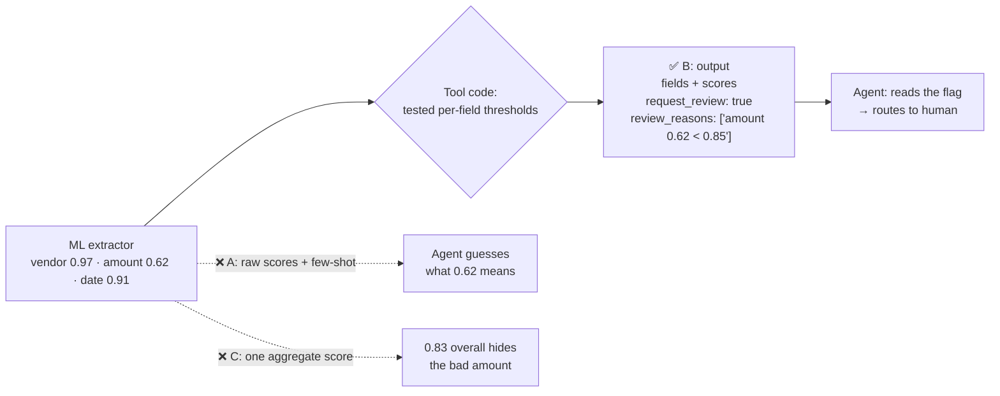

# Q21 — Confidence scores: let code decide when to request review

**Domain / lesson:** D5 › 5.5 Human Review & Confidence Calibration
**Also touches:** D2 › 2.1 Tool Interface Design (tool output contract) · D1 › 1.4 Workflow Enforcement (deterministic over probabilistic)
**Scenario:** invoice extraction with per-field confidence scores

## Question

Your document extraction tool uses ML models to extract invoice fields (vendor, amount, date). The models return confidence scores (0.0-1.0) for each extracted field. In production, you observe: (1) the agent proceeds with low-confidence extractions that are incorrect 23% of the time, and (2) the agent requests unnecessary human review for 31% of extractions that were actually correct. How should you restructure the tool's output?

- **A.** Return fields with their raw confidence scores and add detailed few-shot examples to your system prompt demonstrating how to interpret different confidence ranges and when to request human review.
- **B.** Return fields with confidence scores, plus a `request_review` boolean computed using your tested confidence thresholds, along with a `review_reasons` array explaining which fields triggered review.
- **C.** Compute an aggregate `extraction_quality` score across all fields and return it alongside the extracted values. Include a text summary describing the overall extraction reliability.
- **D.** Return fields organized into `verified` and `needs_verification` objects based on confidence thresholds.

## Answer: **B**

## Diagram

## Concept

**Diagnose the two symptoms:**
1. Proceeds with wrong extractions (23%) → the agent **under-escalates** on some low scores.
2. Requests review on correct ones (31%) → the agent **over-escalates** on others.

Both errors come from the same cause: **the agent is interpreting raw confidence numbers itself**, and that's inconsistent. What does 0.72 mean? The agent guesses differently each time.

**Fix:** make the **decision in code**, inside the tool, using **thresholds you've tested** (calibrated against data where you know the right answer). The tool returns:
- the fields + their scores (transparency),
- **`request_review: true/false`** (the decision, deterministic),
- **`review_reasons`**, e.g. `["amount: 0.62 below 0.85 threshold"]` (which field, why, so the human knows where to look).

The agent no longer interprets numbers. It **follows a flag**. Same principle as gates: **deterministic decisions go in code** (1.4).

## Why the others are wrong

| Option | Why not |
|---|---|
| **A** Raw scores + few-shot on interpreting ranges | **Leaves the decision with the model, which is what's failing.** Few-shot is probabilistic, and the guide lists *"Using raw model confidence scores without calibration"* as a trap. Different thresholds per field are hard to teach by example. |
| **C** One aggregate `extraction_quality` score + text summary | **Hides which field is bad.** Vendor 0.99, date 0.99, amount 0.50 → average ≈ 0.83, which looks fine while the amount is wrong. The text summary is prose for the agent to interpret again. Guide trap: *"Using aggregate accuracy… to justify automating all high-confidence extractions."* |
| **D** `verified` / `needs_verification` groups | **Close, but missing the decision and the reasons.** It sorts fields, but the agent still has to decide whether the case needs review, and nothing says **why** a field is in `needs_verification`. Calling a field "verified" when it was only high-confidence is also misleading: nobody verified it. |

## Pattern to remember

> **Don't make the agent interpret raw confidence scores. Compute the review decision in the tool, with tested per-field thresholds, and return the reasons.** Decision = code. Explanation = structured reasons.

**Exam signal:** if the agent is **inconsistent with numbers** (over- AND under-escalating), the answer moves the decision **into code** and returns an explicit flag + reasons. Reject:
- few-shot / prompt to interpret scores (A)
- aggregate scores that hide per-field problems (C)
- grouping without a decision or reasons (D)

### Where this comes from in the guide

**D5 › 5.5 Human Review & Confidence Calibration:**
- *"Human review is a safety check for automated extraction and classification systems."*
- Exam traps: *"Using raw model confidence scores without calibration"* · *"Using aggregate accuracy (e.g., 97%) to justify automating all high-confidence extractions"*
- *"Route the highest-uncertainty items to reviewers first."* `review_reasons` makes that routing possible.

## How this connects to earlier questions

| Question | Link |
|---|---|
| [Q16](../Q16-escalation-triggers/question.md) | **Instruct or gate?** A threshold on a number is plain data → **code**. Q16's rule applied |
| [Q08](../Q08-conflicting-findings-annotation/question.md) | Averaging hides information (C), same as averaging conflicting sources |
| [Q18](../Q18-meaningful-confirmation/question.md) | `review_reasons` tells the human **where to look**, the same as showing the details in a confirmation |
| [Q20](../Q20-parameter-descriptions/question.md) | Tool **output** design matters as much as input design |

**Plain-language version:** [concepts/confidence-scores-simple.md](../../concepts/confidence-scores-simple.md) (invoice story + traffic-light analogy, with my answer on why a fixed rule beats agent judgment ✅).

## Check question

**B says the threshold is "tested". What does "tested" mean here, and what would go wrong if you just picked 0.8 for every field?**

*My answer:* "'Tested' means the number above which you can trust field values as being accurate enough, and below which practice shows it is worth reviewing." ✅ **Correct: "practice shows" is the key idea.** The threshold comes from **evidence**, not a guess. Two pieces to add:

**1. How you test it (calibration with a validation set):**
1. Take a few hundred invoices where you **already know the right answers** (checked by people).
2. Run the extractor and record each field's score **and** whether it was actually right.
3. Look at the results per field, e.g. *"amount fields scoring 0.80–0.85 were right only 78% of the time."*
4. Pick the threshold where accuracy is good enough **for that field**.

**2. Why one 0.8 for every field is wrong (the second half of the question):**

| Reason | Example |
|---|---|
| **Different cost of a mistake** | Wrong **amount** = paying the wrong money. Wrong **vendor** spelling = a small fix. So amount needs a **stricter** threshold |
| **Scores mean different things per field** | The model's "0.8" on **dates** might be 98% right in practice, but "0.8" on **amounts** only 75% right. The same number ≠ the same reliability |

So tested thresholds are usually **different per field**, e.g. amount 0.92, date 0.80, vendor 0.75.

> **Tested threshold = per field, chosen from real accuracy on known answers, and strict where mistakes are costly.** A threshold you made up is consistent, but consistently wrong.

## Glossary

- **Confidence score:** the ML model's own estimate (0.0–1.0) that an extracted value is correct.
- **Calibration:** checking scores against data where the right answer is known, so that "0.9" really means ~90% correct.
- **Threshold:** the cut-off below which a field needs human review. Can differ per field.
- **Under-escalation / over-escalation:** sending too few / too many cases to humans.

## Related course lessons

### Udemy A (primary): Claude Certified Architect (CCAR-F) - 2026 Exam Prep
| # | Lecture | Part | Why |
|---|---|---|---|
| **126** | **Per-Field Confidence** | 5D | ⭐ Why per-field, not aggregate (vs C) |
| **127** | **Calibrating with a Validation Set** | 5D | ⭐ What "tested thresholds" means |
| **129** | **Routing Low-Confidence Output Through a Review Queue** | 5D | ⭐ What `request_review` feeds into |
| 128 | Stratified Sampling | 5D | Checking the high-confidence items nobody reviews |
| 29 | Designing Programmatic Validation and Enforcement Layers | 1D | Decision in code, not in the prompt (vs A) |
| Quiz 18 | 5D quiz | | Self-test |

**▶ Watch in this order (~35 min, est.):** #126 → #127 → #129 → #128 → #29, then do **Quiz 18**.

### Udemy B: Claude Certified Architect Foundations: Complete Course (Voroniuk)
| # | Lecture | Section | Why |
|---|---|---|---|
| **32** | **Confidence Calibration and Human Review** | S4 Structured Output | ⭐ Exactly this question |
| **36** | **Extraction Case: Types and Review** | S4 Structured Output | ⭐ Extraction + review case |
| 49 | Prerequisite Gates in Code | S6 Support Agent | Decision in code |
| Quiz 4 | Structured Output quiz | S4 | Self-test |

**▶ Watch in this order (~20 min, est.):** #32 → #36 → #49, then do **Quiz 4**.

### CBT Nuggets: CCA-F course
| Skill | Why |
|---|---|
| 16. Improve Graders with Model Feedback | Confidence and review quality (5.5) |
| 19. Explain Tool Use and Tool Schemas | Designing the tool's output fields |

*CBT is thin on calibration. Use Udemy A #126–#129.*
