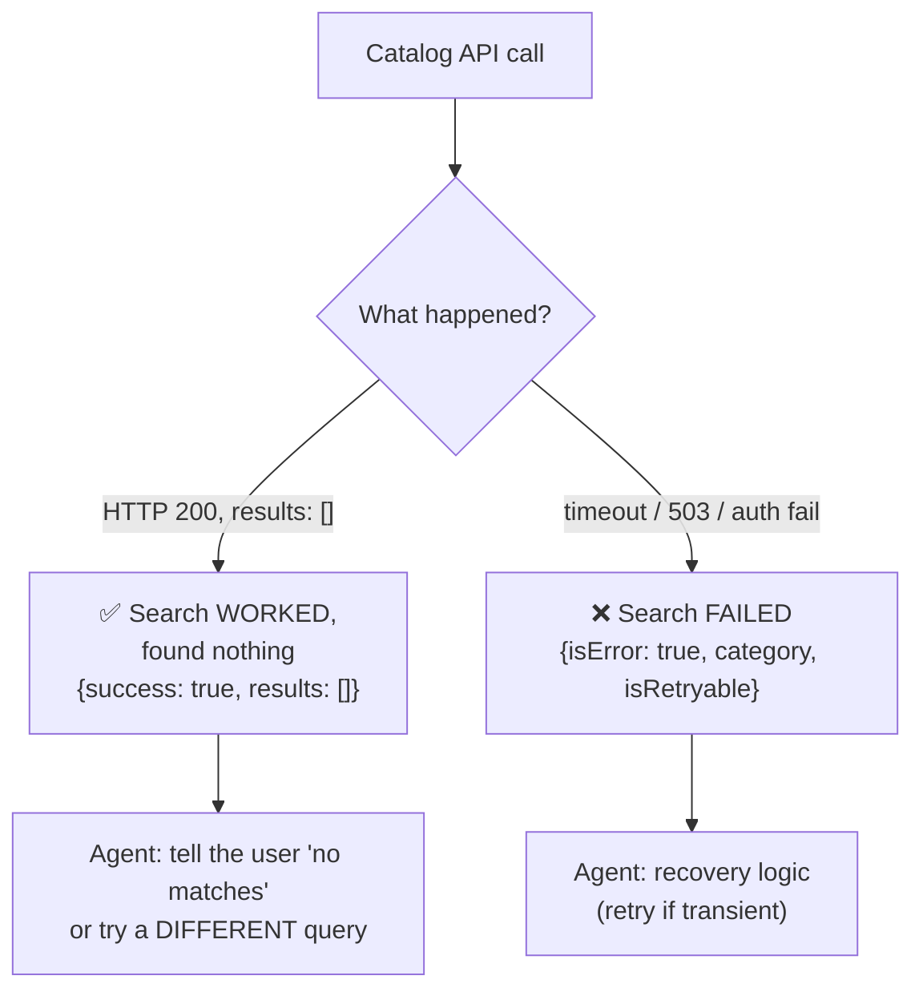

# Q22 — "No matches found" is not an error

**Domain / lesson:** D2 › 2.2 Structured Error Responses
**Also touches:** D5 › 5.3 Error Propagation ("found nothing" vs "could not search") · D2 › 2.1 Tool Interface Design (output contract)
**Scenario:** product search tool over an external catalog API

## Question

Your product search tool queries an external catalog API and returns matching items. In production, you observe the agent frequently retries searches immediately after receiving zero results, treating "no matches found" as a failure requiring retry. The external API returns HTTP 200 with an empty results array – a valid response. How should you restructure the tool's result to help the agent correctly interpret empty result sets?

- **A.** Add a `suggestions` field containing alternative search strategies when results are empty, helping guide the agent toward more productive follow-up queries.
- **B.** Return a natural language string describing the outcome, allowing the agent to interpret the result contextually based on the message content.
- **C.** Return a result object with `isError: true` and a message explaining no products matched.
- **D.** Return a structured result with a `success` boolean and `results` array, reserving `isError: true` for actual execution failures only.

## Answer: **D**

## Diagram

## Concept

There are **two very different "nothing came back" situations**:

| | **Valid empty result** | **Access failure** |
|---|---|---|
| What happened | Search **ran**, found **no matches** | Search **couldn't run** (timeout, outage, auth) |
| Will the same retry help? | ❌ No, same query = same empty result | ✅ Maybe (if transient) |
| Correct signal | `success: true`, `results: []` | `isError: true` (+ category, `isRetryable`) |

The guide: *"A tool should distinguish the two… Confusing the two breaks recovery logic."*

The agent retries because the result **looks like** a failure to it. Fix the **output structure** so the meaning is explicit: `success: true` + empty `results` = "the search worked, there's just nothing". `isError` is kept **only** for real execution failures, because *"When the tool sets `isError`, the model knows that the execution failed."*

## Why the others are wrong

| Option | Why not |
|---|---|
| **A** `suggestions` field with alternative strategies | **Doesn't fix the signal.** The agent still can't tell "valid empty" from "failure"; suggestions are an add-on. It may help *after* the agent understands the result, but it isn't the restructure the question asks for. |
| **B** Natural-language string, interpreted contextually | **Prose instead of structure.** The agent already misreads the result; making it interpret free text is *less* reliable. Same rule as Q01/Q09: structure beats prose. |
| **C** `isError: true` + "no products matched" | **Exactly backwards.** It labels a valid result as a failure, which tells the model to start recovery, i.e. **retry**. That makes the bug official. Guide trap: *"Retrying a successful empty query."* |

## Pattern to remember

> **Empty result ≠ error.** A search that ran and found nothing returns **success + empty results**. `isError` is only for searches that **couldn't run**. Confusing them breaks recovery logic.

**Exam signal:** "agent retries on zero results" → the answer **separates success-with-no-data from execution failure** in structured fields. Reject: flagging empty as an error (C), prose (B), add-ons that don't fix the signal (A).

### The other side of the same coin
The guide also lists the **opposite** trap: *"Silently returning empty results as success"* when the search actually **failed**. Then the coordinator *"cannot tell 'found nothing' from 'could not search'."*

| Situation | Wrong | Right |
|---|---|---|
| Search ran, 0 matches | `isError: true` (Q22 C) | `success: true, results: []` |
| Search failed (timeout) | `success: true, results: []` (silent) | `isError: true`, category, `isRetryable` |

### Where this comes from in the guide

**D2 › 2.2 Structured Error Responses:**
- A valid empty result means the tool *"queried the data source successfully and found no matches"*; *"Retrying will produce the same empty result."*
- An access failure means the tool *"could not reach the data source."*
- *"A tool should distinguish the two… Confusing the two breaks recovery logic."*
- *"When the tool sets `isError`, the model knows that the execution failed."*
- Four error categories: **transient, validation, business, permission**. *"Only transient errors get [`isRetryable`] `true`."*
- Traps: *"Retrying a successful empty query"* · *"Treating business errors as retryable"* · *"Silently returning empty results as success."*

## How this connects to earlier questions

| Question | Link |
|---|---|
| [Q13](../Q13-agentic-loop-model-decides-next-tool/question.md) | Structured error steers the loop. Here: no error → no recovery loop |
| [Q21](../Q21-review-flag-from-calibrated-thresholds/question.md) | Same idea: give the agent an **explicit field** instead of making it interpret raw output |
| [Q01](../Q01-source-attribution-multi-agent/question.md) / [Q09](../Q09-synthesis-preserve-merge-mappings/question.md) | Structure beats prose (vs B) |
| [Q20](../Q20-parameter-descriptions/question.md) | Tool **output** contract matters as much as the input |

## Check question

**The API times out (no response). What should the tool return now, and what should the agent do?** (Use the fields from D and the guide's error categories.)

*(Your answer and feedback will be recorded here.)*

## Glossary

- **`isError`:** flag on a tool result that tells the model the tool **execution failed** (MCP / tool-result convention).
- **Valid empty result:** the operation succeeded and the correct answer is "nothing matches".
- **Access failure:** the tool couldn't reach or run against the data source.
- **Error categories (2.2):** transient (temporary, e.g. timeout), validation (bad input), business (policy says no), permission (not allowed).
- **`isRetryable`:** "will resending this exact request work?" Only transient → `true`.

## Related course lessons

### Udemy A (primary): Claude Certified Architect (CCAR-F) - 2026 Exam Prep
| # | Lecture | Part | Why |
|---|---|---|---|
| **37** | **Returning Useful Errors from Tools** | 2A | ⭐ Exactly this: what a tool result should signal |
| **38** | **Tool Retry Logic and Partial Success Patterns** | 2A | ⭐ When retry makes sense (and when it doesn't) |
| 24 | Tool, Reasoning, and Environment Errors | 1D | Kinds of errors |
| 25 | Error Detection | 1D | Telling failure from valid output |
| 116 | Where to Catch the Error | 5B | "Found nothing" vs "couldn't search" upstream |
| Quiz 5 | 2A quiz | | Self-test |

**▶ Watch in this order (~35 min, est.):** #24 → #25 → #37 → #38 → #116, then do **Quiz 5**.

### Udemy B: Claude Certified Architect Foundations: Complete Course (Voroniuk)
| # | Lecture | Section | Why |
|---|---|---|---|
| **44** | **Customer Messages and Empty Results** | S5 Tools & MCP | ⭐ Exactly this question |
| **43** | **Structured Tool Errors** | S5 Tools & MCP | ⭐ `isError`, categories, retryable |
| 45 | Practice: Structured Tool Errors in Code | S5 Tools & MCP | Building it |
| 66 | Failure Handling Across Agents | S7 Multi-Agent | Propagation (5.3) |
| Quiz 5 | Tools & MCP quiz | S5 | Self-test |

**▶ Watch in this order (~25 min, est.):** #43 → #44 → #45 → #66, then do **Quiz 5**.

### CBT Nuggets: CCA-F course
| Skill | Why |
|---|---|
| **20. Handle Tool Calls and Tool Results** | ⭐ Returning results and errors to Claude |
| 40. Build an Agentic Multimedia Article System: Part 2 | Failures across agents (5.3) |
