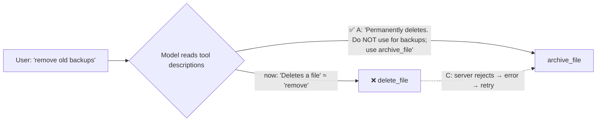

# Q23 — delete_file vs archive_file: fix minimal descriptions

**Domain / lesson:** D2 › 2.1 Tool Interface Design
**Also touches:** D2 › 2.4 MCP Server Integration (MCP tool definitions) · D1 › 1.4 Workflow Enforcement (C as the guarantee layer)
**Scenario:** MCP file-management server

## Question

Your MCP server includes `archive_file(file_id)` and `delete_file(file_id)` tools. Production logs show the agent calls `delete_file` when users ask to "remove old backups," but company policy requires archiving backup files. Both tools currently have minimal descriptions: "Archives a file" and "Deletes a file." Which change most directly improves tool selection for this scenario?

- **A.** Expand tool descriptions to clarify use cases, adding guidance like "Do not use for backup files" to `delete_file`.
- **B.** Add a confirmation step that requires users to type "CONFIRM DELETE" before `delete_file` executes.
- **C.** Implement server-side validation that rejects `delete_file` calls for files tagged as backups, returning an error message suggesting `archive_file`.
- **D.** Add few-shot examples to the system prompt demonstrating that requests involving "backup" or "old" should use `archive_file`.

## Answer: **A**

## Diagram



## Concept

**Diagnose:** why does the model pick `delete_file`? The user says **"remove"**; the only descriptions are *"Archives a file"* and *"Deletes a file."* "Remove" sounds like "delete", and nothing tells the model about the backup policy. The model is choosing correctly **from the information it has**. The information is the problem.

Guide (2.1): *"Tool descriptions are the primary mechanism LLMs use for tool selection."* Minimal descriptions *"leave the model unable to tell overlapping tools apart."*

**Fix the root cause:** expand both descriptions with **when to use** and **when not to use**:

```
delete_file: Permanently deletes a file. Cannot be undone.
  Do NOT use for backup files: company policy requires archiving them; use archive_file.
archive_file: Moves a file to the archive (recoverable). Use for backups and
  any request to "remove", "clean up" or "get rid of" old backup files.
```

## Why the others are wrong

| Option | Why not |
|---|---|
| **B** Type "CONFIRM DELETE" | **Friction, not selection** (Q18). The wrong tool is still chosen; the user is just asked to confirm it. A user who asked to "remove old backups" will likely confirm. |
| **C** Server-side validation rejecting deletes of backups | **A guarantee, not a selection fix.** It catches the wrong choice **after** it's made (error → retry with `archive_file`). Valuable as a safety net, but the question asks what *"most directly improves tool selection"*. Same "detect vs prevent" shape as Q17 B and Q20 C. |
| **D** Few-shot examples in the system prompt | **Listed trap (2.1):** *"Choosing few-shot examples to fix misrouting caused by minimal descriptions."* *"Few-shot examples add token overhead without addressing the root cause."* Also brittle: keyword matching on "backup"/"old". |

## Pattern to remember

> **Misrouting + minimal descriptions → expand the descriptions** (what it does, when to use, when NOT to use, which tool to use instead). Descriptions are the primary selection mechanism.

**Exam signal:** the stem says descriptions are **minimal** and the model picks the **wrong tool** → answer = **better descriptions**. Reject few-shot (listed trap), confirmations (friction), routing classifiers (listed trap).

### Selection vs guarantee: read the question's verb

| The question asks… | Answer type |
|---|---|
| "most directly improves **tool selection**" | **Descriptions** (A) |
| "**guarantee** backups are never deleted" / "100% compliance" | **Server-side validation / hook** (C) |

In production you'd do **both**: A makes the right choice likely; C makes the wrong one impossible.

### Where this comes from in the guide

**D2 › 2.1 Tool Interface Design:**
- *"Tool descriptions are the primary mechanism LLMs use for tool selection."*
- Descriptions are not optional metadata; minimal ones leave the model unable to tell overlapping tools apart.
- Exam traps: *"Choosing few-shot examples to fix misrouting caused by minimal descriptions"* · *"Implementing a routing classifier as the first step to fix tool selection."*

## How this connects to earlier questions

| Question | Link |
|---|---|
| [Q20](../Q20-parameter-descriptions/question.md) | Descriptions for **parameters** (Q20) and for **tool choice** (Q23): same lever |
| [Q13](../Q13-agentic-loop-model-decides-next-tool/question.md) / [Q16](../Q16-escalation-triggers/question.md) | Model decides, gate guarantees. C = the gate layer |
| [Q18](../Q18-meaningful-confirmation/question.md) | "Type CONFIRM" = friction, not a fix (B) |
| [Q17](../Q17-split-unified-tool/question.md) | Detect (validation) vs prevent (better design) |

## Check question

**Company policy *requires* archiving backups. Our cheat sheet says "must always hold → gate in code". So why is A the answer and not C? And would you still add C?**

*(Your answer and feedback will be recorded here.)*

## Glossary

- **Tool selection / routing:** the model choosing which tool to call for a request.
- **Misrouting:** calling the wrong tool for a request.
- **Minimal description:** a one-line description that says what the tool does but not when to use it or how it differs from similar tools.
- **Negative guidance:** "Do NOT use for X; use Y instead" in a description. Helps separate overlapping tools.

## Related course lessons

### Udemy A (primary): Claude Certified Architect (CCAR-F) - 2026 Exam Prep
| # | Lecture | Part | Why |
|---|---|---|---|
| **33** | **Writing Tool Descriptions That Route Correctly** | 2A | ⭐ Exactly this question |
| **40** | **Selection Heuristics and Tool-Selection Failures** | 2A | ⭐ Diagnosing misrouting |
| 32 | How Claude Selects Tools | 2A | Why descriptions drive selection |
| 29 | Designing Programmatic Validation and Enforcement Layers | 1D | C as the guarantee layer |
| Quiz 5 | 2A quiz | | Self-test |

**▶ Watch in this order (~28 min, est.):** #32 → #33 → #40 → #29, then do **Quiz 5**.

### Udemy B: Claude Certified Architect Foundations: Complete Course (Voroniuk)
| # | Lecture | Section | Why |
|---|---|---|---|
| **41** | **How Claude Chooses a Tool** | S5 Tools & MCP | ⭐ Descriptions → choice |
| **42** | **Renaming, Splitting and Keyword Triggers** | S5 Tools & MCP | ⭐ Fixing overlapping tools |
| 49 | Prerequisite Gates in Code | S6 Support Agent | C as the guarantee layer |
| Quiz 5 | Tools & MCP quiz | S5 | Self-test |

**▶ Watch in this order (~20 min, est.):** #41 → #42 → #49, then do **Quiz 5**.

### CBT Nuggets: CCA-F course
| Skill | Why |
|---|---|
| **22. Route Requests Across Multiple Tools** | ⭐ Tool selection between similar tools |
| 34. Build MCP Tools Resources and Prompts | Writing MCP tool descriptions |
| 6. Implement Hooks for Safer Automation | Guarantee layer (C) |
