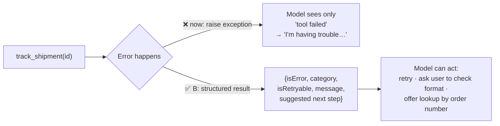

# Q24 — Exceptions vs structured error results

**Domain / lesson:** D2 › 2.2 Structured Error Responses
**Also touches:** D1 › 1.1 Agentic Loops (the model only sees what's in the tool result) · D5 › 5.3 Error Propagation
**Scenario:** shipment tracking tool over an external logistics API
**Follows:** [Q22](../Q22-empty-result-is-not-error/question.md) (empty ≠ error, the four error categories)

## Question

Your `track_shipment(tracking_id)` tool queries an external logistics API that sometimes fails – the API may be temporarily unavailable, the tracking ID may be malformed, or the shipment may not exist. Currently, your tool raises a Python exception when errors occur. Users report the agent gives unhelpful responses like "I'm having trouble with that request" instead of suggesting alternatives such as verifying the tracking number format or checking by order number. How should you handle errors in tool results?

- **A.** Return a generic error response (e.g., `{"success": false, "error": "lookup_failed"}`) for all failure cases to maintain a consistent schema and avoid exposing internal error details.
- **B.** Return structured error information as normal tool output including error type, recoverability status, and actionable context for the user.
- **C.** Create dedicated error-recovery tools (`retry_tracking_lookup`, `search_by_order_number`) that the model can invoke after the primary tracking tool returns a failure indicator.
- **D.** Implement retry logic with exponential backoff inside the tool implementation so transient errors are automatically handled and only return a result after all retry attempts are exhausted.

## Answer: **B**

## Diagram

## Concept

**Diagnose:** why is the agent unhelpful? A raised exception reaches the model as little more than **"the tool failed."** It can't tell **why**, so it can't suggest **what to do**, so it says "I'm having trouble". The model is only as helpful as the information in the tool result (1.1: the model sees only what's appended to the conversation).

**Fix:** catch the error **inside the tool** and return it as a **structured result** the model can reason over:

| Field | Purpose |
|---|---|
| **Error type / category** | *Why* it failed: transient, validation, business, permission (2.2) |
| **Recoverability** (`isRetryable`) | Can the **same** call work if retried? |
| **Actionable context** | What to tell the user / do next: "check the format: 12 chars, starts with 'TRK'", "try lookup by order number" |

The three failures in the question map to different categories and different next steps. That's exactly what a generic error (A) or an exception throws away.

## Why the others are wrong

| Option | Why not |
|---|---|
| **A** One generic `lookup_failed` for everything | **Throws away the "why".** A timeout, a malformed ID and a missing shipment all look identical, so the agent still can't tell the user what to do. "Consistent schema" is good, but B is consistent *and* informative. (Avoid leaking stack traces, yes; hiding the error **type**, no.) |
| **C** Separate recovery tools | **Doesn't fix the signal.** The model still gets a bare "failure indicator" and doesn't know **which** recovery fits. More tools also means harder selection (Q04). An order-number lookup tool may be useful, but the structured error is what tells the model **when** to use it. |
| **D** Retries with backoff inside the tool | **Handles only one of the three cases.** It helps the transient case, but retrying a malformed ID or a non-existent shipment is pointless (*"business errors… will never resolve through retry"*). After retries run out, it still returns… what? The same unhelpful failure. A good **addition** for transient errors, not the answer. |

## Pattern to remember

> **Don't raise exceptions to the model. Return structured errors as tool output: category, retryable or not, and an actionable next step.** The model can only recover from what it can see.

**Exam signal:** agent gives **vague** "I'm having trouble" responses → the tool is hiding **why** it failed. Answer = structured error with type + recoverability + context. Reject: generic errors (A), extra recovery tools (C), retry-only (D).

### Where this comes from in the guide

**D2 › 2.2 Structured Error Responses:**
- *"When the tool sets `isError`, the model knows that the execution failed."* It then reasons about recovery.
- *"Every tool failure belongs to one of four categories"*: transient, validation, business, permission. Each needs a different recovery strategy.
- `isRetryable` answers *"will resending this exact request work?"* *"Only transient errors get `true`."*
- *"None of the three non-retryable categories means abandon the task."*
- Trap: *"Treating business errors as retryable."*

## How this connects to earlier questions

| Question | Link |
|---|---|
| [Q22](../Q22-empty-result-is-not-error/question.md) | Same lesson: categories + `isRetryable`. Q22 = don't call success an error; Q24 = when it **is** an error, say **which kind** |
| [Q13](../Q13-agentic-loop-model-decides-next-tool/question.md) | Structured error steers the loop: model reads it and picks the next action |
| [Q21](../Q21-review-flag-from-calibrated-thresholds/question.md) | Same idea: explicit fields + reasons instead of making the model guess |
| [Q04](../Q04-tool-scoping-per-subagent/question.md) | Extra tools (C) make selection harder |

## Check question

**The question names three failures: (1) API temporarily unavailable, (2) malformed tracking ID, (3) shipment doesn't exist. For each one: which category, is it retryable, and what should the agent do or tell the user?**

*(Your answer and feedback will be recorded here.)*

## Glossary

- **Exception:** a programming-language error (`raise ...`) that stops normal execution. If uncaught in a tool, the model gets little or no useful detail.
- **Structured error result:** an error returned as data (fields like category, `isRetryable`, message) so the model can reason over it.
- **Actionable context:** information telling the model what to do next or what to ask the user.
- **Exponential backoff:** retrying with growing waits (1s, 2s, 4s…). Only sensible for transient errors.

## Related course lessons

### Udemy A (primary): Claude Certified Architect (CCAR-F) - 2026 Exam Prep
| # | Lecture | Part | Why |
|---|---|---|---|
| **37** | **Returning Useful Errors from Tools** | 2A | ⭐ Exactly this question |
| **38** | **Tool Retry Logic and Partial Success Patterns** | 2A | ⭐ Why D covers only the transient case |
| 24 | Tool, Reasoning, and Environment Errors | 1D | Error types |
| 27 | Fallback Chains and Graceful Degradation | 1D | "Check by order number" as a fallback |
| Quiz 5 | 2A quiz | | Self-test |

**▶ Watch in this order (~30 min, est.):** #24 → #37 → #38 → #27, then do **Quiz 5**.

### Udemy B: Claude Certified Architect Foundations: Complete Course (Voroniuk)
| # | Lecture | Section | Why |
|---|---|---|---|
| **43** | **Structured Tool Errors** | S5 Tools & MCP | ⭐ Exactly this question |
| **45** | **Practice: Structured Tool Errors in Code** | S5 Tools & MCP | ⭐ Catching exceptions → structured results |
| 44 | Customer Messages and Empty Results | S5 Tools & MCP | What to tell the user |
| Quiz 5 | Tools & MCP quiz | S5 | Self-test |

**▶ Watch in this order (~20 min, est.):** #43 → #45 → #44, then do **Quiz 5**.

### CBT Nuggets: CCA-F course
| Skill | Why |
|---|---|
| **20. Handle Tool Calls and Tool Results** | ⭐ Returning errors as tool results |
| 21. Build Multi Turn Tool Conversations | Recovery over the next turns |
