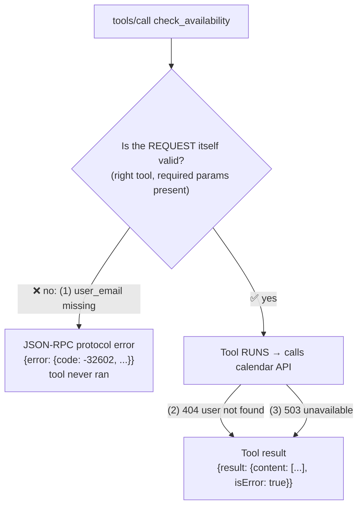

# Q25 — MCP: protocol error or `isError` tool result?

**Domain / lesson (closest fit):** D2 › 2.2 Structured Error Responses
**Also touches:** D2 › 2.4 MCP Server Integration
**Note:** the guide's 2.4 page doesn't cover MCP error mechanics (checked 2026-10-30). The answer comes from the **MCP specification**, Tools › Error Handling (versions 2025-06-18 and 2025-11-25 both checked).
**Follows:** [Q22](../Q22-empty-result-is-not-error/question.md), [Q24](../Q24-structured-errors-not-exceptions/question.md)

## Question

Your MCP server implements a `check_availability` tool that queries an external calendar API. During testing, you encounter three error conditions: (1) the tool is called with a malformed request missing the required `user_email` parameter, (2) the calendar API returns a 404 because the specified user doesn't exist in the calendar system, and (3) the calendar API returns a 503 because the service is temporarily unavailable. How should each error be reported according to MCP's error handling design?

- **A.** Report all three as tool results with `isError: true`.
- **B.** Report errors 1 and 2 as JSON-RPC protocol errors; report error 3 as a tool result with `isError: true`.
- **C.** Report error 1 as a JSON-RPC protocol error; report errors 2 and 3 as tool results with `isError: true`.
- **D.** Report all three as JSON-RPC protocol errors.

## Answer: **C**

## Diagram

## Concept

MCP has **two layers** where something can go wrong, and two ways to report it:

| Layer | What failed | How it's reported | Examples (spec) |
|---|---|---|---|
| **Protocol** (the request) | The call itself is broken: the tool **never ran** | **JSON-RPC error** (`"error": {code, message}`) | Unknown tool · **malformed request** (fails the call schema) · server errors |
| **Tool execution** (the work) | The tool **ran**, but its work failed | **Tool result** with **`isError: true`** | **API failures** · input validation (value wrong) · business logic errors |

Apply it:
1. **Missing required `user_email`** → the request is **malformed**; the tool can't even start → **protocol error**.
2. **Calendar API 404** → the tool ran and called the API; the API said "no such user" → **API failure** → **`isError: true`**.
3. **Calendar API 503** → same: the tool ran; the API was down → **API failure** → **`isError: true`**.

**One-line test:** *Did the tool get to run?* No → protocol error. Yes, but it failed → `isError: true`.

**Why it matters:** `isError` results **go to the model** so it can recover (spec: *"Tool Execution Errors contain actionable feedback that language models can use to self-correct and retry"*). Errors 2 and 3 need the model to act (tell the user the person isn't in the calendar; retry later). That's the Q22/Q24 categories: 404 = business/not-found (not retryable), 503 = transient (retryable).

## Why the others are wrong

| Option | Why not |
|---|---|
| **A** All three as `isError` | Error 1 isn't a tool **execution** failure; the request was malformed before the tool ran. The spec lists malformed requests under **protocol errors**. |
| **B** 1 and 2 as protocol errors | **Error 2 is the trap.** A 404 *sounds* like a "request problem", but it's the **calendar API's** answer **after the tool ran**. The MCP request was perfectly valid. → API failure → `isError`. Reporting it as a protocol error also hides it from the model, which then can't tell the user. |
| **D** All three as protocol errors | Hides **all** real execution failures from the model: no recovery, no useful message to the user (the Q24 "I'm having trouble…" problem). |

## Pattern to remember

> **MCP errors: did the tool run?** No (unknown tool, malformed request) → **JSON-RPC protocol error**. Yes, but its work failed (API 404/503, validation of values, business rules) → **tool result with `isError: true`**, so the model can recover.

**Exam signal:** don't be fooled by **HTTP codes** from the external API (404, 500, 503). Those are the **tool's** problem → `isError`. Protocol errors are about the **MCP call** itself.

### Spec nuance: a wrong *value* vs a missing *field*
In the 2025-11-25 spec, **input validation errors** (e.g. *"date in wrong format, value out of range"*) moved to **tool execution errors** (`isError: true`), so the model can fix the value and retry. **Malformed requests** (failing the call schema, e.g. a required param missing, as in this question) stay **protocol errors**. The question calls error 1 *"a malformed request"*, so C holds under both versions.

### Where this comes from

**MCP specification, Tools › Error Handling:**
- *"Protocol Errors: Standard JSON-RPC errors for issues like: Unknown tools · Malformed requests (requests that fail to satisfy CallToolRequest schema) · Server errors"* (2025-06-18 wording: *"Invalid arguments"*)
- *"Tool Execution Errors: Reported in tool results with `isError: true`: API failures · Input validation errors · Business logic errors"*
- *"Tool Execution Errors contain actionable feedback that language models can use to self-correct and retry with adjusted parameters."*
- *"Clients SHOULD provide tool execution errors to language models to enable self-correction."*

**Guide D2 › 2.2:** *"When the tool sets `isError`, the model knows that the execution failed."*

## How this connects to earlier questions

| Question | Link |
|---|---|
| [Q22](../Q22-empty-result-is-not-error/question.md) | Empty result = success, not `isError` |
| [Q24](../Q24-structured-errors-not-exceptions/question.md) | Errors 2 and 3 should be **structured** `isError` results: 404 = business (not retryable), 503 = transient (retryable) |
| [Q20](../Q20-parameter-descriptions/question.md) | Clear descriptions + `required` reduce error 1 in the first place |

## Check question

**Why does MCP send errors 2 and 3 back as tool results (`isError`) rather than protocol errors? Think about who reads each kind of error and what they can do with it.**

*(Your answer and feedback will be recorded here.)*

## Glossary

- **JSON-RPC:** the message format MCP uses. A response has either a `result` or an `error`.
- **Protocol error:** a JSON-RPC `error` response: the request itself was invalid (unknown tool, malformed). The tool didn't run.
- **Tool execution error:** a normal `result` with `isError: true`: the tool ran but its work failed. Meant for the model to see and recover from.
- **HTTP 404 / 503:** "not found" / "service unavailable" from the **external** API. Inside an MCP tool these are execution errors.

## Related course lessons

### Udemy A (primary): Claude Certified Architect (CCAR-F) - 2026 Exam Prep
| # | Lecture | Part | Why |
|---|---|---|---|
| **37** | **Returning Useful Errors from Tools** | 2A | ⭐ `isError` results for the model |
| 43–49 | MCP primitives, servers, clients | 2B | MCP request/response structure (JSON-RPC) |
| 38 | Tool Retry Logic and Partial Success Patterns | 2A | 503 = retryable, 404 = not |
| Quiz 5, Quiz 6 | 2A and 2B quizzes | | Self-test |

**▶ Watch in this order (~40 min, est.):** #37 → #38 → the 2B MCP server lectures (#43–49, focus on servers), then do **Quiz 5** and **Quiz 6**.

### Udemy B: Claude Certified Architect Foundations: Complete Course (Voroniuk)
| # | Lecture | Section | Why |
|---|---|---|---|
| **43** | **Structured Tool Errors** | S5 Tools & MCP | ⭐ `isError` and categories |
| 45 | Practice: Structured Tool Errors in Code | S5 Tools & MCP | Building error results |
| 44 | Customer Messages and Empty Results | S5 Tools & MCP | What the model tells the user |
| Quiz 5 | Tools & MCP quiz | S5 | Self-test |

**▶ Watch in this order (~20 min, est.):** #43 → #45 → #44, then do **Quiz 5**.

### CBT Nuggets: CCA-F course
| Skill | Why |
|---|---|
| **34. Build MCP Tools Resources and Prompts** | ⭐ MCP server tool implementation |
| 20. Handle Tool Calls and Tool Results | Error results back to the model |

*Primary source for this question: the MCP spec, Tools › Error Handling (modelcontextprotocol.io).*
