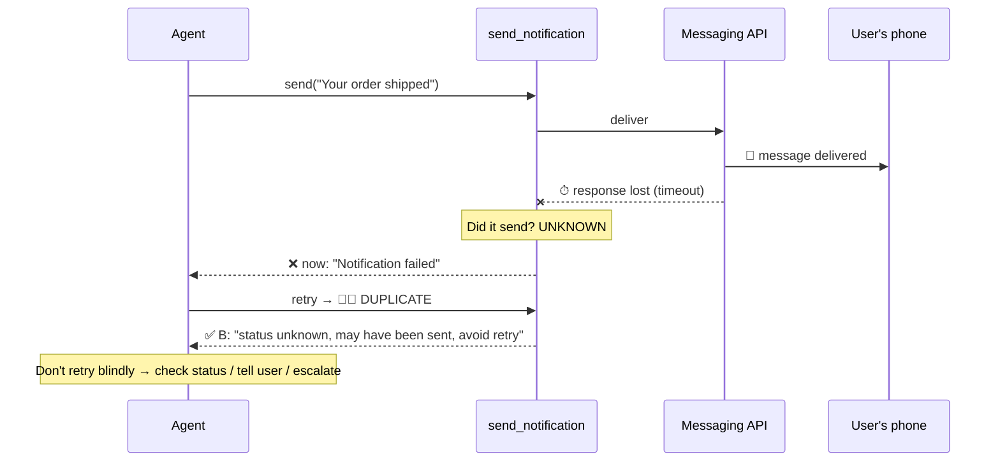

# Q26 — Timeout with unknown outcome: don't tell the agent to retry

**Domain / lesson:** D2 › 2.2 Structured Error Responses
**Also touches:** D5 › 5.3 Error Propagation · D1 › 1.4 Workflow Enforcement (side-effecting actions)
**Follows:** [Q22](../Q22-empty-result-is-not-error/question.md), [Q24](../Q24-structured-errors-not-exceptions/question.md), [Q25](../Q25-mcp-protocol-vs-tool-errors/question.md)

## Question

Your `send_notification` tool calls third-party messaging APIs. When these services time out during delivery, you cannot determine whether the message was actually sent. Currently, the tool returns `is_error: true` with a generic "Notification failed" message for all timeouts. Production monitoring reveals agents automatically retry these failures, frequently causing users to receive duplicate notifications. How should you modify the error response?

- **A.** Return `is_error: true` with a structured field `retry_safe: true` for timeouts, distinguishing them from permanent failures that should not be retried.
- **B.** Return `is_error: true` with a message communicating uncertainty: "Timeout – status unknown. Message may have been sent. Avoid retry."
- **C.** Return `is_error: true` with a message encouraging retry: "Delivery service temporarily unavailable. Please retry the notification."
- **D.** Return `is_error: true` with the original message content echoed back.

## Answer: **B**

## Diagram



## Concept

**Diagnose:** the timeout happens **during delivery**. The message may have **already reached the user**; only the confirmation got lost. The tool says *"Notification failed"*, which is **false** (it doesn't know that). The agent believes it, retries, and the user gets the message **twice**.

**Two different questions about a failed call:**

| Question | Read-only call (search, lookup) | **Action with a side effect** (send, pay, delete) |
|---|---|---|
| Did it happen? | Nothing happened, nothing to undo | **Maybe**: the action may have completed |
| Is a blind retry safe? | ✅ Yes (worst case: same result) | ❌ **No**: may do it **twice** (duplicate message, double charge) |

**Fix:** the error must say **the truth**: the outcome is **unknown**, the message **may have been sent**, and **don't retry automatically**. Then the agent can do something sensible: check delivery status if a tool exists, tell the user, or escalate. This is why B is right.

### Nuance: "transient" is not the same as "safe to retry"
In Q22/Q24 we said *"only transient errors get `isRetryable: true`"*. A timeout **is** transient, but here retrying is **not safe**, because the operation has a **side effect** and **isn't idempotent** (sending twice ≠ sending once). `isRetryable` asks *"will resending this exact request work?"*, and here "work" would mean **a second message**.

**Ideal production design** (not an option here, but good to know):
```json
{ "isError": true, "category": "transient", "isRetryable": false,
  "delivery_status": "unknown",
  "message": "Timeout - message may have been sent. Do not resend; check status first." }
```
And/or an **idempotency key** so the messaging API ignores a duplicate send.

## Why the others are wrong

| Option | Why not |
|---|---|
| **A** `retry_safe: true` for timeouts | **Structured, but factually wrong.** It labels exactly the dangerous case as safe to retry, so it makes the duplicate problem **official**. Structure only helps if it says the right thing. |
| **C** "Please retry the notification" | **Actively instructs the harmful action.** Same result as A, in prose. Also claims the service was "unavailable", which may be false (it may have delivered). |
| **D** Echo the original message back | **No information about the outcome.** The agent still sees only "error", still doesn't know it may have been sent, and still retries. |

## Pattern to remember

> **When an action with side effects times out, the outcome is unknown. Say so, and tell the agent not to retry blindly.** A retry is only safe if the operation can't happen twice (idempotent).

**Exam signal:** "**duplicates**" after retries → the fix communicates **uncertainty** and **discourages retry**. Reject anything that labels the case retry-safe (A) or tells the agent to retry (C).

**Exam lesson:** "structure beats prose" is a tiebreaker, not a rule that overrides **correctness**. A structured field with the **wrong meaning** (A) loses to a message with the **right meaning** (B).

### Where this comes from in the guide

**D2 › 2.2 Structured Error Responses:**
- `isRetryable` answers *"will resending this exact request work?"*
- *"Only transient errors get `true`."* Here, a transient error where resending is harmful: the error must say so.
- *"None of the three non-retryable categories means abandon the task."* Not retrying ≠ giving up: check status, inform, escalate.

## How this connects to earlier questions

| Question | Link |
|---|---|
| [Q22](../Q22-empty-result-is-not-error/question.md) | Retry is pointless on empty results. Q26: retry is **harmful** on unknown-outcome actions |
| [Q24](../Q24-structured-errors-not-exceptions/question.md) | Errors need actionable context. Here the actionable context is "don't resend" |
| [Q15](../Q15-mid-process-escalation-handoff/question.md) | Don't "try and see" with actions that have real-world effects |
| [Q18](../Q18-meaningful-confirmation/question.md) | Messages to users are outward-facing: mistakes are visible and can't be undone |

## Check question

**We keep saying "structure beats prose". So why does B (a text message) beat A (a structured field)?**

*(Your answer and feedback will be recorded here.)*

## Glossary

- **Side effect:** a change in the outside world caused by a call (a message sent, money moved, a file deleted).
- **Idempotent:** doing it twice has the same effect as doing it once (e.g. "set status = shipped"). Sending a message is **not** idempotent.
- **Idempotency key:** a unique ID sent with a request so the server can recognize and ignore a duplicate.
- **Unknown outcome:** the request may or may not have taken effect, typically after a timeout during the action.

## Related course lessons

### Udemy A (primary): Claude Certified Architect (CCAR-F) - 2026 Exam Prep
| # | Lecture | Part | Why |
|---|---|---|---|
| **38** | **Tool Retry Logic and Partial Success Patterns** | 2A | ⭐ When retry is safe and when it isn't |
| **37** | **Returning Useful Errors from Tools** | 2A | ⭐ What the error must tell the model |
| **26** | **Retry Logic — When to Retry, When to Abort** | 1D | ⭐ Exactly the retry/abort decision |
| 27 | Fallback Chains and Graceful Degradation | 1D | What to do instead of retrying |
| Quiz 5, Quiz 4 | 2A and 1D quizzes | | Self-test |

**▶ Watch in this order (~30 min, est.):** #26 → #37 → #38 → #27, then do **Quiz 5** and **Quiz 4**.

### Udemy B: Claude Certified Architect Foundations: Complete Course (Voroniuk)
| # | Lecture | Section | Why |
|---|---|---|---|
| **43** | **Structured Tool Errors** | S5 Tools & MCP | ⭐ Retryable vs not |
| 45 | Practice: Structured Tool Errors in Code | S5 Tools & MCP | Building the error result |
| 66 | Failure Handling Across Agents | S7 Multi-Agent | Unknown outcomes upstream |
| Quiz 5 | Tools & MCP quiz | S5 | Self-test |

**▶ Watch in this order (~20 min, est.):** #43 → #45 → #66, then do **Quiz 5**.

### CBT Nuggets: CCA-F course
| Skill | Why |
|---|---|
| **20. Handle Tool Calls and Tool Results** | ⭐ Error results back to the model |
| 6. Implement Hooks for Safer Automation | Guarding side-effecting actions |
