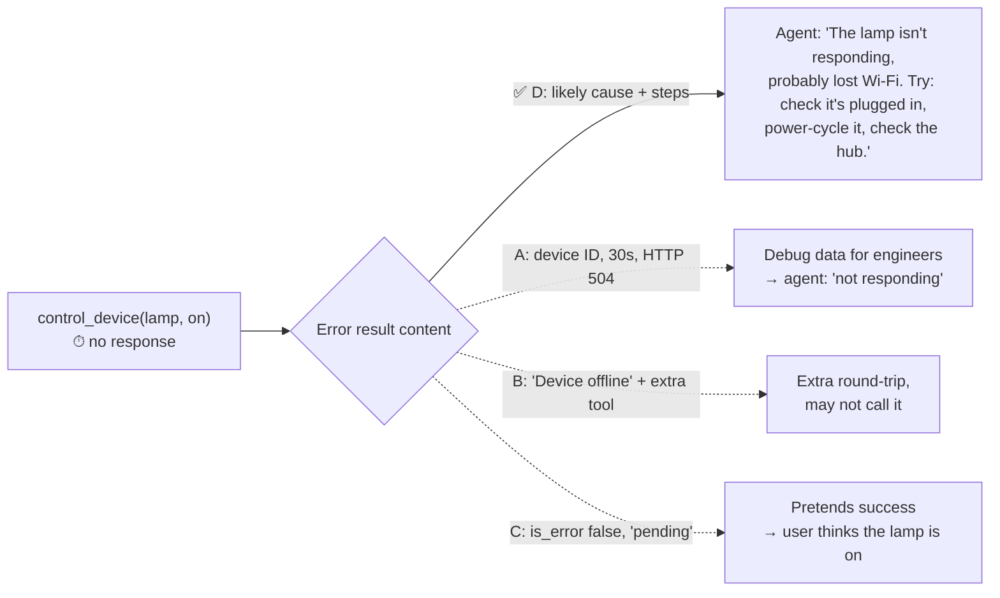

# Q27 — Device timeout: give the agent something to offer the user

**Domain / lesson:** D2 › 2.2 Structured Error Responses
**Also touches:** D2 › 2.3 Tool Distribution (why an extra tool, B, is worse)
**Follows:** [Q24](../Q24-structured-errors-not-exceptions/question.md) (actionable context), [Q26](../Q26-timeout-unknown-status-no-retry/question.md) (truthful errors)

## Question

Your `control_device` tool manages smart home devices through external APIs. When a device doesn't respond within the timeout period, the tool returns an error. Production logs show that the agent simply tells users "the device is not responding" without offering helpful next steps. Which error response structure would best enable the agent to provide useful follow-up?

- **A.** Set `is_error: true` with a structured technical error containing the device ID, timeout duration, and raw API response code for debugging purposes.
- **B.** Set `is_error: true` with a brief "Device offline" message and provide a separate tool the agent can call to retrieve context-specific troubleshooting suggestions.
- **C.** Set `is_error: false` with an optimistic message indicating the command was dispatched successfully but device acknowledgment is still pending.
- **D.** Set `is_error: true` with a message explaining the likely cause and suggesting troubleshooting steps the agent can offer the user.

## Answer: **D**

## Diagram

## Concept

**Diagnose:** the agent is only as helpful as **what the error tells it**. Today the error says little more than "timeout", so the agent says *"the device is not responding"*. It has nothing else to offer.

**Fix:** put **actionable context** into the error itself (Q24's third field):
- **Likely cause:** "Device didn't respond within 10 s. Usually lost Wi-Fi, no power, or hub offline."
- **Next steps the agent can offer:** "Check it's plugged in · power-cycle it · check the hub's light · try again in a minute."

Now the agent can turn the error into a **helpful reply** in one turn, with no guessing and no extra calls.

The audience of an error result is the **model**, and through it the **user**. Write it for them, not for a debugger.

## Why the others are wrong

| Option | Why not |
|---|---|
| **A** Device ID, timeout duration, raw API code | **Written for engineers, not for the agent or user.** "HTTP 504, 30000 ms" doesn't tell the agent what the user can **do**. Useful in **logs**, not as the main content of the tool result. |
| **B** Brief "Device offline" + a separate troubleshooting tool | **Extra hop, same signal problem as Q24 C.** The agent must realise it should call another tool, then make another round-trip. It often won't. Also, "offline" is a guess; a timeout doesn't prove that. More tools = harder selection (Q04). |
| **C** `is_error: false`, "dispatched, acknowledgment pending" | **Pretends success.** The user hears "done" while the lamp stays off. It's the *"silently returning… as success"* trap (Q22) and an untruthful error (Q26). |

## Pattern to remember

> **An error result should help the agent help the user: what probably went wrong + what the user can do next.** Not raw debug data, not a pointer to another tool, never a fake success.

**Exam signal:** "the agent gives **unhelpful** replies after errors" → the answer puts **cause + actionable next steps** in the error. Reject: debug-only data (A), "call another tool for help" (B), hiding the error (C).

### Where this comes from in the guide

**D2 › 2.2 Structured Error Responses:**
- *"When the tool sets `isError`, the model knows that the execution failed."* It then reasons about recovery, so give it what it needs to reason.
- *"None of the three non-retryable categories means abandon the task."* Offering next steps is how the agent doesn't abandon it.
- Trap: *"Silently returning empty results as success"*: the same family as C.

## How this connects to earlier questions

| Question | Link |
|---|---|
| [Q24](../Q24-structured-errors-not-exceptions/question.md) | Same answer shape: error type + recoverability + **actionable context**. Q24 C ≈ Q27 B (extra recovery tools) |
| [Q26](../Q26-timeout-unknown-status-no-retry/question.md) | Errors must be **truthful**. C claims success it can't confirm |
| [Q22](../Q22-empty-result-is-not-error/question.md) | Opposite trap: never report a failure as success (C) |
| [Q18](../Q18-meaningful-confirmation/question.md) | Same idea: show the person what they need to act |

## Check question

**Option C sets `is_error: false` and says the command is "pending". What will the user experience, and which earlier question had the same kind of trap?**

*(Your answer and feedback will be recorded here.)*

## Glossary

- **Actionable context:** information in an error that tells the model (and user) what to do next.
- **Likely cause:** the most probable reason for the failure (e.g. lost Wi-Fi), stated as likely, not certain.
- **Debug data:** technical details (IDs, codes, durations) useful to engineers; belongs in logs, not as the main message to the model.

## Related course lessons

### Udemy A (primary): Claude Certified Architect (CCAR-F) - 2026 Exam Prep
| # | Lecture | Part | Why |
|---|---|---|---|
| **37** | **Returning Useful Errors from Tools** | 2A | ⭐ Exactly this question |
| 27 | Fallback Chains and Graceful Degradation | 1D | Offering alternatives instead of giving up |
| 40 | Selection Heuristics and Tool-Selection Failures | 2A | Why an extra tool (B) may never be called |
| Quiz 5 | 2A quiz | | Self-test |

**▶ Watch in this order (~22 min, est.):** #37 → #27 → #40, then do **Quiz 5**.

### Udemy B: Claude Certified Architect Foundations: Complete Course (Voroniuk)
| # | Lecture | Section | Why |
|---|---|---|---|
| **43** | **Structured Tool Errors** | S5 Tools & MCP | ⭐ What an error result should contain |
| **44** | **Customer Messages and Empty Results** | S5 Tools & MCP | ⭐ Turning errors into helpful replies |
| 45 | Practice: Structured Tool Errors in Code | S5 Tools & MCP | Building it |
| Quiz 5 | Tools & MCP quiz | S5 | Self-test |

**▶ Watch in this order (~20 min, est.):** #43 → #44 → #45, then do **Quiz 5**.

### CBT Nuggets: CCA-F course
| Skill | Why |
|---|---|
| **20. Handle Tool Calls and Tool Results** | ⭐ Error results back to the model |
| 21. Build Multi Turn Tool Conversations | Follow-up turns after an error |
