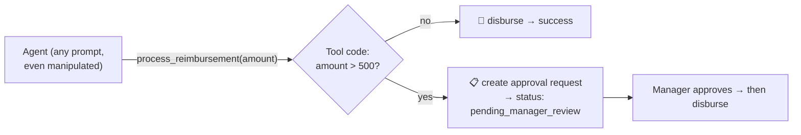

# Q28 — Tamper-proof $500 approval threshold

**Domain / lesson:** D1 › 1.4 Workflow Enforcement and Handoff
**Also touches:** D1 › 1.5 Agent SDK Hooks (why D and C are weaker) · D2 › 2.1 Tool Interface Design (the tool owns its rule)
**Follows:** [Q13](../Q13-agentic-loop-model-decides-next-tool/question.md) (gate inside the tool), [Q16](../Q16-escalation-triggers/question.md) ("gate the numbers")

## Question

Your expense reimbursement agent processes employee requests using a `process_reimbursement` tool. Company policy requires that reimbursements above $500 must be approved by a manager before funds are disbursed. The agent handles hundreds of requests daily, and you need the threshold enforcement to be tamper-proof regardless of how the agent is prompted. Which design ensures the $500 approval threshold cannot be bypassed?

- **A.** The `process_reimbursement` tool accepts amount and details, and internally enforces the threshold: amounts <$500 are auto-disbursed and the tool returns a success confirmation; amounts >$500 cause the tool to create a pending approval request and return a status indicating manager review is pending.
- **B.** The `process_reimbursement` tool accepts an `approved_by_manager: boolean` parameter. The system prompt instructs the agent to only set this to true after confirming that a manager has approved the request. A nightly audit script reviews all reimbursements where `approved_by_manager` was set to true.
- **C.** Provide two tools: `auto_reimburse` (hard-coded limit of $500) and `request_manager_approval`. Include detailed system prompt instructions telling the agent to check the amount and call the appropriate tool. Add a PostToolUse hook that logs which tool was called for auditing.
- **D.** Implement the threshold check in a PreToolUse hook that inspects the amount parameter before `process_reimbursement` executes. If the amount exceeds $500, the hook modifies the tool call to add a `requires_approval: true` flag, which the tool checks before disbursing.

## Answer: **A**

## Diagram

The **only** path to money runs through the tool's own `if`. Nothing the agent says or sets can skip it.

## Concept

**"Tamper-proof regardless of how the agent is prompted"** means: assume the agent can be confused, jailbroken or simply wrong. Then the rule must live **where the agent can't influence it**: inside the code that moves the money.

In A, the tool:
- takes only **facts** (`amount`, details); there is **no parameter** the agent could set to skip approval,
- checks `amount > 500` **itself**, every call,
- for big amounts, **can't** disburse: it creates an approval request instead and returns a clear status ("pending manager review"), so the agent can tell the employee truthfully (Q26/Q27).

That's Q13's gate and Q16's "**gate the numbers**", at full strength: **the enforcement and the action are the same piece of code.**

Guide (1.4): *"if a single failure would cause financial loss, a security breach or a compliance violation, use programmatic enforcement."*

## Why the others are wrong

| Option | Why not |
|---|---|
| **B** `approved_by_manager` boolean + prompt + nightly audit | **The agent approves itself.** The flag is set by the very component we don't trust, guided only by a prompt (probabilistic). The audit runs **after** the money is gone. Guide trap: *"Enhanced prompt instructions as the solution for 100% compliance requirements."* |
| **C** Two tools + prompt routing + PostToolUse logging | **Routing depends on the prompt**, and the PostToolUse hook only **logs after** the call. Guide trap: *"Using PostToolUse hooks to block policy-violating actions. By the time the hook fires, the non-compliant action has already been processed."* (The hard-coded $500 limit in `auto_reimburse` is a partial gate, but the design leans on the agent choosing correctly, and auditing ≠ enforcing.) |
| **D** PreToolUse hook adds a `requires_approval` flag | **Closest distractor.** PreToolUse is the right *timing*, but the enforcement is **split across two pieces**: the hook decides, and the tool trusts a **flag** instead of checking the amount itself. If the tool is ever called without that hook (another agent, another client, a config change), there's no flag → it disburses. A tool that guards itself has no such gap. |

## Pattern to remember

> **"Tamper-proof / cannot be bypassed / regardless of prompting" → put the rule inside the tool that performs the action**, checking the real data (amount) itself. No agent-set flags, no prompt-only routing, no after-the-fact audits.

**Exam signal, ranked:**
1. ✅ Rule enforced **inside the action's own code** on real data (A)
2. ⚠️ PreToolUse hook that **blocks** (valid per guide 1.5, but depends on hook configuration); one that only **adds a flag** is weaker (D)
3. ❌ PostToolUse hook (too late), prompt instructions, agent-set booleans, nightly audits (B, C)

### Where this comes from in the guide

**D1 › 1.4 Workflow Enforcement and Handoff:**
- *"Prompt-based guidance is probabilistic. Programmatic enforcement is deterministic."*
- *"if a single failure would cause financial loss, a security breach or a compliance violation, use programmatic enforcement."*
- Trap: *"Enhanced system prompt instructions or few-shot examples as the fix for high-stakes compliance failures."*

**D1 › 1.5 Agent SDK Hooks:**
- Trap: *"Using PostToolUse hooks to block policy-violating actions."* *"By the time the hook fires, the non-compliant action has already been processed."*
- Trap: *"Enhanced prompt instructions as the solution for 100% compliance requirements."* *"Prompts provide probabilistic compliance."*
- The guide's own hook example: `approve_discount` above 20% *"pauses execution and routes the request to a manager approval queue."* Hooks **can** enforce; A is still the most self-contained.

## How this connects to earlier questions

| Question | Link |
|---|---|
| [Q13](../Q13-agentic-loop-model-decides-next-tool/question.md) | First time we put the gate **inside** `process_refund` |
| [Q16](../Q16-escalation-triggers/question.md) | "Instruct the judgment, gate the numbers." $500 is a number |
| [Q14](../Q14-escalation-handoff-summary/question.md) / [Q15](../Q15-mid-process-escalation-handoff/question.md) | Same $500 limit; never "try and see" (Q15 D) |
| [Q23](../Q23-expand-minimal-tool-descriptions/question.md) | "Guarantee" → code check (here: the whole answer) |
| [Q26](../Q26-timeout-unknown-status-no-retry/question.md) / [Q27](../Q27-actionable-error-context/question.md) | A returns a **truthful status** ("pending"), not a fake success |

## Check question

**The guide's own hook example routes big discounts to a manager queue with a PreToolUse hook. So hooks *can* enforce rules. Why is D still weaker than A in this question?**

*(Your answer and feedback will be recorded here.)*

## Glossary

- **Tamper-proof:** can't be bypassed by changing the prompt, the model's reasoning, or any value the agent controls.
- **Self-attestation:** the agent declaring its own permission (B's `approved_by_manager: true`). Not a control.
- **PreToolUse / PostToolUse hook:** code that runs **before** / **after** a tool call. Pre can block or modify; Post can only react.
- **Pending approval:** the request is recorded, money is not moved until a human approves.

## Related course lessons

### Udemy A (primary): Claude Certified Architect (CCAR-F) - 2026 Exam Prep
| # | Lecture | Part | Why |
|---|---|---|---|
| **28** | **Why Prompts Are Not Sufficient for High-Stakes Paths** | 1D | ⭐ Why B and C fail |
| **29** | **Designing Programmatic Validation and Enforcement Layers** | 1D | ⭐ Exactly A: enforcement inside the action |
| 30 | Hook Lifecycle Events | 1D | PreToolUse vs PostToolUse (C, D) |
| 80 | Real-World Hook Applications | 3D | When hooks are the right enforcement point |
| Quiz 4 | 1D quiz | | Self-test |

**▶ Watch in this order (~30 min, est.):** #28 → #29 → #30 → #80, then do **Quiz 4**.

### Udemy B: Claude Certified Architect Foundations: Complete Course (Voroniuk)
| # | Lecture | Section | Why |
|---|---|---|---|
| **49** | **Prerequisite Gates in Code** | S6 Support Agent | ⭐ Exactly this pattern |
| **50** | **Hooks: Intercepting Tool Calls** | S6 Support Agent | ⭐ Pre vs Post hooks (C, D) |
| 14 | Practice: System Prompt Rules vs Code Rules | S2 API Basics | Why B fails |
| Quiz 6 | Support Agent quiz | S6 | Self-test |

**▶ Watch in this order (~22 min, est.):** #14 → #49 → #50, then do **Quiz 6**.

### CBT Nuggets: CCA-F course
| Skill | Why |
|---|---|
| **6. Implement Hooks for Safer Automation** | ⭐ Hooks vs in-tool enforcement |
| 7. Apply Hooks to Block Sensitive Information | PreToolUse blocking |
