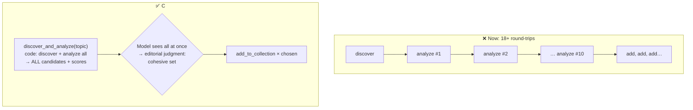

# Q29 — Tool composition: combine the mechanical steps, keep the judgment

**Domain / lesson:** D2 › 2.1 Tool Interface Design (tool granularity)
**Also touches:** D1 › 1.1 Agentic Loops (round-trips) · D1 › 1.4 (what code decides vs what the model decides)
**Related:** [Q17](../Q17-split-unified-tool/question.md) (split), [Q19](../Q19-tool-accepts-available-identifier/question.md) (resolve internally)

## Question

Your content curation agent discovers articles, analyzes each for relevance, then adds selected articles to themed collections. With separate `discover_articles(topic)`, `analyze_article(id)`, and `add_to_collection(article_id, collection_id)` tools, you observe 18+ sequential tool calls per request, causing latency issues. The agent must make editorial judgments about which articles fit a collection's theme – this requires seeing all candidates with their analysis scores simultaneously to select a cohesive set. What tool composition best addresses efficiency while preserving editorial judgment?

- **A.** Keep all tools separate but implement response caching for `analyze_article` calls.
- **B.** Create a `curate_collection(topic, collection_id)` tool that handles discovery, analysis, and selection internally using configurable quality thresholds.
- **C.** Create a `discover_and_analyze(topic)` composite tool that returns all candidates with their analysis scores, keeping `add_to_collection` separate for selective calls.
- **D.** Add a `preview_curation(topic, collection_id)` tool that shows what would be added based on predefined rules, with an `approve_curation()` tool to confirm.

## Answer: **C**

## Diagram

## Concept

Split the workflow into **two kinds of steps**:

| Step | Needs judgment? | Who should do it |
|---|---|---|
| Discover articles for a topic | ❌ Mechanical | **Code** (inside a tool) |
| Analyze each article → score | ❌ Mechanical, same for every article | **Code** (inside a tool) |
| **Choose a cohesive set** for the theme | ✅ **Editorial judgment**, needs all candidates side by side | **Model** |
| Add the chosen ones | ❌ Mechanical action | Tool call per choice |

Today the model **babysits the mechanical part**: one call to discover, one per article to analyze, so 18+ round-trips just to collect data it needs **at once** anyway.

**C** bundles the mechanical steps into one tool that returns **all candidates with scores in one result**. That's exactly what the question says judgment needs (*"seeing all candidates… simultaneously"*). The **choice** stays with the model, and `add_to_collection` stays separate so it can act on that choice.

> **Combine what's mechanical. Keep separate what needs the model's judgment.**

## Why the others are wrong

| Option | Why not |
|---|---|
| **A** Caching `analyze_article` | **Doesn't reduce the call count.** Each request analyzes **new** articles, so the cache rarely hits, and even a cache hit is still a separate round-trip. Faster plumbing, same 18+ calls. |
| **B** `curate_collection` does everything with quality thresholds | **Removes the editorial judgment.** Thresholds pick articles **one by one** ("score > 0.7"), but cohesion is about the **set** (balance, no duplicates, fits the theme together). The question explicitly says judgment must be **preserved**. Also over-consolidation (2.1 trap). |
| **D** `preview_curation` with predefined rules + `approve_curation` | **Rules again replace judgment**; the model can only approve or reject a rule-based selection, not compose one. And it adds a confirmation step to an automated flow. |

## Pattern to remember

> **Efficiency + judgment → composite tool for the mechanical steps that returns everything the model needs to decide at once; keep the decision and the action with the model.**

**Exam signal:** "too many sequential tool calls" **and** "must preserve judgment" → combine the **data-gathering** steps, not the **decision**. Reject:
- caching / retries (don't reduce round-trips),
- one mega-tool with thresholds or rules (removes judgment),
- preview + approve with predefined rules (rules ≠ judgment).

### When to merge vs split (Q17, Q19, Q29 together)

| Situation | Do | Question |
|---|---|---|
| One tool does **different operations** with different params | **Split** | Q17 |
| A tool needs a **lookup** just to get its input | **Resolve inside** the tool | Q19 |
| Several **mechanical** steps always run together before a decision | **Compose** them, return everything | Q29 |
| A step needs **model judgment** | **Keep it with the model**, never bury it in thresholds | Q29 B/D |

### Where this comes from in the guide

**D2 › 2.1 Tool Interface Design:**
- Tools should be *"purpose-specific… with defined input and output contracts."* `discover_and_analyze` has one clear purpose: *gather scored candidates for a topic.*
- Trap: *"Consolidating similar tools into one as the first step."* B consolidates everything **including the decision**.

(The guide has no lesson on composite tools by name; this is 2.1's purpose-specific principle plus 1.4's "code for deterministic, model for judgment".)

## How this connects to earlier questions

| Question | Link |
|---|---|
| [Q16](../Q16-escalation-triggers/question.md) | "Judgment → model, numbers → code." Cohesion is judgment; scores are numbers |
| [Q19](../Q19-tool-accepts-available-identifier/question.md) | Deterministic chains move into code |
| [Q21](../Q21-review-flag-from-calibrated-thresholds/question.md) | Thresholds **are** right there (a per-field review decision is a numeric rule). Here they're wrong, because cohesion isn't a per-item number |
| [Q13](../Q13-agentic-loop-model-decides-next-tool/question.md) | Every tool call = one loop round-trip |

## Check question

**In Q21 we said "put the threshold decision in code". Here B puts thresholds in code and it's *wrong*. What's the difference between the two situations?**

*My answer:* "Because the question explicitly says judgment must be preserved. There is no judgment in B." 🟡 **True, and reading the stem's constraint is a good exam habit.** But it says *that* B fails, not *why* thresholds work in Q21 and not here. The real difference is **what kind of decision** it is:

| | **Q21** (threshold ✅) | **Q29** (threshold ❌) |
|---|---|---|
| Decision is about… | **One field at a time** | **The whole set together** |
| Question asked | "Is *this* amount's score below 0.85?" | "Do *these* articles form a cohesive, balanced set?" |
| Can a number capture it? | ✅ Yes, the score **is** the signal (once calibrated) | ❌ No, cohesion depends on how items **relate** (overlap, balance, theme coverage) |
| Same input → same right answer? | ✅ Yes, so make it deterministic | ❌ Depends on the other candidates, so it needs judgment |

**Example:** three articles all score 0.95 but say the **same thing**. A threshold adds all three (each passes on its own). An editor picks **one** and adds a different angle scoring 0.80. No per-item threshold can do that.

**Rule (extends Q16's "instruct the judgment, gate the numbers"):**
- Decision on **one item vs a number** → **code** (Q21, Q28)
- Decision about **how items fit together**, or meaning → **model** (Q29, Q16)

> **Thresholds judge items one by one. Cohesion is a property of the set. That's why it needs the model.**

## Glossary

- **Composite tool:** one tool that performs several steps internally and returns the combined result.
- **Tool granularity:** how much work each tool does: fine-grained (one small step) vs coarse-grained (many steps).
- **Editorial judgment:** deciding what fits together (cohesion, balance, theme): a decision about the **set**, not each item.
- **Round-trip:** one model call → tool call → result back to the model.

## Related course lessons

### Udemy A (primary): Claude Certified Architect (CCAR-F) - 2026 Exam Prep
| # | Lecture | Part | Why |
|---|---|---|---|
| **34** | **Designing Tool Input Schemas** | 2A | ⭐ Designing tool boundaries and outputs |
| **8** | **When Workflows Outperform Agents** | 1A | ⭐ Mechanical steps as a workflow, judgment as the agent |
| 32 | How Claude Selects Tools | 2A | Fewer, purposeful tools |
| 40 | Selection Heuristics and Tool-Selection Failures | 2A | Granularity trade-offs |
| Quiz 5, Quiz 1 | 2A and 1A quizzes | | Self-test |

**▶ Watch in this order (~30 min, est.):** #8 → #32 → #34 → #40, then do **Quiz 1** and **Quiz 5**.

### Udemy B: Claude Certified Architect Foundations: Complete Course (Voroniuk)
| # | Lecture | Section | Why |
|---|---|---|---|
| **42** | **Renaming, Splitting and Keyword Triggers** | S5 Tools & MCP | ⭐ Shaping tool boundaries |
| 41 | How Claude Chooses a Tool | S5 Tools & MCP | Tool count vs clarity |
| 38 | The Agentic Loop on stop_reason | S5 Tools & MCP | Why each call costs a round-trip |
| Quiz 5 | Tools & MCP quiz | S5 | Self-test |

**▶ Watch in this order (~20 min, est.):** #38 → #41 → #42, then do **Quiz 5**.

### CBT Nuggets: CCA-F course
| Skill | Why |
|---|---|
| **36. Design Workflows and Agent Systems** | ⭐ What code does vs what the agent decides |
| 22. Route Requests Across Multiple Tools | Tool composition |
