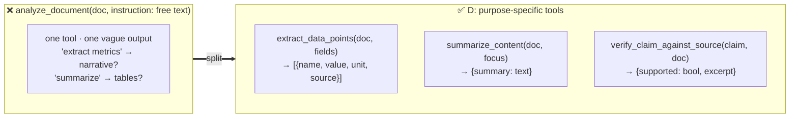

# Q30 — Split the generic analyze_document tool

**Domain / lesson:** D2 › 2.1 Tool Interface Design
**Also touches:** D1 › 1.2 Multi-Agent Orchestration (coordinator, synthesis agent) · D4 › 4.3 Structured Output (output contracts)
**Note:** this is the **guide's own example** for 2.1, almost word for word.
**Related:** [Q17](../Q17-split-unified-tool/question.md) (same lesson, same answer shape)

## Question

The document analysis agent has a single `analyze_document` tool that takes a document and a free-text instruction parameter. During evaluation, requests like "extract the key financial metrics" often return narrative summaries, while "summarize the methodology" sometimes returns raw data tables. The synthesis agent reports that 35% of analysis results require re-requests with clarified instructions. What's the most effective way to improve reliability?

- **A.** Have the coordinator pre-classify each analysis request before passing instructions to the document analysis agent.
- **B.** Keep the single tool but add an `analyze_type` enum parameter requiring explicit selection between extraction, summarization, and verification modes.
- **C.** Enhance the tool description with detailed examples showing how different instruction phrasings should map to different output formats.
- **D.** Split the generic tool into purpose-specific tools – `extract_data_points`, `summarize_content`, `verify_claim_against_source` – each with defined input/output contracts.

## Answer: **D**

## Diagram

## Concept

**Diagnose:** one tool, one free-text instruction, **one undefined output**. The model has to work out from prose what kind of work to do **and** what shape to return. It mixes them up: extraction comes back as prose, summaries as tables. The synthesis agent can't use the result and re-requests (35%).

**Fix:** split by **purpose**, each tool with a **defined input and output contract**:

| Tool | Input | Output contract |
|---|---|---|
| `extract_data_points` | doc, which fields | **Structured list** of values (name, value, unit, source) |
| `summarize_content` | doc, focus | **Text** summary |
| `verify_claim_against_source` | claim, doc | **Verdict** (supported yes/no) + supporting excerpt |

Now **choosing the tool = choosing the task**, and the **output shape is fixed by the tool**, not by how the instruction was phrased. The synthesis agent always gets what it expects.

Guide (2.1), using this exact example: *"Generic tools with broad responsibilities create ambiguity, because a broad description fits many requests."* → *"Split them into purpose-specific tools with defined input and output contracts."* Example: `analyze_document` → `extract_data_points`, `summarize_content`, `verify_claim_against_source`.

## Why the others are wrong

| Option | Why not |
|---|---|
| **A** Coordinator pre-classifies requests | **Listed trap (2.1):** *"Implementing a routing classifier as the first step to fix tool selection."* Adds a probabilistic step **before** the same vague tool. The tool's output is still undefined. |
| **B** Single tool + `analyze_type` enum | **Better than free text, but still one tool with one output contract.** The enum picks a mode, but the tool's output schema can't be "a list of data points" **and** "a text summary" **and** "a verdict" at once without becoming loose or conditional (Q17 A/B pattern). |
| **C** Detailed examples in the description | **Patches the phrasing problem with more prose.** Still free-text instructions, still no defined output contract. Close to the few-shot trap: *"Few-shot examples add token overhead without addressing the root cause."* |

## Pattern to remember

> **A generic tool with a free-text instruction → split into purpose-specific tools, each with its own input and output contract.** The tool choice defines the task; the contract defines the output.

**Exam signal:** "single generic tool" + "wrong output type / format" + "re-requests" → **split**. Reject: routing classifier (trap), mode enum on one tool, more examples/descriptions.

**Q23 vs Q30, don't mix them up:**

| | Q23 | Q30 |
|---|---|---|
| Tools | **Two separate tools** already exist | **One generic tool** |
| Problem | Descriptions are minimal → wrong tool picked | One tool does many jobs → wrong output |
| Fix | **Expand descriptions** | **Split** |

### Where this comes from in the guide

**D2 › 2.1 Tool Interface Design:**
- *"Generic tools with broad responsibilities create ambiguity, because a broad description fits many requests."*
- *"Split them into purpose-specific tools with defined input and output contracts."* (Example: `analyze_document` → `extract_data_points`, `summarize_content`, `verify_claim_against_source`.)
- Traps: *"Implementing a routing classifier as the first step to fix tool selection"* · *"Choosing few-shot examples to fix misrouting caused by minimal descriptions."*

## How this connects to earlier questions

| Question | Link |
|---|---|
| [Q17](../Q17-split-unified-tool/question.md) | Same answer: split a unified tool. Q17 = different **inputs**; Q30 = different **outputs** |
| [Q23](../Q23-expand-minimal-tool-descriptions/question.md) | Different fix (descriptions) because the tools were already separate |
| [Q29](../Q29-compose-mechanical-keep-judgment/question.md) | Merge vs split: here each job is a different **purpose**, so split |
| [Q01](../Q01-source-attribution-multi-agent/question.md) / [Q09](../Q09-synthesis-preserve-merge-mappings/question.md) | Same research system: defined output contracts keep data usable downstream |

## Check question

**Option B also forces an explicit choice (an enum: extraction / summarization / verification). Why is D still better than B?**

*(Your answer and feedback will be recorded here.)*

## Glossary

- **Generic tool:** one tool with a broad purpose and free-form instructions (e.g. "analyze this document: <anything>").
- **Purpose-specific tool:** a tool that does one job with a fixed input and output contract.
- **Output contract:** the guaranteed shape of what a tool returns (e.g. a list of data points with fixed fields).
- **Routing classifier:** a separate step that classifies the request before choosing the tool. A listed trap as a *first* fix.

## Related course lessons

### Udemy A (primary): Claude Certified Architect (CCAR-F) - 2026 Exam Prep
| # | Lecture | Part | Why |
|---|---|---|---|
| **33** | **Writing Tool Descriptions That Route Correctly** | 2A | ⭐ Generic vs purpose-specific tools |
| **34** | **Designing Tool Input Schemas** | 2A | ⭐ Defined contracts per tool |
| 40 | Selection Heuristics and Tool-Selection Failures | 2A | Why a routing classifier (A) is a trap |
| 19 | Designing Agent-to-Agent Message Schemas | 1C | Output contracts the synthesis agent can rely on |
| Quiz 5 | 2A quiz | | Self-test |

**▶ Watch in this order (~30 min, est.):** #33 → #34 → #40 → #19, then do **Quiz 5**.

### Udemy B: Claude Certified Architect Foundations: Complete Course (Voroniuk)
| # | Lecture | Section | Why |
|---|---|---|---|
| **42** | **Renaming, Splitting and Keyword Triggers** | S5 Tools & MCP | ⭐ Exactly this: splitting a generic tool |
| 41 | How Claude Chooses a Tool | S5 Tools & MCP | Why broad descriptions confuse selection |
| 25 | Functions, JSON and Schemas | S4 Structured Output | Output contracts |
| Quiz 5 | Tools & MCP quiz | S5 | Self-test |

**▶ Watch in this order (~20 min, est.):** #25 → #41 → #42, then do **Quiz 5**.

### CBT Nuggets: CCA-F course
| Skill | Why |
|---|---|
| **19. Explain Tool Use and Tool Schemas** | ⭐ Defining tool contracts |
| 22. Route Requests Across Multiple Tools | Selecting among purpose-specific tools |
