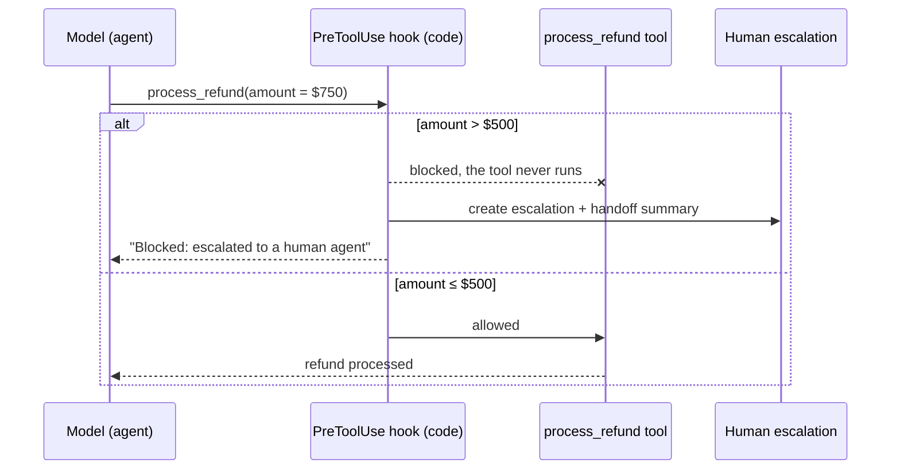
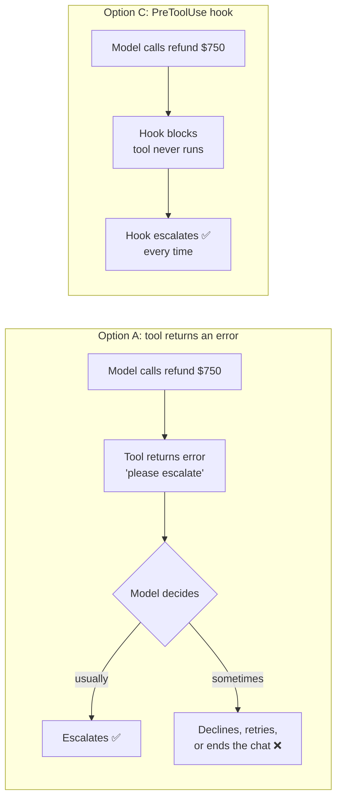

# Q31 — Guaranteed compliance: refunds over $500 must escalate

**Domain / lesson:** D1 › 1.5 Agent SDK Hooks
**Also touches:** D1 › 1.4 Workflow Enforcement and Handoff · D5 › 5.2 Escalation & Ambiguity Resolution
**Follows:** [Q28](../Q28-tamper-proof-threshold-in-tool/question.md) (same $500 rule, in-tool answer) · [Q13](../Q13-agentic-loop-model-decides-next-tool/question.md) (gate in `process_refund`) · [Q16](../Q16-escalation-triggers/question.md) ("gate the numbers") · [Q14](../Q14-escalation-handoff-summary/question.md) (handoff summary)

## Question

Compliance requires that refunds exceeding $500 must automatically escalate to a human agent – this rule cannot be left to model discretion. Despite clear system prompt instructions, production logs show the agent occasionally processes high-value refunds directly (3% failure rate). How should you achieve guaranteed compliance?

- **A.** Modify the refund tool to return an error with message "Amount exceeds policy limit – please escalate" when threshold is exceeded.
- **B.** Add few-shot examples to the prompt showing correct escalation behavior at various refund amounts ($400, $500, $600).
- **C.** Implement a hook to intercept tool calls; when the refund process amount exceeds $500, block it and invoke human escalation.
- **D.** Strengthen the system prompt with emphatic language: "CRITICAL POLICY: Refunds over $500 MUST trigger human escalation. NEVER process these directly."

## Answer: **C**

## Diagram

### C: a PreToolUse hook blocks the call and escalates, every time



### A vs. C: who decides to escalate?



Pseudocode for the hook (to show the idea, not exact Agent SDK syntax):

```python
# PreToolUse hook: runs before every tool call
def before_tool_call(tool_name, tool_input):
    if tool_name == "process_refund" and tool_input["amount"] > 500:
        ticket = escalate_to_human(tool_input)   # code escalates, every time
        return block(reason=f"Refund over $500: escalated to a human agent ({ticket})")
    return allow()
```

## Concept

The question gives two signals:
1. **"Guaranteed compliance"** and **"cannot be left to model discretion"** mean a 100% requirement.
2. **"Despite clear system prompt instructions … 3% failure rate"** means the prompt already works about 97% of the time. That's the "works most of the time" level the guide describes for prompts, and better wording won't make it 100%.

A model's choices are **probabilistic**. Better prompts or examples can move 97% closer to 100%, but they can't guarantee it. A **hook** is code that runs between the model and its tools, so it's **deterministic**: it applies the same rule every time.

The rule has **two halves**, and both have to be guaranteed:

| Half of the rule | A (tool error) | **C (hook)** |
|---|---|---|
| **Don't process** refunds over $500 | ✅ code blocks it | ✅ code blocks it |
| **Escalate** them to a human automatically | ❌ the model reads "please escalate" and decides | ✅ code invokes escalation |

**PreToolUse, not PostToolUse:** blocking has to happen *before* the tool runs. A PostToolUse hook fires after the refund has already been paid out, and stopping there doesn't undo it.

**After the block, the handoff matters too (1.4):** the human agent doesn't see the transcript, so the escalation should carry a self-contained summary: customer ID, conversation summary, root cause, the **exact refund amount**, and a recommended action.

## Why the others are wrong

| Option | Why not |
|---|---|
| **A** Refund tool returns an error | **Half-enforced.** The block is in code, but the **escalation is left to the model**: it has to read "please escalate" and choose to do it. That's exactly the model discretion the question rules out. The model might tell the customer it can't help, suggest a smaller amount, or end the conversation. It's the most tempting distractor, because it looks like lesson 1.4's tool gate and like Q28's winning answer. But that gate only has to *prevent* an action. This rule also requires an action (escalation) to *happen*. |
| **B** Few-shot examples at $400 / $500 / $600 | Still a prompt technique, so still **probabilistic**. It may lower the 3% but can't make it 0%. Lesson 1.4 lists "stronger system prompts or few-shot examples" for high-stakes failures as an exam trap. Few-shot examples teach format and judgment. They don't enforce anything. |
| **D** Emphatic language ("CRITICAL", "MUST", "NEVER") | The same instruction, louder. The question says the instructions were **already clear**, so the problem isn't misunderstanding. It's that the model is probabilistic, and capital letters don't change that. Lesson 1.5 lists "enhanced prompt instructions for 100% compliance" as an exam trap. |

## Pattern to remember

> **Money, security or compliance + "guaranteed" → code, not prompts. For tool actions, use a PreToolUse hook that blocks the call and routes it to the required workflow. Enforce the whole rule, not just the prohibition.**

### Where this comes from in the guide

**D1 › 1.5 Agent SDK Hooks** (the main lesson):
- *"A PreToolUse hook, sometimes described as tool-call interception, runs before a tool executes."* C's "intercept tool calls" is this.
- *"If the amount exceeds $500, the hook blocks the call and redirects it to a human escalation workflow"*. This is the guide's own example, almost exactly option C.
- *"The hook blocks a call that breaks the rule, so there is no side effect to undo."* · *"A blocked tool never runs."*
- *"A prompt is probabilistic, so even a good one sometimes fails."*
- *"A hook is deterministic: it applies the same rule every time, inside an otherwise probabilistic system."*
- *"If a single failure would lose the business money or expose it to legal risk, use a hook."*
- *"For a 100% requirement, the right answer is a hook."*
- *"PostToolUse hooks transform data after execution. PreToolUse hooks enforce policy before execution."*
- *"By the time PostToolUse fires, the tool has already run."* · *"A block at that point stops the loop but does not undo the side effect."*
- Exam trap (paraphrased): "enhanced prompt instructions for 100% compliance" is wrong, because prompts are probabilistic. This is why **D** fails.

**D1 › 1.4 Workflow Enforcement and Handoff** (the general principle):
- *"A prompt instruction works most of the time, perhaps in 90-95% of cases."* The 97% in this question is that level.
- *"It still has a non-zero failure rate, because the model is probabilistic."*
- *"A gate works every time. It is code, not a prompt instruction, so it is deterministic."*
- *"A billing subagent might have a PreToolUse hook that blocks refunds above a threshold."*
- Exam trap (paraphrased): choosing stronger system prompts or few-shot examples as the fix for high-stakes failures. They improve the odds but don't eliminate errors. This is why **B** and **D** fail.
- *"The handoff summary is the only information they receive, so it must be self-contained."*

## How this connects to earlier questions

| Question | Link |
|---|---|
| [Q28](../Q28-tamper-proof-threshold-in-tool/question.md) | The same $500 rule, but there the in-tool option won. Why the difference? See the check question below |
| [Q13](../Q13-agentic-loop-model-decides-next-tool/question.md) | The model decides, code enforces: a gate in `process_refund` |
| [Q16](../Q16-escalation-triggers/question.md) | "Instruct the judgment, gate the numbers." `amount > 500` is a number, so it goes in code |
| [Q14](../Q14-escalation-handoff-summary/question.md) / [Q15](../Q15-mid-process-escalation-handoff/question.md) | What the escalation must carry: a self-contained handoff summary with the exact amount |
| [Q23](../Q23-expand-minimal-tool-descriptions/question.md) | "Guarantee" in the question means a code check, not better prompting |

## Check question

**Q28's winning answer also put the $500 rule inside the tool. Why does the tool option (A) lose here?**

*My answer:* (pending)

## Glossary

- **Hook (Agent SDK):** your own code that the SDK runs at a fixed point in the agent loop, between the model and its tools. The model can't skip it.
- **PreToolUse hook:** runs **before** a tool executes and can allow, block or redirect the call. Used to **enforce policy**. Also called "tool-call interception".
- **PostToolUse hook:** runs **after** a tool executes and before the model sees the result. Used to **transform results**, such as normalizing formats. Too late to prevent an action.
- **Deterministic vs. probabilistic:** deterministic code gives the same output for the same input every time. A model's behaviour is probabilistic: likely, but not certain.
- **Side effect:** a change a tool makes in the real world, like paying out a refund or sending an email. Once it has happened, blocking afterwards doesn't undo it.

## Related course lessons

*Lecture lengths aren't recorded in the study-map files, so the watch times below are estimates from each course's average lecture length.*

### Udemy A (primary): Claude Certified Architect (CCAR-F) - 2026 Exam Prep
| # | Lecture | Part | Why |
|---|---|---|---|
| **28** | **Why Prompts Are Not Sufficient for High-Stakes Paths** | 1D | ⭐ Why B and D fail *(also in Q01)* |
| **30** | **Hook Lifecycle Events** | 1D | ⭐ PreToolUse vs. PostToolUse: the mechanism behind C |
| 29 | Designing Programmatic Validation and Enforcement Layers | 1D | Deterministic enforcement *(also in Q01)* |
| 80 | Real-World Hook Applications | 3D | Hooks that block and redirect in practice |
| 114 | When to Escalate — Trigger Design | 5B | Designing escalation triggers like "> $500" |
| 115 | The Handoff Payload — What the Next Actor Needs | 5B | What the human agent receives *(also in Q02)* |
| Quiz 4, Quiz 16 | 1D and 5B quizzes | | Self-test |

**▶ Watch in this order (~40 min, est.):** #28 → #29 → #30 → #80 → #114 → #115, then do **Quiz 4** and **Quiz 16**.
(why prompts aren't enough → enforcement layers → hook events → hooks in practice → escalation triggers → handoff → self-tests)
#77 Hook Lifecycle Events (3C) covers the same topic for Claude Code. Watch it only if #30 isn't enough.

### Udemy B: Claude Certified Architect Foundations: Complete Course (Voroniuk)
| # | Lecture | Section | Why |
|---|---|---|---|
| **50** | **Hooks: Intercepting Tool Calls** | S6 Support Agent | ⭐ Exactly option C |
| **14** | **Practice: System Prompt Rules vs Code Rules** | S2 API Basics | ⭐ Why B and D fail *(also in Q01)* |
| 49 | Prerequisite Gates in Code | S6 Support Agent | Lesson 1.4's gate, so you can compare it with A *(also in Q01)* |
| 48 | The Agent SDK: the Same Loop, Run for You | S6 Support Agent | Where hooks sit in the loop |
| 52 | When to Escalate to a Human | S6 Support Agent | Escalation rules |
| 51 | Handoffs and Multi-Concern Requests | S6 Support Agent | The handoff after the block |
| 57 | Support Case: Escalation Calls | S6 Support Agent | Exam-style escalation cases |
| Quiz 6 | Support Agent: Gates, Hooks, Escalation Rules & Case Facts | S6 | Self-test, on exactly this topic |

**▶ Watch in this order (~35 min, est.):** #14 → #49 → #48 → #50 → #52 → #51 → #57, then do **Quiz 6**.
(prompt vs. code → gates → SDK loop → hooks → escalation → handoff → exam cases → self-test)

### CBT Nuggets: CCA-F course
| Skill | Why |
|---|---|
| **6. Implement Hooks for Safer Automation** | ⭐ Hooks that block unsafe actions |
| **7. Apply Hooks to Block Sensitive Information** | Blocking with hooks in practice |
| 8. Apply Useful Hooks and Claude Code SDK Basics | Hooks + SDK basics |
| 17. Design Clear Prompts with Examples | Few-shot examples: useful for format, but not enforcement (why B fails) |

*CBT is strong on hooks (✅ for 1.5). It's a good hands-on complement here.*
