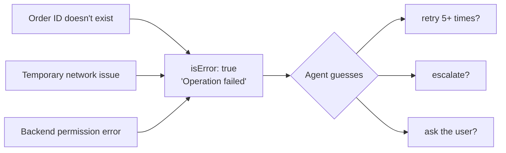
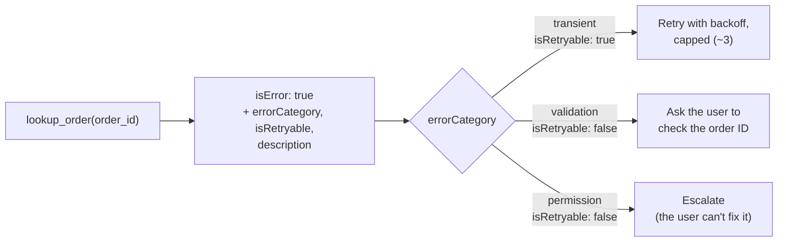

# Q32 — Uniform "Operation failed" errors → inconsistent recovery

**Domain / lesson:** D2 › 2.2 Structured Error Responses
**Also touches:** D2 › 2.4 MCP Server Integration (`isError` envelope) · D5 › 5.3 Error Propagation (where retries belong)
**Scenario:** customer-support agent, MCP `lookup_order` tool
**Follows:** [Q24](../Q24-structured-errors-not-exceptions/question.md) (same answer: structured errors) · [Q22](../Q22-empty-result-is-not-error/question.md) (the four categories) · [Q25](../Q25-mcp-protocol-vs-tool-errors/question.md) (`isError` vs protocol error)

## Question

Production logs reveal inconsistent error handling: when lookup_order fails, the agent sometimes retries 5+ times (wasteful when the order ID doesn't exist), sometimes escalates immediately (premature for temporary network issues), and sometimes asks users for clarification (inappropriate when the issue is a backend permission error). Investigation shows your MCP tool returns uniform error responses: `{"isError": true, "content": [{"type": "text", "text": "Operation failed"}]}`. The agent cannot distinguish between error types. What's the most effective improvement?

- **A.** Create an `analyze_error` MCP tool the agent calls after any failure to determine the error category and recommended action.
- **B.** Add few-shot examples to the system prompt demonstrating how to interpret error message patterns and select appropriate responses for each.
- **C.** Enhance error responses with structured metadata: include `errorCategory` (transient/validation/permission), `isRetryable` boolean, and a description of what caused the failure.
- **D.** Implement retry logic with exponential backoff in your MCP server for all errors, returning to the agent only after retries are exhausted.

## Answer: **C**

## Diagram

### Now: three different failures, one identical message



### Fix (C): the error says which kind it is, so the agent can pick the right recovery



Example error result. The metadata is a convention **inside** the MCP result, not part of the MCP envelope:

```json
{
  "isError": true,
  "content": [{
    "type": "text",
    "text": "{\"errorCategory\": \"permission\", \"isRetryable\": false, \"description\": \"The order service rejected this agent's credentials (403). The customer cannot fix this. Escalate to a human agent.\"}"
  }]
}
```

## Concept

**Diagnose first:** each of the agent's three behaviours is **the right response to a different error**:

| Observed behaviour | Wrong for (in the logs) | Right for |
|---|---|---|
| Retries 5+ times | Order ID doesn't exist | Temporary network issue (**transient**) |
| Escalates immediately | Temporary network issue | Backend permission error (**permission**) |
| Asks the user for clarification | Backend permission error | Order ID doesn't exist (**validation**) |

So the agent's **playbook is fine**. What it lacks is the **signal** to choose between the options. Every failure arrives as the same `"Operation failed"`, so its choice is a guess. You can't fix a missing signal downstream. The tool has to **say what went wrong**, at the source, at the moment it knows.

**C adds exactly the three things the agent needs:**

| Field | Answers | Example |
|---|---|---|
| `errorCategory` | **Why** did it fail? | `transient` / `validation` / `permission` (the guide's 4th is `business`) |
| `isRetryable` | Will **this exact call** work if resent? | `true` only for transient |
| `description` | **What** happened, and what can the user be told? | "No order with ID 12345. Ask the customer to check the number." |

**Mapping for this question:**

| Failure | Category | `isRetryable` | Right action |
|---|---|---|---|
| Order ID doesn't exist | validation | ❌ false | Ask the user to check the ID. Retrying fails the same way every time |
| Temporary network issue | transient | ✅ true | Retry with backoff, **capped**. If it still fails: "temporarily unavailable, please try again shortly" |
| Backend permission error | permission | ❌ false | **Escalate**. The user can't fix credentials, so asking them is pointless |

*(Q24 filed "doesn't exist" as **business / not found**. With C's three categories it lands in **validation**, because the input refers to nothing. Either way: not retryable, ask the user to check it.)*

## Why the others are wrong

| Option | Why not |
|---|---|
| **A** `analyze_error` tool after every failure | **There's nothing to analyze.** The only information that leaves the failing tool is "Operation failed". The real cause (404, timeout, 403) is known only **inside** `lookup_order` at the moment it fails, and A doesn't change what it returns. It also adds an extra hop after every failure that the model may skip, plus one more tool to choose from (Q04). Same shape as Q24 C and Q27 B. |
| **B** Few-shot examples for "error message patterns" | **There are no patterns.** Every error is the identical string "Operation failed", and examples can't teach the model to read information that isn't in the response. Even with informative messages, few-shot would be the probabilistic version of what C makes explicit. |
| **D** Server retries **all** errors with exponential backoff | **Fixes one case in three, and makes the other two slower.** Retries help transient errors. A non-existent order ID or a permission error fails the same way every time, so those retries are pure waste and add latency. When retries run out, the agent **still** gets "Operation failed" and still can't choose between asking the user and escalating. Same as Q24 D: a good **addition** for transient errors only, not the fix. |

## Pattern to remember

> **"The agent cannot distinguish between error types" → fix the tool's error output at the source: `errorCategory` + `isRetryable` + a description.** Inconsistent recovery is usually a missing-signal problem, not a reasoning problem.

**Exam signal:** an agent picks the **wrong recovery** (retries what can't succeed, escalates what would clear up, asks users about backend problems) → the errors don't say **why**. Reject: an extra analysis tool (A), few-shot to read the error text (B), blanket retries (D).

### Where this comes from in the guide

**D2 › 2.2 Structured Error Responses:**
- *"A generic message such as "Operation failed" is useless to an LLM."* This is the question's exact error.
- *"Without errorCategory, isRetryable, and a description, the agent cannot distinguish transient failures from business rule violations."* This is option C, field for field.
- The four categories and their recovery:
  - **Transient:** *"Timeouts, service unavailability, rate limits."* Recovery: *"retry after a short delay."*
  - **Validation:** *"Invalid input format, missing required fields, out-of-range values."* Recovery: *"fix the input, then send a corrected call."*
  - **Business:** *"Policy violations, limit exceedances, business rule conflicts."* Recovery: *"do not retry. The agent needs an alternative workflow."*
  - **Permission:** *"Access denied, insufficient credentials, authorisation failures."* Recovery: *"escalate or use different credentials."*
- *"isRetryable answers one narrow question: will resending this exact request work?"*
- *"A permission error needs a different account, not a better call."* This is why asking the user fails.
- *"So `false` means "not this call again", not "stop"."*
- The metadata fields are *"an application-level convention, not part of the MCP envelope."*
- Retries belong to transient errors: the guide's example *"retries transient errors up to 3 times with backoff."* This is against **D**'s "all errors".
- Exam trap: *"A malformed order ID fails the same check every time, so validation is `isRetryable: false`."*

## How this connects to earlier questions

| Question | Link |
|---|---|
| [Q24](../Q24-structured-errors-not-exceptions/question.md) | **Same answer, different symptom.** Q24: exceptions → *vague* replies. Q32: uniform `isError` → *inconsistent* recovery. Q24's C/D distractors are Q32's A/D |
| [Q22](../Q22-empty-result-is-not-error/question.md) | The four categories + `isRetryable`. Also: an **empty** search result isn't an error at all |
| [Q25](../Q25-mcp-protocol-vs-tool-errors/question.md) | `isError: true` is the right envelope here (the tool ran, and the backend failed). What's missing is *why* |
| [Q26](../Q26-timeout-unknown-status-no-retry/question.md) | Transient ≠ always retry-safe. `lookup_order` is **read-only**, so retrying it is safe. A side-effecting tool would need care |
| [Q27](../Q27-actionable-error-context/question.md) | The `description` should be actionable for the model and the user, not debug data |
| [Q31](../Q31-refund-threshold-hook/question.md) | The guide's **business** example is a refund above the automatic limit → escalate |

## Check question

**Option C lists three categories, but the guide has a fourth: business. Give an example of a business error for this support agent, and say whether it's retryable and what the agent should do.**

*My answer:* "E.g. 'Policy violation', `isRetryable: false`, try an alternative workflow." 🟡 **Two of three.** `isRetryable: false` ✅ and "alternative workflow" ✅ match the guide exactly (*"do not retry. The agent needs an alternative workflow"*). But "policy violation" is the **category's definition**, not a concrete **example**. On the exam you have to recognise the category from a concrete case, so practise naming one.

**Concrete business errors for this support agent:**

| Case | Category | `isRetryable` | Alternative workflow |
|---|---|---|---|
| Refund of $750 exceeds the **$500 automatic limit** (Q31) | business | ❌ false | **Escalate** to a human, with a self-contained handoff summary (Q14) |
| Return requested on day 45, outside the **30-day window** (Q13) | business | ❌ false | Explain the policy. If the customer asks for an exception, escalate (Q16: policy exception) |

The first one is the guide's own example: *"a refund above the automatic limit is a business error, so the agent escalates the refund to a person."*

**Business vs. validation** (both are `isRetryable: false`, but the next step differs):

| | What's wrong | Next step |
|---|---|---|
| **Validation** | The **input** is bad (wrong ID, bad format) | **Fix the input** and send a corrected call |
| **Business** | The input is fine, but **policy forbids** the action | **Don't** change the input to get around the rule. Take a **different path** (escalate, explain, offer an alternative) |

Splitting a $750 refund into two $375 refunds would not be an "alternative workflow". It would be circumventing the policy.

> **Validation → fix the input and resend. Business → the request is valid but not allowed, so change the path, not the input.**

### Follow-up check question

**Classify each error (transient / validation / business / permission) and say whether it's retryable: (1) the API returns 429 rate limit, (2) refunds are blocked because the customer's account is suspended, (3) the date was sent as "30/10/2026" but the API expects "2026-10-30", (4) the agent's API key has expired.**

*My answer:* (pending)

## Glossary

- **`errorCategory`:** a field naming *why* a tool failed: transient, validation, business or permission (guide 2.2). Each one has a different recovery.
- **`isRetryable`:** `true` only if resending **the exact same call** could work (i.e. transient). `false` means "change something", not "give up".
- **Transient error:** a temporary failure (timeout, network blip, rate limit) that may clear up on its own.
- **Exponential backoff:** waiting longer before each retry (e.g. 1 s, 2 s, 4 s) so a struggling service gets time to recover.
- **MCP envelope:** the protocol-level result structure (`isError`, `content`). Category and retryability are your own convention, carried **inside** the content.

## Related course lessons

*Lecture lengths aren't recorded in the study-map files, so the watch times below are estimates from each course's average lecture length.*

### Udemy A (primary): Claude Certified Architect (CCAR-F) - 2026 Exam Prep
| # | Lecture | Part | Why |
|---|---|---|---|
| **37** | **Returning Useful Errors from Tools** | 2A | ⭐ Exactly option C *(also in Q24)* |
| **38** | **Tool Retry Logic and Partial Success Patterns** | 2A | ⭐ Why blanket retries (D) are wrong *(also in Q24)* |
| 26 | Retry Logic — When to Retry, When to Abort | 1D | Retry transient only, with a cap |
| 116 | Where to Catch the Error | 5B | Fix the signal where the error happens |
| 117 | Designing the Propagation Contract | 5B | What an error must carry to the next decision-maker |
| Quiz 5, Quiz 16 | 2A and 5B quizzes | | Self-test |

**▶ Watch in this order (~35 min, est.):** #37 → #38 → #26 → #116 → #117, then do **Quiz 5** and **Quiz 16**.
(useful errors → retry patterns → when to retry → where to catch → propagation contract → self-tests)
If you've just done Q24's list, skip #37 and #38 (~20 min).

### Udemy B: Claude Certified Architect Foundations: Complete Course (Voroniuk)
| # | Lecture | Section | Why |
|---|---|---|---|
| **43** | **Structured Tool Errors** | S5 Tools & MCP | ⭐ Exactly option C *(also in Q24)* |
| 44 | Customer Messages and Empty Results | S5 Tools & MCP | The `description`: what to tell the customer *(also in Q24)* |
| 46 | MCP: Servers, Tools and Resources | S5 Tools & MCP | Where `isError` sits in an MCP result |
| 66 | Failure Handling Across Agents | S7 Multi-Agent | Recover transient errors locally, propagate the rest (5.3) |
| Quiz 5 | Tools & MCP quiz | S5 | Self-test |

**▶ Watch in this order (~20 min, est.):** #43 → #44 → #46 → #66, then do **Quiz 5**.

### CBT Nuggets: CCA-F course
| Skill | Why |
|---|---|
| **20. Handle Tool Calls and Tool Results** | ⭐ Returning errors as tool results |
| 33. Explain MCP Clients and Servers | The MCP result envelope (`isError`) |
| 21. Build Multi Turn Tool Conversations | Recovery over the next turns |
