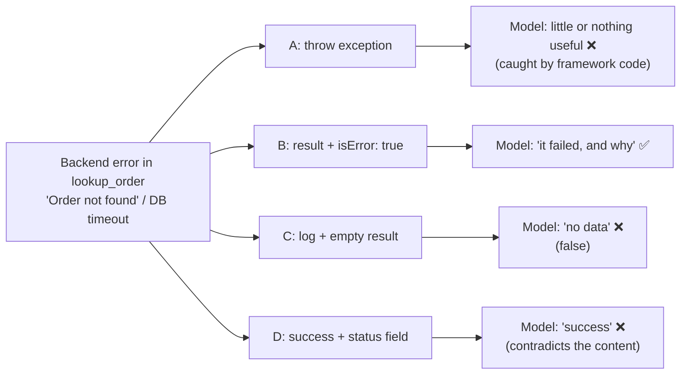

# Q33 — Communicating MCP tool errors back to the agent

**Domain / lesson (closest fit):** D2 › 2.2 Structured Error Responses
**Also touches:** D2 › 2.4 MCP Server Integration
**Note:** like [Q25](../Q25-mcp-protocol-vs-tool-errors/question.md), the mechanics come from the **MCP specification**, Tools › Error Handling (versions 2025-06-18 and 2025-11-25 both checked 2026-10-30). The guide's 2.4 page doesn't cover them.
**Scenario:** customer-support agent, MCP `lookup_order` tool (same as [Q32](../Q32-uniform-errors-add-category/question.md))
**Follows:** [Q24](../Q24-structured-errors-not-exceptions/question.md) (no exceptions) · [Q22](../Q22-empty-result-is-not-error/question.md) (empty ≠ error) · [Q25](../Q25-mcp-protocol-vs-tool-errors/question.md) (did the tool run?)

## Question

When implementing your lookup_order MCP tool, the backend sometimes returns errors (e.g., "Order not found" or temporary database failures). What is the correct pattern for communicating these errors back to the agent?

- **A.** Throw an exception from the tool handler so the agent framework can catch and log it
- **B.** Return the error message in the tool result content with the `isError` flag set to true
- **C.** Log the error server-side and return an empty result to avoid confusing the model
- **D.** Return a success response with a "status" field indicating the error type

## Answer: **B**

## Diagram

### What the model ends up seeing with each option



### B for the two errors in the question

**"Order not found"** (the tool ran, and the backend found nothing for that ID):

```json
{
  "content": [{ "type": "text", "text": "Order 12345 not found. Ask the customer to check the order number." }],
  "isError": true
}
```

**Temporary database failure** (the tool ran, and the backend timed out):

```json
{
  "content": [{ "type": "text", "text": "Order database temporarily unavailable (timeout). Safe to retry shortly." }],
  "isError": true
}
```

## Concept

**Q25's test:** *did the tool get to run?* Here it did. `lookup_order` ran and called the backend, and the **backend** failed. In MCP, that is a **tool execution error**, and the spec says exactly how to report it: **inside the tool result, with `isError: true`**.

Why the result, and not some other channel? Because the result is **what the model sees**. It's appended to the conversation, so the model can reason about it: tell the customer the order number looks wrong, or retry after a moment. The spec says so directly: tool execution errors *"contain actionable feedback that language models can use to self-correct"*, and clients *"SHOULD provide tool execution errors to language models."*

Each wrong option breaks the signal in a different way:

| Option | What happens to the error | Name for it |
|---|---|---|
| **A** exception | It goes to framework code, not to the model as a normal result | **Hidden** |
| **C** log + empty result | It's turned into "no data", which is false | **Disguised** |
| **D** success + status | `isError` says success while the content says failure | **Contradicted** |
| **B** `isError: true` + message | The model sees that it failed and why | **Told** ✅ |

**B is the baseline. Q32 is the upgrade:** "Order not found" and a database timeout need **different** recoveries (ask the user vs. retry). So the content should also say *which kind* of error it is (`errorCategory`, `isRetryable`, description). That makes it B with structured content, not plain text.

## Why the others are wrong

| Option | Why not |
|---|---|
| **A** Throw an exception for the framework to catch and log | **Logging is for humans; recovery needs the model.** An exception is a signal for code: depending on the setup, the model gets a protocol error or a raw exception string, or nothing at all. You lose control of what the model sees. This is Q24's problem: the agent ends up saying *"I'm having trouble with that request."* Under the spec, protocol-level errors are *"less likely to result in successful recovery."* |
| **C** Log server-side, return an empty result | **Turns a failure into a false answer.** An empty result means *"the search worked and found nothing"* (Q22). During a temporary database failure, the agent would tell the customer their order doesn't exist, which is wrong, and it wouldn't retry. "Avoid confusing the model" gets it backwards: hiding the error is what misleads it. This is the opposite of Q22's trap: a failure returned as a silent empty success. |
| **D** Success response with a "status" field | **A fake success.** The envelope says "it worked" (`isError` false), and only a custom field says otherwise. The model and the client both rely on `isError` to know execution failed (guide 2.2: *"When the tool sets `isError`, the model knows that the execution failed"*). The model may treat the payload as valid data, and any code that checks `isError` (retries, metrics, hooks) counts it as a success. Same family as Q27's `is_error: false` "pending" result. |

## Pattern to remember

> **The tool ran and the work failed → tell the model in the tool result: `isError: true` + a message (ideally structured, Q32).** Don't hide it (exception, A), disguise it (empty result, C), or contradict it (success + status, D).

**Exam signal:** "how should the tool communicate errors back to the agent?" → the `isError` result. Logging is fine **in addition**, but never **instead**.

### Where this comes from

**MCP specification, Tools › Error Handling** (2025-11-25; 2025-06-18 has the same two mechanisms):
- *"Tools use two error reporting mechanisms"*: **Protocol Errors** (*"Standard JSON-RPC errors"*: unknown tools, malformed requests, server errors) and **Tool Execution Errors**.
- *"Tool Execution Errors: Reported in tool results with `isError: true`"*: *"API failures"*, *"Input validation errors"*, *"Business logic errors"*. Both of the question's errors (not found, database failure) are failures of the backend the tool called.
- *"Tool Execution Errors contain actionable feedback that language models can use to self-correct and retry with adjusted parameters."*
- *"Clients SHOULD provide tool execution errors to language models to enable self-correction."*
- *"Clients MAY provide protocol errors to language models, though these are less likely to result in successful recovery."* This is why routing errors anywhere but the result (**A**) is weaker.
- The spec's own example of an execution error: `"content": [{"type": "text", "text": "Failed to fetch weather data: API rate limit exceeded"}], "isError": true`.

**Guide D2 › 2.2 Structured Error Responses:**
- *"When the tool sets `isError`, the model knows that the execution failed."*
- *"A generic message such as "Operation failed" is useless to an LLM."* So B's message should be specific (Q32).
- *"An empty result from a successful query means 'no data matches your criteria.'"* This is why **C**'s empty result after a **failed** query is a lie.

## How this connects to earlier questions

| Question | Link |
|---|---|
| [Q24](../Q24-structured-errors-not-exceptions/question.md) | Option A is Q24's starting problem: exceptions → vague replies |
| [Q22](../Q22-empty-result-is-not-error/question.md) | The mirror image: Q22 = don't report success as an error. Q33 C = don't report an error as an empty success |
| [Q25](../Q25-mcp-protocol-vs-tool-errors/question.md) | "Did the tool run?" Yes → `isError` result, not a protocol error |
| [Q32](../Q32-uniform-errors-add-category/question.md) | The next step: B's message should carry `errorCategory` + `isRetryable` + description |
| [Q27](../Q27-actionable-error-context/question.md) | Option D's family: an `is_error: false` "pending" fake success |

## Check question

**Walk through option C during a temporary database failure: what would the agent tell the customer, and why is that worse than the agent saying "something went wrong"?**

*My answer:* (pending)

## Glossary

- **`isError`:** the MCP tool-result flag that marks a **tool execution error**: the tool ran, but its work failed. The result still goes to the model.
- **Tool execution error vs. protocol error:** execution error = the tool ran and failed (`isError: true` in the result). Protocol error = the call itself was invalid (unknown tool, malformed request), reported as a JSON-RPC `error` (Q25).
- **Silent failure:** an error that is swallowed and reported as a normal result (like C's empty result). It's dangerous because nothing downstream knows anything went wrong.
- **Fake success:** a result that claims success while carrying an error inside a custom field (D). Anything that trusts the success flag is misled.

## Related course lessons

*Lecture lengths aren't recorded in the study-map files, so the watch times below are estimates from each course's average lecture length.*

### Udemy A (primary): Claude Certified Architect (CCAR-F) - 2026 Exam Prep
| # | Lecture | Part | Why |
|---|---|---|---|
| **37** | **Returning Useful Errors from Tools** | 2A | ⭐ `isError` results for the model *(also in Q24, Q25, Q32)* |
| 43–49 | MCP primitives, servers, clients | 2B | Where the tool result and `isError` sit in MCP *(also in Q25)* |
| 116 | Where to Catch the Error | 5B | Catch it in the tool and return it, don't throw it *(also in Q32)* |
| Quiz 5, Quiz 6 | 2A and 2B quizzes | | Self-test |

**▶ Watch in this order (~30 min, est.):** #37 → #116 → the 2B MCP server lectures (#43–49, focus on servers and tools), then do **Quiz 5** and **Quiz 6**.
If you've done Q25's list, just rewatch #37 and #116 (~12 min).

### Udemy B: Claude Certified Architect Foundations: Complete Course (Voroniuk)
| # | Lecture | Section | Why |
|---|---|---|---|
| **43** | **Structured Tool Errors** | S5 Tools & MCP | ⭐ `isError` results *(also in Q24, Q25, Q32)* |
| **45** | **Practice: Structured Tool Errors in Code** | S5 Tools & MCP | ⭐ Catching exceptions and returning results instead (why A fails) |
| 44 | Customer Messages and Empty Results | S5 Tools & MCP | Empty result vs. error (why C fails) |
| 46 | MCP: Servers, Tools and Resources | S5 Tools & MCP | The MCP result envelope |
| Quiz 5 | Tools & MCP quiz | S5 | Self-test |

**▶ Watch in this order (~20 min, est.):** #43 → #45 → #44 → #46, then do **Quiz 5**.

### CBT Nuggets: CCA-F course
| Skill | Why |
|---|---|
| **34. Build MCP Tools Resources and Prompts** | ⭐ Implementing MCP tool handlers and their results |
| 20. Handle Tool Calls and Tool Results | Error results back to the model |
| 35. Test MCP Systems with the Inspector | Seeing exactly what an error result looks like |

*Primary source for this question: the MCP spec, Tools › Error Handling (modelcontextprotocol.io).*
