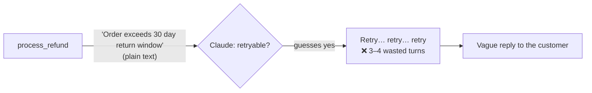
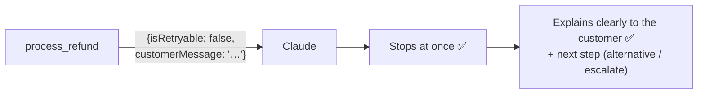

# Q34 — Wasted retries on business errors

**Domain / lesson:** D2 › 2.2 Structured Error Responses
**Also touches:** D5 › 5.3 Error Propagation (local retries for transient errors) · D2 › 2.1 Tool Interface Design (why an extra tool isn't the fix)
**Scenario:** customer-support agent, `process_refund` tool
**Follows:** [Q32](../Q32-uniform-errors-add-category/question.md) (same fix: error metadata) · [Q24](../Q24-structured-errors-not-exceptions/question.md) (actionable context) · [Q13](../Q13-agentic-loop-model-decides-next-tool/question.md) (30-day window gate)

## Question

Your process_refund tool returns two types of errors: technical errors ("503 Service Unavailable", "Connection timeout") that are transient (5% of calls), and business errors ("Order exceeds 30 day return window", "Item already refunded") that are permanent (12% of calls). Monitoring shows the agent wastes 3-4 turns retrying business errors that can never succeed. Currently, both error types return only a plain text message to Claude.
What's the most effective way to reduce wasted retries while improving customer-facing response quality?

- **A.** Implement automatic retry logic at the tool level for technical errors only, passing business errors to Claude without retries.
- **B.** Add few-shot examples showing how to distinguish retriable from non-retriable errors by parsing error message text.
- **C.** Return structured error responses with `retriable: false` for business errors and a customer-friendly explanation for Claude to use.
- **D.** Add a `check_refund_eligibility` tool that must be called before `process_refund` to prevent business rule violations.

## Answer: **C**

## Diagram

### Now: plain text, so Claude can't tell "permanent" from "try again"



### Fix (C): the error says it's permanent and gives the words for the customer



Example business-error result (the field names are an application convention, Q32):

```json
{
  "isError": true,
  "errorCategory": "business",
  "isRetryable": false,
  "description": "Return window exceeded: delivered 2026-09-18, 42 days ago; policy allows 30.",
  "customerMessage": "This order was delivered 42 days ago, and refunds are available within 30 days of delivery."
}
```

And a technical error, for contrast:

```json
{
  "isError": true,
  "errorCategory": "transient",
  "isRetryable": true,
  "description": "Payment service returned 503 Service Unavailable."
}
```

## Concept

**Read the question's two goals, then find the option that does both:**

| Goal in the question | What delivers it |
|---|---|
| **"reduce wasted retries"** | A **machine-readable** signal that business errors are permanent: `retriable: false` |
| **"improving customer-facing response quality"** | A **customer-friendly explanation** written by the tool, which has the facts |

C contains exactly those two fields. Each other option touches **at most one** goal, and none of them does it reliably.

**Diagnose the waste from the numbers:** the wasted turns come from **business errors** (12% of calls), and Claude retries them because plain text doesn't say they're permanent. So the fix has to change **what a business error looks like to Claude**. The 5% of technical errors aren't the problem.

## Why the others are wrong

| Option | Why not |
|---|---|
| **A** Tool-level retries for technical errors only | **Fixes the wrong half.** The waste comes from **business** errors (12%), and A sends those to Claude as the **same plain text** as before, so Claude still can't tell they're permanent and still retries. Customer responses don't improve either. Auto-retrying transient errors inside the tool is a fine **addition** (the guide's example retries transient errors *"up to 3 times with backoff"*), but it targets the 5%, not the problem. The most tempting distractor, because it sounds like it understands transient vs. permanent. |
| **B** Few-shot examples for parsing error text | **Probabilistic and brittle.** The model has to infer "permanent" from wording, and a new or reworded business error ("Refund limit reached for this account") breaks the pattern. It also does nothing for customer-facing quality. If the tool knows an error is permanent, it should **say so in a field**, not leave the model to guess from prose. |
| **D** Mandatory `check_refund_eligibility` tool first | **Changes the workflow, not the error signal.** "Must be called before" is either a prompt instruction (probabilistic) or yet another gate. It adds an extra call to **every** refund to deal with 12%, and business errors can still happen (a rule the check doesn't cover, or a state change between check and refund). When they do, they're **still plain text**. It also does nothing for customer-facing explanations. Same family as Q24 C and Q32 A: extra tools don't fix the error signal. |

## Pattern to remember

> **Wasted retries on permanent errors → the error must say it's permanent (`isRetryable: false`). Poor customer replies → the error must carry a customer-friendly explanation.** Both belong in a structured tool result, written by the tool, which knows the facts.

**Exam signal:** when the question names **two goals** ("reduce X *while* improving Y"), pick the option that hits both. The distractors here each hit at most one (A: transient retries, D: prevention) or none reliably (B).

### Where this comes from in the guide

**D2 › 2.2 Structured Error Responses:**
- *"Without errorCategory, isRetryable, and a description, the agent cannot distinguish transient failures from business rule violations."* This is the plain-text problem.
- *"isRetryable answers one narrow question: will resending this exact request work?"*
- Exam trap: *"Business errors (e.g. refund exceeds policy limit) will never resolve through retry."*
- **Business** errors: *"Policy violations, limit exceedances, business rule conflicts."* Recovery: *"do not retry. The agent needs an alternative workflow."*
- *"A customer-friendly explanation in the description lets the agent tell the customer why."* This is C's second half, almost word for word.
- *"So `false` means "not this call again", not "stop"."* So Claude stops retrying, but still helps (explain, offer alternatives, escalate).
- The guide's retry example: *"retries transient errors up to 3 times with backoff."* Retries are for transient errors only, which is why **A** is an addition, not the fix.

## How this connects to earlier questions

| Question | Link |
|---|---|
| [Q32](../Q32-uniform-errors-add-category/question.md) | Same fix, sharper focus: Q32 = "which category?"; Q34 = "permanent or not?" + "what to tell the customer" |
| [Q24](../Q24-structured-errors-not-exceptions/question.md) | Same answer family: type + recoverability + actionable context. A ≈ Q24 D, D ≈ Q24 C |
| [Q13](../Q13-agentic-loop-model-decides-next-tool/question.md) | The 30-day window is enforced **inside** `process_refund`. Q34 is about how that gate **reports** a rejection |
| [Q31](../Q31-refund-threshold-hook/question.md) | Another business error on the same tool (refund over $500) → escalate |
| [Q19](../Q19-tool-accepts-available-identifier/question.md) | "Tool B must always be called first" chains are a smell. Fix the tool itself (D) |
| [Q27](../Q27-actionable-error-context/question.md) | Errors written for the customer and the model, not a debugger |

## Check question

**Why should the tool write the customer-friendly explanation, instead of letting Claude compose one from the plain-text error ("Order exceeds 30 day return window")?**

*My answer:* "Because Claude might misinterpret the meaning of errors." 🟡 **Right direction, but not the main reason.** Misinterpretation is one risk. The bigger one is that **Claude doesn't have the facts.** Even if it reads "Order exceeds 30 day return window" perfectly, that's all it knows.

**What each side can write:**

| | Claude, from the plain text | The tool, which has the data |
|---|---|---|
| Message | *"I'm sorry, this order is outside our 30-day return window."* | *"This order was delivered on 18 September, 42 days ago. Refunds are available within 30 days of delivery."* |
| Specifics (dates, days) | ❌ Not in the text, so it's generic | ✅ It has them |
| Risk | Fills gaps by **inventing** details (a wrong date, an alternative that doesn't exist) | Facts come straight from the system |

**Three reasons, in order of weight:**
1. **Facts:** the tool has the delivery date, days elapsed and refund history. Claude only sees what's returned.
2. **Accuracy:** to sound helpful, Claude may fill the gaps with made-up details. Your "misinterpret" is part of this.
3. **Consistency:** the same policy-approved wording every time, with no internal codes leaking out.

> **Whoever has the facts writes the explanation. The model can only rephrase what it's given.** This is the same idea as Q02: *"The synthesis agent cannot cite a source it was not given."* Likewise, Claude can't explain a fact it wasn't given.

### Follow-up check question

**For the other business error, "Item already refunded", which facts should the tool's customer-friendly message include?**

*My answer:* (pending)

## Glossary

- **Transient (technical) error:** temporary, such as 503 or a timeout. The same call may work later, so `isRetryable: true`.
- **Business (permanent) error:** the request is valid but policy forbids it, such as outside the return window or already refunded. It will never succeed on retry, so `isRetryable: false` and the next step is an alternative workflow.
- **Customer-friendly explanation:** an error message written for the end user, with the relevant facts and without internal codes, so the agent can pass it on accurately.
- **Wasted turn:** an agent-loop iteration that can't make progress, like retrying a permanent error. It costs tokens and latency and frustrates the customer.

## Related course lessons

*Lecture lengths aren't recorded in the study-map files, so the watch times below are estimates from each course's average lecture length.*

### Udemy A (primary): Claude Certified Architect (CCAR-F) - 2026 Exam Prep
| # | Lecture | Part | Why |
|---|---|---|---|
| **37** | **Returning Useful Errors from Tools** | 2A | ⭐ Exactly option C *(also in Q24, Q32, Q33)* |
| **38** | **Tool Retry Logic and Partial Success Patterns** | 2A | ⭐ Where retries belong (why A is an add-on) *(also in Q24, Q32)* |
| 26 | Retry Logic — When to Retry, When to Abort | 1D | Abort on permanent errors *(also in Q32)* |
| 27 | Fallback Chains and Graceful Degradation | 1D | What to do after a business error: alternatives *(also in Q24)* |
| Quiz 5, Quiz 4 | 2A and 1D quizzes | | Self-test |

**▶ Watch in this order (~30 min, est.):** #37 → #38 → #26 → #27, then do **Quiz 5** and **Quiz 4**.
(useful errors → where retries belong → when to abort → fallbacks → self-tests)
All four also appear in Q24/Q32's lists. If those are fresh, go straight to the quizzes.

### Udemy B: Claude Certified Architect Foundations: Complete Course (Voroniuk)
| # | Lecture | Section | Why |
|---|---|---|---|
| **43** | **Structured Tool Errors** | S5 Tools & MCP | ⭐ `isRetryable` + categories *(also in Q24, Q32, Q33)* |
| **44** | **Customer Messages and Empty Results** | S5 Tools & MCP | ⭐ The customer-friendly explanation (C's second half) |
| 45 | Practice: Structured Tool Errors in Code | S5 Tools & MCP | Building the error result |
| Quiz 5 | Tools & MCP quiz | S5 | Self-test |

**▶ Watch in this order (~15 min, est.):** #43 → #44 → #45, then do **Quiz 5**.

### CBT Nuggets: CCA-F course
| Skill | Why |
|---|---|
| **20. Handle Tool Calls and Tool Results** | ⭐ Error results back to the model |
| 21. Build Multi Turn Tool Conversations | How wasted retries pile up across turns |
