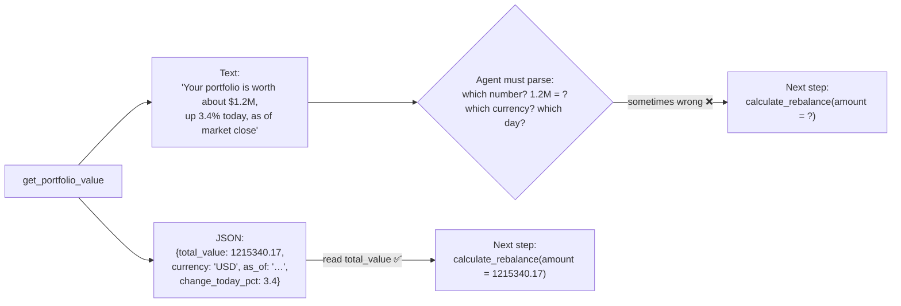

# Q35 — Structured tool output vs. a formatted text string

**Domain / lesson (closest fit):** D2 › 2.1 Tool Interface Design (input **and output** contracts)
**Also touches:** D4 › 4.3 Structured Output with Tool Use (structure ≠ correctness) · D2 › 2.4 MCP Server Integration (`structuredContent`, `outputSchema`)
**Note:** the guide's 2.1 page only mentions output contracts briefly (*"with defined input and output contracts"*). The answer rests on lesson 4.3 and the MCP spec, Tools › Output Schema (checked 2026-10-30).
**Follows:** [Q30](../Q30-split-generic-analyze-document/question.md) (output contracts) · [Q22](../Q22-empty-result-is-not-error/question.md) (structured results) · [Q20](../Q20-parameter-descriptions/question.md) (valid ≠ correct)

## Question

Your get_portfolio_value tool returns the total value of a user's investment portfolio. You're deciding between returning a structured JSON object with explicit fields versus returning the information as a formatted text string. What is the primary advantage of using structured output with defined fields?

- **A.** JSON schemas automatically validate that the underlying API returned correct data before the agent processes it.
- **B.** Structured JSON consumes significantly fewer tokens than natural language, substantially reducing API costs.
- **C.** Structured JSON is processed deterministically by the model, significantly improving accuracy when extracting values.
- **D.** The agent can reliably extract specific values without parsing free-form text, reducing errors in subsequent operations.

## Answer: **D**

## Diagram



The same information in both forms:

**Formatted text:**
> *"Your portfolio is currently worth approximately $1.2M (up 3.4% today) as of market close."*

**Structured JSON:**
```json
{
  "total_value": 1215340.17,
  "currency": "USD",
  "as_of": "2026-10-30T20:00:00Z",
  "change_today_pct": 3.4
}
```

## Concept

**What goes wrong with text:** to use the value, the agent has to **parse prose**, and every step of that is a chance for error:
- **Which number** is the value: 1.2 or 3.4?
- **Rounding:** "approximately $1.2M" isn't 1,215,340.17.
- **Units and format:** "M" means million; currency symbols, thousands separators and decimal commas vary.
- **Context:** "as of market close" doesn't say *which* close.

**What fields give you:** each value has a **name, a type and a unit**. The agent (or code) reads `total_value` directly. Nothing has to be interpreted, so the **next operation** (a calculation, a comparison, an argument to another tool) gets the exact number.

**What fields don't give you** (that's where A and C overclaim):
- They don't make the **data correct**. A wrong value from the API is still wrong, just neatly formatted.
- They don't make the **model deterministic**. The model reads JSON more reliably, but it's still a probabilistic model.

So the honest claim is D's: **reliably** extract values, **reducing** errors.

## Why the others are wrong

| Option | Why not |
|---|---|
| **A** "Schemas automatically validate that the API returned **correct** data" | **Structure ≠ correctness.** A schema checks **shape and types** (is `total_value` a number?), not whether the number is **right**. If the API returns a stale or wrong total, it's still schema-valid. Guide 4.3: a schema *"guarantees structure, not correctness."* It isn't automatic either: in MCP, *"Clients SHOULD validate structured results against this schema"*, so someone has to implement the check, and even then it only checks conformance. Same lesson as Q20: **valid ≠ correct**. |
| **B** "Significantly fewer tokens" | **Not true in general, and not the point.** JSON adds keys, quotes and braces, so a short sentence can use fewer tokens than the same data as JSON. And cost isn't the **primary** advantage of choosing a data format for reliability. The question asks about extracting values correctly. |
| **C** "Processed **deterministically** by the model" | **The model is never deterministic**, whatever format its input comes in. Guide 1.5: *"The model's choices are probabilistic."* "Deterministic" describes **code** (hooks, gates, schema validation), not how a model reads a tool result. This is the **most tempting** distractor, because it sounds like D. The difference is one word: C claims determinism (false), and D claims **reliability** and **fewer errors** (true). |

## Pattern to remember

> **Structured tool output = the agent reads exact values from named fields instead of parsing prose → fewer errors downstream.** It improves reliability, but it isn't determinism (C), it doesn't prove correctness (A), and it isn't mainly about cost (B).

**Exam signal: watch for overclaiming words.** "Deterministically", "automatically validates correct data" and "guarantees" are usually wrong when they describe what a **model** does or what a **schema** proves. The right answer often says "reliably" or "reducing errors".

### Where this comes from

**D2 › 2.1 Tool Interface Design:** purpose-specific tools *"with defined input and output contracts."*

**D4 › 4.3 Structured Output with Tool Use** (what structure does and doesn't guarantee):
- *"Structured output is a reply whose fields and types match a fixed shape."*
- *"Prompt-based JSON is plain text with no structural guarantees."*
- *"tool_use with JSON schemas eliminates syntax errors but does not prevent semantic errors."* The schema *"guarantees structure, not correctness"*. This is why **A** fails.
- Exam trap: *"Believing tool_use with JSON schemas prevents all extraction errors."*

**D1 › 1.5 Agent SDK Hooks:** *"The model's choices are probabilistic."* This is why **C** fails.

**MCP specification, Tools › Structured Content / Output Schema** (2025-06-18 and 2025-11-25):
- *"**Structured** content is returned as a JSON object in the `structuredContent` field of a result."*
- An output schema helps by *"Guiding clients and LLMs to properly parse and utilize the returned data"*. That's D's advantage.
- *"Servers MUST provide structured results that conform to this schema. Clients SHOULD validate structured results against this schema."* Validation checks **conformance**, and someone has to do it. This is against **A**.

## How this connects to earlier questions

| Question | Link |
|---|---|
| [Q30](../Q30-split-generic-analyze-document/question.md) | Output contracts: each tool returns one exact shape the consumer can rely on |
| [Q20](../Q20-parameter-descriptions/question.md) | "Valid ≠ correct": schema = shape, description = meaning, code check = guarantee |
| [Q22](../Q22-empty-result-is-not-error/question.md) | `success` + `results` fields instead of prose, so the agent reads the outcome directly |
| [Q21](../Q21-review-flag-from-calibrated-thresholds/question.md) | Explicit fields instead of making the model interpret raw text or numbers |
| [Q32](../Q32-uniform-errors-add-category/question.md) / [Q34](../Q34-business-errors-not-retryable/question.md) | The same principle applied to errors: fields (`isRetryable`) instead of text to parse |
| [Q01](../Q01-source-attribution-multi-agent/question.md) | Fields survive where prose gets lost or misread |

## Check question

**Why can't any input format (JSON included) make the *model's* processing deterministic? And where *does* determinism come from in these systems? (Think back to Q31.)**

*My answer:* "Determinism comes from the tools. Models are statistical, thus their interpretation of extracted values is also probabilistic." ✅ **Correct on both parts.** One precision: determinism comes from **code**, and tool code is only one place it lives.

There's also a subtle trap: a tool is deterministic **once it runs**, but the **model decides** whether to call it, when, and with which arguments.

| Where | Deterministic? | Example |
|---|---|---|
| The model **reading** a tool result | ❌ Probabilistic, whatever the format | Reads `total_value` from JSON: very reliable, not guaranteed |
| The model **choosing** to call a tool, and its arguments | ❌ Probabilistic | May skip `check_refund_eligibility` (Q34 D) |
| **Tool code**, once it runs | ✅ | `process_refund` rejects a 45-day-old order (Q13, Q28) |
| A **hook** around every tool call | ✅ | PreToolUse blocks > $500 and escalates (Q31) |
| **Validation / orchestration code** | ✅ | Schema check, handoff gate (Q10), retrieval-log check (concept: claim-source-mapping) |

> **Determinism lives in code that runs no matter what the model decides: inside the tool, or in a hook around every call. A tool the model has to *remember* to call is only as reliable as the model.**

### Follow-up check question

**Which of these are deterministic? (a) Claude reading `total_value` from JSON, (b) a PreToolUse hook blocking refunds > $500, (c) Claude deciding to call `check_refund_eligibility` first, (d) `process_refund` rejecting a 45-day-old order.**

*My answer:* "(b) A PreToolUse hook blocking refunds over $500." 🟡 **(b) is right, but (d) is missing.** The answer is **(b) and (d)**.

**Why (d) is deterministic too:** the rejection is **code inside the tool**: `if days_since_delivery > 30: reject`. The model decides whether to *call* `process_refund`, but either way the rule holds:
- The model doesn't call it → no refund happens at all.
- The model calls it → the check runs and rejects, every time.

The only path to the money goes through that `if`, which is Q28's point.

**The test: can the model's choice make the rule fail?**

| | Can the model's choice break it? | Deterministic? |
|---|---|---|
| (a) Reading `total_value` | Yes: it could misread it (rarely) | ❌ |
| (b) PreToolUse hook | No: it runs on every call, whatever the model does | ✅ |
| (c) Calling `check_refund_eligibility` first | Yes: the model can skip it | ❌ |
| (d) `process_refund` rejecting > 30 days | No: the check is inside the only path to the refund | ✅ |

> **(c) and (d) look similar ("a check before refunding"), but in (c) the model has to *remember* the check, and in (d) the check is *built into* the action.**

### Follow-up check question

**Apply the test: a system prompt says "never refund more than $500", and `process_refund` has no amount check. Deterministic or not, and why?**

*Skipped (moved on to Q36).* Answer: **Not deterministic.** The rule lives only in the prompt, so the model's choice **can** break it: it can call `process_refund` with $600, and nothing stops it (Q31's 3% failure rate). To make it deterministic, put the check in code: inside `process_refund` (Q28) or in a PreToolUse hook (Q31).

## Glossary

- **Structured output (tool result):** a result with named, typed fields (e.g. `total_value: number`) instead of a sentence.
- **Parsing:** pulling specific values out of free text. It's error-prone when wording, rounding, units or formats vary.
- **`structuredContent` / `outputSchema` (MCP):** the MCP fields for returning a JSON result and declaring its shape, so clients and models know exactly what comes back.
- **Syntax vs. semantic error:** syntax = malformed structure (missing bracket, wrong type), which a schema can catch. Semantic = well-formed but wrong (a stale price, a total that doesn't add up), which a schema can't catch.
- **Overclaiming distractor:** an option that states a real benefit too strongly ("deterministic", "guarantees", "automatically validates correctness").

## Related course lessons

*Lecture lengths aren't recorded in the study-map files, so the watch times below are estimates from each course's average lecture length.*

### Udemy A (primary): Claude Certified Architect (CCAR-F) - 2026 Exam Prep
| # | Lecture | Part | Why |
|---|---|---|---|
| **98** | **Schema Design for Reliable Extraction** | 4C | ⭐ Fields designed so values can be read reliably (D) |
| **99** | **Structured Outputs Limits** | 4C | ⭐ Structure ≠ correctness (why A fails) |
| 97 | JSON Mode and Schema-Constrained Output | 4C | What schemas guarantee: syntax, not meaning |
| 112 | The Tool-Output Bloat Problem | 5A | Tool output design: return the relevant fields, not prose |
| Quiz 14 | 4C quiz | | Self-test |

**▶ Watch in this order (~28 min, est.):** #97 → #98 → #99 → #112, then do **Quiz 14**.
(schemas → designing fields → limits → tool output design → self-test)

### Udemy B: Claude Certified Architect Foundations: Complete Course (Voroniuk)
| # | Lecture | Section | Why |
|---|---|---|---|
| **25** | **Functions, JSON and Schemas** | S4 Structured Output | ⭐ Why fields beat free text |
| 28 | Practice: Schema-Valid Output from Claude | S4 Structured Output | Schema-valid ≠ correct |
| 31 | Fields That Expose Errors | S4 Structured Output | Fields that make wrong values visible (beyond A's false promise) |
| 46 | MCP: Servers, Tools and Resources | S5 Tools & MCP | Structured tool results in MCP |
| Quiz 4 | Structured Output quiz | S4 | Self-test |

**▶ Watch in this order (~20 min, est.):** #25 → #28 → #31 → #46, then do **Quiz 4**.

### CBT Nuggets: CCA-F course
| Skill | Why |
|---|---|
| **19. Explain Tool Use and Tool Schemas** | ⭐ Schemas and structured data |
| **20. Handle Tool Calls and Tool Results** | ⭐ What the model receives back from a tool |
| 13. Control Outputs with Prompts and Stops | Structured vs. free-form outputs |
