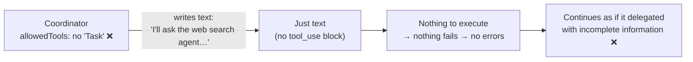
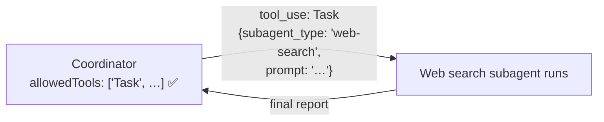

# Q36 — Coordinator talks about delegating, but no subagent ever runs

**Domain / lesson:** D1 › 1.3 Subagent Invocation and Context Passing
**Also touches:** D1 › 1.1 Agentic Loops (only a `tool_use` acts; text is just text) · D2 › 2.3 Tool Distribution (allowed tools)
**Scenario:** the multi-agent research system (coordinator + four subagents)
**Follows:** [Q04](../Q04-tool-scoping-per-subagent/question.md) (tool scoping) · [Q13](../Q13-agentic-loop-model-decides-next-tool/question.md) (agentic loop) · [Q10](../Q10-missing-context-in-subagent-prompt/question.md) (match the symptom exactly)

## Question

The coordinator agent has AgentDefinitions configured for all four specialized subagents, each with appropriate descriptions, prompts, and tool restrictions. During testing, you notice the coordinator correctly reasons about when to delegate – it generates messages like "I'll ask the web search agent to find sources on this topic" – but no subagent execution ever occurs. The coordinator then proceeds as if the delegation happened and continues with incomplete information. Logs show no errors. What is the most likely cause?

- **A.** The coordinator's max_tokens setting is too low, causing the Task tool invocation to be truncated before the subagent type parameter can be specified.
- **B.** The coordinator's allowedTools configuration doesn't include "Task", so while it can reason about delegation, it cannot invoke the tool required to spawn subagents.
- **C.** The AgentDefinitions are configured correctly, but the coordinator's system prompt doesn't explicitly list the available subagent types, preventing the model from knowing they can be invoked.
- **D.** Subagent context isolation means task descriptions from the coordinator don't automatically reach subagents; you need to configure explicit context forwarding in ClaudeAgentOptions.

## Answer: **B**

## Diagram

### Now: the coordinator can *say* "delegate" but can't *do* it



### Fix: with "Task" allowed, the delegation becomes a real tool call



Sketch of the configuration (Python Agent SDK; the exam guide calls the tool `"Task"`):

```python
options = ClaudeAgentOptions(
    allowed_tools=["Task"],   # without this, the coordinator can't spawn anyone
    agents={
        "web-search": AgentDefinition(
            description="Finds and ranks web sources on a topic.",
            prompt="You are a web research specialist…",
            tools=["WebSearch", "WebFetch"],
        ),
        # … document analysis, synthesis, report generation
    },
)
```

## Concept

**Saying is not doing.** In the agentic loop (Q13), an action happens **only** when the model emits a `tool_use` block for a tool it's allowed to use. "I'll ask the web search agent…" is **just text**. Without `Task` in `allowedTools`, the coordinator can **reason about** delegation (the AgentDefinitions tell it which subagents exist), but it has no way to **perform** it.

**Read the three clues:**

| Clue in the question | What it tells you |
|---|---|
| "correctly reasons about when to delegate", naming **the web search agent** | It **knows** the subagents, so the definitions and descriptions are fine (this rules out C) |
| "no subagent execution **ever** occurs" | Not occasional or partial: something is **missing**, not flaky (rules out A) |
| "Logs show **no errors**" | Nothing was **attempted**, so nothing failed. A missing tool fits. A failed call would leave a trace |

Then **"proceeds as if the delegation happened"**: the model "decided" to delegate, wrote about it, and carried on. Nothing in the loop tells it the delegation never happened.

Guide 1.3: the requirement is **yes or no**. Without `Task`, *"the coordinator cannot invoke any subagent, however the subagents are defined."*

### Current-state note (not needed for the exam)
- Claude Code renamed the tool **`Agent`** in v2.1.63. The guide says to answer **"Task tool"** on the exam, because exam guide v1.0 uses that name.
- In the current SDK, `allowedTools` is the **auto-approve** list. Per the guide, omitting `Agent` *"does not remove the tool"*, but *"in an unattended run, that callback denies the spawn."* The practical result is the same: no subagent runs.
- To check from logs: look for `tool_use` blocks named `"Task"` or `"Agent"` (SDK docs: it appears as `"Agent"` in `tool_use` blocks and as `"Task"` in the `system:init` tools list).

## Why the others are wrong

| Option | Why not |
|---|---|
| **A** `max_tokens` too low, truncating the Task call | **Doesn't fit "ever" or "no errors".** Truncation depends on output length, so it would be **intermittent**, and it shows up as `stop_reason: "max_tokens"` with an incomplete tool call, which is a visible trace. It also wouldn't cut off "exactly before the subagent type" every single time. And a coordinator whose `allowedTools` includes Task would at least *start* a tool call. Here there's only text. |
| **C** The system prompt doesn't list the subagent types | **The symptom contradicts it.** The coordinator *does* know the subagents: it names "the web search agent" and reasons correctly about when to use it. The AgentDefinition **descriptions** are how it learns about them (guide: *"The coordinator reads it to decide when to invoke the subagent"*), so there's no need to repeat them in the system prompt. Knowledge isn't the gap. The **ability to invoke** is. |
| **D** Context isolation; configure "explicit context forwarding" | **Wrong symptom, and the mechanism doesn't exist.** Context isolation is real (1.3), but it causes subagents that **run with missing information**, not subagents that **never run**. And there is no "context forwarding" setting. The coordinator passes context by **writing it into the Task prompt** (*"A subagent receives only what the coordinator writes into the subagent's prompt"*). This is the Q10/Q12 family: no automatic sharing, no inheritance. |

## Pattern to remember

> **"The coordinator talks about delegating, but no subagent ever runs, and there are no errors" → `Task` is missing from `allowedTools`.** The model can describe any action, but it can only *perform* actions through tools it's allowed to call.

**Symptom → cause map** (match the symptom *exactly*, as in Q10):

| Symptom | Likely cause |
|---|---|
| Talks about delegating, **no subagent ever runs**, no errors | `Task` not in the coordinator's `allowedTools` (Q36) |
| Subagent **runs** but says "no findings / sources were provided" | Coordinator didn't **write** the context into the Task prompt (Q10) |
| Subagent runs but calls **another role's tools** | Tool scoping too broad (Q04) |
| Subagents run **one at a time** when they could run in parallel | Coordinator doesn't emit **multiple Task calls in one response** (1.3) |

### Where this comes from in the guide

**D1 › 1.3 Subagent Invocation and Context Passing:**
- *"The Task tool is how a coordinator spawns subagents."*
- *"The coordinator's `allowedTools` must include "Task" (or "Agent", its name in Claude Code since v2.1.63)."*
- *"This is a yes-or-no requirement."* · *"With neither name on the list, the coordinator has no way to invoke subagents at all."*
- Key concept: *"the coordinator cannot invoke any subagent, however the subagents are defined."* This is why C (and even perfect AgentDefinitions) can't help.
- An AgentDefinition specifies a description, a system prompt and tool restrictions. For the description: *"The coordinator reads it to decide when to invoke the subagent."*
- *"A subagent receives only what the coordinator writes into the subagent's prompt."* · *"There is no automatic context inheritance."* This is why **D**'s "forwarding config" isn't a thing.
- *"Exam guide v1.0 uses the name Task tool, so answer "Task tool" even where current code shows `Agent`."*

**Claude Agent SDK docs, Subagents** (checked 2026-10-30): *"Claude invokes subagents through the `Agent` tool."* The examples put `"Agent"` in `allowed_tools`, and *"The tool appears as "Agent" in `tool_use` blocks but as "Task" in the `system:init` tools list."*

## How this connects to earlier questions

| Question | Link |
|---|---|
| [Q13](../Q13-agentic-loop-model-decides-next-tool/question.md) | The loop acts only on `tool_use` blocks. Text like "I'll ask…" executes nothing |
| [Q04](../Q04-tool-scoping-per-subagent/question.md) | Tool scoping cuts both ways: too many tools → misuse; a missing tool → the action is impossible |
| [Q10](../Q10-missing-context-in-subagent-prompt/question.md) | Symptom matching: "runs but has no input" (Q10) ≠ "never runs" (Q36) |
| [Q07](../Q07-context-flows-through-coordinator/question.md) / [Q12](../Q12-include-complete-findings-in-prompt/question.md) | Context reaches subagents only via the coordinator's prompt, which is why D's "forwarding config" is fake |
| [Q06](../Q06-coordinator-gap-loop/question.md) | A coordinator that carries on with incomplete information should detect the gaps, not assume success |

## Check question

**Different symptom: the web search subagent *does* run, but replies "No topic or search criteria were provided." Which cause does that point to, and how is it different from Q36's?**

*My answer:* "Coordinator formulates no task." ✅ **Right cause: context passing (Q10).** Two additions:
1. **Precision:** it's not that there's *no task*. The coordinator **did** call Task, since the subagent ran, but the **prompt it wrote** left out the topic and criteria. ("No task" could also describe Q36, where there was no Task call at all.)
2. **The contrast with Q36** (the second half of the question):

| | Q36 | This symptom (Q10 family) |
|---|---|---|
| Did the coordinator call Task? | ❌ No. It couldn't (Task not allowed) | ✅ Yes |
| Did the subagent run? | ❌ Never | ✅ Yes |
| What's missing? | The **ability** to call: `Task` not in `allowedTools` | The **content**: the Task prompt lacks the topic/criteria |
| Fix | Add `"Task"` to `allowedTools` (configuration) | The coordinator writes the full context into the Task prompt, plus a handoff gate that checks it's non-empty (Q10) |
| Where you see it in the logs | No `tool_use` blocks named `Task`/`Agent` | A `Task` call exists, but its `prompt` input is thin or empty |

> **Never runs → it *can't call* (permissions). Runs but clueless → it *didn't tell* (context).**

### Follow-up check question

**A third symptom: all subagents run and get the right context, but one at a time, so the research takes about 4× longer than it should. What's the cause, and the fix?**

*My answer:* "Sequential vs. parallel?" 🟡 **Right diagnosis, but the fix needs the mechanism.** "Sequential instead of parallel" names the problem. The exam asks *how* the coordinator runs subagents in parallel:

- **Cause: sequential spawning.** The coordinator emits **one Task call per turn**. Guide 1.3: *"Sequential spawning means one subagent per coordinator turn. The second subagent cannot start until the first has returned and the coordinator takes another turn."*
- **Fix: one response with several Task calls.** *"When a coordinator needs several subagents for independent tasks, it should emit multiple Task tool calls in a single response."*
- **Condition: only for independent tasks.** *"When the tasks are independent, that wait adds latency with no benefit."*
- **In the logs:** each coordinator response contains just **one** `Task` `tool_use` block. With the fix, a single response contains all of them.

| | Sequential (now) | Parallel (fix) |
|---|---|---|
| Coordinator turn 1 | `Task(A)` → waits | `Task(A)`, `Task(B)`, `Task(C)`, `Task(D)` |
| Turn 2 | `Task(B)` → waits | All four results come back together |
| Turns 3–4 | `Task(C)`, then `Task(D)` | (coordinator already synthesising) |
| Wall-clock time | ≈ 4 × one subagent | ≈ the slowest subagent |

**Exam signal:** options that say *"in a single response"* or *"simultaneously"* mean parallel spawning. **Exam trap:** *"Proposing sequential subagent invocation for tasks that can run independently."*

> **Independent → one response, many Task calls. Dependent → wait for the result, then pass it on in full (Q10).**

**All three Q36 symptoms:**

| Symptom | Cause | Fix |
|---|---|---|
| Never runs | Can't call: `Task` not in `allowedTools` | Configuration |
| Runs but clueless | Didn't tell: thin Task prompt | Full context in the prompt (Q10) |
| Runs, but one at a time | Didn't batch: one Task call per turn | Multiple Task calls in one response |

### Follow-up check question 2

**The coordinator needs three subagents: web search, document analysis, and synthesis (which writes the report from the other two's findings). Which can go in the same response, which must wait, and why?**

*My answer:* "Synthesis has to wait." ✅ **Right split.** By implication, web search and document analysis go **together in one response**. The *why* was missing, though:

**Synthesis's input *is* the other two's output.** A subagent gets context only through its Task prompt (Q10), and that prompt is written **when the Task call is made**. If synthesis were spawned in turn 1, the findings wouldn't exist yet, so there would be nothing to write into its prompt. Guide 1.3: *"If it needs web search results and document analysis output, the coordinator must pass both in full."*

| Coordinator turn | Task calls | Why |
|---|---|---|
| 1 | `Task(web search)` + `Task(document analysis)` | Independent. Neither needs the other's output, so one response |
| 2 | `Task(synthesis)`, with both outputs **in full** in its prompt (plus claim→source mapping, Q02) | Dependent. It can only be written once both results are back |

That's **2 rounds instead of 3**: run what's independent in parallel, and only wait where there's a real dependency.

> **Parallel where independent, sequential where dependent. The test: "does this Task prompt need another subagent's output?"**

### Follow-up check question 3

**An exam option says: "Spawn all three subagents in a single response to minimise latency, and instruct the synthesis subagent to wait for the other two to finish." Why is that wrong?**

*My answer:* (pending)

## Glossary

- **Task tool (`Agent` in current Claude Code):** the tool a coordinator calls to spawn a subagent. Its input names the subagent type and carries the prompt (the subagent's only context).
- **`allowedTools`:** the list of tools an agent may use (in the current SDK, the tools it may use without asking for approval). A coordinator without `Task` on it can't delegate.
- **AgentDefinition:** the configuration of one subagent: description (when to use it), prompt (how it behaves) and tools (what it may use).
- **Narrated action / hallucinated delegation:** the model *writes about* doing something ("I'll ask the web search agent…") without a tool call, then carries on as if it happened.

## Related course lessons

*Lecture lengths aren't recorded in the study-map files, so the watch times below are estimates from each course's average lecture length.*

### Udemy A (primary): Claude Certified Architect (CCAR-F) - 2026 Exam Prep
| # | Lecture | Part | Why |
|---|---|---|---|
| **75** | **Creating and Configuring Custom Subagents** | 3C | ⭐ AgentDefinitions and the tool that spawns them |
| **4** | **Tool Use as the Foundation of Agency** | 1A | ⭐ No tool → no action, only talk |
| 16 | The Orchestrator Role | 1C | What the coordinator must be able to do |
| 17 | Subagent Design — Scope, Authority, and Isolation | 1C | Isolation (why D's "forwarding" is wrong) *(also in Q02)* |
| 76 | Designing Subagents for Delegation | 3C | Descriptions drive delegation (why C is wrong) |
| 39 | Tool Scoping per Agent — Why Less Is More | 2A | Allowed tools per agent |
| Quiz 3, Quiz 10 | 1C and 3C quizzes | | Self-test |

**▶ Watch in this order (~40 min, est.):** #4 → #16 → #17 → #75 → #76 → #39, then do **Quiz 3** and **Quiz 10**.
(agency needs tools → orchestrator → isolation → configuring subagents → delegation → tool scoping → self-tests)

### Udemy B: Claude Certified Architect Foundations: Complete Course (Voroniuk)
| # | Lecture | Section | Why |
|---|---|---|---|
| **62** | **Spawning Subagents with Task** | S7 Multi-Agent | ⭐ Exactly this question |
| **65** | **Practice: Coordinator and Subagents in Code** | S7 Multi-Agent | ⭐ The configuration, including `allowedTools` |
| 38 | The Agentic Loop on stop_reason | S5 Tools & MCP | Only `tool_use` acts; text doesn't |
| 60 | The Coordinator Pattern | S7 Multi-Agent | The coordinator's role |
| 63 | Scoping Each Agent's Tools | S7 Multi-Agent | Allowed tools per agent |
| 64 | Passing Context Between Agents | S7 Multi-Agent | Why D is wrong *(also in Q01–Q03)* |
| Quiz 7 | Multi-Agent Systems quiz | S7 | Self-test |

**▶ Watch in this order (~30 min, est.):** #38 → #60 → #62 → #63 → #65 → #64, then do **Quiz 7**.

### CBT Nuggets: CCA-F course
| Skill | Why |
|---|---|
| **38. Build a Skill-Aware Agent** | Configuring what an agent can invoke (1.3, partial) |
| 36. Design Workflows and Agent Systems | Coordinator + subagents architecture |
| 20. Handle Tool Calls and Tool Results | Only tool calls execute |
| 39–40. Build an Agentic Multimedia Article System | Hands-on multi-agent build |

*CBT is only partial on 1.3 (🟡). Use Udemy B #62 and #65 first.*
