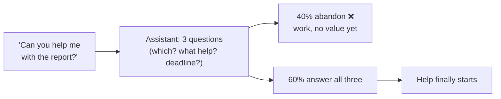
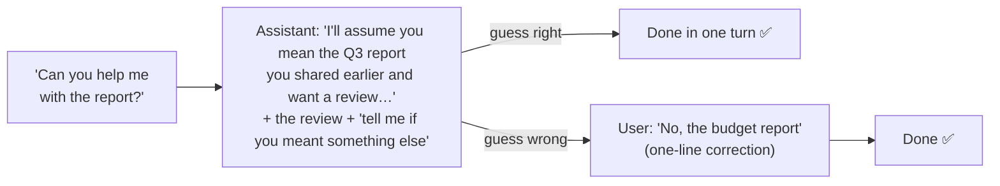

# Q37 — Too many clarifying questions: assume, state it, offer to adjust

**Domain / lesson (closest fit):** D5 › 5.2 Escalation & Ambiguity Resolution
**Also touches:** D4 › 4.1 System Prompts with Explicit Criteria (the fix lives in the system prompt)
**Note:** the guide's 5.2 covers ambiguity only for **high-stakes** cases (several matching customer records → *"Asking for clarification is the only safe response"*). It doesn't cover the low-stakes case asked here. I checked 5.2 and 4.1 on 2026-10-31. The "assume and proceed" behaviour comes from **Anthropic's prompting best practices** (Tool use section, `default_to_action` prompt).
**Scenario:** general conversational assistant
**Follows:** [Q16](../Q16-escalation-triggers/question.md) (instruct the judgment) · [Q31](../Q31-refund-threshold-hook/question.md) (when a prompt is *not* enough) · [Q18](../Q18-meaningful-confirmation/question.md) (people can only correct what they can see)

## Question

Your conversational assistant frequently generates multiple clarifying questions when users make ambiguous requests. When a user asks "Can you help me with the report?", the assistant responds: "I'd be happy to help! Could you tell me: 1) Which report? 2) What kind of help – drafting, reviewing, or formatting? 3) What's your deadline?"
User analytics show a 40% conversation abandonment rate after these multi-question responses. What's the most effective way to reduce friction while appropriately handling ambiguity?

- **A.** Limit the assistant to one clarifying question per turn, using conversation history to accumulate answers over multiple exchanges rather than requesting everything upfront.
- **B.** Add a preprocessing step using a smaller model to classify request ambiguity on a 1-5 scale, routing high-ambiguity requests to a clarification dialog and low-ambiguity requests directly to the assistant.
- **C.** Modify the system prompt to instruct the assistant to make reasonable assumptions from available context, state those assumptions explicitly, and offer to adjust if the interpretation is wrong.
- **D.** Create a lookup table of common request patterns with predefined default interpretations, having the assistant respond with those defaults without stating the assumptions made.

## Answer: **C**

## Diagram

### Now: questions before any help

### Fix (C): help first, with the guess visible

Example reply under C:

> *"Happy to help! I'll assume you mean the Q3 sales report you shared earlier and that you'd like a review. Here are my main suggestions: … If you meant a different report, or you'd rather I draft or format it, just say so."*

## Concept

**Find the cause of the friction:** the assistant makes the user **do work before getting any value**. Three questions means three answers to type before anything happens, and 40% give up.

**C replaces "ask, then help" with "help, and show the guess".** Each of its three parts has a job:

| Part of C | What it does | Without it |
|---|---|---|
| **1. Reasonable assumptions from available context** | Progress now: uses what's already known (files shared, earlier messages, the user's usual tasks) | Interrogation (the current problem) |
| **2. State the assumptions explicitly** | The user can **see** the interpretation, so a wrong guess is obvious | Silent wrong answers (option **D**) |
| **3. Offer to adjust** | The user stays in control; a correction costs one line, not three answers | The user feels stuck with the guess |

**C handles ambiguity *and* reduces friction.** Ambiguity isn't ignored: it's turned into a visible guess the user can correct. That's the "appropriately handling ambiguity" half of the question.

**But not every ambiguity should be guessed.** The deciding question is **what a wrong guess costs**:

| | Q37: "help with the report" | Guide 5.2: three "John Smith" records |
|---|---|---|
| Cost of a wrong guess | One correction message | Privacy violation or a refund on the wrong account |
| Reversible? | Yes, instantly | No |
| Right move | **Assume + state + offer to adjust** | **Ask** for an identifier. *"It must never pick one itself."* |

**Why a system-prompt fix is fine here** (unlike Q31): apply Q31's determinism test, *"can the model's choice make the rule fail?"* Yes, sometimes. But here a failure costs a one-line correction, not money or compliance, and choosing a sensible interpretation is a **judgment** call. Q16: *instruct the judgment, gate the numbers.*

## Why the others are wrong

| Option | Why not |
|---|---|
| **A** One clarifying question per turn | **The same interrogation, spread out.** The three questions now take three round trips before any help, so there are *more* turns in which to give up. It shrinks the wall of text, but the user still works before getting value. "Using conversation history to accumulate answers" is just how chat works, not a fix. And it never uses context to **avoid** a question. The most tempting distractor, because it looks like it reduces friction. |
| **B** Smaller model scores ambiguity 1–5, routes high scores to a clarification dialog | **Over-engineered, and it still interrogates.** "Can you help me with the report?" would score as highly ambiguous, so it gets routed to the very clarification dialog that causes the 40% abandonment. It adds a model call (latency, cost, another failure point) and relies on a model's self-assessed score, the kind of uncalibrated number the guide warns about (5.2: *"LLM self-confidence is poorly calibrated"*; Q16, Q21). It **sorts** requests but doesn't change the **response**. Same family as the routing-classifier distractors in Q23 and Q30. |
| **D** Lookup table of default interpretations, **without stating the assumptions** | **Hidden guesses.** When a default is wrong, the user gets an answer that's off and can't tell why, so they can't correct it cheaply, and trust erodes. The table is also rigid: it ignores the actual context (the report the user mentioned two minutes ago). D is C **minus transparency**, and "without stating the assumptions" is the giveaway. Like Q33's disguised errors: *a wrong answer that looks right is worse than an honest one.* |

## Pattern to remember

> **Ambiguous but cheap to correct → assume from context, state the assumption, offer to adjust. Ambiguous and costly or irreversible (which customer, which account) → ask; never guess (5.2).**

**Exam signal:** "reduce friction **while** appropriately handling ambiguity" names two goals. Pick the option that makes progress now (friction) **and** keeps the guess visible and correctable (ambiguity). Distractors: spread the questions out (A), classify and route (B), silent defaults (D).

### Where this comes from

**Anthropic, Prompting best practices › Tool use** (platform.claude.com, checked 2026-10-31). The sample `default_to_action` system prompt:
- *"If the user's intent is unclear, infer the most useful likely action and proceed, using tools to discover any missing details instead of guessing."* This is C's "reasonable assumptions from available context".
- The docs also show the opposite steering (`do_not_act_before_instructions`): *"When the user's intent is ambiguous, default to providing information, doing research, and providing recommendations rather than taking action."* Either way, how to handle ambiguity is **set in the system prompt**, which is C's mechanism.

**Guide D5 › 5.2 Escalation & Ambiguity Resolution** (the high-stakes boundary):
- *"The agent must then ask for additional identifiers: email address, phone number, order number"* … *"It must never pick one itself."*
- *"Picking the wrong customer risks a privacy violation (exposing one customer's data to another)"* … *"or an incorrect action (a refund on the wrong account)."*
- *"Asking for clarification is the only safe response."*
- Exam trap: *"Self-reported confidence scores provide a reliable escalation signal"*: *"LLM self-confidence is poorly calibrated."* (B's 1–5 score)

**Guide D4 › 4.1 System Prompts with Explicit Criteria:**
- *"Explicit categorical criteria always outperform vague instructions and confidence-based filtering."* A good C-style prompt says **when** to assume (cheap to correct) and **when** to ask (costly or irreversible), instead of "use your judgment".

## How this connects to earlier questions

| Question | Link |
|---|---|
| [Q16](../Q16-escalation-triggers/question.md) | "Instruct the judgment, gate the numbers." Picking an interpretation is judgment, so the system prompt is the right layer. Also: self-reported scores are unreliable (B) |
| [Q31](../Q31-refund-threshold-hook/question.md) | The contrast: a prompt that fails 3% is unacceptable for $500 refunds (hook). Here a failure costs one correction, so a prompt is enough |
| [Q18](../Q18-meaningful-confirmation/question.md) | People can only correct what they can see. Stating the assumption = showing the details (D hides them) |
| [Q33](../Q33-mcp-iserror-result/question.md) | D's silent default ≈ a disguised error: a wrong answer that looks right |
| [Q23](../Q23-expand-minimal-tool-descriptions/question.md), [Q30](../Q30-split-generic-analyze-document/question.md) | B's family: a pre-routing classifier bolted on instead of fixing the behaviour itself |

## Check question

**Same assistant. A user says "Cancel my subscription", and they have two active subscriptions (Premium and Cloud Storage). Should the assistant assume and state its guess, or ask? Why?**

*My answer:* "Assume, but state the assumption to the user, giving them a chance to correct it." ❌ **Here it should ask.** Keeping the user in control is the right instinct, but this case fails both conditions that made C right:

| | Q37: "help with the report" | "Cancel my subscription" (two of them) |
|---|---|---|
| What the guess leads to | **Output** (a review). Nothing changes in the world | **An action**: a subscription is cancelled |
| Wrong guess costs | One correction message | Premium lost (maybe a price you can't get back), or Cloud Storage files scheduled for deletion |
| When "offer to adjust" comes | In time: nothing has happened yet | **Too late**: the cancellation already ran |
| Basis for a "reasonable assumption" | Context points to one report (shared earlier) | **None.** Two equal matches, so any pick is a coin flip |

This is guide 5.2's "three John Smiths" case: several matches for an **action**, so *"It must never pick one itself"*, ask for what tells them apart.

**"State the guess before acting, then wait" isn't the fix either.** *"I'll cancel Premium, OK?"* is a confirmation with a guessed default, and users tend to approve those quickly without noticing it's the wrong one (Q18's 98%-in-2-seconds). Asking which one is just as short and avoids that.

**The right reply: one targeted question, with the details that matter (Q18):**
> *"Which one would you like to cancel: Premium ($12/month, renews 15 Nov) or Cloud Storage (200 GB; your files are kept for 30 days after cancelling)?"*

That's one question, not an interrogation. A's "one question" idea is fine **when asking is the right move**. In Q37 it was wrong because the assistant didn't need to ask at all.

> **Assume for what you *say*. Ask before what you *do*, when a wrong guess changes something that's hard to undo.**

### Follow-up check question

**Variation: the user has only one subscription and says "Cancel my subscription." There's nothing to clarify now. Should the assistant just cancel it straight away, or is there still something to do first?**

*My answer:* "It might ask for confirmation, stating the consequences." ✅ **Correct, and "stating the consequences" is the key part.** Two points of precision:

1. **This is a confirmation, not a clarifying question.** Nothing is unclear about *what* the user wants. What's at stake is whether they know *what will happen*. A clarifying question asks **"which one?"** (ambiguity). A confirmation asks **"are you sure, given this?"** (irreversibility).
2. **The confirmation must carry the details** (Q18), or it becomes a rubber stamp. "Are you sure?" alone gets a reflex "yes".

> *"Just to confirm: cancelling Premium ends it on 15 Nov, when your paid period runs out. After that you'll lose ad-free listening and offline downloads, and if you rejoin later the price is $15/month instead of your current $12. Cancel it?"*

**"Might" → "should"** whenever the action is hard to undo. If the business **requires** confirmation every time, enforce it in code (a PreToolUse hook that asks before `cancel_subscription` runs, Q18/Q31) rather than relying on the prompt.

**The full picture across Q37 and its check questions:**

| | Cheap / easy to undo | Costly / hard to undo |
|---|---|---|
| **Unclear what the user means** | **Assume + state + offer to adjust** (Q37: "help with the report") | **Ask** one targeted question (two subscriptions; 5.2's John Smiths) |
| **Clear what the user means** | **Just do it** | **Confirm, showing the consequences** (one subscription; Q18) |

> **Unclear → resolve the meaning (assume or ask, by cost). Costly → make sure the user sees the consequences before acting.**

### Follow-up check question 2 (optional)

**A user says "Delete my old drafts." They have 40 drafts, and 12 are over a year old. Which cell of the grid is this, and what should the assistant reply?**

*Skipped (moved on to Q38).* Answer: **Unclear + costly.** "Old" could mean the 12 over a year, or anything older than a month, and deletion is hard to undo. So don't guess and delete. Unlike the two subscriptions (a coin flip), the context *does* suggest a likely reading, so the assistant can propose it **as a question, with the details visible** (Q18), resolving the meaning and confirming in one reply:
> *"Do you mean these 12 drafts from before Nov 2025? (lists titles and dates) Deleting them is permanent. Delete these 12, or did you mean a different cut-off?"*

## Glossary

- **Clarifying question:** a question the assistant asks before acting, to resolve what the user meant. Useful when a wrong guess is costly; friction when it isn't.
- **Stated assumption:** the assistant's interpretation, said out loud ("I'll assume you mean…"), so the user can spot and correct a wrong guess.
- **Conversation abandonment:** the user leaves before the task is done. Here, 40% after a multi-question reply.
- **Cost of a wrong guess:** what happens if the interpretation is wrong. Cheap and reversible → assume + state. Costly or irreversible → ask.
- **Silent default:** a predefined interpretation applied without telling the user (option D). When it's wrong, nobody can see why.

## Related course lessons

*Lecture lengths aren't recorded in the study-map files, so the watch times below are estimates from each course's average lecture length.*

### Udemy A (primary): Claude Certified Architect (CCAR-F) - 2026 Exam Prep
| # | Lecture | Part | Why |
|---|---|---|---|
| **15** | **Handling Ambiguity and Incomplete Specifications** | 1B | ⭐ The core topic: what to do with an unclear request |
| **119** | **Disambiguation Patterns** | 5B | ⭐ When to ask vs. when to proceed (the 5.2 boundary) |
| 83 | Clarity, Specificity, and the Cost of Ambiguity | 4A | Ambiguity in prompts and its cost |
| 85 | The System Prompt | 4A | Where C's fix lives |
| Quiz 2, Quiz 16 | 1B and 5B quizzes | | Self-test |

**▶ Watch in this order (~30 min, est.):** #15 → #119 → #83 → #85, then do **Quiz 2** and **Quiz 16**.
(what to do with ambiguity → ask vs. proceed → why ambiguity costs → where the behaviour is set → self-tests)

### Udemy B: Claude Certified Architect Foundations: Complete Course (Voroniuk)
| # | Lecture | Section | Why |
|---|---|---|---|
| **53** | **When Not to Escalate** | S6 Support Agent | ⭐ Resolve it yourself when you can (the "proceed" side) |
| **14** | **Practice: System Prompt Rules vs Code Rules** | S2 API Basics | ⭐ Why a prompt fix is enough here but not in Q31 |
| 52 | When to Escalate to a Human | S6 Support Agent | The high-stakes side, for contrast |
| 20 | Explicit Criteria That Reduce False Positives | S3 Prompt Engineering | Write *when to assume / when to ask* as explicit criteria |
| Quiz 6 | Support Agent quiz | S6 | Self-test |

**▶ Watch in this order (~20 min, est.):** #53 → #14 → #52 → #20, then do **Quiz 6**.

### CBT Nuggets: CCA-F course
| Skill | Why |
|---|---|
| **14. Apply System Prompts and Temperature** | ⭐ Setting assistant behaviour in the system prompt |
| 17. Design Clear Prompts with Examples | Writing the assume/ask criteria clearly |

*CBT doesn't cover 5.2 (see the study map), so use the guide and the Udemy lectures for the ask-vs-assume boundary.*
