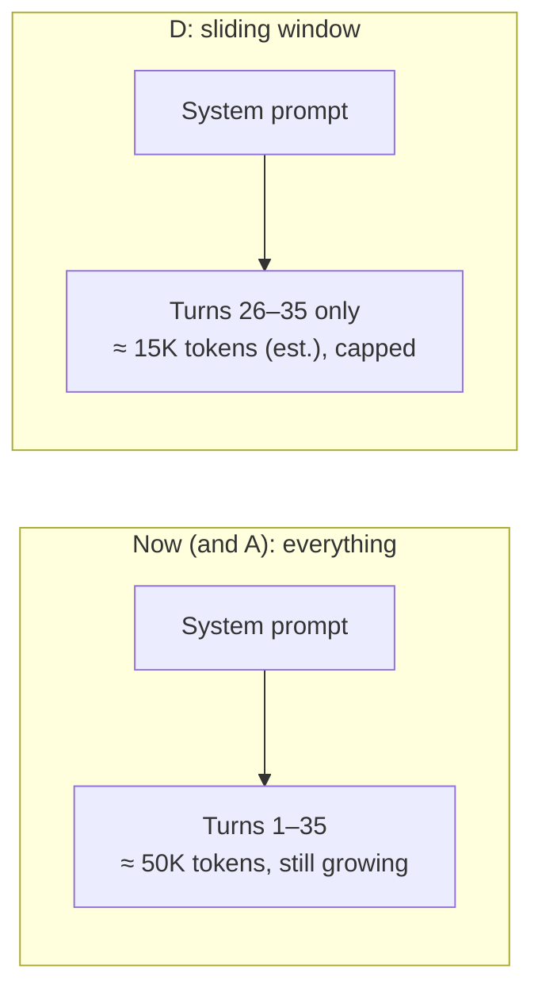
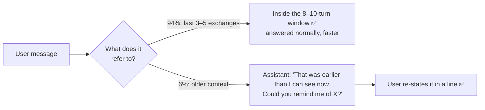

# Q38 — Long conversations slow down: size the context from the usage data

**Domain / lesson:** D5 › 5.1 Context Window Management
**Scenario:** general conversational assistant (same as [Q37](../Q37-state-assumptions-not-interrogate/question.md))
**Follows:** [Q37](../Q37-state-assumptions-not-interrogate/question.md) (be open about limits) · [Q02](../Q02-context-passing-source-index/question.md) (complete ≠ everything) · [Q03](../Q03-crash-recovery-state-manifest/question.md) (semantic search ≠ exact state)

## Question

After 30+ turns, your conversational assistant shows noticeably slower responses and occasionally produces less coherent outputs. Investigation reveals: (1) average conversations reach 50,000 tokens by turn 35, (2) production logs show 94% of user messages only reference the previous 3-5 exchanges, (3) the 6% of queries referencing earlier context typically ask about information the user could easily re-state. Your goal is to improve response speed and quality while maintaining good user experience. What's the most effective approach?

- **A.** Enable prompt caching and continue sending the complete conversation history, using cached prefixes to reduce per-request costs while preserving all context.
- **B.** Build a retrieval system that stores all conversation turns and uses semantic search to pull in relevant historical context only when the current query appears to reference past information.
- **C.** Implement a summarization layer that progressively compresses older conversation turns into a running summary while keeping the most recent 5-6 turns verbatim, maintaining full historical context in condensed form.
- **D.** Implement a sliding window keeping only the system prompt and last 8-10 turns. When users reference earlier context, acknowledge the limitation and ask them to re-state the relevant information.

## Answer: **D**

## Diagram

### What each request carries at turn 35



### What happens to the two kinds of messages



*(≈ 15K is an estimate: 50K ÷ 35 turns ≈ 1.4K per turn × 10 turns, plus the system prompt.)*

## Concept

**Read the data before the options.** The question gives three facts, and each one is there for a reason:

| Fact | What it tells you |
|---|---|
| (1) 50K tokens by turn 35 | The cause: a huge, ever-growing input → slower responses and diluted attention (less coherent) |
| (2) 94% only reference the last 3–5 exchanges | Almost all of those 50K tokens are **never used** |
| (3) The 6% could easily be re-stated | Dropping the old turns costs the user very little |

Together they point to the simplest fix: **send only what's actually used**, with a margin (8–10 turns, about twice the 3–5 exchanges referenced), and **say so openly** in the rare case something falls outside.

**Why D improves both goals:**
- **Speed:** each request is a fraction of the size, and it **stays capped**, whether at turn 35 or turn 135.
- **Quality:** the model no longer works through 35K+ tokens of irrelevant history. The guide's *"lost in the middle"* point: *"A model may miss findings in the middle of a long context, or may give them less weight."*
- **UX:** the acknowledgment is honest. Without it, the model might **guess** at what was said earlier. Same idea as Q37: show the limit, don't hide it.

**"But the guide says to keep the complete history"?** Lesson 5.1 does warn that *"When you omit earlier messages, the model loses conversational coherence"*, and calls selective truncation a trap. That warning is about dropping what the conversation **still depends on**. Here the logs prove the old turns aren't used (94%), and the window keeps twice what is. The trap is trimming **without evidence**. D trims **from evidence**.

**Where D would need more:** if the conversation held **transactional facts** (order IDs, amounts, dates), you'd add the guide's **persistent case facts block**, kept in every prompt outside the trimmed history (see the check question).

## Why the others are wrong

| Option | Why not |
|---|---|
| **A** Prompt caching + keep sending the full history | **A cost tool used for a quality problem.** Caching avoids paying to re-process the unchanged prefix (guide 5.1: *"lets you avoid paying to reprocess the parts that do not change"*), and the option itself says its aim is *"reduce per-request costs"*. But the goals are **speed and quality**. The model still reads all 50K tokens, so the coherence problem stays, and the history keeps growing. "Preserving all context" preserves exactly the 94% that's never used. |
| **B** Store every turn, semantic search when a query "appears to reference" the past | **Heavy machinery for the 6% that users can easily re-state.** It adds an embedding + search step to requests (slower, not faster), and depends on detecting when a query "appears to" refer back, which is a guess. When it misses, you get D's situation, but without the honest acknowledgment. When it misfires, it pulls irrelevant old turns in and hurts quality. Retrieval is also approximate: it finds *similar* text, not *the* right turn (Q03 B). |
| **C** Running summary of older turns + last 5–6 turns verbatim | **Extra work and lossy, for context that isn't needed.** Summarising means extra model calls, and summaries lose the specifics: guide 5.1, summarising *"systematically destroys the most critical information"*, e.g. *"$247.83 for order #8891"* becomes *"a recent order"*. "Full historical context in condensed form" is a contradiction: condensed means lossy. The loss is also **invisible**: the model answers confidently from a vague or wrong summary, where D openly asks. And 5–6 verbatim turns leaves little margin over the 3–5 exchanges users refer to. |

## Pattern to remember

> **Let usage data size the context.** Keep what's actually referenced (with a margin), drop the rest, and be open when something falls outside. Don't add caching, retrieval or summarisation to preserve context nobody uses.

**Exam signal:** when a question gives **usage statistics** ("94% only reference…", "the 6% could easily re-state…"), the numbers are there to justify the **simple, targeted** option. Options that "preserve everything" (A, C) or add machinery for the rare case (B) ignore the data.

**Option-wording signals:**
- "Reduce per-request **costs**" when the goal is speed and quality → mismatched goal (A).
- "**Full** historical context in **condensed** form" → overclaim: condensed means lossy (C).
- "When the query **appears to** reference…" → a probabilistic detector in the critical path (B).

### Where this comes from in the guide

**D5 › 5.1 Context Window Management:**
- *"Multi-turn conversations, multi-agent pipelines and long-document extraction all depend on context window management."*
- *"Models process information at the beginning and end of long inputs reliably."* / *"A model may miss findings in the middle of a long context, or may give them less weight."* Why 50K tokens of mostly unused history hurts quality.
- Summarising earlier turns *"systematically destroys the most critical information"*, e.g. *"$247.83 for order #8891"* → *"a recent order"*. Why C is lossy.
- *"Prompt caching is the other way to control the cost of context"*: it *"lets you avoid paying to reprocess the parts that do not change."* A cost lever, not a quality fix (A).
- *"When you omit earlier messages, the model loses conversational coherence."* The warning D respects by keeping twice the window that users actually reference.
- The persistent case facts block, *"included in every prompt, outside the summarised history"*, is *"the single most important pattern in context window management."* The add-on D needs if there are transactional facts.

## How this connects to earlier questions

| Question | Link |
|---|---|
| [Q37](../Q37-state-assumptions-not-interrogate/question.md) | Same assistant, same principle: be open about what you don't know (state assumptions / acknowledge the window) instead of guessing silently |
| [Q02](../Q02-context-passing-source-index/question.md) | *Complete ≠ everything*: pass what's needed, not the whole history |
| [Q03](../Q03-crash-recovery-state-manifest/question.md) | B's family: semantic search returns *similar* content, not the exact thing you need |
| [Q33](../Q33-mcp-iserror-result/question.md) | C's silent summary loss vs D's honest "please re-state": a visible gap beats a hidden one |
| [extract-first-summarize-second](../../concepts/extract-first-summarize-second.md) | Why summaries drop exact facts, and the fact-block fix |

## Check question

**Same assistant, but now it handles support: at turn 3 the user gave an order number and a refund amount, and by turn 30 the sliding window has dropped those turns. What would you add to D, and why is "ask the user to re-state it" not good enough here?**

*My answer:* "Critical details such as an order ID should be stored." 🟡 **Right direction, but "stored" isn't enough, and the second half is missing.**

**1. Stored *where*: in every prompt, not just in a database.** The API is stateless, so the model only knows what's in the current request. An order ID saved in a database but not sent is invisible to it. The guide's pattern is the **persistent case facts block**: *"included in every prompt, outside the summarised history"*, and *"the single most important pattern in context window management."*

```text
[system prompt]
<case_facts>
customer_id: C-10442
order_id: 8891
refund_amount: $247.83
status: refund approved, awaiting processing
</case_facts>
[last 8–10 turns]
```

The block goes **near the top**, because models attend reliably to the start of long inputs (lost in the middle). The window can drop turns, but the block never drops facts.

**2. Why "please re-state it" fails here:** Q38's fact (3), *"information the user could easily re-state"*, no longer holds:

| Q38 (chat) | Support case |
|---|---|
| Users can easily repeat the information | Users may not remember **exact** values ("#8891"? "$247.83"?) |
| The user said it | Some facts came **from the system** (a tool computed the refund amount), so the user never knew them |
| A slightly wrong re-statement is harmless | A wrong ID → **action on the wrong order** (5.2: wrong refund, privacy risk) |
| Asking feels normal | Asking at turn 30 tells the customer the agent **forgot their case** |

> **Trim the conversation, never the facts.** Conversation → sliding window (can drop). Transactional facts → case facts block (in every prompt).

### Follow-up check question

**Who should write the order ID into the case facts block: the model (told "note down important facts as you go") or code? Why?**

*My answer:* "Code, because it's not probabilistic." ✅ **Correct.** It's Q31's test: *can the model's choice make the rule fail?* Yes. It might forget to note the fact, paraphrase it (*"a recent order"*, the summary loss from 5.1), or mistype a digit. If a wrong ID means a refund on the wrong order, the block must be owned by code.

**Precision: where code gets the values from.** Code can't *understand* a chat message, so it depends on the fact's source:

| Where the fact comes from | Who does what |
|---|---|
| A **tool result** (`lookup_order` returns `order_id`, `amount`) | Code copies the fields straight into the block. Structured tool output makes this reliable (Q35) |
| **Typed by the user** ("my order is 8891") | The model **extracts** it into a schema (structured output, 4.3) → code **validates** it (e.g. a lookup confirms the order exists and belongs to this customer, Q20: valid ≠ correct) → code **writes** it |

> **The model may *find* facts. Code *keeps* them.** (Same as [extract-first-summarize-second](../../concepts/extract-first-summarize-second.md): extract into a schema, save as a persistent fact block.)

## Glossary

- **Sliding window:** sending only the system prompt plus the last N turns. Older turns drop out, so request size stays capped.
- **Prompt caching:** reusing an already-processed, unchanged prompt prefix so you don't pay to process it again. Lowers cost (and some latency), but the model still reads the whole context.
- **Progressive (running) summarisation:** repeatedly compressing older turns into a summary. Saves tokens but loses specifics such as amounts, dates and IDs.
- **Semantic retrieval:** storing past turns as embeddings and pulling in the most *similar* ones for a query. It's approximate, and only fires when something triggers it.
- **Lost in the middle:** models attend best to the start and end of long inputs, and may miss or under-weight what's in the middle.
- **Persistent case facts block:** the key transactional facts (IDs, amounts, dates), extracted and included in every prompt, outside the trimmed or summarised history.

## Related course lessons

*Lecture lengths aren't recorded in the study-map files, so the watch times below are estimates from each course's average lecture length.*

### Udemy A (primary): Claude Certified Architect (CCAR-F) - 2026 Exam Prep
| # | Lecture | Part | Why |
|---|---|---|---|
| **113** | **Trim Strategies** | 5A | ⭐ Option D: which history to drop, and how |
| **108** | **Context Window Economics** | 5A | ⭐ Why 50K tokens per request is slow and costly (and what caching does and doesn't fix) |
| 107 | How the Context Window Works | 5A | The model reads everything you send, every turn |
| 109 | Why Summaries Lose Facts | 5A | Why C is lossy *(also in 5.6)* |
| 110 | Designing a Persistent Fact Block | 5A | The add-on for the check question |
| Quiz 15 | 5A quiz | | Self-test |

**▶ Watch in this order (~35 min, est.):** #107 → #108 → #113 → #109 → #110, then do **Quiz 15**.
(how context works → why it costs → trimming → why summaries lose facts → the fact block → self-test)

### Udemy B: Claude Certified Architect Foundations: Complete Course (Voroniuk)
| # | Lecture | Section | Why |
|---|---|---|---|
| **12** | **Practice: The Conversation Lives in Your Code** | S2 API Basics | ⭐ You decide what history goes in each request |
| **55** | **Trimming Tool Results and Lost in the Middle** | S6 Support Agent | ⭐ Why less context can mean better answers |
| 54 | Case Facts in Long Conversations | S6 Support Agent | The fact block (check question) |
| Quiz 2, Quiz 6 | API Basics and Support Agent quizzes | S2, S6 | Self-test |

**▶ Watch in this order (~15 min, est.):** #12 → #55 → #54, then do **Quiz 2** and **Quiz 6**.

### CBT Nuggets: CCA-F course
| Skill | Why |
|---|---|
| **31. Optimize Prompts with Caching** | ⭐ What caching does (cost of the unchanged prefix), which is why A doesn't fix quality |
| 10. Send Structured Messages to Claude | The full message history goes in every request |
| 26. Explain RAG and Document Chunking | The retrieval machinery behind option B |
