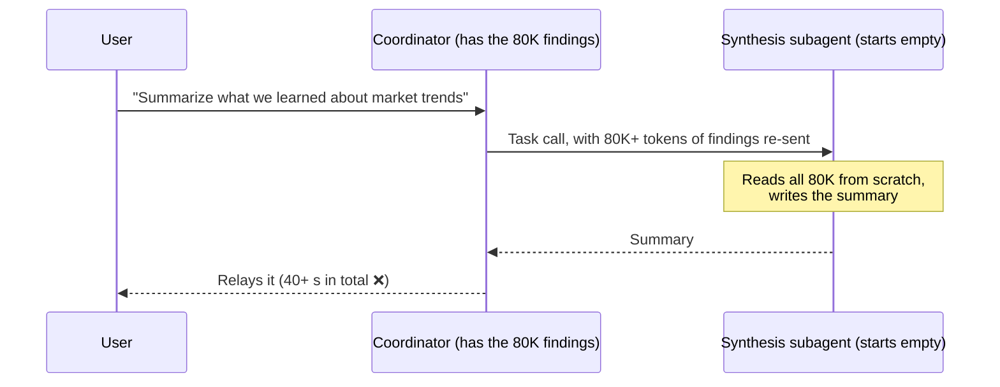
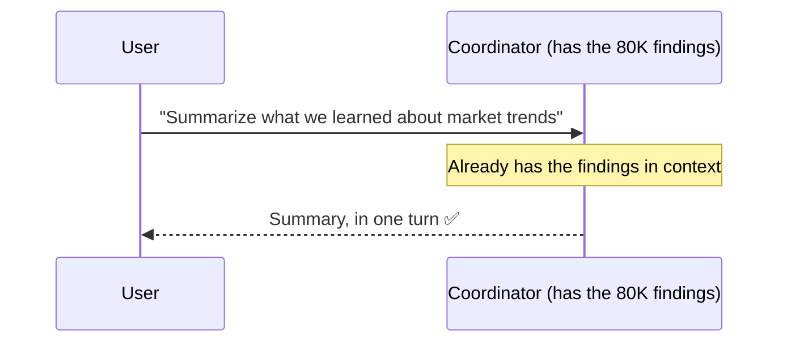

# Q39 — Slow follow-up summaries: don't spawn a subagent you don't need

**Domain / lesson:** D1 › 1.2 Multi-Agent Orchestration
**Also touches:** D1 › 1.3 Subagent Invocation and Context Passing (the cost of re-passing findings) · D5 › 5.1 Context Window Management (caching is a cost lever)
**Scenario:** multi-agent research system (coordinator + web search, document analysis, synthesis subagents)
**Follows:** [Q36](../Q36-coordinator-missing-task-tool/question.md) (latency: parallel spawning) · [Q38](../Q38-sliding-window-recent-turns/question.md) (caching doesn't remove unneeded work) · [Q12](../Q12-include-complete-findings-in-prompt/question.md) (what a synthesis handoff costs when it *is* needed)

## Question

Production monitoring shows that follow-up queries like "summarize what we learned about market trends" consistently take 40+ seconds. Investigation reveals the coordinator spawns the synthesis subagent for each summarization request, passing 80K+ tokens of accumulated findings. The coordinator already has these findings in its context from orchestrating the research. What's the most effective way to improve response time for these follow-up summaries?

- **A.** Enable prompt caching on the synthesis subagent to reduce the overhead of repeatedly transferring the same research findings.
- **B.** Have the coordinator handle straightforward summarization requests directly using its existing context, reserving subagent spawning for complex analysis.
- **C.** Pre-generate and cache summaries at multiple granularities whenever new findings accumulate.
- **D.** Spawn the synthesis subagent with reduced context and have it request specific findings from the coordinator on-demand.

## Answer: **B**

## Diagram

### Now: three steps to summarise what the coordinator already knows

### Fix (B): one step

## Concept

**The giveaway sentence:** *"The coordinator already has these findings in its context."* So the subagent adds nothing the coordinator can't do itself. It only adds:
- a **spawn** (an extra model call, plus a hop back to the coordinator), and
- a **re-transfer**: 80K+ tokens copied into a fresh context that has to read them all from scratch.

**A subagent is worth spawning when it adds something:**

| A subagent adds… | Example |
|---|---|
| **Different tools** | Web search, document access |
| **A fresh, focused context** for a big new job | Writing the full cited report from structured findings (Q01, Q02) |
| **Parallel work** | Several independent searches at once (Q36) |

A follow-up "summarise what we learned" needs none of these. The coordinator has the data, the task is simple, and it's one step. Guide 1.2: *"The coordinator analyses what a query requires and selects only the subagents it needs."* Sometimes that's **none**.

**B fixes the cause; A, C and D speed up the symptom.** The time is spent on an **unnecessary step**. B removes the step. The others keep it and try to make it faster (A), do it in advance (C), or split it into smaller pieces (D).

## Why the others are wrong

| Option | Why not |
|---|---|
| **A** Prompt caching on the synthesis subagent | **Speeds up a step that shouldn't happen.** Caching avoids re-processing an unchanged prefix, but the subagent is still spawned, still runs, and still hands back through the coordinator. Guide 1.2's exam trap, word for word: *"Invoking subagents that a query does not need adds latency and API call overhead, cached or not."* The findings also keep **growing**, so the prefix keeps changing and the cache keeps missing. "Reduce the overhead of transferring" is also inaccurate: caching doesn't avoid sending the tokens, only re-processing them. Same distractor family as Q38 A. |
| **C** Pre-generate summaries at several granularities whenever findings change | **Lots of extra work, mostly wasted.** It runs synthesis *more* often (every time findings change), for summaries nobody may ask for. Follow-ups are free-form ("…about market trends", "…about pricing"), so a pre-made generic summary may not match the question. And each new finding makes the cached summaries stale. Guide 1.2 trap: *"caching the unused subagents' results"* doesn't fix the cost of unneeded subagents. |
| **D** Spawn with reduced context, the subagent requests findings on demand | **More round trips, not fewer.** A subagent can't call back to the coordinator mid-task. It runs on its prompt and returns (hub-and-spoke, Q07; *"a subagent can't wait for anything"*, Q36). "On demand" therefore means: return "I need X" → coordinator spawns it again with X → repeat. It also can't know which findings to ask for when it hasn't seen them. And it still keeps the unnecessary spawn. |

## Pattern to remember

> **Delegate only when a subagent adds something: tools, a fresh context for a big job, or parallel work. If the coordinator already holds what a simple task needs, it does it directly.** Zero subagents is a valid selection.

**Exam signal:** *"The coordinator already has…"* plus a latency complaint → **remove the hop**. Options that keep the unnecessary step and make it faster (caching), earlier (pre-generating) or thinner (on-demand fetching) treat the symptom.

### Where this comes from in the guide

**D1 › 1.2 Multi-Agent Orchestration:**
- *"The coordinator analyses what a query requires and selects only the subagents it needs."* The page's example: a simple opening-hours question goes to web search alone, not the whole chain.
- Exam trap: *"Invoking subagents that a query does not need adds latency and API call overhead, cached or not."* This kills **A**.
- Exam trap: *"Routing every query through the full subagent pipeline and caching the unused subagents' results to cut cost."* Caching doesn't fix the cost of unneeded subagents (**A**, **C**).
- A coordinator that sends every query through every subagent *"wastes time and resources."*

**D1 › 1.3 Subagent Invocation and Context Passing:**
- *"A subagent receives only what the coordinator writes into the subagent's prompt."* So every spawn re-sends the 80K findings. That's the cost B avoids.

**D5 › 5.1 Context Window Management:**
- Caching *"lets you avoid paying to reprocess the parts that do not change."* A cost lever for the **unchanged** parts; here the findings keep changing (**A**).

## How this connects to earlier questions

| Question | Link |
|---|---|
| [Q36](../Q36-coordinator-missing-task-tool/question.md) | Same exam theme, *latency awareness*: Q36 = spawn independent subagents in parallel; Q39 = don't spawn one you don't need |
| [Q38](../Q38-sliding-window-recent-turns/question.md) | Same distractor A: caching cuts the cost of repeated content, but it doesn't remove unneeded work |
| [Q12](../Q12-include-complete-findings-in-prompt/question.md), [Q02](../Q02-context-passing-source-index/question.md) | When synthesis **is** needed, pass the complete findings. That cost is exactly why you skip the hop when it isn't |
| [Q07](../Q07-context-flows-through-coordinator/question.md) | D's "request findings from the coordinator" assumes a callback channel that hub-and-spoke doesn't have |

## Check question

**Which of these follow-ups should the coordinator still delegate to the synthesis subagent, and why? (a) "Summarize what we learned about pricing." (b) "Write the final report, with every claim cited to its source." (c) "Which competitor came up most often?"**

*My answer:* (pending)

## Glossary

- **Spawning overhead:** the extra cost of a subagent call: another model call, a fresh context that must read everything it's given, and a hop back through the coordinator.
- **Re-transfer:** copying context the coordinator already has (here, 80K+ tokens of findings) into a subagent's prompt, because subagents start empty.
- **Dynamic subagent selection:** the coordinator picks only the subagents a query needs, which may be none.
- **Pre-computation:** generating results in advance in case they're asked for (option C). It's wasted when they aren't, and stale when the data changes.

## Related course lessons

*Lecture lengths aren't recorded in the study-map files, so the watch times below are estimates from each course's average lecture length.*

### Udemy A (primary): Claude Certified Architect (CCAR-F) - 2026 Exam Prep
| # | Lecture | Part | Why |
|---|---|---|---|
| **16** | **The Orchestrator Role** | 1C | ⭐ What the coordinator does itself vs. delegates |
| **23** | **Multi-Agent Cost and Fit** | 1D | ⭐ The overhead of each subagent call (why B wins) |
| 18 | Multi Agent Topology and Selection | 1C | Selecting only the subagents a query needs |
| 9 | Choosing the Right Architecture | 1A | When a single agent is enough |
| Quiz 3, Quiz 4 | 1C and 1D quizzes | | Self-test |

**▶ Watch in this order (~30 min, est.):** #16 → #23 → #18 → #9, then do **Quiz 3** and **Quiz 4**.
(the coordinator's job → what a subagent costs → selecting subagents → when one agent is enough → self-tests)

### Udemy B: Claude Certified Architect Foundations: Complete Course (Voroniuk)
| # | Lecture | Section | Why |
|---|---|---|---|
| **60** | **The Coordinator Pattern** | S7 Multi-Agent Systems | ⭐ The coordinator's role and its context |
| **69** | **Research Case: Coordinator Calls** | S7 Multi-Agent Systems | ⭐ Which calls a coordinator should make, in this exact scenario |
| 65 | Practice: Coordinator and Subagents in Code | S7 Multi-Agent Systems | What a spawn costs in code |
| Quiz 7 | Multi-Agent Systems quiz | S7 | Self-test |

**▶ Watch in this order (~15 min, est.):** #60 → #69 → #65, then do **Quiz 7**.

### CBT Nuggets: CCA-F course
| Skill | Why |
|---|---|
| **36. Design Workflows and Agent Systems** | ⭐ When to use (and not use) extra agents |
| 39. Build an Agentic Multimedia Article System: Part 1 | A coordinator + subagents build: see where each call is spent |
| 40. Build an Agentic Multimedia Article System: Part 2 | Same system, continued |
