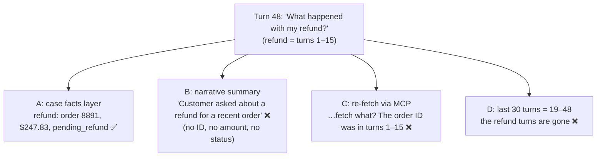
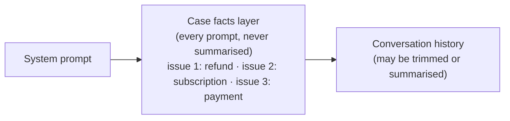

# Q40 — Three issues, one session: persist structured issue data

**Domain / lesson:** D5 › 5.1 Context Window Management
**Also touches:** D2 › 2.4 MCP Server Integration (why re-fetching alone fails)
**Scenario:** customer-support agent, one long multi-issue session
**Follows:** [Q38](../Q38-sliding-window-recent-turns/question.md) (its check question *is* this question) · [Q14](../Q14-escalation-handoff-summary/question.md) (structured fields, not narrative) · [Q03](../Q03-crash-recovery-state-manifest/question.md) (state kept outside the conversation)

## Question

A customer raises three separate issues during one session: a refund inquiry (turns 1-15), a subscription question (turns 16-30), and a payment method update (turns 31-45). At turn 48, the customer asks "What happened with my refund?" The conversation is approaching context limits. What strategy best maintains the agent's ability to address all issues throughout the session?

- **A.** Extract and persist structured issue data (order IDs, amounts, statuses) into a separate context layer.
- **B.** Summarize earlier turns into a narrative description, preserving full message history only for the active issue.
- **C.** Rely on MCP tools to re-fetch relevant information on demand when the customer references earlier issues.
- **D.** Implement sliding window context that retains the most recent 30 turns.

## Answer: **A**

## Diagram

### What the agent has at turn 48 under each option



### The prompt layout with A



Example layer, using the guide's field names (the subscription and payment entries are my illustration):

```json
{
  "caseFactsBlock": {
    "customerId": "C-10442",
    "issues": [
      { "type": "refund", "orderId": "8891", "orderDate": "2026-10-02",
        "refundAmount": 247.83, "status": "pending_refund",
        "itemDescription": "Wireless headphones" },
      { "type": "subscription", "plan": "Premium",
        "status": "downgrade_scheduled", "effectiveDate": "2026-11-15" },
      { "type": "payment_method", "status": "updated",
        "newMethod": "Visa ending 4242" }
    ]
  }
}
```

## Concept

**This is the question Q38's check question predicted:** a long support session with **transactional facts**, where the customer comes back to the **oldest** issue. You answered then: *"critical details such as an order ID should be stored"*, and stored **in every prompt**. That's option A.

**Why A works:** the facts the agent needs to act (order ID, amount, status) are kept **apart from the conversation**, in a structured layer that goes into **every prompt** and is **never summarised**. Whatever happens to the history (trimmed, summarised, near the limit), the facts survive. **One entry per issue** keeps them from mixing: the refund amount can't drift into the subscription issue.

**Why the question says "separate context layer":** guide 5.1, nearly word for word: *"When a customer raises several problems in one session, extract and persist structured issue data into a separate context layer."*

**Why a sliding window was right in Q38 but wrong here:**

| | Q38 (chat assistant) | Q40 (support, multi-issue) |
|---|---|---|
| Do users go back to old turns? | Rarely: 94% reference the last 3–5 exchanges | **Yes**: the question is about turns 1–15 |
| Can the user re-state it? | Easily | Not exact IDs, amounts or system-set statuses (Q38 check) |
| Kind of information | Conversational | **Transactional** (order IDs, amounts, statuses) |
| Right move | Sliding window | **Case facts layer** (+ trim or summarise the rest) |

## Why the others are wrong

| Option | Why not |
|---|---|
| **B** Narrative summary of earlier turns, full history only for the active issue | **The listed trap.** Guide 5.1: *"Thinking progressive summarisation is safe for transactional data."* A narrative keeps the gist and drops the specifics: *"By default, a summary of transactional data keeps the general meaning and drops the specific details"*, e.g. *"Customer wants a refund for a recent order."* At turn 48 the agent knows *there was* a refund, but not which order, how much, or its status. Narrative also lets details from different issues blur together. |
| **C** Re-fetch with MCP tools on demand | **Circular: you need the key to fetch the data.** To look up the refund, the agent needs the order ID, which was in turns 1–15, the part that's been dropped or summarised away. It also only covers what's **in a system**. What was said, promised or agreed in the conversation isn't in any database. And it adds a round trip every time an old issue comes up. Re-fetching is a good **complement** (fresh status using the ID from the layer), but not a replacement. |
| **D** Sliding window of the last 30 turns | **Drops exactly what's being asked about.** At turn 48 the window holds turns 19–48, so the refund (turns 1–15) is entirely gone. Guide 5.1 trap: *"Selectively truncating conversation history on the assumption that nothing is lost."* In Q38 that assumption was **backed by data**. Here the question itself proves it false. |

## Pattern to remember

> **Multi-issue or long support session → extract each issue's transactional facts (IDs, amounts, statuses) into a structured layer that's in every prompt and never summarised. The conversation can be trimmed. The facts can't.**

**Exam signal:** "several issues in one session" + "approaching context limits" + a question about an **early** issue → the case facts layer. Options that summarise (B), trim (D) or re-fetch (C) each lose or can't find the specifics.

### Where this comes from in the guide

**D5 › 5.1 Context Window Management:**
- *"When a customer raises several problems in one session, extract and persist structured issue data into a separate context layer."* This is option A, nearly word for word.
- *"Separate entries prevent the data of one issue from mixing with the data of another issue during summarisation."*
- *"Extract transactional facts (amounts, dates, order numbers, statuses) into a structured block"*, *"never summarised, so it persists across every turn"*. Example fields: `customerId` and an `issues` array with `orderId`, `orderDate`, `refundAmount`, `status` (`"pending_refund"`) and `itemDescription`.
- The block goes at the top of each prompt, under a clearly marked section header (build exercise).
- Exam traps: *"Thinking progressive summarisation is safe for transactional data"* (**B**) and *"Selectively truncating conversation history on the assumption that nothing is lost"* (**D**).
- *"Progressive summarisation systematically destroys the most critical information."*

## How this connects to earlier questions

| Question | Link |
|---|---|
| [Q38](../Q38-sliding-window-recent-turns/question.md) | Q38's check question asked exactly this. The sliding window fits chat; transactional support needs the facts layer |
| [Q39](../Q39-coordinator-answers-simple-followups/question.md) | Same principle: structured records, written by code, are what make facts reliable (counts there, IDs here) |
| [Q14](../Q14-escalation-handoff-summary/question.md) | Handoffs need structured fields (customer ID, amount, root cause), not a narrative. Same reason B fails |
| [Q03](../Q03-crash-recovery-state-manifest/question.md) | State kept in a structured store outside the conversation, so it survives what happens to the conversation |
| [extract-first-summarize-second](../../concepts/extract-first-summarize-second.md) | The principle behind A: extract exact facts into a schema first, summarise second |

## Check question

**At turn 48 the layer says the refund's status is `pending_refund`, written at turn 12. Should the agent just tell the customer "it's still pending"? What should it do, and who updates the layer afterwards?**

*My answer:* (pending)

## Glossary

- **Case facts layer / block:** a structured record of each issue's transactional facts (IDs, amounts, dates, statuses), included at the top of every prompt and never summarised.
- **Transactional facts:** exact values the agent needs to act correctly: order numbers, amounts, dates, statuses. A summary keeps their gist and loses their values.
- **Multi-issue session:** one conversation in which the customer raises several separate problems. Each gets its own entry so their facts don't mix.
- **Narrative summary:** a prose retelling of earlier turns ("customer asked about a refund"). Fine for gist, lossy for specifics.
- **Re-fetching:** looking data up again with a tool. It needs a key (such as an order ID) and only covers data that lives in a system.

## Related course lessons

*Lecture lengths aren't recorded in the study-map files, so the watch times below are estimates from each course's average lecture length.*

### Udemy A (primary): Claude Certified Architect (CCAR-F) - 2026 Exam Prep
| # | Lecture | Part | Why |
|---|---|---|---|
| **110** | **Designing a Persistent Fact Block** | 5A | ⭐ Exactly option A *(also in Q38)* |
| **109** | **Why Summaries Lose Facts** | 5A | ⭐ Why B fails *(also in Q38)* |
| 113 | Trim Strategies | 5A | Why D's window drops the refund here but was fine in Q38 *(also in Q38)* |
| 111 | The Memory Tool | 5A | Another way to keep facts outside the conversation |
| Quiz 15 | 5A quiz | | Self-test |

**▶ Watch in this order (~30 min, est.):** #110 → #109 → #113 → #111, then do **Quiz 15**.
If Q38's list is fresh, rewatch #110 and go straight to Quiz 15 (~10 min).

### Udemy B: Claude Certified Architect Foundations: Complete Course (Voroniuk)
| # | Lecture | Section | Why |
|---|---|---|---|
| **54** | **Case Facts in Long Conversations** | S6 Support Agent | ⭐ Option A in the support scenario *(also in Q38)* |
| **51** | **Handoffs and Multi-Concern Requests** | S6 Support Agent | ⭐ Several issues in one session |
| 55 | Trimming Tool Results and Lost in the Middle | S6 Support Agent | Why the layer goes at the top *(also in Q38)* |
| Quiz 6 | Support Agent quiz | S6 | Self-test |

**▶ Watch in this order (~15 min, est.):** #54 → #51 → #55, then do **Quiz 6**.

### CBT Nuggets: CCA-F course
| Skill | Why |
|---|---|
| 10. Send Structured Messages to Claude | What goes into each request (where the layer lives) |

*CBT covers 5.1 only partially and doesn't teach the case facts block. Use the guide and the Udemy lectures for this one.*
