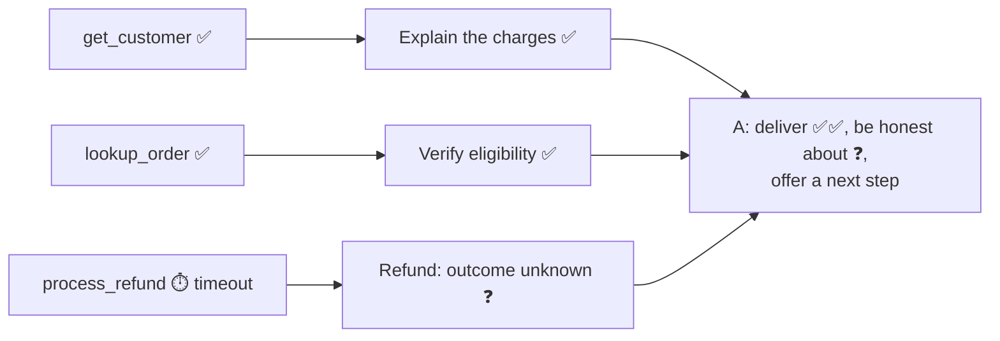

# Q41 — Refund tool times out mid-resolution: deliver what worked, be honest, offer a next step

**Domain / lesson (closest fit):** D5 › 5.3 Error Propagation (partial results, honest gaps, proportionate response)
**Also touches:** D2 › 2.2 Structured Error Responses (timeouts on side-effecting actions, [Q26](../Q26-timeout-unknown-status-no-retry/question.md)) · D5 › 5.2 Escalation & Ambiguity Resolution (when to escalate)
**Note:** 5.3 is written for multi-agent pipelines (a subagent times out). Its rules (keep partial results, state the gap, don't over-react) carry over directly to a single support agent whose tool times out. I checked 5.3 on 2026-10-31.
**Scenario:** customer-support agent, billing dispute (`get_customer`, `lookup_order`, `process_refund`)
**Follows:** [Q26](../Q26-timeout-unknown-status-no-retry/question.md) (timeout = unknown outcome) · [Q33](../Q33-mcp-iserror-result/question.md) (no fake success) · [Q16](../Q16-escalation-triggers/question.md) (valid escalation triggers)

## Question

During a billing dispute resolution, your agent successfully retrieves customer info via get_customer and order details via lookup_order, but when attempting to call process_refund, the tool returns a timeout error. The agent has enough information to explain the charges and verify refund eligibility, but cannot actually process the refund due to the backend failure. What approach best balances first-contact resolution with appropriate error handling?

- **A.** Explain the billing confirm refund eligibility, acknowledge the system issue preventing immediate processing, and offer escalation or retry later
- **B.** Confirm the refund will be processed and close the conversation, since the system has all necessary information to complete it automatically
- **C.** Implement automatic retries with exponential backoff for process_refund, keeping the conversation open until the refund is successfully processed
- **D.** Escalate immediately to a human agent since the refund action cannot be completed

## Answer: **A**

## Diagram

### Three parts of the job: two succeeded, one failed

### What each option does with that

| | Explanation + eligibility (succeeded) | Refund (failed) | Customer leaves knowing… |
|---|---|---|---|
| **A** | ✅ Delivered | Honest: "couldn't confirm it", next step offered | The truth, and what happens next |
| **B** | ✅ Delivered | ❌ Claimed as done | Something false |
| **C** | ⏳ Customer kept waiting | Retried blindly, maybe **twice** | Nothing yet (still on hold) |
| **D** | ❌ Thrown away (handed off) | Handed to a human | That they have to start again |

Example reply under A:

> *"I've gone through your bill: the $89.99 charge on 14 Oct is the annual renewal, and since you cancelled within 30 days you're eligible for a full refund. I tried to process it just now, but our refund system didn't respond, so I can't confirm it went through. I can check again shortly and email you confirmation, or pass it to a colleague who'll make sure it's completed today. Which would you prefer?"*

## Concept

**Read the two goals in the question:** *first-contact resolution* (solve as much as possible now) and *appropriate error handling* (be truthful about the failure and handle it safely). A is the only option that does both:

| A's part | Goal it serves |
|---|---|
| Explain the billing, confirm eligibility | **First-contact resolution**: the parts that worked are delivered now, not thrown away |
| Acknowledge the system issue | **Error handling**: no fake success, the gap is visible |
| Offer escalation or retry later | Both: a concrete next step, and the customer chooses |

**This is 5.3's partial-results rule, applied to one agent.** *"If the subagent retrieved three of five sources before timing out, those three are still useful."* Here, two of three steps worked, so deliver them. And state the gap rather than hiding it: *"A coverage annotation like this is far better than silently omitting the topic."*

**The catch (Q26): a timeout on `process_refund` means the outcome is unknown.** The refund might have gone through before the connection dropped. So A's "retry later" has to be done safely: **check the refund status first** (or use an idempotency key) before submitting again. Otherwise a retry can refund twice.

## Why the others are wrong

| Option | Why not |
|---|---|
| **B** Confirm the refund will be processed and close | **A false promise.** The call failed, and nothing will finish it "automatically": no step was queued, and the agent's call timed out. The customer leaves believing it's done, never gets the money, and comes back angrier, or disputes the charge with the bank. This is a fake success (Q33), and 5.3's warning: *"Silent suppression is especially dangerous because it is invisible."* The worst option. |
| **C** Automatic retries with exponential backoff, keep the conversation open until it succeeds | **Unbounded wait, and possibly a double refund.** "Until successfully processed" has no limit: the backend may be down for hours while the customer is stuck on hold. And a timeout on a money action has an **unknown outcome** (Q26), so blind retries may refund **twice**. Short, **bounded** retries inside the tool are fine (5.3's build exercise: *"3 retries with exponential backoff"*, after which the error goes up), but they don't replace telling the customer what's happening. |
| **D** Escalate immediately | **A disproportionate response.** The agent has already explained the charges and confirmed eligibility, and escalating hands all of that to a human who has to pick it up again. That's 5.3's anti-pattern in a support setting: a *"disproportionate response"* that *"wastes completed work"*. A technical outage isn't one of 5.2's escalation triggers (customer asks for a human, policy gap, no progress possible), and the human may face the same broken backend. Escalation belongs **as an option** (it's in A), not as the reflex. |

## Pattern to remember

> **Partial failure → deliver what succeeded, be honest about what didn't, offer a concrete next step.** Don't fake success (B), don't hold the customer hostage to retries (C), don't throw the work away by escalating (D).

**Exam signal:** *"balances X with Y"* (here, first-contact resolution with error handling) → pick the option that serves **both**. B serves resolution by lying, C serves error handling by making the customer wait, and D serves neither.

**Extra catch:** a timeout on an action with side effects (refund, payment, message) → **check the status before retrying** (Q26).

### Where this comes from in the guide

**D5 › 5.3 Error Propagation in Multi-Agent Systems:**
- *"If the subagent retrieved three of five sources before timing out, those three are still useful."* Keep and use partial results.
- *"A coverage annotation like this is far better than silently omitting the topic."* State the gap (A, not B).
- *"Silent suppression is especially dangerous because it is invisible: nobody can detect the gaps."* (**B**)
- *"Transient failures (a timeout, a rate limit) may succeed on retry."* Build exercise: *"3 retries with exponential backoff"*. Bounded retries, then report (why **C**'s "until successful" is wrong).
- Terminating everything over one failure is a *"disproportionate response"* that *"wastes completed work and gives no way to recover."* (**D**)
- Exam trap: *"Catching a timeout and returning empty results marked as successful."* The tool-level version of B's false confirmation.

**D5 › 5.2 Escalation & Ambiguity Resolution:**
- Valid escalation triggers: *"explicit human request (honour immediately), policy gaps (not violations)"* and *"inability to progress."* A backend timeout with most of the issue resolved is none of these (**D**). If the customer **asks** for a human, A's offer covers it.

## How this connects to earlier questions

| Question | Link |
|---|---|
| [Q26](../Q26-timeout-unknown-status-no-retry/question.md) | Timeout on a side-effecting action = outcome unknown → no blind retry. Why C (and a careless "retry later") risk a double refund |
| [Q33](../Q33-mcp-iserror-result/question.md) | B is a fake success: a wrong answer that looks right |
| [Q16](../Q16-escalation-triggers/question.md) | Escalation triggers: a technical failure with progress made isn't one (D) |
| [Q34](../Q34-business-errors-not-retryable/question.md) | The other error type: a **business** error (e.g. outside the window) → explain + alternative. Here it's **technical**, so a retry is possible, but only safely |
| [Q40](../Q40-multi-issue-case-facts-layer/question.md) | Record the pending refund in the case facts layer (status `submission_unknown`), so a later turn or a human picks it up correctly |

## Check question

**Before the agent (or anyone) tries `process_refund` again "later", what must be checked first, and why? What would make a retry safe even without that check?**

*My answer:* (pending)

## Glossary

- **First-contact resolution:** solving the customer's issue in the first conversation, without a callback or handoff. Here: as much of it as possible.
- **Partial success:** some steps of a task worked and others didn't. The successful parts are still worth delivering.
- **Side-effecting action:** a tool call that changes something in the world (a refund, a payment, a message). Doing it twice is not the same as doing it once.
- **Unknown outcome:** after a timeout you don't know whether the action happened. Check before repeating it.
- **Idempotency key:** a unique ID sent with a request so the backend ignores a duplicate. It makes retries safe.
- **Disproportionate response:** reacting to one failure by abandoning everything (here: escalating a mostly resolved case).

## Related course lessons

*Lecture lengths aren't recorded in the study-map files, so the watch times below are estimates from each course's average lecture length.*

### Udemy A (primary): Claude Certified Architect (CCAR-F) - 2026 Exam Prep
| # | Lecture | Part | Why |
|---|---|---|---|
| **27** | **Fallback Chains and Graceful Degradation** | 1D | ⭐ Deliver what works when one part fails (option A) *(also in Q24, Q34)* |
| **38** | **Tool Retry Logic and Partial Success Patterns** | 2A | ⭐ Bounded retries + partial success (why C is wrong) *(also in Q24, Q32, Q34)* |
| 26 | Retry Logic — When to Retry, When to Abort | 1D | When a retry is safe (the Q26 catch) *(also in Q32, Q34)* |
| 117 | Designing the Propagation Contract | 5B | What a failure report must carry |
| 114 | When to Escalate — Trigger Design | 5B | Why a timeout alone isn't a trigger (D) |
| Quiz 4, Quiz 16 | 1D and 5B quizzes | | Self-test |

**▶ Watch in this order (~35 min, est.):** #27 → #38 → #26 → #117 → #114, then do **Quiz 4** and **Quiz 16**.
(graceful degradation → partial success → safe retries → reporting failures → when to escalate → self-tests)

### Udemy B: Claude Certified Architect Foundations: Complete Course (Voroniuk)
| # | Lecture | Section | Why |
|---|---|---|---|
| **66** | **Failure Handling Across Agents** | S7 Multi-Agent Systems | ⭐ 5.3's partial-results and proportionate-response rules |
| **44** | **Customer Messages and Empty Results** | S5 Tools & MCP | ⭐ Telling the customer the truth about a failure *(also in Q34)* |
| 53 | When Not to Escalate | S6 Support Agent | Why D over-reacts *(also in Q37)* |
| Quiz 7, Quiz 5 | Multi-Agent and Tools & MCP quizzes | S7, S5 | Self-test |

**▶ Watch in this order (~15 min, est.):** #66 → #44 → #53, then do **Quiz 7** and **Quiz 5**.

### CBT Nuggets: CCA-F course
| Skill | Why |
|---|---|
| **40. Build an Agentic Multimedia Article System: Part 2** | ⭐ Error propagation in a working system |
| 20. Handle Tool Calls and Tool Results | Getting the timeout back to the model as an error result |

*CBT covers 5.3 only partially. Use the guide for the partial-results and escalation rules.*
