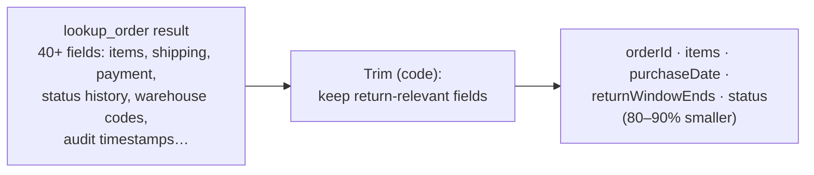
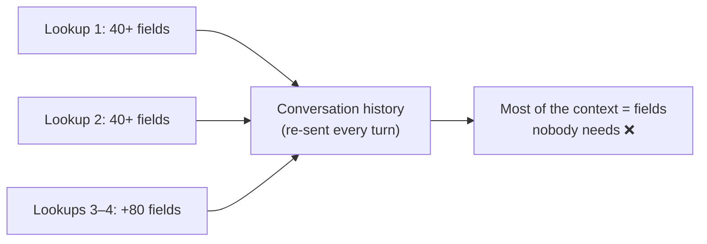

# Q42 — Tool outputs fill the context: trim to the relevant fields

**Domain / lesson:** D5 › 5.1 Context Window Management
**Also touches:** D1 › 1.5 Agent SDK Hooks (PostToolUse is where trimming belongs from now on)
**Scenario:** customer-support agent, several `lookup_order` calls for return requests
**Follows:** [Q40](../Q40-multi-issue-case-facts-layer/question.md) (keep the facts, drop the rest) · [Q35](../Q35-structured-tool-output-fields/question.md) (structured fields beat prose) · [Q31](../Q31-refund-threshold-hook/question.md) (PreToolUse blocks; PostToolUse transforms)

## Question

Your agent has called lookup_order multiple times while investigating a customer's return requests. Each response includes 40+ fields (items, shipping details, payment info, status history). Tool outputs now represent the majority of the conversation's context. The customer mentions two more orders they want to discuss. What's the most effective approach before making additional lookups?

- **A.** Move all tool responses to a vector database with semantic indexing, retrieving relevant portions as the conversation continues
- **B.** Proceed with additional lookups without modifying the existing tool output context
- **C.** Have the model generate a natural language summary of each order's key details, replacing structured responses with prose descriptions
- **D.** Extract only the return-relevant fields (items, purchase date, return window, status) from each existing order response, removing verbose details

## Answer: **D**

## Diagram

### One lookup result, before and after trimming



```json
{ "orderId": "8891",
  "items": ["Wireless headphones"],
  "purchaseDate": "2026-10-02",
  "returnWindowEnds": "2026-11-01",
  "status": "delivered" }
```

### Why it matters: untrimmed results are paid for on every later turn



## Concept

**Guide 5.1 uses almost this exact scenario:** *"An order lookup might return 40+ fields, such as internal audit timestamps, warehouse codes,"* … *"Most of these fields are irrelevant to a refund request."* *"You need 5."* *"The other 35 consume tokens in every subsequent turn as the history grows."*

**Why D:** the task is **returns**, so the fields that matter are known in advance: items, purchase date, return window, status (plus the order ID as the key, Q40). Keeping just those:
- **frees most of the context** before two more lookups add 80+ more fields;
- keeps **exact values in structured fields**, so the return window date stays a date, not a paraphrase (Q35);
- is **deterministic**: a fixed field list applied by code, with no model judgment involved.

**Nothing is lost for good.** The full order still lives in the order system. If a later question needs a trimmed field (say, the shipping carrier), the agent re-fetches it **with the order ID it kept**. You trim the *context*, not the *data*.

**D cleans up now. The lasting fix is to trim on the way in.** The guide: *"Trim the result in a `PostToolUse` hook or in the tool implementation itself,"* *"before the result enters the conversation history."* Then the next two lookups arrive already trimmed. Rewriting earlier results is possible because the API is stateless: your code builds the message list it sends each turn.

**PostToolUse: too late to block, the right place to trim.** In Q28/Q31 PostToolUse was the wrong answer, because *"By the time PostToolUse fires, the tool has already run"*, too late to stop a refund. For **reshaping a result** it's exactly right: it *"runs after a tool executes and before the model processes the result."*

## Why the others are wrong

| Option | Why not |
|---|---|
| **A** Vector database + semantic retrieval of tool responses | **Heavy and approximate for a known need.** You already know which fields matter for returns, so there's nothing to *search* for. Semantic retrieval returns *similar* chunks, which may miss the exact field you need (order #2's status) or pull the wrong order's data (Q03 B, Q38 B). Chunking JSON for embeddings also breaks the structure. And it adds infrastructure and latency for what a field filter does in one line. |
| **B** Carry on without changing anything | **The listed trap.** Guide 5.1: *"Keeping full tool results in context because 'the model might need them later'"*. *"Untrimmed tool results from 40+ field lookups exhaust the token budget across turns."* Two more lookups add 80+ more fields to a context that's already mostly tool output, with slower turns, diluted attention (lost in the middle) and the context limit getting close. |
| **C** The model writes a prose summary of each order, replacing the structured data | **Backwards: structure → prose.** Prose loses exact values and invites paraphrase: *"bought in early October"* instead of `2026-10-02`, and the return window is the field that decides eligibility. A model-written summary is probabilistic, so it may drop or alter a value, and it costs extra model calls. Guide 5.1: summaries keep the gist and drop the specifics. Q35: structured fields let the agent extract values reliably. D keeps structure **and** shrinks it. |

## Pattern to remember

> **Tool outputs bloating the context → trim each result to the fields the task needs, in code, ideally before it enters the history (PostToolUse hook or the tool itself).** Keep the key (order ID) so anything trimmed can be re-fetched.

**Exam signal:** *"tool outputs now represent the majority of the context"* → trim to relevant fields. Distractors: keep everything "just in case" (B), retrieval machinery (A), model-written prose (C).

### Where this comes from in the guide

**D5 › 5.1 Context Window Management:**
- *"Tool results use context budget unnoticed."*
- *"An order lookup might return 40+ fields, such as internal audit timestamps, warehouse codes,"* … *"Most of these fields are irrelevant to a refund request."* *"You need 5."*
- *"The other 35 consume tokens in every subsequent turn as the history grows."*
- *"Trim verbose tool outputs to only the relevant fields before they accumulate in context."*
- *"Trim the result in a `PostToolUse` hook or in the tool implementation itself,"* *"before the result enters the conversation history."* *"Once verbose data is in the context, it stays there for every subsequent turn."*
- Exam trap: *"Keeping full tool results in context because 'the model might need them later'"*. *"Untrimmed tool results from 40+ field lookups exhaust the token budget across turns."* (**B**)
- Build exercise: trim *"from 40+ fields to only the 5 relevant return-related fields"*; *"The trimmed result should be 80-90% smaller than the original."*

**D1 › 1.5 Agent SDK Hooks:**
- *"A PostToolUse hook runs after a tool executes and before the model processes the result."* *"It can transform the result."*
- Exam trap: *"Using a PreToolUse hook to convert or clean up the results a tool returns"*. *"Result transformation belongs in a PostToolUse hook."*

## How this connects to earlier questions

| Question | Link |
|---|---|
| [Q40](../Q40-multi-issue-case-facts-layer/question.md) | Same goal, different source: Q40 keeps the **conversation's** facts; Q42 trims the **tools'** output. Both keep exact fields and drop the rest |
| [Q35](../Q35-structured-tool-output-fields/question.md) | Why C fails: structured fields → reliable extraction; prose → re-interpretation |
| [Q31](../Q31-refund-threshold-hook/question.md), [Q28](../Q28-tamper-proof-threshold-in-tool/question.md) | PostToolUse was "too late" for **blocking**. It's the right hook for **trimming** results |
| [Q38](../Q38-sliding-window-recent-turns/question.md) | Also context management, by a different cut: Q38 drops old **turns**; Q42 drops irrelevant **fields** |
| [Q03](../Q03-crash-recovery-state-manifest/question.md) | A's family: semantic search ≠ exact retrieval |

## Check question

**After D, where should trimming happen so the next two lookups don't flood the context again? And why is "tell the model to ignore the irrelevant fields" not a substitute?**

*My answer:* (pending)

## Glossary

- **Tool output bloat:** verbose tool results piling up in the conversation history, re-sent on every later turn.
- **Trimming (field filtering):** keeping only the fields a task needs from a tool result, done by code with a fixed field list.
- **PostToolUse hook:** runs after a tool executes and before the model sees the result. It can transform the result (trim, normalise), but can't undo what the tool did.
- **Re-fetch:** looking the full record up again with its key (order ID) if a trimmed field turns out to be needed.

## Related course lessons

*Lecture lengths aren't recorded in the study-map files, so the watch times below are estimates from each course's average lecture length.*

### Udemy A (primary): Claude Certified Architect (CCAR-F) - 2026 Exam Prep
| # | Lecture | Part | Why |
|---|---|---|---|
| **112** | **The Tool-Output Bloat Problem** | 5A | ⭐ This exact question |
| **113** | **Trim Strategies** | 5A | ⭐ How to trim (option D) *(also in Q38, Q40)* |
| 108 | Context Window Economics | 5A | Why every untrimmed field costs on every turn *(also in Q38)* |
| 80 | Real-World Hook Applications | 3D | Where PostToolUse trimming fits |
| Quiz 15 | 5A quiz | | Self-test |

**▶ Watch in this order (~30 min, est.):** #112 → #113 → #108, then do **Quiz 15**.
#80 is optional, for the hook side.

### Udemy B: Claude Certified Architect Foundations: Complete Course (Voroniuk)
| # | Lecture | Section | Why |
|---|---|---|---|
| **55** | **Trimming Tool Results and Lost in the Middle** | S6 Support Agent | ⭐ This exact question *(also in Q38, Q40)* |
| **12** | **Practice: The Conversation Lives in Your Code** | S2 API Basics | ⭐ Why you *can* rewrite earlier results: you build the message list *(also in Q38)* |
| Quiz 6 | Support Agent quiz | S6 | Self-test |

**▶ Watch in this order (~10 min, est.):** #55 → #12, then do **Quiz 6**.

### CBT Nuggets: CCA-F course
| Skill | Why |
|---|---|
| 20. Handle Tool Calls and Tool Results | Where tool results enter the conversation (and can be trimmed) |
| 10. Send Structured Messages to Claude | The message list your code sends every turn |

*CBT covers 5.1 only partially. Use the guide and the Udemy lectures for tool-output trimming.*
