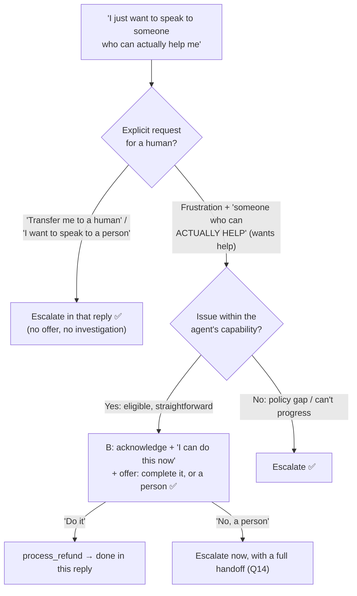

# Q43 — Frustrated customer, straightforward case: acknowledge, offer to resolve now, or escalate

**Domain / lesson:** D5 › 5.2 Escalation & Ambiguity Resolution
**Also touches:** D1 › 1.4 Workflow Enforcement and Handoff (the handoff if they choose a human)
**Scenario:** customer-support agent, return request
**Follows:** [Q16](../Q16-escalation-triggers/question.md) (the 3 escalation triggers; frustration isn't one) · [Q37](../Q37-state-assumptions-not-interrogate/question.md) (the customer stays in control) · [Q41](../Q41-partial-success-honest-next-step/question.md) (escalation as an offered option)

## Question

A customer writes: "I've been going back and forth on this return for days. I just want to speak to someone who can actually help me." The agent has confirmed via lookup_order that the return is straightforward – within policy and eligible for immediate processing. What should the agent do?

- **A.** Process the refund via process_refund to resolve the underlying issue, then inform them it's complete
- **B.** Acknowledge frustration, inform them this is resolvable now, and offer to complete it or escalate
- **C.** Call escalate_to_human immediately to honor the customer's request
- **D.** Ask what specifically hasn't worked in previous attempts before deciding whether to escalate or resolve automatically

## Answer: **B**

## Diagram

### Read the message: what is the customer actually asking for?

Example reply under B:

> *"I'm sorry this has dragged on for days, that's really frustrating. Good news: I've checked your order, and the return qualifies, so I can process your $89.99 refund right now. Would you like me to do that, or would you prefer I connect you with a member of our team?"*

## Concept

**The customer's goal is help, not a particular kind of helper.** *"Someone who can actually help me"* puts the weight on **capability**, after *"days"* of back and forth. Here the agent **can** actually help: the return is in policy and can be processed now. Telling them so is the fastest route to what they want.

**Guide 5.2 separates two situations:**

| Situation | Guide 5.2 | Here? |
|---|---|---|
| **Explicit request** for a human: *"I want to speak to a person"*, *"Transfer me to a human agent"* | *"Escalate immediately. No investigation, no offer to help first."* | Not this clearly. "Someone **who can actually help**" is about getting help |
| **Frustration** with a straightforward issue | *"Acknowledge the frustration and offer the resolution."* Example: *"I understand this is frustrating. I can process your replacement right now."* | ✅ This one |
| …and the customer **repeats** that they want a human | *"Now escalate."* | B's offer covers this in the same reply |

**Why B handles both readings.** If the customer *did* mean "a human", B's offer gets them there in one word, with no persuasion and no investigation first. If they meant "someone competent", B gets them a refund in this very reply. A, C and D each assume one reading and act on it.

**Frustration alone doesn't decide.** Guide 5.2: *"Frustration alone does not decide the response,"* and *"frustration does not correlate with case complexity."* Angry + simple → resolve. Calm + policy gap → escalate (Q16).

## Why the others are wrong

| Option | Why not |
|---|---|
| **A** Process the refund, then tell them it's done | **Right outcome, wrong process: it ignores what the customer said.** They asked for someone who can help, not "do whatever you think". Acting without acknowledging them or asking skips their stated preference; if they wanted a person (or an exchange instead of a refund), the agent has acted over their head. A refund is also an action with consequences, so confirm first (Q37's grid: clear but costly → confirm). |
| **C** Escalate immediately | **Treats frustration as an explicit request.** Right only if the customer said *"transfer me to a human"*. Here they want help, and the agent can give it now. Escalating sends a customer who's already waited *"days"* into a queue, for a case the agent could close in one reply. The guide: *"Offering to resolve first fits frustration without an explicit request."* (And if it **was** a clear request, C would be correct, which is exactly what this question tests.) |
| **D** Ask what hasn't worked before deciding | **More back and forth, for a customer frustrated by back and forth.** The agent already knows the answer (eligible, straightforward), so the question only delays. If the customer wanted a human, investigating first is what the guide forbids: *"No investigation, no offer to help first."* And "before **deciding**" keeps the decision with the agent instead of offering it to the customer. |

## Pattern to remember

> **Frustrated but the case is straightforward → acknowledge, say you can resolve it now, and offer the choice (resolve or a person). Explicit "I want a human" → escalate in that reply. If they repeat it after your offer → escalate, no more persuasion.**

**Exam signal:** read the customer's words closely. *"Transfer me to a human"* / *"I want a person"* → **C-type answer** (immediate). *"Someone who can actually help"* + a straightforward, eligible case → **B-type answer** (acknowledge + offer). Frustration level never decides on its own.

### Where this comes from in the guide

**D5 › 5.2 Escalation & Ambiguity Resolution:**
- Explicit requests: *"I want to speak to a person"*, *"Transfer me to a human agent"*. *"Escalate immediately. No investigation, no offer to help first."* *"An absolute rule with no exceptions."*
- *"A customer who says 'I want a human' has already stated their preference, so trying first turns a clear instruction into a negotiation."*
- *"Frustration alone does not decide the response."* *"Frustration does not correlate with case complexity."*
- Straightforward issue: acknowledge the frustration and offer the resolution: *"I understand this is frustrating. I can process your replacement right now."*
- *"Offering to resolve first fits frustration without an explicit request."*
- *"If the customer reiterates their preference for a human after you offer help"* → *"Now escalate."*
- Worked example: the firm *"reships the tiles to the angry homeowner, unless the homeowner asks again for a person."*

**Note:** the guide's example offers the resolution; B also offers escalation in the same breath. That goes one step further than the guide's wording, but in the same spirit: the customer chooses, and a human is one word away.

## How this connects to earlier questions

| Question | Link |
|---|---|
| [Q16](../Q16-escalation-triggers/question.md) | The 3 valid triggers. Frustration isn't one. Q16 counted *"Can I talk to someone real?"* as a human request (it asks for a **human**); here *"someone who can actually help"* asks for **help** |
| [Q37](../Q37-state-assumptions-not-interrogate/question.md) | The customer stays in control. Confirm before a consequential action (A acts without asking) |
| [Q41](../Q41-partial-success-honest-next-step/question.md) | Escalation **offered** as an option, not used as a reflex (C) |
| [Q14](../Q14-escalation-handoff-summary/question.md), [Q15](../Q15-mid-process-escalation-handoff/question.md) | If they choose a person: a structured handoff, so they don't repeat "days" of history |

## Check question

**The customer replies to B's offer: "No. I want a real person." What does the agent do now, and what must the handoff include so the customer doesn't have to start over?**

*My answer:* "It must escalate immediately, providing persistent details and a summary of the situation in the handoff." ✅ **Correct on both counts.** The preference is now **reiterated** (guide 5.2: *"Now escalate."*), so there's no second offer and no persuasion. Here's what "details + summary" should mean concretely: Q14's five fields, filled in for this case:

| Field (Q14) | For this case |
|---|---|
| **1. Customer ID** | `C-10442` |
| **2. Summary** (asked + tried) | Return for order 8891; customer reports *days* of back and forth; agent offered to process now; customer **asked twice for a person** |
| **3. Root cause** | None found: the return is straightforward, so the delay was process, not policy |
| **4. Exact amount** | $89.99, order 8891 |
| **5. Recommended action** | **Eligibility already verified, within policy: process the refund**, then confirm with the customer |

Two extras that matter here:
- **Structured, not the transcript** (Q14, Q15): the human should be able to act in one step, without re-reading days of history.
- **Tell the customer what happens next**, honestly: *"I'm connecting you with a colleague now. They'll have everything we've discussed, so you won't need to repeat anything."* Only say that if the handoff really carries it.

> **Repeated request → escalate now. A good handoff means the customer's "days" end with the human, not restart with them.**

## Glossary

- **Explicit human request:** the customer clearly asks for a person ("transfer me to a human", "I want to speak to a person"). Honoured in that reply, with no attempt to resolve first.
- **Frustration without an explicit request:** the customer is upset but asks for a result, not a person. If the issue is within the agent's capability, acknowledge and offer to resolve.
- **Reiterated preference:** after the agent's offer, the customer asks for a human again. Escalate then.
- **First-contact resolution:** solving the issue in this conversation, without a handoff or callback.

## Related course lessons

*Lecture lengths aren't recorded in the study-map files, so the watch times below are estimates from each course's average lecture length.*

### Udemy A (primary): Claude Certified Architect (CCAR-F) - 2026 Exam Prep
| # | Lecture | Part | Why |
|---|---|---|---|
| **114** | **When to Escalate — Trigger Design** | 5B | ⭐ Explicit request vs. frustration *(also in Q41)* |
| **115** | **The Handoff Payload** | 5B | ⭐ For the check question: what the human needs |
| 119 | Disambiguation Patterns | 5B | Reading what the customer actually asked for *(also in Q37)* |
| Quiz 16 | 5B quiz | | Self-test |

**▶ Watch in this order (~25 min, est.):** #114 → #115 → #119, then do **Quiz 16**.

### Udemy B: Claude Certified Architect Foundations: Complete Course (Voroniuk)
| # | Lecture | Section | Why |
|---|---|---|---|
| **53** | **When Not to Escalate** | S6 Support Agent | ⭐ Frustrated + straightforward → resolve *(also in Q37, Q41)* |
| **52** | **When to Escalate to a Human** | S6 Support Agent | ⭐ The explicit-request rule (when C would be right) *(also in Q37)* |
| **57** | **Support Case: Escalation Calls** | S6 Support Agent | ⭐ Worked cases like this one |
| Quiz 6 | Support Agent quiz | S6 | Self-test |

**▶ Watch in this order (~15 min, est.):** #52 → #53 → #57, then do **Quiz 6**.

### CBT Nuggets: CCA-F course

*CBT doesn't cover 5.2 (see the study map). Use the guide and the Udemy lectures for escalation decisions.*
