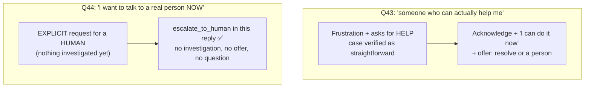
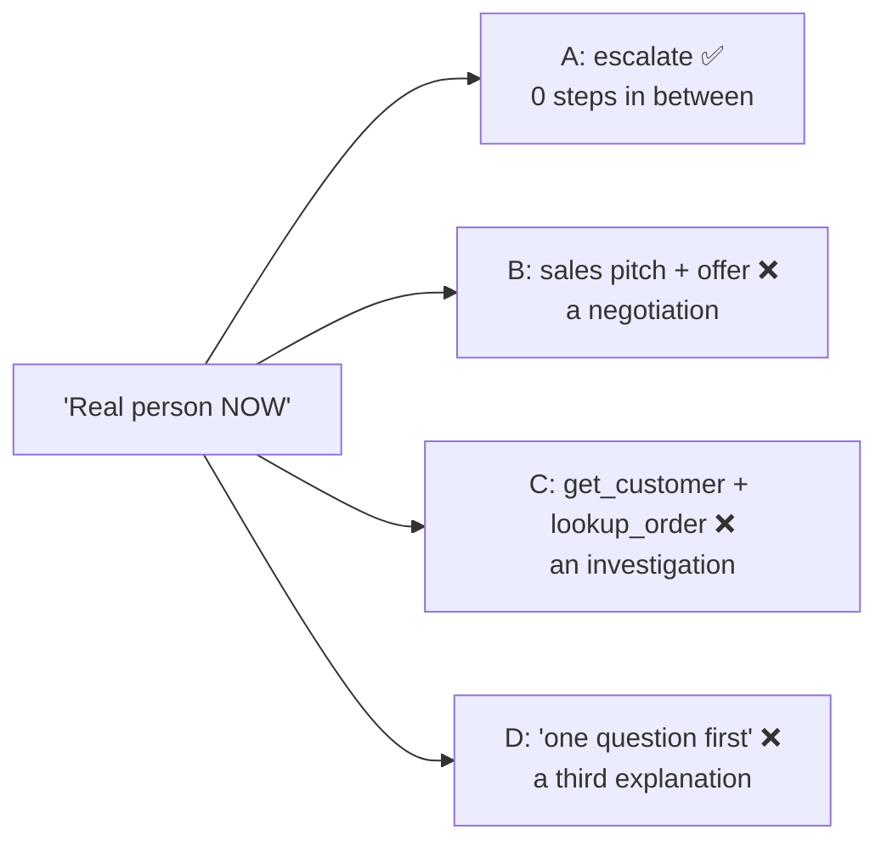

# Q44 — "I want to talk to a real person NOW": escalate in that reply

**Domain / lesson:** D5 › 5.2 Escalation & Ambiguity Resolution
**Also touches:** D1 › 1.4 Workflow Enforcement and Handoff (what goes with the escalation)
**Scenario:** customer-support agent
**Follows:** [Q43](../Q43-frustration-offer-resolve-or-escalate/question.md) (the twin: frustration without an explicit request → B there, A here) · [Q16](../Q16-escalation-triggers/question.md) (trigger 1: the customer asks for a human) · [Q14](../Q14-escalation-handoff-summary/question.md) (handoff content)

## Question

A customer sends: "This is frustrating. I've explained my issue twice and nothing is being resolved. I want to talk to a real person NOW." The agent has not yet called any tools to investigate their account. What should the agent do?

- **A.** Immediately call escalate_to_human with the conversation history.
- **B.** Briefly explain what the agent can help with and offer to resolve the issue quickly, escalating only if the customer repeats their request.
- **C.** First call get_customer and lookup_order to gather account context, then escalate to a human agent.
- **D.** Acknowledge the frustration and ask one targeted question to understand the specific issue before escalating.

## Answer: **A**

## Diagram

### Q43 vs Q44: the customer's words decide

### What each option puts between the customer and a person

## Concept

**This is an explicit request, not just frustration.** *"I want to talk to a real person NOW"* names **a person**, says **now**, and comes after the customer has *"explained my issue twice"*. It's the guide's case almost word for word: *"I want to speak to a person"* → *"Escalate immediately. No investigation, no offer to help first."* The guide calls it *"an absolute rule with no exceptions."*

**Why the rule is absolute:** *"A customer who says 'I want a human' has already stated their preference, so trying first turns a clear instruction into a negotiation."* B, C and D are three versions of "trying first".

**The twin question, Q43:**

| | Q43 | Q44 |
|---|---|---|
| Customer's words | *"someone who can **actually help** me"* | *"talk to a **real person NOW**"* |
| Asks for | Help (capability) | A **human** (explicit, urgent) |
| What the agent knows | Return verified: eligible, straightforward | Nothing yet: no tools called |
| Answer | **B**: acknowledge + offer to resolve, or a person | **A**: escalate in this reply |

Same frustration, different request. **Frustration level never decides. The words do.**

**What about Q14's "structured summary, not the transcript"?** A says *"with the conversation history"*. Here that's fine: the conversation is short and it's all the agent knows. The agent can add a brief summary of what the customer described (from the conversation itself, **no tool calls needed**). What it must not do is **delay** the escalation to gather more (that's C). The human has the tools to look the account up.

## Why the others are wrong

| Option | Why not |
|---|---|
| **B** Explain what the agent can do, offer to resolve, escalate only if they repeat | **Q43's answer, applied to the wrong case.** "Offer first, escalate if repeated" is for frustration **without** an explicit request. Here the request **is** explicit, so offering first *"turns a clear instruction into a negotiation."* The customer has effectively repeated themselves already (*"explained twice"*). And the agent can't honestly promise "quickly": it hasn't investigated anything. |
| **C** Call get_customer and lookup_order first, then escalate | **Investigation before honouring the request.** The guide: *"No investigation."* It delays the customer for the agent's benefit (a richer handoff), after they said "NOW". The human agent has the same tools. Tempting because good handoffs include account details (Q14), but the order of priorities is: honour the request first. |
| **D** Acknowledge, ask one targeted question, then escalate | **A condition on the customer's request.** "Before escalating" makes the escalation depend on answering a question, and the customer has already explained twice, which is exactly what's frustrating them. One targeted question was right in Q37 for an **ambiguous** request with costly consequences. This request isn't ambiguous. |

## Pattern to remember

> **Explicit "I want a human / a real person" → escalate in that reply. No investigation (C), no offer to resolve (B), no clarifying question (D). Pass along what you already know from the conversation.**

**Exam signal:** the words **"person"**, **"human"**, **"agent"** or **"manager"**, especially with **"now"** → immediate escalation. Words about **help** or **resolution** with a straightforward case → acknowledge + offer (Q43). Frustration level on its own decides nothing.

### Where this comes from in the guide

**D5 › 5.2 Escalation & Ambiguity Resolution:**
- Explicit requests: *"I want to speak to a person"*, *"Transfer me to a human agent"*.
- *"Escalate immediately. No investigation, no offer to help first."*
- *"Do not attempt to resolve the issue first, or say "Let me see if I can help you with that first.""* This is *"an absolute rule with no exceptions."*
- *"A customer who says 'I want a human' has already stated their preference, so trying first turns a clear instruction into a negotiation."*
- Exam trap: *"Attempting to resolve before honouring an explicit human request"*: *"Escalate in that reply."* *"Offering to resolve first fits frustration without an explicit request."* (That's Q43, not Q44.)
- Valid triggers: *"explicit human request (honour immediately)"*, policy gaps, inability to progress.

## How this connects to earlier questions

| Question | Link |
|---|---|
| [Q43](../Q43-frustration-offer-resolve-or-escalate/question.md) | The twin. Same frustration; Q43 asks for help → offer; Q44 asks for a person → escalate |
| [Q16](../Q16-escalation-triggers/question.md) | Trigger 1: *"The customer explicitly requests a human."* Honoured immediately |
| [Q14](../Q14-escalation-handoff-summary/question.md), [Q15](../Q15-mid-process-escalation-handoff/question.md) | Handoff content: pass what you know. But don't delay an explicit request to gather more |
| [Q37](../Q37-state-assumptions-not-interrogate/question.md) | "One targeted question" fits an **ambiguous**, costly request, not a clear one (D) |

## Check question

**Classify each message: escalate now, or acknowledge + offer to resolve (with escalation as an option)? (a) "Is there a manager I can talk to?" (b) "Ugh, this is taking forever." (c) "Can a human look at this, please?" (d) "I need someone who actually knows what they're doing."**

*My answer:* (pending)

## Glossary

- **Explicit human request:** the customer clearly asks for a person ("real person", "human", "agent", "manager"). Escalate in that reply.
- **Negotiation (here):** responding to a clear request with an offer, a question or a delay, so the customer has to ask again.
- **Investigation before escalation:** calling tools to gather account details before handing off. Not allowed when the customer has explicitly asked for a human.
- **escalate_to_human:** the tool that hands the conversation to a person, with whatever the agent already knows.

## Related course lessons

*Lecture lengths aren't recorded in the study-map files, so the watch times below are estimates from each course's average lecture length.*

### Udemy A (primary): Claude Certified Architect (CCAR-F) - 2026 Exam Prep
| # | Lecture | Part | Why |
|---|---|---|---|
| **114** | **When to Escalate — Trigger Design** | 5B | ⭐ The explicit-request rule *(also in Q41, Q43)* |
| 115 | The Handoff Payload | 5B | What goes with the escalation *(also in Q43)* |
| Quiz 16 | 5B quiz | | Self-test |

**▶ Watch in this order (~15 min, est.):** #114 → #115, then do **Quiz 16**.
If Q43's list is fresh, go straight to Quiz 16.

### Udemy B: Claude Certified Architect Foundations: Complete Course (Voroniuk)
| # | Lecture | Section | Why |
|---|---|---|---|
| **52** | **When to Escalate to a Human** | S6 Support Agent | ⭐ This exact rule *(also in Q37, Q43)* |
| **57** | **Support Case: Escalation Calls** | S6 Support Agent | ⭐ Q43 vs Q44-style cases side by side *(also in Q43)* |
| 53 | When Not to Escalate | S6 Support Agent | The contrast (Q43) *(also in Q37, Q41, Q43)* |
| Quiz 6 | Support Agent quiz | S6 | Self-test |

**▶ Watch in this order (~15 min, est.):** #52 → #57 → #53, then do **Quiz 6**.

### CBT Nuggets: CCA-F course

*CBT doesn't cover 5.2 (see the study map). Use the guide and the Udemy lectures for escalation decisions.*
