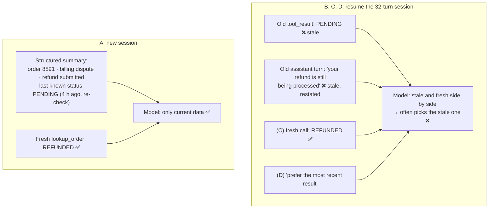

# Q45 — Returning customer, stale tool results: start fresh with a structured summary

**Domain / lesson:** D1 › 1.7 Session State and Resumption
**Also touches:** D5 › 5.1 Context Window Management (case facts; volatile fields)
**Note:** the guide's 1.7 examples are about **files** changing between sessions (Claude Code). The rule is the same for **tool results** that describe a changing system, like an order status.
**Scenario:** customer-support agent, billing dispute, customer returns after 4 hours
**Follows:** [Q40](../Q40-multi-issue-case-facts-layer/question.md) (status is volatile: re-check it) · [Q42](../Q42-trim-tool-outputs-relevant-fields/question.md) (a prompt can't remove what's in context) · [Q03](../Q03-crash-recovery-state-manifest/question.md) (a structured state summary loaded into a new run)

## Question

A customer returns 4 hours after the initial session about the same billing dispute. The previous 32-turn session contains lookup_order results showing "Status: PENDING, Expected resolution: 24-48 hours." In testing, you observe that when resuming sessions with stale tool results, the agent often references the outdated data in responses (e.g., "I see your refund is still being processed") even after subsequent fresh tool calls return different information. What approach most reliably handles returning customers?

- **A.** Start a new session, inject a structured summary of the previous interaction (issue type, actions taken, resolution status), then make fresh tool calls before engaging.
- **B.** Resume with full history but filter out previous tool_result messages before resuming, keeping only the human/assistant turns so the agent must re-fetch needed data.
- **C.** Resume with full history and configure the agent to automatically re-call all previously-used tools at session start to ensure data freshness.
- **D.** Resume with full history and add a system prompt instruction telling the agent to always prefer the most recent tool results when multiple calls to the same tool exist in context.

## Answer: **A**

## Diagram

### What's in the context when the customer says "Any update?"

## Concept

**Read the test result in the question: it rules out three options.** The agent *"references the outdated data… **even after subsequent fresh tool calls return different information**."* So adding fresh data isn't enough. **As long as the stale data is in the context, the model can pick it.** The only reliable fix is to make sure the stale data **isn't there**.

**A does exactly that.** Guide 1.7: *"Start a completely new session and inject a structured summary of the prior session's findings."* *"The new session has no stale tool results. It has only the curated summary that you provide."* Then fresh tool calls supply the **current** status before the agent says anything.

**What goes in the summary:** what's still true and useful (customer and order IDs, issue type, what was done: refund submitted, escalation offered…), the **case facts** from Q40. What must **not** go in it: a volatile value presented as current. "Status: PENDING" belongs there only as *"last known status, 4 hours ago, re-check"*, or not at all. Otherwise the summary re-injects the very staleness you're removing.

**Resume or start fresh? (guide 1.7)**

| Situation | Choice |
|---|---|
| Prior context still valid (nothing changed since) | **Resume** (`--resume`) |
| Most of it valid, a few known changes | Resume and say what changed |
| Prior **tool results are stale** (status, files changed) | **New session + structured summary** ✅ |
| Comparing two alternative approaches from one baseline | **Fork** (`fork_session`) |

## Why the others are wrong

| Option | Why not |
|---|---|
| **B** Resume, but strip the tool_result messages | **The stale data survives in the assistant's own words.** Earlier assistant turns already restated the results: *"Your refund is pending and should resolve in 24–48 hours."* Removing the tool_result blocks leaves those sentences, so the model still "knows" PENDING. The agent also isn't forced to re-fetch: it can answer from its own earlier text. (There's a technical snag too: in the Messages API every `tool_use` block needs a matching `tool_result`, so you'd have to cut the tool calls out of the assistant turns as well.) And it keeps 32 turns of clutter. |
| **C** Resume, and auto-re-call every tool used before | **The question already shows it fails.** Fresh tool calls **were** made in testing, and the agent still quoted the stale data. Adding fresh results next to stale ones doesn't remove the stale ones: *"The stale tool results remain in the conversation history."* Re-calling **every** tool is also wasteful: guide 1.7, *"Full re-exploration is wasteful."* |
| **D** Resume, and tell the agent to prefer the most recent results | **An instruction against what the context shows.** Probabilistic, and the test already shows the model mixing them up. It's Q42's lesson: *a prompt can change how the model reads the context, never what's in it.* The stale data stays, so "often" becomes "less often", not "reliably". The question asks for **most reliably**. |

## Pattern to remember

> **Stale tool results in a session → don't resume and patch. Start a new session, inject a structured summary (IDs, issue, actions taken; volatile values marked as "last known"), and fetch fresh data before engaging.** Remove stale data, don't argue with it.

**Exam signal:** *"references outdated data even after fresh tool calls"* → anything that **keeps** the old history (resume + re-fetch, resume + instruction, resume + partial filtering) fails. Pick the option where the stale data **isn't in the context at all**.

### Where this comes from in the guide

**D1 › 1.7 Session State and Resumption:**
- *"A tool result is stale when the file it describes has changed since the agent read it."*
- *"The agent then reasons from cached tool results that no longer reflect the current state of those files."*
- *"The stale tool results remain in the conversation history."* *"The correct fix is to start a fresh session with a structured summary of prior findings."*
- *"Start a completely new session and inject a structured summary of the prior session's findings."* *"The new session has no stale tool results. It has only the curated summary that you provide."*
- *"Start fresh with an injected summary when prior tool results are stale."* Resume suits cases where the prior context is still valid.
- Exam traps: *"Simply resuming and asking the agent to re-read changed files is not the best answer."* *"fork_session branches from the existing session, which still contains stale tool results."* *"Full re-exploration is wasteful."* (**C**)

## How this connects to earlier questions

| Question | Link |
|---|---|
| [Q40](../Q40-multi-issue-case-facts-layer/question.md) | Its check question: status is **volatile**, so re-check it, and store it with a timestamp. Q45 is the same idea across sessions |
| [Q42](../Q42-trim-tool-outputs-relevant-fields/question.md) | *A prompt can't remove what's in context.* That's why D fails |
| [Q03](../Q03-crash-recovery-state-manifest/question.md) | Same pattern for crash recovery: a structured state summary loaded into a new run, not a replay of everything |
| [Q14](../Q14-escalation-handoff-summary/question.md) | A new session is a handoff to your future self: structured fields, not the transcript |
| [Q33](../Q33-mcp-iserror-result/question.md) | "Still being processed" when it's already refunded: a wrong answer that looks right |

## Check question

**Two returning customers. (1) Their connection dropped mid-conversation; they're back 5 minutes later, and nothing has happened on their order since. (2) They come back the next morning; a refund was submitted in yesterday's session. Resume or start fresh for each, and why?**

*My answer:* "(1) Resume. (2) Start a new session, because (2) gave enough time for stale info to accumulate." ✅ **Both correct.** One refinement to the *why*: **time is only a proxy. The real test is whether what the old tool results describe has changed, or could have.**

| | Time passed | Could the old results have changed? | Choice |
|---|---|---|---|
| (1) Dropped connection | 5 min | **No**: nothing happened on the order | **Resume**: context still valid, and the customer doesn't repeat themselves |
| (2) Next morning | ~16 h | **Yes**: a refund was submitted, so its status will move | **New session + summary** (order ID, "refund submitted yesterday", last known status *as of*…) **+ fresh lookup** |

Why time alone isn't the test, both ways:
- **Long gap, nothing changed → resume is fine.** The guide's own example: after a night with no file changes, resume.
- **Short gap, something in flight → can already be stale.** If the refund had been submitted just before the connection dropped, its status could change within minutes. Then resume, but **re-check the status before stating it** (Q40).

> **Ask "has anything the old results describe changed?", not "how long has it been?"**

## Glossary

- **Stale tool result:** a result that described the system correctly when it was fetched, but no longer does (the status has changed since).
- **Resume (`--resume`):** continue an existing session with its full history, including old tool results.
- **Fork (`fork_session`):** start a new branch from a copy of an existing session's history, used to compare alternatives. It still contains the old (possibly stale) results.
- **Fresh session + summary injection:** start a new session and give it a curated, structured summary of the previous one. No stale tool results come along.
- **Volatile field:** a value that changes outside the conversation (like a refund status). In a summary it's "last known, as of…", never "current".

## Related course lessons

*Lecture lengths aren't recorded in the study-map files, so the watch times below are estimates from each course's average lecture length.*

### Udemy A (primary): Claude Certified Architect (CCAR-F) - 2026 Exam Prep
| # | Lecture | Part | Why |
|---|---|---|---|
| **22** | **Session Continuity Across Turns and Failures** | 1C | ⭐ Resume vs. start fresh |
| **81** | **The Claude Agent SDK — Session Control** | 3D | ⭐ `resume`, `fork_session`, new sessions in the SDK |
| 21 | In-Context State vs. External Memory | 1C | Why the summary lives outside the old history |
| 124 | Long-Conversation Coherence, Compaction, and Session Memory | 5C | Carrying the right state across sessions |
| Quiz 3, Quiz 11 | 1C and 3D quizzes | | Self-test |

**▶ Watch in this order (~30 min, est.):** #22 → #81 → #21 → #124, then do **Quiz 3** and **Quiz 11**.

### Udemy B: Claude Certified Architect Foundations: Complete Course (Voroniuk)
| # | Lecture | Section | Why |
|---|---|---|---|
| **84** | **Sessions: Resume or Start Fresh** | S8 Claude Code Setup | ⭐ This exact decision |
| 85 | Forking a Session | S8 Claude Code Setup | Why fork doesn't help with stale results |
| Quiz 8 | Claude Code Setup quiz | S8 | Self-test |

**▶ Watch in this order (~10 min, est.):** #84 → #85, then do **Quiz 8**.

### CBT Nuggets: CCA-F course

*CBT doesn't cover 1.7 (see the study map). Use the guide and the Udemy lectures for session resumption.*
