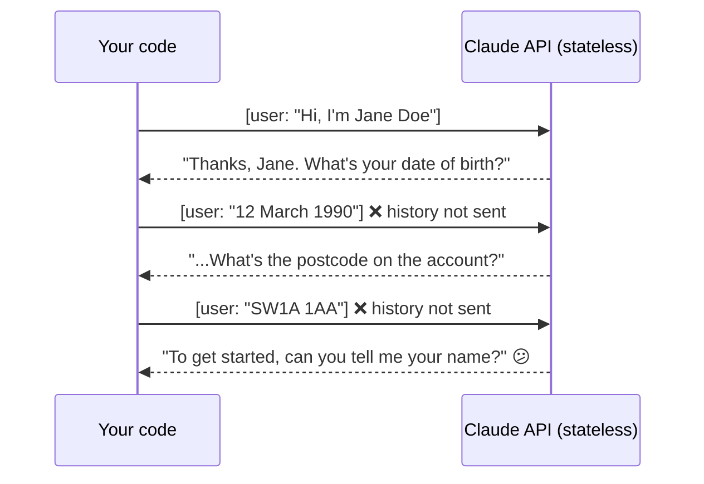

# Q46 — The agent "forgets" earlier answers: the history isn't being sent

**Domain / lesson:** D5 › 5.1 Context Window Management (the API is stateless)
**Also touches:** D1 › 1.1 Agentic Loops (your code builds the message list) · D1 › 1.4 Workflow Enforcement (verification as a code gate, see the check question)
**Scenario:** customer-support agent, multi-step identity verification before a password reset
**Follows:** [Q10](../Q10-missing-context-in-subagent-prompt/question.md) (if it's not in the prompt, the model doesn't know it) · [Q38](../Q38-sliding-window-recent-turns/question.md) (dropping history on purpose vs. by accident) · [Q36](../Q36-coordinator-missing-task-tool/question.md) (no "automatic" context mechanisms)

## Question

The agent verifies customer identity through a multi-step process before resetting passwords. During testing, you notice that after the customer answers the third verification question, the agent asks them to provide their name again, as if the earlier exchange never happened. What's the most likely cause of this behavior?

- **A.** The verification tool is clearing the agent's internal state after each successful validation step.
- **B.** Claude's memory retention is limited to two conversational turns by default, requiring explicit configuration to extend it.
- **C.** The conversation history isn't being passed in subsequent API requests.
- **D.** The prompt lacks instructions telling Claude to remember information across multiple exchanges.

## Answer: **C**

## Diagram

### The model only knows what's in the current request



### Bug vs. fix

```python
# ❌ Bug: each request carries only the newest message
response = client.messages.create(
    model=MODEL, system=SYSTEM,
    messages=[{"role": "user", "content": latest_user_message}],
)

# ✅ Fix: keep the whole conversation and send it every time
messages.append({"role": "user", "content": latest_user_message})
response = client.messages.create(model=MODEL, system=SYSTEM, messages=messages)
messages.append({"role": "assistant", "content": response.content})
```

## Concept

**The Claude API is stateless.** Each request is answered from **only what's in that request**: the system prompt plus the `messages` list. Nothing carries over between calls on Claude's side. The "memory" of a conversation is the history **your code** keeps and re-sends every turn. Guide 5.1: the API is stateless, so the exam guide stresses *"passing complete conversation history in each request to keep coherence,"* and *"When you omit earlier messages, the model loses conversational coherence."*

**So the symptom points straight at the code.** An agent that behaves *"as if the earlier exchange never happened"* most likely **didn't receive** the earlier exchange. Typical bugs: sending only the newest message, rebuilding `messages` from scratch each turn, not appending the assistant's replies, or a new session/conversation ID per request.

**Same rule as subagents (Q10):** a subagent knows only what's in its Task prompt, and the model knows only what's in its request. **If it isn't sent, it isn't known.**

## Why the others are wrong

| Option | Why not |
|---|---|
| **A** The verification tool clears the agent's internal state | **There's no internal state to clear.** The model holds nothing between requests. A tool returns a result; it can't reach into "the agent's memory", because that memory is just the message list your code sends. (Only your own code could drop messages, and then the cause is C.) |
| **B** Memory limited to two turns by default; needs configuration | **No such setting exists.** Within a request, the model sees everything you send, up to the context window. Between requests, it remembers nothing. There is no "turns retained" default to raise. This is the invented-mechanism distractor family (Q10 A, Q12 A, Q36 D). |
| **D** The prompt lacks "remember earlier answers" instructions | **An instruction can't bring back what wasn't sent.** If the name isn't in the request, no prompt can make the model know it. Same lesson as Q42 and Q45: a prompt changes how the model **reads** the context, not **what's in** it. |

## Pattern to remember

> **The agent "forgets" earlier turns → check that your code sends the full conversation history with every request.** The API is stateless: the model knows only what's in the current request.

**Exam signal:** *"as if the earlier exchange never happened"* → history not passed. Distractors invent memory that doesn't exist: internal state a tool can clear (A), a default retention limit (B), or a "remember" instruction (D).

### Where this comes from in the guide

**D5 › 5.1 Context Window Management:**
- The Claude API is stateless: each request must resend the full conversation history.
- *"When you omit earlier messages, the model loses conversational coherence."*
- The exam guide stresses *"passing complete conversation history in each request to keep coherence."*

**D1 › 1.2 / 1.3 (same principle for subagents):** subagents don't inherit the coordinator's history: *"A subagent receives only what the coordinator writes into the subagent's prompt."*

## How this connects to earlier questions

| Question | Link |
|---|---|
| [Q10](../Q10-missing-context-in-subagent-prompt/question.md), [Q12](../Q12-include-complete-findings-in-prompt/question.md) | Same rule one level up: a subagent knows only its prompt; the model knows only its request |
| [Q36](../Q36-coordinator-missing-task-tool/question.md) | Option D there and B here: invented "automatic" memory/context mechanisms |
| [Q38](../Q38-sliding-window-recent-turns/question.md) | Dropping history **on purpose**, based on usage data, vs. here, dropping it **by accident** |
| [Q42](../Q42-trim-tool-outputs-relevant-fields/question.md), [Q45](../Q45-fresh-session-structured-summary/question.md) | A prompt can't change what's in the context (why D fails) |

## Check question

**Once the history is fixed, should the agent decide "this customer is verified" by reading the conversation? Where should the verified status live, and what should check it before `reset_password` runs?**

*My answer:* (pending)

## Glossary

- **Stateless API:** the server keeps nothing between requests. Each call must include everything the model needs.
- **Conversation history (`messages`):** the list of user and assistant turns your code keeps and re-sends with every request. It *is* the model's memory of the conversation.
- **Conversational coherence:** the model's responses fitting what was said earlier. Lost when earlier messages aren't sent.

## Related course lessons

*Lecture lengths aren't recorded in the study-map files, so the watch times below are estimates from each course's average lecture length.*

### Udemy A (primary): Claude Certified Architect (CCAR-F) - 2026 Exam Prep
| # | Lecture | Part | Why |
|---|---|---|---|
| **107** | **How the Context Window Works** | 5A | ⭐ The model reads exactly what you send, each request *(also in Q38)* |
| **22** | **Session Continuity Across Turns and Failures** | 1C | ⭐ Keeping the conversation intact across turns *(also in Q45)* |
| 21 | In-Context State vs. External Memory | 1C | Where "memory" actually lives *(also in Q45)* |
| Quiz 15, Quiz 3 | 5A and 1C quizzes | | Self-test |

**▶ Watch in this order (~20 min, est.):** #107 → #22 → #21, then do **Quiz 15** and **Quiz 3**.

### Udemy B: Claude Certified Architect Foundations: Complete Course (Voroniuk)
| # | Lecture | Section | Why |
|---|---|---|---|
| **12** | **Practice: The Conversation Lives in Your Code** | S2 API Basics | ⭐ This exact bug and its fix *(also in Q38, Q42)* |
| 49 | Prerequisite Gates in Code | S6 Support Agent | For the check question: verification as a code gate |
| Quiz 2 | API Basics quiz (Requests, Conversation History) | S2 | Self-test |

**▶ Watch in this order (~10 min, est.):** #12 → #49, then do **Quiz 2**.

### CBT Nuggets: CCA-F course
| Skill | Why |
|---|---|
| **10. Send Structured Messages to Claude** | ⭐ Building the `messages` list *(also in Q38, Q42)* |
| **21. Build Multi Turn Tool Conversations** | ⭐ Carrying history across turns |
