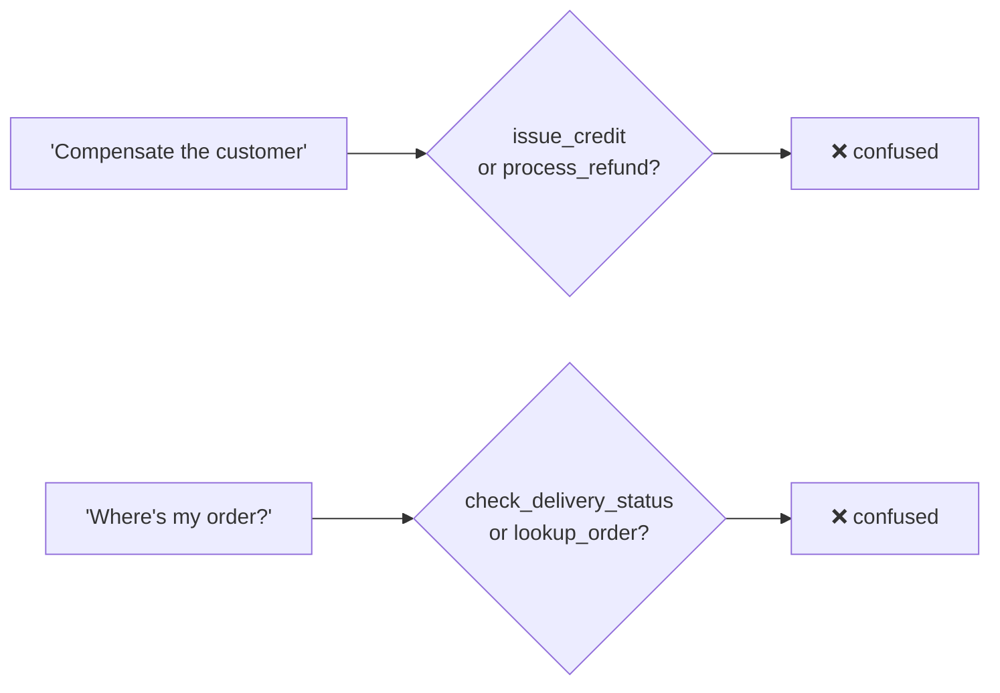
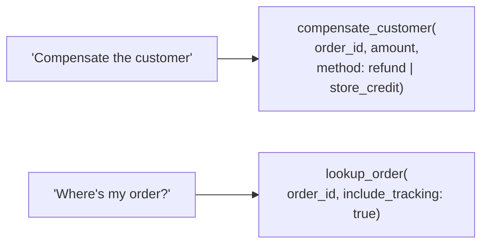

# Q47 — Tool accuracy drops from 88% to 71% after adding overlapping tools: merge the overlap

**Domain / lesson:** D2 › 2.3 Tool Distribution & Tool Choice
**Also touches:** D2 › 2.1 Tool Interface Design (the "consolidation as a first step" trap, and when it doesn't apply)
**Scenario:** customer-support agent (Agent SDK): returns, billing disputes, account issues
**Follows:** [Q23](../Q23-expand-minimal-tool-descriptions/question.md) (first step: better descriptions) · [Q17](../Q17-split-unified-tool/question.md), [Q30](../Q30-split-generic-analyze-document/question.md) (the opposite case: split) · [Q04](../Q04-tool-scoping-per-subagent/question.md) (tool scoping)
**Source:** ExamTopics, CCA-F Topic 1, Question 47. ⚠️ **The question and options below are paraphrased** (the page couldn't be quoted verbatim). Replace them with the exact text when available.

## Question (paraphrased)

You're building a customer support agent with the Claude Agent SDK that handles returns, billing disputes and account issues. After you add six delivery-specific MCP tools, the agent has 10 tools instead of 4, and tool selection accuracy falls from 88% to 71%. Logs show the agent confusing semantically overlapping tools, such as `issue_credit` vs. `process_refund` and `check_delivery_status` vs. `lookup_order`. Which approach structurally eliminates the overlap?

- **A.** Use a tool search tool with deferred loading for the six new tools.
- **B.** Split the tools across two subagents (financial and delivery), with a coordinator routing between them.
- **C.** Add few-shot examples to the system prompt showing when to pick each of the overlapping tools.
- **D.** Merge the overlapping tools: combine `issue_credit` and `process_refund` into one tool (with a parameter for the type), and fold `check_delivery_status` into `lookup_order`.

## Answer: **D**

## Diagram

### Before: two pairs of near-duplicates the model must choose between

### After (D): one tool per purpose, the variant is a parameter

## Concept

**Diagnose first: count or overlap?** Guide 2.1: *"First, diagnose which case you face."* 10 tools is a workable number (Anthropic's tool search docs put the degradation point at *"30 to 50"* tools). And the logs don't show random errors: they show **two specific pairs** being confused. So the problem is **overlap**, not size.

**Overlap means two tools for one purpose.** `issue_credit` and `process_refund` both *compensate the customer*; they differ only in the form (store credit vs. money back). `check_delivery_status` and `lookup_order` both *report on an order*. Whenever a request fits both tools of a pair, nothing in the tool set tells the model which is right.

**D removes the choice instead of helping the model make it.** One tool per purpose, with the variant as a **parameter** (an enum or a flag):
- `compensate_customer(order_id, amount, method: "refund" | "store_credit")`
- `lookup_order(order_id, include_tracking: true)`

Tool selection becomes unambiguous. The remaining decision (refund or credit?) is a clearly described enum value inside the right tool, often set by policy or by the customer's choice. Guide 2.3: when tools *"all do the same kind of work,"* *"combine them into one tool whose parameter names the operation."*

**Split or merge? One tool per *purpose*:**

| Situation | Fix | Example |
|---|---|---|
| **One tool, several purposes** (different params/outputs) | **Split** | Q17 unified order tool, Q30 generic `analyze_document` |
| **One purpose, several tools** (near-duplicates) | **Merge** | Q47 `issue_credit` + `process_refund` |
| **Distinct tools, vague descriptions** | **Expand descriptions** (first step) | Q23 |

**But isn't consolidation a trap (2.1)?** Only *"as the first step"*: *"Tool consolidation is a valid long-term architectural choice, but it requires more effort than expanding descriptions,"* and *"The exam favours low-effort first steps with a large effect."* Read the question's verb:
- *"What's the best **first step**?"* with an "improve the descriptions" option → descriptions (Q23).
- *"What **structurally eliminates** the overlap?"* → merge (Q47). Descriptions and examples **reduce** confusion; only merging **eliminates** the overlap. And no description option is offered here anyway.

## Why the others are wrong

| Option | Why not |
|---|---|
| **A** Tool search with deferred loading for the six new tools | **A fix for size, not overlap.** Deferred loading keeps rarely used tools out of context until a search finds them, which helps with large catalogues (the *"30 to 50"* tools range). With 10 tools that isn't the problem. And when a delivery question comes in, the search loads `check_delivery_status` next to `lookup_order`, so the model faces the same pair. The overlap still exists; it's just loaded later. |
| **B** Split into financial and delivery subagents, with a coordinator | **The confused pairs end up in the same subagent.** `issue_credit` and `process_refund` are both financial, so the financial agent still has to choose between them. `lookup_order` is needed by both roles, so the delivery pair overlaps across agents too. Guide 2.3: *"Splitting tools by role is the wrong fix when the tools all do the same kind of work."* It also adds a coordinator and routing hops (Q39): *"Coordinator round-trips add 2-3 extra hops per request."* |
| **C** Few-shot examples for choosing between overlapping tools | **Mitigation, not elimination.** Guide 2.1: *"Few-shot examples add token overhead without addressing the root cause."* They make the right choice more likely but leave both near-duplicates in place, so new phrasings that fall between the examples still get confused. Not "structural". |

## Pattern to remember

> **Two tools doing the same job → merge them into one tool and make the variant a parameter.** One tool per purpose: split when one tool does several jobs (Q17, Q30), merge when several tools do one job (Q47).

**Exam signals:**
- *"Structurally eliminates"* the overlap → **merge** (only option that removes it).
- *"Best **first** step"* + a description option → **improve descriptions** (2.1 trap: consolidation first).
- Selection degrades with **many** tools (18, 30–50+) → **scope per agent** / tool search. With a **few overlapping** tools → **fix the overlap**.

### Where this comes from in the guide

**D2 › 2.3 Tool Distribution & Tool Choice:**
- *"Every additional tool makes the decision more complex, so error rates increase as the toolkit grows."*
- *"Splitting tools by role is the wrong fix when the tools all do the same kind of work."* *"So combine them into one tool whose parameter names the operation:"* *"Twenty-two tools become four, and nothing is lost."*
- *"Anthropic's tool search docs say Claude's ability to pick the right tool degrades once you exceed 30 to 50 available tools."*
- Exam trap: *"Coordinator round-trips add 2-3 extra hops per request."* (**B**)

**D2 › 2.1 Tool Interface Design:**
- *"Two tools with overlapping or near-identical descriptions confuse the model when it selects a tool."*
- *"First, diagnose which case you face."* *"Descriptions are the fix when the agent has a workable number of tools and cannot distinguish two of them."*
- Exam trap: *"Consolidating similar tools into one as the first step"*. *"Tool consolidation is a valid long-term architectural choice, but it requires more effort than expanding descriptions."* *"The exam favours low-effort first steps with a large effect."*
- *"Few-shot examples add token overhead without addressing the root cause."* (**C**)

## How this connects to earlier questions

| Question | Link |
|---|---|
| [Q23](../Q23-expand-minimal-tool-descriptions/question.md) | Same symptom family (misrouting between tools), different question: Q23 asked for the **first step** (descriptions); Q47 asks what **eliminates** the overlap (merge) |
| [Q17](../Q17-split-unified-tool/question.md), [Q30](../Q30-split-generic-analyze-document/question.md) | The mirror image: one tool doing several jobs → **split**. Q47: several tools doing one job → **merge** |
| [Q04](../Q04-tool-scoping-per-subagent/question.md) | Scoping per agent fixes **too many** tools; it doesn't fix **overlap** inside one role (B) |
| [Q39](../Q39-coordinator-answers-simple-followups/question.md) | B adds a coordinator hop for every request |

## Check question

**A colleague proposes a third merge: fold `cancel_order` into `process_refund`, "since cancelling usually ends in a refund anyway". Merge or keep separate? Why?**

*My answer:* "Keep separate, as it's not just cancel_order that needs process_refund." ✅ **Right decision, and your reason is real evidence:** refunds happen without a cancellation (a returned item, a billing error), and cancellations happen without a refund (an unpaid order, a switch to store credit). The underlying reason is the **merge test** itself:

| | `issue_credit` vs `process_refund` | `cancel_order` vs `process_refund` |
|---|---|---|
| Relationship | **Alternatives**: you do one **OR** the other | **Steps**: you do one **AND THEN** (maybe) the other |
| Same job? | Yes: compensate the customer | No: stop an order vs. move money |
| Parameters | Same shape (order, amount, method) | Different (cancel reason, items vs. amount, payment method) |
| Side effects and rules | Same family | Different: fulfilment and inventory vs. payments (and a $500 escalation hook, Q31) |
| Verdict | **Merge** (variant = parameter) | **Keep separate** |

Merging them would recreate **Q17's problem**: one tool doing two jobs, with a mix of parameters that only apply to one mode, and gates (like Q31's refund hook) that have to work out which mode was meant. The sequence "cancel, then refund" belongs in the **agentic loop** (the model calls one, sees the result, calls the next, Q13) or in a fixed workflow if it must always happen.

> **Merge alternatives (OR). Keep workflow steps separate (AND THEN). "Often used together" is not the same as "the same job".**

## Glossary

- **Semantic overlap:** two tools whose descriptions both fit the same request, so the model can't tell which is right.
- **Tool consolidation (merge):** replacing near-duplicate tools with one tool whose parameter selects the variant (`method: refund | store_credit`).
- **Tool search with deferred loading:** keeping tool definitions out of the context until a search tool finds them. For large catalogues (roughly 30–50+ tools), not for overlap.
- **Tool selection accuracy:** how often the agent picks the right tool for a request (here 88% → 71%).

## Related course lessons

*Lecture lengths aren't recorded in the study-map files, so the watch times below are estimates from each course's average lecture length.*

### Udemy A (primary): Claude Certified Architect (CCAR-F) - 2026 Exam Prep
| # | Lecture | Part | Why |
|---|---|---|---|
| **40** | **Selection Heuristics and Tool-Selection Failures** | 2A | ⭐ Diagnosing overlap vs. count |
| **42** | **Tool Search for Large Catalogs** | 2A | ⭐ What tool search is for (why A doesn't fit) |
| 39 | Tool Scoping per Agent — Why Less Is More | 2A | Scoping fixes count, not overlap (B) |
| 32 | How Claude Selects Tools | 2A | Why overlapping tools confuse selection *(also in Q23)* |
| Quiz 5 | 2A quiz | | Self-test |

**▶ Watch in this order (~30 min, est.):** #32 → #40 → #39 → #42, then do **Quiz 5**.

### Udemy B: Claude Certified Architect Foundations: Complete Course (Voroniuk)
| # | Lecture | Section | Why |
|---|---|---|---|
| **42** | **Renaming, Splitting and Keyword Triggers** | S5 Tools & MCP | ⭐ Fixing overlapping tools *(also in Q23)* |
| **41** | **How Claude Chooses a Tool** | S5 Tools & MCP | ⭐ Why near-duplicates get confused |
| 63 | Scoping Each Agent's Tools | S7 Multi-Agent Systems | Why splitting by role doesn't fix same-job tools (B) |
| Quiz 5 | Tools & MCP quiz | S5 | Self-test |

**▶ Watch in this order (~15 min, est.):** #41 → #42 → #63, then do **Quiz 5**.

### CBT Nuggets: CCA-F course
| Skill | Why |
|---|---|
| **22. Route Requests Across Multiple Tools** | ⭐ Tool selection across a growing tool set |
| 19. Explain Tool Use and Tool Schemas | Parameters and enums (how the merged tool carries the variant) |
