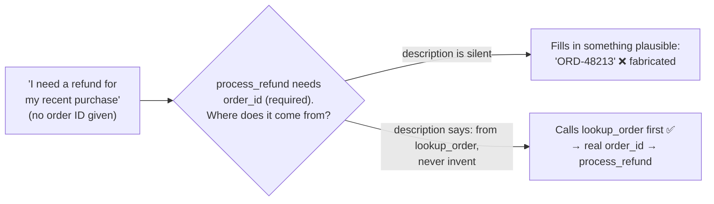

# Q48 — The agent invents an order_id: say where the value must come from

**Domain / lesson:** D2 › 2.1 Tool Interface Design
**Also touches:** D2 › 2.3 Tool Distribution & Tool Choice (`tool_choice`) · D1 › 1.4 Workflow Enforcement (a code gate as the safety net, see the check question)
**Note:** the guide's 2.1 covers parameter descriptions (types, formats, which identifiers a tool accepts) but not fabricated values. The "say what each parameter means" rule below is from Anthropic's **Define tools** docs (checked 2026-10-31).
**Scenario:** customer-support agent, `lookup_order` → `process_refund`
**Follows:** [Q20](../Q20-parameter-descriptions/question.md) (descriptions give meaning) · [Q19](../Q19-tool-accepts-available-identifier/question.md) (where a tool's input comes from) · [Q16](../Q16-escalation-triggers/question.md) (instruct the judgment, gate the numbers)

## Question

During testing, you find that when a customer says "I need a refund for my recent purchase," the agent calls process _refund immediately – but populates the required order_id parameter with a plausible-looking but fabricated value instead of first calling lookup_order to retrieve the actual order ID. The refund call fails because the fabricated ID doesn't exist. Which change directly addresses the root cause of the agent fabricating the order_id value?

- **A.** Switch tool_choice from "auto" to "any" to force the agent to make a tool call on every turn.
- **B.** Update the process_refund tool description to explicitly state that order_id must be obtained from a prior lookup_order call and must never be assumed or invented.
- **C.** Pre-parse incoming customer messages to extract any order IDs mentioned, and inject them into the conversation context before passing to Claude.
- **D.** Add server-side validation that checks whether the order_id exists in your database before executing the refund, returning an error to the agent if not found.

## Answer: **B**

## Diagram

### Why the model invents a value



### The fix (B), in the tool definition

```json
{
  "name": "process_refund",
  "description": "Issues a refund for one order. Call this only after lookup_order has returned the order. ...",
  "input_schema": {
    "type": "object",
    "properties": {
      "order_id": {
        "type": "string",
        "description": "The order ID exactly as returned by a prior lookup_order call in this conversation. Never guess, assume or construct an ID. If you don't have one, call lookup_order first (or ask the customer)."
      }
    },
    "required": ["order_id"]
  }
}
```

## Concept

**Root cause: the model doesn't know where `order_id` comes from.** The schema says it's a required string. The description doesn't say *"this comes from lookup_order"*. The customer didn't give one. So the model does what a required field invites: it fills in a value that **looks** right. The model isn't being careless; nothing in the tool's interface told it that this value has a **source**.

**The tool description is how the model learns that.** Anthropic's *Define tools* docs: *"Provide extremely detailed descriptions. This is by far the most important factor in tool performance."* The description should explain *"What each parameter means and how it affects the tool's behavior."* For an ID, "what it means" includes **where it comes from**. Guide 2.1: *"Tool descriptions are the primary mechanism LLMs use for tool selection,"* and *"not supplementary metadata."*

**B targets the cause; D catches the effect.** The question says *"directly addresses the root cause of the agent fabricating."* D's validation is a good **safety net** (and worth having), but it acts after the model has already invented the ID, and the refund already fails today without it.

**Description ≠ guarantee.** B makes fabrication much less likely, but it's still the model's choice. Q20's ladder: *schema → valid shape; description → correct meaning (likely); code check → guaranteed.* For money, add a code gate on top (see the check question). The question asks for the **root cause**, though, and that's the missing information in the description.

## Why the others are wrong

| Option | Why not |
|---|---|
| **A** `tool_choice: "any"` (force a tool call every turn) | **Makes it worse.** The agent already calls tools; the problem is *which value* it passes. Forcing a call every turn adds pressure to call **something** even when it should ask the customer or explain, and doesn't tell it where `order_id` comes from. The docs: *"`any` tells Claude that it must use one of the provided tools, but doesn't force a particular tool."* (Side note: on the newest models, forced `tool_choice` isn't supported at all; the docs suggest `auto` instead.) |
| **C** Pre-parse messages for order IDs and inject them | **There's nothing to extract.** The customer said *"my recent purchase"*, with no ID. The real source is `lookup_order` (by customer), not the message text. It adds a brittle preprocessing layer for a case that doesn't occur here, and when no ID is found, the model is back where it started. |
| **D** Server-side check that the order_id exists | **Catches the effect, not the cause.** The refund **already** fails on a non-existent ID, so D mostly formalises today's failure (a structured error is still an improvement, Q24/Q32). It doesn't stop the model from inventing IDs. And an **existence** check misses the worst case: a fabricated ID that happens to **exist**, belonging to another customer. That passes D and refunds the wrong order (Q20: *valid ≠ correct*). Keep it as a safety net, with an ownership check, but it isn't the root-cause fix. |

## Pattern to remember

> **The model fills a required parameter with a made-up value → its description doesn't say where the value comes from.** Fix the description: state the source ("from a prior lookup_order call"), and say "never guess or construct". Then add a code check as the safety net for anything costly.

**Exam signals:**
- *"Directly addresses the **root cause**"* of a model behaviour → fix what the model **knows** (the description), not what happens **after** (validation).
- *"Fabricated"* / *"plausible-looking"* parameter values → the parameter's **source** is undocumented.
- Forcing tool calls (`any`) never fixes *which values* the model passes.

### Where this comes from

**Anthropic docs, Define tools › Best practices for tool definitions** (platform.claude.com, checked 2026-10-31):
- *"Provide extremely detailed descriptions. This is by far the most important factor in tool performance."*
- Descriptions should explain *"What the tool does,"* *"When it should be used (and when it shouldn't),"* and *"What each parameter means and how it affects the tool's behavior."*
- `tool_choice`: *"`auto` allows Claude to determine whether to call any provided tools."* *"`any` tells Claude that it must use one of the provided tools, but doesn't force a particular tool."*

**Guide D2 › 2.1 Tool Interface Design:**
- *"Tool descriptions are the primary mechanism LLMs use for tool selection."* *"Tool descriptions are not supplementary metadata."*
- A good description covers *"What inputs it expects: data types, formats, constraints, and required versus optional fields,"* and *"which identifiers each tool accepts."*

## How this connects to earlier questions

| Question | Link |
|---|---|
| [Q20](../Q20-parameter-descriptions/question.md) | Parameter descriptions give meaning. Here, "meaning" includes **where the value comes from**. Schema = shape, description = meaning, code = guarantee |
| [Q19](../Q19-tool-accepts-available-identifier/question.md) | The other fix for a dependent tool: make it accept the identifier the agent already has. Not an option here, but the same root issue (where the input comes from) |
| [Q16](../Q16-escalation-triggers/question.md), [Q31](../Q31-refund-threshold-hook/question.md) | Instruct the judgment (B), gate the money (check question) |
| [Q24](../Q24-structured-errors-not-exceptions/question.md), [Q32](../Q32-uniform-errors-add-category/question.md) | D's error is useful as a structured, actionable error ("call lookup_order first"), but it's recovery, not prevention |
| [Q46](../Q46-stateless-api-pass-full-history/question.md) | Same split as its check question: the model *finds* the ID; code *checks* it before acting |

## Check question

**B fixes the cause, but it's still probabilistic. What code-level check inside `process_refund` (or a PreToolUse hook) would *guarantee* that an invented or wrong order_id can never trigger a refund? Why isn't D's "the ID exists" enough?**

*My answer:* "lookup_order passes the value to the persistent facts. The 'ID exists' check isn't enough, as it doesn't guarantee that even an existing ID is the right one, or belongs to the right customer." ✅ **Correct on both.** Here's the gate spelled out:

**Code records what `lookup_order` returned.** Each time `lookup_order` runs, code adds the returned order IDs to the session state (the code side, not text in the prompt, Q46). Then the gate in `process_refund` checks:

| Check | Catches |
|---|---|
| **1. `order_id` was returned by `lookup_order` in this session** | Invented IDs, even ones that happen to exist |
| **2. The order belongs to the session's verified customer** (database check) | Someone else's order (privacy, wrong refund) |
| 3. The order is refundable (status, window, amount limit; Q13, Q31) | Policy violations |

If a check fails → **block**, and return a structured error: *"order_id not from lookup_order: call lookup_order first"* (Q24, Q32). The model self-corrects.

**Why "exists" isn't enough:** existence is a property of the **database**; what matters is the **relationship** to this conversation. A fabricated ID that exists is the worst case: it passes D and refunds a stranger's order.

**What code still can't decide:** *which* of the customer's own orders they meant by *"my recent purchase"*. If `lookup_order` returns several, that's ambiguity about a costly action → **ask or confirm with details** (Q37's grid; 5.2's "never pick one itself"). The gate guarantees the ID is **real and theirs**; the conversation makes sure it's **the one they meant**.

> **Gate on provenance and ownership, not existence: "did this ID come from our lookup, for this customer?"**

## Glossary

- **Fabricated (hallucinated) parameter:** a value the model makes up to fill a required field, often plausible-looking.
- **Parameter source:** where a value must come from (the customer, a prior tool result). Undocumented sources invite guessing.
- **`tool_choice`:** `auto` (model decides), `any` (must call some tool), `tool` (must call a named tool), `none` (no tools).
- **Safety net vs. root-cause fix:** validation catches a bad call after it's made; a better description stops the model from making it.

## Related course lessons

*Lecture lengths aren't recorded in the study-map files, so the watch times below are estimates from each course's average lecture length.*

### Udemy A (primary): Claude Certified Architect (CCAR-F) - 2026 Exam Prep
| # | Lecture | Part | Why |
|---|---|---|---|
| **33** | **Writing Tool Descriptions That Route Correctly** | 2A | ⭐ Option B: what a description must say *(also in Q23)* |
| **35** | **Required vs. Optional Parameters, Enums, and Constraints** | 2A | ⭐ Why a required field with no source invites guessing |
| 36 | Strict Tool Use and Valid Inputs | 2A | Strict = schema-valid, not *real* (a fabricated ID is valid) |
| 41 | Controlling Tool Selection | 2A | `tool_choice` (why A doesn't help) |
| Quiz 5 | 2A quiz | | Self-test |

**▶ Watch in this order (~30 min, est.):** #33 → #35 → #36 → #41, then do **Quiz 5**.

### Udemy B: Claude Certified Architect Foundations: Complete Course (Voroniuk)
| # | Lecture | Section | Why |
|---|---|---|---|
| **41** | **How Claude Chooses a Tool** | S5 Tools & MCP | ⭐ What the model reads to decide *(also in Q47)* |
| **27** | **tool_choice: auto, any and Forced** | S4 Structured Output | ⭐ Why forcing a call (A) doesn't fix the values |
| 49 | Prerequisite Gates in Code | S6 Support Agent | The check question: the code-level guarantee *(also in Q46)* |
| Quiz 5, Quiz 4 | Tools & MCP and Structured Output quizzes | S5, S4 | Self-test |

**▶ Watch in this order (~15 min, est.):** #41 → #27 → #49, then do **Quiz 5** and **Quiz 4**.

### CBT Nuggets: CCA-F course
| Skill | Why |
|---|---|
| **19. Explain Tool Use and Tool Schemas** | ⭐ Tool and parameter descriptions |
| 22. Route Requests Across Multiple Tools | `tool_choice` and tool sequencing |
