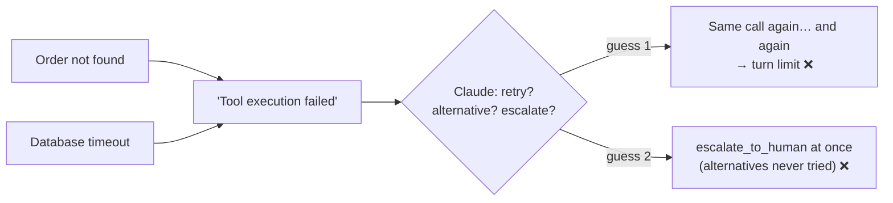
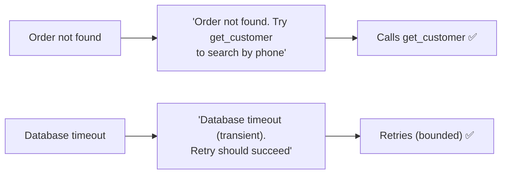

# Q49 — "Tool execution failed": write errors that say what went wrong and what to try next

**Domain / lesson:** D2 › 2.2 Structured Error Responses
**Also touches:** D5 › 5.3 Error Propagation (local retries) · D2 › 2.4 MCP (`is_error` / `isError`)
**Scenario:** billing dispute agent, `lookup_order` catches all exceptions
**Follows:** [Q32](../Q32-uniform-errors-add-category/question.md) (uniform errors → categories) · [Q27](../Q27-actionable-error-context/question.md) (actionable context) · [Q33](../Q33-mcp-iserror-result/question.md) (keep `isError: true`) · [Q34](../Q34-business-errors-not-retryable/question.md) (tool-level retries fix the wrong half)

## Question

Anthropic's tool use documentation states: "Write instructive error messages. Instead of generic errors like 'failed', include what went wrong and what Claude should try next." A billing dispute agent uses lookup_order, which catches all exceptions and returns a tool_result with is_error: true and the message "Tool execution failed". Monitoring shows two failure modes: the agent retries the identical call until hitting the turn limit, or it immediately calls escalate_to_human without trying alternative tools. Which change follows the documented recommendation and gives Claude the information it needs to select the correct recovery action for each error type?

- **A.** Implement retry logic with exponential backoff inside each tool implementation so transient errors are resolved transparently within the tool before any failure result is surfaced to Claude in the agentic loop.
- **B.** Add an error classification step in the agentic loop that intercepts tool errors before Claude sees them, tags each as "retry," "try_alternative," or "escalate," and appends that recommendation to the tool result.
- **C.** Remove is_error: true and return the error details as normal tool content, so Claude reasons about the response as data rather than treating it as a flagged failure condition that biases retry behavior.
- **D.** Return error-type-specific messages with is_error: true, e.g., "Order not found-try get_customer to search by phone" for data errors and "Database timeout (transient)-retry should succeed" for infrastructure errors.

## Answer: **D**

## Diagram

### Now: one message for every failure, so Claude guesses

### Fix (D): each error says what went wrong and what to try next

## Concept

**Both failure modes have one cause: Claude can't tell the errors apart.** *"Tool execution failed"* is the same text for a missing order and a database hiccup. So Claude guesses:
- guess "temporary" → **retries the identical call** (useless for "not found", so it hits the turn limit);
- guess "hopeless" → **escalates immediately** (it doesn't know an alternative tool exists).

**D gives each error type its own message, with the two parts the docs ask for:** *what went wrong* + *what to try next*.

| Error type | D's message | Recovery it unlocks |
|---|---|---|
| **Data** (order not found) | *"Order not found — try get_customer to search by phone"* | **Alternative tool** (fixes premature escalation) |
| **Infrastructure** (timeout) | *"Database timeout (transient) — retry should succeed"* | **Retry** (fixes retrying the wrong kind of error) |

**Only the tool knows what happened.** It caught the exception, so it has the exception type, the query and the backend's answer. That's where the message must be written. Anything downstream sees only "Tool execution failed".

**The upgrade (Q32):** D's messages are prose. Adding structured fields (`errorCategory`, `isRetryable`) on top makes the signal even more reliable. Both keep `is_error: true`.

## Why the others are wrong

| Option | Why not |
|---|---|
| **A** Retry with backoff inside each tool | **Fixes the wrong half, and doesn't change the message.** Bounded local retries for transient errors are good practice (5.3), but "Order not found" isn't transient, so after the retries it still surfaces as *"Tool execution failed"*. Claude still can't tell what happened, still loops or escalates. It doesn't follow the documented recommendation either: the message stays generic. Same as Q34 A. |
| **B** A classification step in the loop tags errors "retry / try_alternative / escalate" | **The classifier has nothing to classify.** By the time the loop sees the error, the tool has already flattened every exception to "Tool execution failed"; the information about *what went wrong* is gone. It adds a layer that guesses (Q27's `analyze_error` problem), and it hands Claude a verdict instead of the facts it needs. The fix belongs at the source, in the tool's message. |
| **C** Drop `is_error: true`, return the details as normal content | **Disguises the failure as data.** This is the fake-success pattern (Q33 D, Q27 C): code that relies on `is_error` (metrics, hooks, retries) now counts failures as successes, and the model may treat an error text as a valid answer. And it adds no information: "Tool execution failed" without the flag is no more helpful. The retry loops come from **missing information**, not from the flag. |

## Pattern to remember

> **Generic "failed" errors → Claude guesses (loops or gives up). Write each error type's message with *what went wrong* + *what to try next*, keep `is_error: true`, and write it in the tool, which is the only place that knows.**

**Exam signals:**
- Two opposite failure modes (retrying forever **and** escalating too early) from **one** generic message → the message lacks the information to choose.
- Options that intercept, classify or retry **after** the information is lost (A, B) or hide the error flag (C) don't fix the message.

### Where this comes from

**Anthropic docs, Handle tool calls › Handling errors with is_error** (platform.claude.com, checked 2026-10-31):
- *"If the tool itself throws an error during execution (for example, a network error when fetching weather data), you can return the error message in the `content` along with `"is_error": true`."*
- Tip: *"Write instructive error messages. Instead of generic errors such as `"failed"`, include what went wrong and what Claude should try next (for example, `"Rate limit exceeded. Retry after 60 seconds."`). This gives Claude the context it needs to recover or adapt without guessing."*

**Guide D2 › 2.2 Structured Error Responses:**
- *"A generic message such as "Operation failed" is useless to an LLM."*
- *"Without errorCategory, isRetryable, and a description, the agent cannot distinguish transient failures from business rule violations."*

**Guide D5 › 5.3 Error Propagation:**
- *"Subagents should recover locally from transient failures"* (bounded retries, e.g. 3 with backoff). A is fine **in addition**, not instead.

## How this connects to earlier questions

| Question | Link |
|---|---|
| [Q32](../Q32-uniform-errors-add-category/question.md) | Same symptom (uniform "Operation failed" → random recovery), same fix family. Q32 adds `errorCategory` + `isRetryable`; Q49 is the docs' message-level version |
| [Q27](../Q27-actionable-error-context/question.md) | Actionable error context; B ≈ Q27's extra "analyze the error" step with nothing to analyze |
| [Q33](../Q33-mcp-iserror-result/question.md) | C drops the flag: a fake success. Keep `is_error: true` |
| [Q34](../Q34-business-errors-not-retryable/question.md) | A ≈ Q34 A: retries for transient errors don't fix the non-transient ones |
| [Q26](../Q26-timeout-unknown-status-no-retry/question.md) | "Retry should succeed" is safe here because `lookup_order` is **read-only**. On a side-effecting tool, a timeout needs "outcome unknown, check first" |
| [Q24](../Q24-structured-errors-not-exceptions/question.md) | The tool catches exceptions, but must turn them into **informative** results, not one generic string |

## Check question

**Write the message `lookup_order` should return for a third error type: the customer's account is locked for a fraud review, and the agent must not keep trying to access it. Include what went wrong and what Claude should do next.**

*My answer:* (pending)

## Glossary

- **Instructive error message:** an error that says what went wrong and what to try next, so the model can recover without guessing.
- **Data error:** the request was valid but the data isn't there (order not found). Retrying the same input won't help; a different tool or input might.
- **Infrastructure (transient) error:** a temporary system failure (timeout). Retrying a read-only call should succeed.
- **Turn limit:** the cap on agent-loop iterations. Hitting it by retrying the same failing call is a wasted session.

## Related course lessons

*Lecture lengths aren't recorded in the study-map files, so the watch times below are estimates from each course's average lecture length.*

### Udemy A (primary): Claude Certified Architect (CCAR-F) - 2026 Exam Prep
| # | Lecture | Part | Why |
|---|---|---|---|
| **37** | **Returning Useful Errors from Tools** | 2A | ⭐ Exactly option D *(also in Q24, Q32, Q33, Q34)* |
| **38** | **Tool Retry Logic and Partial Success Patterns** | 2A | ⭐ Where retries belong (why A is an add-on) *(also in Q34, Q41)* |
| 116 | Where to Catch the Error | 5B | Why the message must be written in the tool (why B can't work) *(also in Q33)* |
| Quiz 5 | 2A quiz | | Self-test |

**▶ Watch in this order (~20 min, est.):** #37 → #38 → #116, then do **Quiz 5**.
If Q32–Q34 are fresh, rewatch #37 and go straight to the quiz.

### Udemy B: Claude Certified Architect Foundations: Complete Course (Voroniuk)
| # | Lecture | Section | Why |
|---|---|---|---|
| **43** | **Structured Tool Errors** | S5 Tools & MCP | ⭐ Error types and what each tells the model *(also in Q32–Q34)* |
| **45** | **Practice: Structured Tool Errors in Code** | S5 Tools & MCP | ⭐ Turning caught exceptions into informative results *(also in Q33, Q34)* |
| Quiz 5 | Tools & MCP quiz | S5 | Self-test |

**▶ Watch in this order (~10 min, est.):** #43 → #45, then do **Quiz 5**.

### CBT Nuggets: CCA-F course
| Skill | Why |
|---|---|
| **20. Handle Tool Calls and Tool Results** | ⭐ `is_error` results back to the model *(also in Q33, Q34)* |
