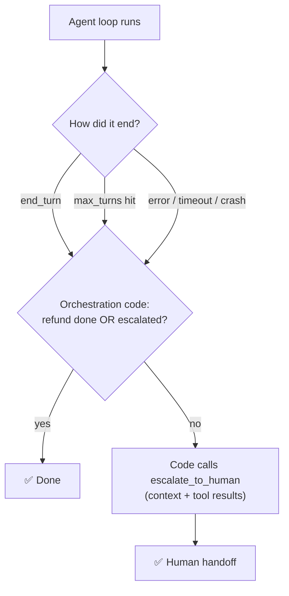

# Q50 — Agent hits `max_turns` mid-dispute: code after the loop guarantees resolution or handoff

**Domain / lesson:** D1 › 1.4 Workflow Enforcement & Handoff (deterministic guarantees in code; self-contained handoff)
**Also touches:** D1 › 1.1 Agentic Loops (caps are safety limits, not control) · D1 › 1.5 Agent SDK Hooks (why D isn't a guarantee)
**Scenario:** customer-support agent, billing disputes (`get_customer` → `lookup_order` → `process_refund` or `escalate_to_human`)
**Follows:** [Q51](../Q51-stop-reason-controls-loop/question.md) (`stop_reason` controls the loop) · [Q15](../Q15-mid-process-escalation-handoff/question.md) (self-contained mid-process handoff) · [Q28](../Q28-tamper-proof-threshold-in-tool/question.md) (enforce in code, not prompts)

## Question

Production logs show that when the agent handles complex billing disputes requiring 6+ tool calls, it sometimes exhausts its max_turns limit after gathering data but before completing resolution or escalating. The team's goal is to guarantee that every customer interaction ends with either a completed resolution or a human handoff, regardless of how the agent loop terminates. Which approach achieves this guarantee?

- **A.** Add system prompt instructions telling the agent to call escalate_to_human with a summary of its findings whenever it determines it cannot complete resolution within its remaining actions.
- **B.** Split the workflow into two sequential agent invocations – a first agent gathers information via get_customer and lookup_order, then a second agent receives that data and handles process_refund or escalate_to_human, each with separate turn budgets.
- **C.** Add orchestration-layer code that checks the agent's outcome after each loop termination – if the loop ended without a completed resolution or escalation, programmatically call escalate_to_human with the accumulated conversation context and tool results.
- **D.** Implement a pre-tool-use hook that counts tool invocations and terminates the loop with an automatic escalation once the agent reaches 80% of its max_turns limit.

## Answer: **C**

## Diagram

## Concept

**Two key words in the stem: "guarantee" and "regardless of how the agent loop terminates".**

- **Guarantee** → it must be **code**, not a prompt. Guide 1.4: *"Prompt-based guidance is probabilistic. Programmatic enforcement is deterministic."* *"A prompt instruction works most of the time, perhaps in 90-95% of cases."*
- **Regardless of how it terminates** → the check must sit **after** the loop, where **every** ending passes through: `end_turn` without action, `max_turns`, an error, a timeout.

**C is a post-loop safety net.** When the loop returns (for whatever reason), orchestration code asks one plain-data question: *was a refund completed or an escalation made?* If not, the code itself calls `escalate_to_human` with the accumulated context and tool results. No path can skip it, because it doesn't depend on the model or on which way the loop ended.

The handoff must be **self-contained**: guide 1.4: *"The human agent does not have access to the conversation transcript."* *"The handoff summary is the only information they receive."* That's why C passes the **accumulated context and tool results**.

## Why the others are wrong

| Option | Why not |
|---|---|
| **A** Prompt: escalate when you can't finish in time | **Probabilistic, not a guarantee.** Works "most of the time"; and the failure is precisely the agent **not noticing** it's running out. Guide trap: options like this *"improve probability but do not eliminate the failure rate."* Also, the model can't reliably count its remaining turns. |
| **B** Two agents with separate turn budgets | **Lowers the odds, doesn't guarantee.** Each agent can still hit **its** cap (a complex dispute can need more gathering than budgeted), and agent 2 can still end without acting. No component checks the outcome. More architecture, same gap. |
| **D** PreToolUse hook escalates at 80% of `max_turns` | **Code, but covers only one ending.** It fires only on **tool calls** near the cap. Loops that end another way (an error, `end_turn` with no action, a timeout) never reach 80% and slip through. And cutting off at 80% escalates disputes the agent was about to resolve (guide 1.1: caps *"cut off useful work"*). |

## Pattern to remember

> **"Guarantee X regardless of how the loop ends" → a deterministic check in orchestration code *after* the loop, with a programmatic fallback (escalate with full context).**

**Exam signals:**
- "guarantee" + "regardless of how … terminates" → **post-loop code check**.
- Reject: prompt instructions (probabilistic), restructuring that only lowers the odds (B), hooks that cover one exit path (D).

**Caps vs guarantees (1.1 + 1.4):**

| Mechanism | Role |
|---|---|
| `stop_reason` | **Controls** the loop (Q51) |
| `max_turns` cap | **Safety limit** against runaway loops: *"never as the primary control"* |
| Post-loop outcome check | **Guarantees** the business outcome, whatever stopped the loop |

### Where this comes from

**Guide D1 › 1.4 Workflow Enforcement & Handoff** (checked 2026-11-03):
- *"Prompt-based guidance is probabilistic. Programmatic enforcement is deterministic."*
- *"A prompt instruction works most of the time, perhaps in 90-95% of cases."*
- *"A gate works every time. It is code, not a prompt instruction, so it is deterministic."*
- Trap: *"Reject them. They improve probability but do not eliminate the failure rate."*
- *"For financial, security, and compliance operations, only programmatic enforcement is correct."*
- *"The human agent does not have access to the conversation transcript."* *"The handoff summary is the only information they receive, so it must be self-contained."*

**Guide D1 › 1.1 Agentic Loops:**
- *"A cap is acceptable as a safeguard against runaway agents (agents that do not stop), never as the primary control."*
- *"Iteration caps either cut off useful work or run unnecessary iterations."*
- *"Caps address runaway loops, not premature exits."*

## How this connects to earlier questions

| Question | Link |
|---|---|
| [Q51](../Q51-stop-reason-controls-loop/question.md) | `stop_reason` controls the loop; this question adds what happens **after** it ends |
| [Q15](../Q15-mid-process-escalation-handoff/question.md) | Mid-process handoff must be self-contained |
| [Q16](../Q16-escalation-triggers/question.md) | Gate on **plain data** ("refund done or escalated?"), not on a judgment |
| [Q28](../Q28-tamper-proof-threshold-in-tool/question.md) | Enforce in code the model can't skip |
| [Q118](../Q118-agentic-review-follows-cross-file-references/question.md) | Same idea in CI: when the cap is hit, never end silently |

## Check question

**(1) D is also code (a hook), so why isn't it a guarantee? Name a way the loop can end that D doesn't cover. (2) The fallback escalation is triggered by code, not by the agent. What must its handoff contain so the human doesn't have to ask the customer to repeat everything?**

*My answer:* "It would miss other kinds of loop endings, like errors or timeouts. These could never reach 80% of max_turns and thus the hook would not be involved." 🟡 **Part 1 ✅, part 2 missing.**

**(1) ✅ Right reason:** D only fires on tool calls approaching the cap; any other ending bypasses it. The subtlest one to remember: **`end_turn` with no action**: the agent replies "I've looked into your dispute and will get back to you" and stops. No error, no cap, no escalation, and the customer is left hanging. Only a check **after** the loop sees it.

**(2) What the code-triggered handoff must contain.** The human *"does not have access to the conversation transcript"*, so the summary is all they get (guide 1.4, Q15):

| Field | Example |
|---|---|
| **Who** | Customer ID, name, account tier (from `get_customer`) |
| **What they asked** | "Disputes a double charge of €49.99 on order #8812" |
| **What was found** | Tool results: order details, both charges, dates (from `lookup_order`) |
| **What was done / not done** | "No refund issued; no escalation made by the agent" |
| **Why it was handed off** | "Agent loop ended at `max_turns` before resolution" (the termination reason) |
| **Recommended action** | "Verify duplicate charge and refund €49.99" (guide: *"Recommended action: what the agent believes the human agent should do."*) |

Note the code has an advantage here: it builds the handoff from **structured data** (tool results, termination reason) it already holds, so it doesn't depend on the agent writing a good summary.

> **Fallback in code + self-contained handoff = the customer never repeats themselves, however the loop ended.**

## Glossary

- **`max_turns`:** the cap on how many turns the agent loop may run; a safety limit.
- **Orchestration layer:** your code around the agent loop: starts it, reads its result, decides what happens next.
- **Post-loop check:** code that inspects the outcome after the loop returns, whatever the reason it stopped.
- **Programmatic fallback:** an action the code takes itself when the agent didn't (here, `escalate_to_human`).
- **Self-contained handoff:** a summary the human can act on without the transcript.

## Related course lessons

*Lecture lengths aren't recorded in the study-map files, so the watch times below are estimates.*

### Udemy A (primary): Claude Certified Architect (CCAR-F) - 2026 Exam Prep
| # | Lecture | Part | Why |
|---|---|---|---|
| **28** | **Why Prompts Are Not Sufficient for High-Stakes Paths** | 1D | ⭐ Why A fails |
| **29** | **Designing Programmatic Validation and Enforcement Layers** | 1D | ⭐ The post-loop check (C) |
| 6 | Loop Control — Stopping, Iterating, and Escalating | 1A | Caps vs control |
| 20 | Handoff Protocols and Continuity Across Agents | 1C | What the handoff carries |
| Quiz 4, Quiz 1, Quiz 3 | 1D, 1A and 1C quizzes | | Self-test |

**▶ Watch in this order (~20 min, est.):** #6 → #28 → #29 → #20, then do **Quiz 1**, **Quiz 4** and **Quiz 3**.

### Udemy B: Claude Certified Architect Foundations: Complete Course (Voroniuk)
| # | Lecture | Section | Why |
|---|---|---|---|
| **39** | **When the Agentic Loop Stops** | S5 Tools & MCP | ⭐ All the ways a loop ends |
| **49** | **Prerequisite Gates in Code** | S6 Support Agent | ⭐ Deterministic enforcement |
| 51 | Handoffs and Multi-Concern Requests | S6 Support Agent | Self-contained handoff |
| 50 | Hooks: Intercepting Tool Calls | S6 Support Agent | What hooks can and can't cover (vs D) |
| Quiz 5, Quiz 6 | Tools & MCP and Support Agent quizzes | S5, S6 | Self-test |

**▶ Watch in this order (~20 min, est.):** #39 → #49 → #50 → #51, then do **Quiz 5** and **Quiz 6**.

### CBT Nuggets: CCA-F course
| Skill | Why |
|---|---|
| **6. Implement Hooks for Safer Automation** | ⭐ Enforcement in code (and what hooks cover, vs D) |
| 21. Build Multi Turn Tool Conversations | The loop and how it ends |
