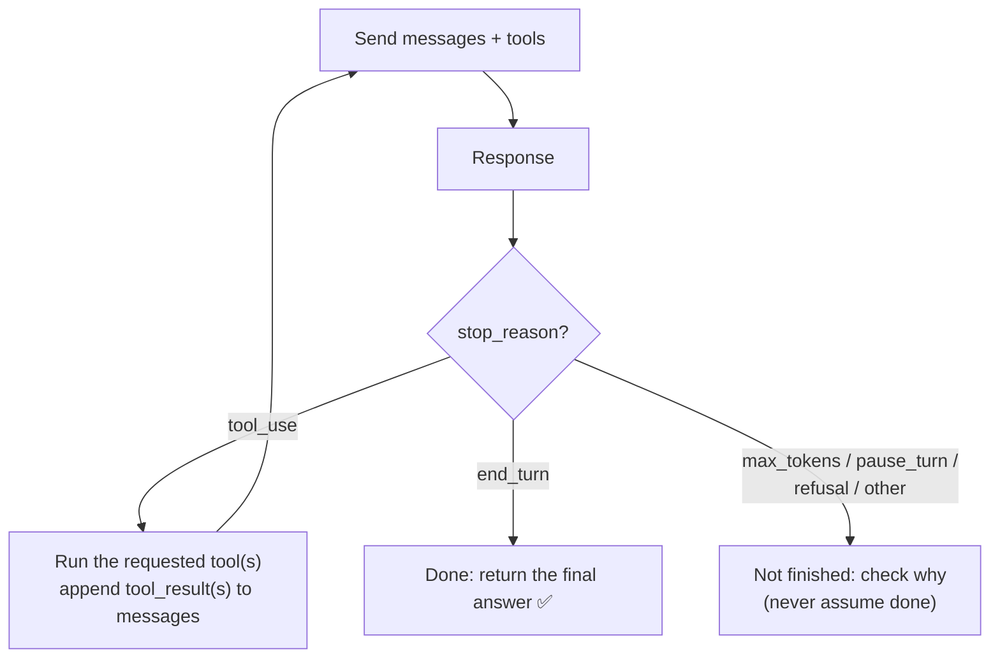

# Q51 — What tells the agentic loop to continue or stop? `stop_reason`

**Domain / lesson:** D1 › 1.1 Agentic Loops
**Scenario:** customer-support agent, warranty claim (`get_customer` → `lookup_order` → `process_refund` or `escalate_to_human`)
**Follows:** [Q13](../Q13-agentic-loop-model-decides-next-tool/question.md) (the model decides the next tool; code reads `stop_reason`) · [Q46](../Q46-stateless-api-pass-full-history/question.md) (append results, send the full history) · [Q36](../Q36-coordinator-missing-task-tool/question.md) (text that narrates an action isn't the action)

## Question

A customer contacts the agent about a warranty claim on a power drill. Resolving this requires multiple sequential tool calls: get_customer to look up their account, lookup_order to find the purchase details, and then either process_refund or escalate_to_human depending on warranty eligibility. You're implementing the agentic loop that orchestrates these steps using the Claude API. What is the primary mechanism your application uses to determine whether to continue the loop or stop?

- **A.** You manually set the tool_choice parameter to "none" after the final expected tool call to force Claude to stop requesting tools.
- **B.** You check whether Claude's response contains a text content block – if text is present, the agent has produced its final answer and the loop should exit.
- **C.** You track the number of tool calls made and exit the loop once a preconfigured maximum is reached.
- **D.** You check the stop_reason field in each API response – the loop continues while it equals "tool_use" and exits when it changes to "end_turn" or another terminal value.

## Answer: **D**

## Diagram



### The warranty case, turn by turn

| Turn | Claude's response | `stop_reason` | Loop |
|---|---|---|---|
| 1 | "Let me look up your account." + `get_customer` | `tool_use` | Continue |
| 2 | `lookup_order` | `tool_use` | Continue |
| 3 | "It's within the 2-year warranty." + `process_refund` | `tool_use` | Continue |
| 4 | "Your refund of $129 has been issued…" | `end_turn` | **Stop** |

Note turns 1 and 3: **text and a tool call in the same response**. That's why B fails.

```python
while True:
    response = client.messages.create(model=MODEL, system=SYSTEM, tools=TOOLS, messages=messages)
    messages.append({"role": "assistant", "content": response.content})

    if response.stop_reason == "tool_use":
        results = [run_tool(block) for block in response.content if block.type == "tool_use"]
        messages.append({"role": "user", "content": results})
        continue
    if response.stop_reason == "end_turn":
        break
    handle_unfinished(response)  # max_tokens, pause_turn, refusal… → check why, don't assume done
```

## Concept

**`stop_reason` is the API telling you why Claude stopped generating.** Guide 1.1: *"The `stop_reason` field in each response says whether to run the loop again. It is the authoritative signal for what happens next."*
- `"tool_use"`: *"Claude wants to call one or more tools. The loop continues."* Run them, append the results, call again.
- `"end_turn"`: *"Claude has finished its work. The loop terminates."*
- Anything else (`max_tokens`, `pause_turn`, `refusal`, `stop_sequence`, `model_context_window_exceeded`): *"Treat any value other than `end_turn` as "not finished, check why" rather than assuming `tool_use`."*

**Why it has to be this signal: the path isn't fixed.** The warranty case might take 3 calls, or 5 (a lookup fails and the agent tries an alternative, Q49), or stop to ask the customer which drill they mean (Q37). Only the model knows when it's done (Q13), and `stop_reason` is how it tells your code.

**Division of labour (Q13):** the **model** decides what to do next and when it's finished; **your code** runs the tools, appends the results (Q46) and reads `stop_reason`.

## Why the others are wrong

| Option | Why not |
|---|---|
| **A** Set `tool_choice: "none"` after the "final expected" tool call | **Assumes you know the path in advance.** The last call is *either* `process_refund` *or* `escalate_to_human`, and there may be retries, alternatives or questions in between. Hard-coding "after call X, stop" turns the agentic loop into a fixed workflow and cuts off calls the case needs. And it's not a way to *detect* completion: you'd still need a signal to know when to switch. |
| **B** Text block present → finished | **Claude writes text alongside tool calls.** *"Let me look up your account"* + `get_customer` comes back in one response. Guide 1.1 exam trap: *"Claude can return text alongside tool_use blocks in the same response. Text presence does not indicate completion."* This loop would exit on turn 1, before any tool runs. |
| **C** Exit after N tool calls | **A safety net, not the stop signal.** Guide 1.1: *"A cap is acceptable as a safeguard against runaway agents… never as the primary control."* *"Iteration caps either cut off useful work or run unnecessary iterations."* A 3-call cap stops a case that needed a 4th call; a 10-call cap doesn't stop anything sooner. Keep one, as a backstop. |

## Pattern to remember

> **The loop runs on `stop_reason`: `"tool_use"` → run tools, append results, call again; `"end_turn"` → stop; anything else → not finished, check why.** Not text content, not natural-language "I'm done", not a call count (that's only a safety cap), not a pre-planned "last tool".

**Exam signal:** *"primary mechanism to continue or stop"* → `stop_reason`. Distractors: text presence (B), iteration caps (C, fine only as a safeguard), forcing the end with `tool_choice` (A), parsing "task complete".

### Where this comes from in the guide

**D1 › 1.1 Agentic Loops:**
- *"The `stop_reason` field in each response says whether to run the loop again."* *"It is the authoritative signal for what happens next."*
- *"`"tool_use"`: Claude wants to call one or more tools. The loop continues."* *"`"end_turn"`: Claude has finished its work. The loop terminates."*
- The API also returns *"`pause_turn`, `max_tokens`, `stop_sequence`, `refusal` and `model_context_window_exceeded`."* *"Treat any value other than `end_turn` as "not finished, check why" rather than assuming `tool_use`."*
- Key concept: *"The `stop_reason` field is the only reliable signal to control the loop."* *"Never make any of these your primary stopping mechanism: parsing natural language, checking text content"*.
- Exam traps: *"Claude can return text alongside tool_use blocks in the same response. Text presence does not indicate completion."* (**B**) · *"A cap is acceptable as a safeguard against runaway agents… never as the primary control."* *"Caps address runaway loops, not premature exits."* (**C**)
- *"Your code must append the tool results to the conversation history."*

## How this connects to earlier questions

| Question | Link |
|---|---|
| [Q13](../Q13-agentic-loop-model-decides-next-tool/question.md) | The model decides the next tool; code runs tools and checks `stop_reason`. Q51 asks about that second half directly |
| [Q46](../Q46-stateless-api-pass-full-history/question.md) | Inside the loop, append each `tool_result` and send the full history |
| [Q36](../Q36-coordinator-missing-task-tool/question.md) | Text that *talks about* an action isn't the action, and text in a response isn't "done" either |
| [Q49](../Q49-instructive-error-messages/question.md) | Why the number of calls varies: errors lead to retries or alternative tools |
| [Q37](../Q37-state-assumptions-not-interrogate/question.md) | The loop may end with a question to the customer (`end_turn`), not a refund |

## Check question

**Mid-way through the warranty case, a response comes back with `stop_reason: "max_tokens"`. Should the loop treat the case as finished? What happened, and what should the code do?**

*My answer:* (pending)

## Glossary

- **Agentic loop:** send a request → if Claude asks for tools, run them and send the results back → repeat until Claude is done.
- **`stop_reason`:** the field in each API response that says why generation stopped (`tool_use`, `end_turn`, `max_tokens`, `pause_turn`, `refusal`, …).
- **`end_turn`:** Claude finished its response normally. The loop stops.
- **Iteration cap:** a maximum number of loop turns, used as a safeguard against runaway loops, never as the main stop signal.

## Related course lessons

*Lecture lengths aren't recorded in the study-map files, so the watch times below are estimates from each course's average lecture length.*

### Udemy A (primary): Claude Certified Architect (CCAR-F) - 2026 Exam Prep
| # | Lecture | Part | Why |
|---|---|---|---|
| **6** | **Loop Control — Stopping, Iterating, and Escalating** | 1A | ⭐ Exactly this question |
| 5 | Perception, Reasoning, Action, and Observation | 1A | The loop's cycle |
| 4 | Tool Use as the Foundation of Agency | 1A | Tool calls drive the loop *(also in Q36)* |
| Quiz 1 | 1A quiz | | Self-test |

**▶ Watch in this order (~20 min, est.):** #4 → #5 → #6, then do **Quiz 1**.

### Udemy B: Claude Certified Architect Foundations: Complete Course (Voroniuk)
| # | Lecture | Section | Why |
|---|---|---|---|
| **38** | **The Agentic Loop on stop_reason** | S5 Tools & MCP | ⭐ Option D |
| **39** | **When the Agentic Loop Stops** | S5 Tools & MCP | ⭐ `end_turn` vs. other values; why caps and text checks fail |
| 40 | Practice: The Agentic Loop in Code | S5 Tools & MCP | The loop in code |
| Quiz 5 | Tools & MCP quiz | S5 | Self-test |

**▶ Watch in this order (~15 min, est.):** #38 → #39 → #40, then do **Quiz 5**.

### CBT Nuggets: CCA-F course
| Skill | Why |
|---|---|
| **21. Build Multi Turn Tool Conversations** | ⭐ The loop across several tool calls |
| 20. Handle Tool Calls and Tool Results | Running tools and appending results |
