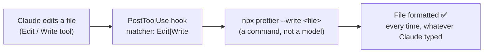

# Q52 — CLAUDE.md says "always run Prettier", 15% still slips: run it with a hook

**Domain / lesson (closest fit):** D1 › 1.5 Agent SDK Hooks (the same hook events exist in Claude Code)
**Also touches:** D3 › 3.1 CLAUDE.md Hierarchy (instructions are guidance) · D3 › 3.3 Path-Specific Rules · D3 › 3.2 Slash Commands and Skills
**Note:** the guide's D3 lessons don't cover hooks; the Prettier hook below is from the **Claude Code hooks guide** (code.claude.com, checked 2026-10-31).
**Scenario:** Claude Code for a development team (code generation, refactoring, CLAUDE.md, slash commands)
**Follows:** [Q31](../Q31-refund-threshold-hook/question.md) (a clear prompt still fails 3% → hook) · [Q42](../Q42-trim-tool-outputs-relevant-fields/question.md) (PostToolUse transforms; PreToolUse blocks) · [Q39](../Q39-coordinator-answers-simple-followups/question.md) check (deterministic work → code)

## Question

You are using Claude Code to accelerate software development. Your team uses it for code generation, refactoring, debugging, and documentation. You need to integrate it into your development workflow with custom slash commands, CLAUDE.md configurations, and understand when to use plan mode vs direct execution.

Your team's CLAUDE.md includes a rule: "Use 4-space indentation and always run Prettier formatting." Despite this, code reviews reveal that roughly 30% of files Claude Code generates use inconsistent formatting – sometimes 2-space indentation, sometimes missing trailing commas. Adding emphasis ("IMPORTANT: You MUST use Prettier formatting") reduces violations to about 15%, but doesn't eliminate them. What is the most effective way to ensure all generated code is consistently formatted?

- **A.** Configure a PostToolUse hook with an Edit|Write matcher that automatically runs Prettier on each file Claude modifies.
- **B.** Split the formatting rules into path-scoped .claude/rules/files that load when Claude works on matching file types.
- **C.** Extract the formatting rules into a dedicated skill that Claude loads automatically when generating code, with more detailed examples of correct formatting.
- **D.** Add a Stop hook with a prompt-based check that evaluates whether generated code follows formatting standards and prompts Claude to fix violations.

## Answer: **A**

## Diagram



The hook, as given in the Claude Code hooks guide (`.claude/settings.json`):

```json
{
  "hooks": {
    "PostToolUse": [
      {
        "matcher": "Edit|Write",
        "hooks": [
          { "type": "command", "command": "jq -r '.tool_input.file_path' | xargs npx prettier --write" }
        ]
      }
    ]
  }
}
```

## Concept

**The numbers tell you it's an instruction problem: 30% → 15% → never 0.** A clear rule fails 30% of the time; shouting (*"IMPORTANT: You MUST"*) halves it, but the model still decides each time. Same lesson as Q31: louder instructions are still instructions. *"Ensure all"* code is formatted → the rule has to **run**, not be **remembered**.

**The rule is an *action*: "always run Prettier".** An action that must always happen is what hooks are for. Claude Code hooks guide: hooks give *"deterministic control: certain actions always happen rather than relying on the LLM to choose to run them."* Its own example is this exact case: *"Automatically run Prettier on every file Claude edits, so formatting stays consistent without manual intervention."*

**Don't make the model do what a formatter does.** Formatting is mechanical: Prettier gets it right 100% of the time, with zero judgment. With the hook, it doesn't matter whether Claude typed 2 or 4 spaces; the file ends up correct. (Keep the CLAUDE.md line as guidance if you like, but enforcement is the hook.)

**Why PostToolUse is right here (and wrong in Q31):** PostToolUse runs **after** the edit. That's too late to *prevent* something harmful (Q31: the refund already happened), but exactly right for *fixing up* a result (Q42: trimming). A badly formatted file isn't harmful; reformatting it straight after the write is the fix.

## Why the others are wrong

| Option | Why not |
|---|---|
| **B** Path-scoped rules in `.claude/rules/` | **Changes *when* the rule loads, not *whether* it's followed.** Guide 3.3: path rules load conventions *"only when you edit files that match"*, a token-efficiency feature, and they *"stay in context as guidance."* The rule is already loaded (root CLAUDE.md loads in every session); loading isn't the problem. Still an instruction, still ~15%. |
| **C** A dedicated skill with more examples | **Still instructions, and maybe not even loaded.** Guide 3.2: skills *"load on demand as task-style workflows and do not shape every session by default."* More examples nudge the odds (like few-shot) but can't guarantee every file. |
| **D** Stop hook with a **prompt-based** check | **A hook, but the check is a model.** Prompt-based hooks are *"for decisions that require judgment rather than deterministic rules"* (hooks guide). Formatting isn't judgment; a model reviewing whitespace and trailing commas can miss some. It also runs only at the **end of the turn**, then asks Claude to re-edit, which costs extra turns and can introduce new violations. It **detects and asks**; A just **fixes**. |

## Pattern to remember

> **A mechanical rule that must hold for every file (formatting, linting) → a *command* hook that runs the tool (PostToolUse, `Edit|Write` → Prettier).** Don't ask the model to do or judge what a deterministic tool can do. Emphasis, rules files, skills and examples are all still instructions.

**Exam signals:**
- *"Reduces violations… but doesn't eliminate them"* + *"ensure all"* → deterministic enforcement (hook), not better wording.
- **Command** hook (runs a program: deterministic) vs. **prompt** hook (asks a model: judgment). Pick command hooks for mechanical rules.
- **PostToolUse** = transform/fix after the tool ran · **PreToolUse** = block before it runs.

### Where this comes from

**Claude Code docs, Automate actions with hooks** (code.claude.com, checked 2026-10-31):
- *"Hooks are user-defined shell commands. Claude Code runs them at specific points in its lifecycle, which gives you deterministic control: certain actions always happen rather than relying on the LLM to choose to run them."*
- *"Automatically run Prettier on every file Claude edits, so formatting stays consistent without manual intervention."* *"This hook uses the `PostToolUse` event with an `Edit|Write` matcher, so it runs only after file-editing tools."*
- *"For decisions that require judgment rather than deterministic rules, use `type: "prompt"` hooks."* (**D**)

**Guide D1 › 1.5 Agent SDK Hooks:**
- *"A PostToolUse hook runs after a tool executes and before the model processes the result."* *"PostToolUse hooks transform data after execution."* *"PreToolUse hooks enforce policy before execution."*

**Guide D3 › 3.3 / 3.2:**
- Path rules: *"A path-specific rule loads its conventions only when you edit files that match its glob patterns,"* and they *"stay in context as guidance."* (**B**)
- Skills: *"Skills load on demand as task-style workflows and do not shape every session by default."* (**C**)

## How this connects to earlier questions

| Question | Link |
|---|---|
| [Q31](../Q31-refund-threshold-hook/question.md) | Same shape: a clear instruction still fails a few % → enforce with a hook. There PreToolUse (block before), here PostToolUse (fix after) |
| [Q42](../Q42-trim-tool-outputs-relevant-fields/question.md) | PostToolUse is the right place to **transform** a result |
| [Q28](../Q28-tamper-proof-threshold-in-tool/question.md) | Must-hold rules belong in code, not instructions |
| [Q39](../Q39-coordinator-answers-simple-followups/question.md) check, [Q38](../Q38-sliding-window-recent-turns/question.md) follow-up | Deterministic work (counting, copying facts, formatting) → code, not the model |
| [Q16](../Q16-escalation-triggers/question.md) | *Instruct the judgment, gate the mechanics.* Formatting is mechanics |

## Check question

**Your team adds another rule: "Never edit files in `/migrations`." Would a PostToolUse hook be the right tool for this one too? If not, what would you use, and why?**

*My answer:* "Isn't it better to make the files in /migrations out of scope of the agent?" ✅ **Yes, and it's even simpler than the PreToolUse hook I had in mind.** Making them "out of scope" is exactly what a Claude Code **permission deny rule** does.

**Why not PostToolUse:** it runs **after** the edit. The migration file is already changed; you could revert it, but this is a rule about **preventing** an action, and prevention has to happen **before** (Q31). PostToolUse fixes results (Q52's formatting); it can't stop them.

**How to make `/migrations` out of scope**, in `.claude/settings.json`:

```json
{ "permissions": { "deny": ["Edit(/migrations/**)"] } }
```

- **Enforced by Claude Code, not the model.** Permissions docs: *"Permission rules are enforced by Claude Code, not by the model. Instructions in your prompt or `CLAUDE.md` shape what Claude tries to do, but they don't change what Claude Code allows."* Guide 3.2 calls deny rules *"the actual security boundary."*
- **Deny wins.** *"Rules are evaluated in order: deny, then ask, then allow."* An allow rule can't carve an exception out of it, and a PreToolUse hook's "allow" doesn't override it either.
- **Gotcha:** use `Edit(...)`, not `Write(...)`. The docs: path rules for `Write` *"never match"*; `Edit(path)` covers file modifications.

**How far it reaches, and what goes further:**

| Mechanism | Blocks |
|---|---|
| **Deny rule** `Edit(/migrations/**)` | Claude's file tools, plus Bash file commands Claude Code recognises (`sed`, `tee`, `> file` redirects) |
| **PreToolUse hook** | Anything you can detect in the tool input with your own logic (e.g. inspect Bash commands) |
| **Sandbox** (OS level) | *All* processes, including a script that opens files itself. The docs: deny rules *"don't apply to… arbitrary subprocesses that read or write files indirectly, like a Python or Node script"*; *"For OS-level enforcement… enable the sandbox."* |

> **Prevent → before the action (deny rule, PreToolUse). Fix up → after (PostToolUse). The simplest way to keep an agent away from something is to not give it access.** Same idea as tool scoping (Q04): what the agent can't reach, it can't misuse.

## Glossary

- **Hook (Claude Code):** a user-defined command that Claude Code runs automatically at a lifecycle point (before/after a tool, at stop…). Deterministic: it always runs.
- **`PostToolUse` + matcher `Edit|Write`:** runs right after Claude uses the Edit or Write tool, e.g. to format the file it just changed.
- **Command hook vs. prompt hook:** `type: "command"` runs a program (deterministic); `type: "prompt"` asks a Claude model to decide (judgment).
- **Path-scoped rules (`.claude/rules/`):** convention files that load only when Claude edits matching files. Guidance, not enforcement.
- **Skill:** a named set of instructions Claude loads on demand for a task. Guidance, not enforcement.

## Related course lessons

*Lecture lengths aren't recorded in the study-map files, so the watch times below are estimates from each course's average lecture length.*

### Udemy A (primary): Claude Certified Architect (CCAR-F) - 2026 Exam Prep
| # | Lecture | Part | Why |
|---|---|---|---|
| **77** | **Hook Lifecycle Events** | 3C | ⭐ PostToolUse vs. PreToolUse vs. Stop in Claude Code |
| **80** | **Real-World Hook Applications** | 3D | ⭐ Auto-formatting is the classic example *(also in Q42)* |
| 69 | Common CLAUDE.md Patterns for Real Teams | 3B | What CLAUDE.md is good for (guidance), and its limits |
| Quiz 10, Quiz 11 | 3C and 3D quizzes | | Self-test |

**▶ Watch in this order (~25 min, est.):** #77 → #80 → #69, then do **Quiz 10** and **Quiz 11**.

### Udemy B: Claude Certified Architect Foundations: Complete Course (Voroniuk)
| # | Lecture | Section | Why |
|---|---|---|---|
| **50** | **Hooks: Intercepting Tool Calls** | S6 Support Agent | ⭐ How hooks run around tool calls |
| **14** | **Practice: System Prompt Rules vs Code Rules** | S2 API Basics | ⭐ Why an instruction can't guarantee 100% *(also in Q37)* |
| 72 | @import and the Rules Folder | S8 Claude Code Setup | What `.claude/rules/` does (and doesn't) do (B) |
| Quiz 6, Quiz 8 | Support Agent and Claude Code Setup quizzes | S6, S8 | Self-test |

**▶ Watch in this order (~15 min, est.):** #14 → #50 → #72, then do **Quiz 6** and **Quiz 8**.

### CBT Nuggets: CCA-F course
| Skill | Why |
|---|---|
| **8. Apply Useful Hooks and Claude Code SDK Basics** | ⭐ Practical Claude Code hooks |
| 6. Implement Hooks for Safer Automation | Hook events and where each fits |
