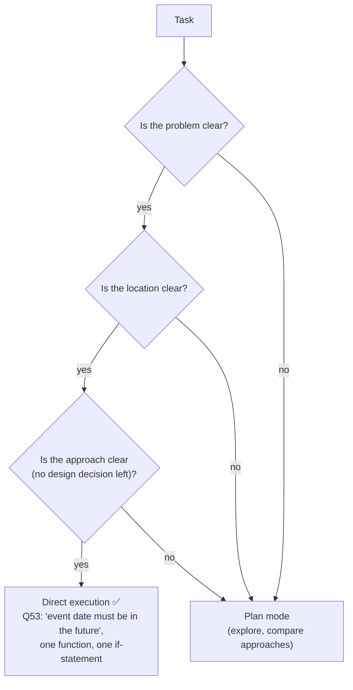

# Q53 — One conditional in one function: direct execution, not plan mode

**Domain / lesson:** D3 › 3.4 Plan Mode vs Direct Execution
**Scenario:** Claude Code for a development team (same as [Q52](../Q52-posttooluse-hook-runs-formatter/question.md))
**Follows:** [Q39](../Q39-coordinator-answers-simple-followups/question.md) (don't add machinery a simple task doesn't need) · [Q37](../Q37-state-assumptions-not-interrogate/question.md) (clarity decides, not effort)

## Question

You are using Claude Code to accelerate software development. Your team uses it for code generation, refactoring, debugging, and documentation. You need to integrate it into your development workflow with custom slash commands, CLAUDE.md configurations, and understand when to use plan mode vs. direct execution.

You need to add a date validation check ensuring event dates are in the future. This requires adding a conditional statement to one existing function in a single file. What is the most appropriate approach?

- **A.** Enter plan mode first to create a detailed implementation strategy before making the change.
- **B.** Enter plan mode to analyze how the validation might impact other parts of the reservation flow.
- **C.** Use direct execution to make the change.
- **D.** Start with extended thinking mode enabled to ensure thorough reasoning about the validation logic.

## Answer: **C**

## Diagram

## Concept

**The question spells out that nothing is unclear:**

| Guide 3.4's test | Q53 |
|---|---|
| **Problem** known? | ✅ Event dates must be in the future |
| **Location** known? | ✅ One existing function, in a single file |
| **Approach** known? | ✅ Add a conditional statement |

When all three are known, there's no design decision left, so: *"Direct execution is for well-understood changes with clear, limited scope."* And: *"Plan mode adds unnecessary overhead when the problem, location, and solution are all clear."*

**The deciding factor is ambiguity, not difficulty or importance.** Guide 3.4: *"The choice of mode depends on ambiguity, not difficulty."* A validation check feels important, but importance doesn't create a design choice. Plan mode is for work where you need to *"explore the codebase, evaluate multiple approaches"*: library migrations across 45+ files, splitting services, choices with several valid designs.

## Why the others are wrong

| Option | Why not |
|---|---|
| **A** Plan mode for a detailed implementation strategy | **A strategy for one `if` statement.** There's nothing to choose between, so planning only adds a round of overhead. The listed trap: plan mode for a single-file change whose problem and fix are clear. |
| **B** Plan mode to analyse impact on the rest of the reservation flow | **Invents a complexity the question doesn't state.** The tempting one, because "what else might this affect?" sounds responsible. But the question says it's one function in one file. Guide 3.4: choose plan mode upfront when *complexity is stated in the requirements* ("Do not wait for surprises"); here it's stated **not** to be. If direct execution did uncover a surprise, you'd switch then. |
| **D** Extended thinking for thorough reasoning | **More reasoning for a simple conditional.** `if event_date <= now: reject` isn't a hard reasoning problem. Extended thinking adds latency and tokens without changing what gets written. It's also not the plan-mode-vs-direct-execution choice the question is about. |

## Pattern to remember

> **Problem, location and approach all clear → direct execution.** Plan mode only when something is unclear: many files, several valid designs, an architectural choice, or the codebase needs exploring first. Ambiguity decides, not importance or difficulty.

**Exam signals:**
- *"One function"*, *"single file"*, *"a conditional"*, *"clear stack trace"*, *"config value"* → **direct execution**.
- *"45+ files"*, *"migration"*, *"service boundaries"*, *"several approaches"*, *"unfamiliar codebase"* → **plan mode**.
- Options that add analysis "to be thorough" for a clearly scoped change → over-engineering (same family as Q39's unnecessary subagent).

### Where this comes from in the guide

**D3 › 3.4 Plan Mode vs Direct Execution:**
- *"Direct execution is for well-understood changes with clear, limited scope."* Examples: a single-file bug fix with a clear stack trace, a configuration value update.
- *"Plan mode is for complex tasks where you need to explore the codebase, evaluate multiple approaches."* *"A library migration affecting 45+ files requires a consistent strategy."* *"Service boundaries, module dependencies and API contracts have consequences for later work."*
- *"Plan mode adds unnecessary overhead when the problem, location, and solution are all clear."*
- Key concept: *"The choice of mode depends on ambiguity, not difficulty."*
- Exam traps: plan mode for a clear single-file fix (**A**, **B**); *"Direct execution risks costly rework when dependencies are discovered late"* (the reverse case: multi-file architectural changes); *"Do not wait for surprises"*: if complexity **is stated**, plan upfront.
- *"The Explore subagent keeps verbose discovery output out of the main conversation."* For verbose discovery before a focused change.

## How this connects to earlier questions

| Question | Link |
|---|---|
| [Q39](../Q39-coordinator-answers-simple-followups/question.md) | Same instinct: don't add a step (subagent / plan mode) a simple, clear task doesn't need |
| [Q37](../Q37-state-assumptions-not-interrogate/question.md) | Clarity decides: when it's clear what's wanted, act; investigate or ask only when something is genuinely unclear |
| [Q52](../Q52-posttooluse-hook-runs-formatter/question.md) | Same Claude Code scenario. Whichever mode you use, the formatting hook still runs on the edit |

## Check question

**Same codebase, new task: "Make all date handling time-zone aware." It touches every module that stores or compares dates, and there are several ways to do it (store UTC everywhere, store local time plus zone, use a date library). Plan mode or direct execution? Which phrases in the task tell you?**

*My answer:* (pending)

## Glossary

- **Direct execution:** Claude Code makes the change straight away. For well-understood, clearly scoped changes.
- **Plan mode:** Claude Code explores and proposes a plan without editing files, for you to review first. For complex, ambiguous or multi-file work.
- **Ambiguity (here):** an open question about the problem, where the change goes, or how to make it. The deciding factor between the modes.
- **Explore subagent:** runs verbose codebase discovery in its own context and returns a summary, so the main conversation stays focused.

## Related course lessons

*Lecture lengths aren't recorded in the study-map files, so the watch times below are estimates from each course's average lecture length.*

### Udemy A (primary): Claude Certified Architect (CCAR-F) - 2026 Exam Prep
| # | Lecture | Part | Why |
|---|---|---|---|
| **78** | **Plan Mode — When and Why to Plan First** | 3C | ⭐ Exactly this decision |
| 62 | Claude Code Permission Modes | 3A | Where plan mode sits among the modes |
| Quiz 10 | 3C quiz | | Self-test |

**▶ Watch in this order (~15 min, est.):** #78 → #62, then do **Quiz 10**.

### Udemy B: Claude Certified Architect Foundations: Complete Course (Voroniuk)
| # | Lecture | Section | Why |
|---|---|---|---|
| **78** | **Plan Mode or Direct Execution** | S8 Claude Code Setup | ⭐ Exactly this decision |
| 89 | Claude Code Case: Plan and Iterate | S8 Claude Code Setup | A worked case where planning *is* needed (contrast) |
| Quiz 8 | Claude Code Setup quiz | S8 | Self-test |

**▶ Watch in this order (~10 min, est.):** #78 → #89, then do **Quiz 8**.

### CBT Nuggets: CCA-F course
| Skill | Why |
|---|---|
| **3. Apply Planning to Guide Code Changes** | ⭐ When planning pays off, and when it doesn't |
