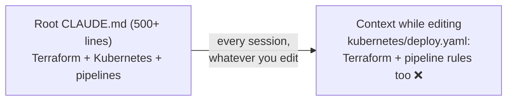
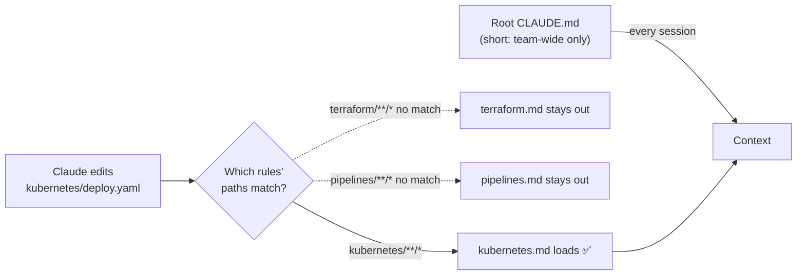

# Q54 — Load Terraform rules only for Terraform files: path-scoped `.claude/rules/`

**Domain / lesson:** D3 › 3.3 Path-Specific Rules
**Also touches:** D3 › 3.1 CLAUDE.md Hierarchy (subdirectory CLAUDE.md, `@path` imports)
**Scenario:** infrastructure-as-code repo with Terraform (`/terraform/`), Kubernetes (`/kubernetes/`) and CI/CD pipelines (`/pipelines/`)
**Follows:** [Q52](../Q52-posttooluse-hook-runs-formatter/question.md) (path rules change *when* guidance loads, not *whether* it's followed) · [Q42](../Q42-trim-tool-outputs-relevant-fields/question.md) (keep only what's relevant in context)

## Question

Your infrastructure-as-code repository includes Terraform modules (/terraform/), Kubernetes manifests (/kubernetes/), and CI/CD pipeline scripts (/pipelines/). Each requires different conventions, but your single root CLAUDE.md has grown to 500+ lines. When developers work on Kubernetes files, Terraform-specific rules load into context unnecessarily, consuming tokens.

What is the best approach to reorganize so only relevant guidance loads when editing specific file types?

- **A.** Split content into subdirectory CLAUDE.md files (/terraform/CLAUDE.md, /kubernetes/CLAUDE.md), so Claude loads directory-specific guidance.
- **B.** Keep the root CLAUDE.md and use @path/to/import syntax to modularly include tool-specific guidance files from separate documents.
- **C.** Restructure the root CLAUDE.md into clearly labeled sections with headers (e.g, "## Terraform Conventions"), improving organization and readability.
- **D.** Create files in .claude/rules/ with YAML frontmatter path-scoping (e.g., paths: ["terraform/**/*"]), loading rules only when editing matching files.

## Answer: **D**

## Diagram

### Now: one 500-line root CLAUDE.md loads in every session



### Fix (D): each rule file loads only when a matching file is touched



### What each option loads while you edit a Kubernetes file

| Option | Mechanism | Loads when | In context |
|---|---|---|---|
| **A** Subdirectory CLAUDE.md | Directory-level CLAUDE.md | When Claude reads or edits a file **in that directory** | Kubernetes guidance, but tied to the **folder**, not the file type |
| **B** `@path` imports | Inlined into root CLAUDE.md | **Every session** | All 500 lines, as now ❌ |
| **C** Headers | Same file, reorganised | **Every session** | All 500 lines, as now ❌ |
| **D** `.claude/rules/` + `paths` | Path-scoped rule | When Claude reads or edits a file **matching the glob** | Only the Kubernetes rules ✅ |

## Concept

**The problem is *what loads*, not how the file is organised.** Guide 3.3: *"Root CLAUDE.md loads for every session, whichever files you edit."* So 500 lines go into context whether you're touching Terraform, Kubernetes or a pipeline script. Any fix that keeps the content in (or inlined into) the root file still loads it every time.

**Path-scoped rules load by file pattern.** A rule file in `.claude/rules/` starts with YAML frontmatter whose `paths` field lists glob patterns. Guide 3.3: *"A path-specific rule loads its conventions only when you edit files that match its glob patterns."* Claude Code docs: *"A path-scoped rule loads when Claude uses the Read, Write, or Edit tool on a matching file."*

**The reorganised repo:**

```
CLAUDE.md                  # short: only what applies to every file
.claude/rules/
├── terraform.md           # paths: ["terraform/**/*", "**/*.tf"]
├── kubernetes.md          # paths: ["kubernetes/**/*"]
└── pipelines.md           # paths: ["pipelines/**/*"]
```

```markdown
---
paths:
  - "terraform/**/*"
  - "**/*.tf"
---
# Terraform conventions
- Pin provider versions in versions.tf
- One module per directory; variables in variables.tf
```

`**` matches across directory levels, so `**/*.tf` catches a Terraform file wherever it lives. That's what makes these rules about **file types**, not folders.

**Two gains, not one:**
- **Tokens:** *"Path-scoped rules are more token-efficient than root CLAUDE.md because they load only when you edit matching files."* (guide 3.3 key concept)
- **Adherence:** *"Less irrelevant context keeps the model focused on conventions that apply to the current work."* (3.3). Claude Code docs: *"target under 200 lines per CLAUDE.md file. Longer files consume more context and reduce adherence."*

## Why the others are wrong

| Option | Why not |
|---|---|
| **A** Subdirectory CLAUDE.md files | **The tempting one, and a partial fix.** Subdirectory CLAUDE.md files do load on demand: *"once Claude reads, writes, or edits another file in that subdirectory"* (Claude Code docs). With this neat folder layout, that would mostly work. But it's keyed to a **directory**, not a **file type**: guide 3.1, *"Directory-level CLAUDE.md applies to one directory only."* A `.tf` file outside `/terraform/` gets no Terraform rules, and conventions shared by several folders must be copied into each one. Guide 3.3 lists this as a trap: choosing directory-level CLAUDE.md over path-specific rules. Subdirectory files are for *"package-specific conventions that differ from the project root"* (3.1). |
| **B** `@path` imports from the root CLAUDE.md | **Organisation, not loading.** Imports are inlined into the file that imports them, which loads every session. Docs: *"Imported files are expanded and loaded into context alongside the CLAUDE.md that references them."* Guide 3.1: *"Splitting a 600-line CLAUDE.md into six 100-line imports makes the source nicer to work in. But the context stays the same size."* |
| **C** Labelled sections with headers | **Readability only.** It's the same file, so all 500 lines still load in every session. Guide 3.3 trap: placing file-type-specific conventions in root CLAUDE.md, which *"loads for every session regardless of which files you edit."* |

## Pattern to remember

> **"Load X's conventions only when editing X files" → `.claude/rules/x.md` with `paths:` globs.** Root CLAUDE.md, headers and `@path` imports all load every session (organising ≠ loading less). A subdirectory CLAUDE.md is tied to one folder; path rules match file patterns anywhere.

**Exam signals:**
- *"Consuming tokens"*, *"only relevant guidance loads"*, *"when editing specific file types"*, conventions for files **spread across many directories** → **path-scoped rules**.
- *"@import"*, *"modular files"* → nicer source, **same context size**.
- *"Sections with headers"* → readability only.
- *"Subdirectory CLAUDE.md"* → right for one package's conventions, wrong for file types or cross-directory conventions.
- Remember Q52: path rules are still **guidance**. They fix *when* it loads, not *whether* it's followed. For "must always happen" you need a hook.

### Where this comes from

**Guide D3 › 3.3 Path-Specific Rules:**
- *"A path-specific rule loads its conventions only when you edit files that match its glob patterns."* Example: editing a file that matches `terraform/**/*` loads the Terraform rules; editing a React component doesn't.
- *"In a glob, `**` matches across directory levels."* *"So `**/*.test.tsx` matches every test file in the codebase, wherever it is."*
- *"Root CLAUDE.md loads for every session, whichever files you edit."*
- Key concept: *"Path-scoped rules are more token-efficient than root CLAUDE.md because they load only when you edit matching files."* *"In large projects with many convention categories, the saving is substantial."*
- Exam traps: directory-level CLAUDE.md for cross-directory conventions (*"a massive maintenance burden"*, **A**) · file-type-specific conventions in root CLAUDE.md (**C**) · confusing skills with path rules (skills load on demand as task workflows; path rules auto-load by file type).

**Guide D3 › 3.1 CLAUDE.md Hierarchy:**
- Directory level: *"These files apply when you work in that specific directory."* *"Use them for package-specific conventions that differ from the project root."*
- *"There is no `@import` keyword, even though many pages online write it that way."* The directive is `@` followed by a path, inlined at load time.
- *"Splitting a 600-line CLAUDE.md into six 100-line imports makes the source nicer to work in. But the context stays the same size."* *"To make the context of each session smaller, use `.claude/rules/` with path-scoped frontmatter."* (**B** vs **D** in one passage)
- *"Without frontmatter, rules files load for all sessions."*

**Claude Code docs, *How Claude remembers your project*** (code.claude.com, checked 2026-10-31):
- *"Rules without a `paths` field are loaded unconditionally and apply to all files. A path-scoped rule loads when Claude uses the Read, Write, or Edit tool on a matching file."*
- *"Move instructions that matter for only part of the codebase into path-scoped rules, which load only when Claude works with matching files. Imports help you organize a long file but don't reduce its context cost."*

## How this connects to earlier questions

| Question | Link |
|---|---|
| [Q52](../Q52-posttooluse-hook-runs-formatter/question.md) | Path rules were the **wrong** answer there: the rule was already loaded and still ignored. Here *loading* is the problem, so they're the right answer. Same tool, different problem |
| [Q42](../Q42-trim-tool-outputs-relevant-fields/question.md) | Same principle for tool results: keep only what's relevant in context. Q42 trims data, Q54 scopes instructions |
| [Q40](../Q40-multi-issue-case-facts-layer/question.md) | The always-present layer (case facts there, root CLAUDE.md here) should hold only what every turn needs |

## Check question

**After the move, four conventions still need a home. For each one, say whether it stays in the root CLAUDE.md or goes into a `.claude/rules/` file, and if it's a rule, give its `paths` pattern:**
- **(a)** "Never hard-code secrets; reference them from Vault."
- **(b)** "Every Kubernetes Deployment sets CPU and memory limits."
- **(c)** "Pin Terraform provider versions."
- **(d)** "All YAML files use 2-space indentation." (Kubernetes manifests **and** the pipeline definitions are YAML.)

## Glossary

- **Root CLAUDE.md:** the project-level instruction file. Loads in every session, whatever files you work on.
- **Subdirectory (directory-level) CLAUDE.md:** a CLAUDE.md inside a folder. Loads when Claude works with a file in that folder. Scoped to one directory.
- **`.claude/rules/`:** a folder of topic-specific rule files. Without frontmatter they load every session; with `paths` they load only for matching files.
- **`paths` frontmatter:** the YAML field at the top of a rule file listing the glob patterns it applies to.
- **Glob:** a file-matching pattern. `*` matches within one folder level; `**` matches across levels (`**/*.tf` = every `.tf` file anywhere).
- **`@path` import:** a line in CLAUDE.md that inlines another file at load time. Helps organise; doesn't reduce what loads.

## Related course lessons

*Lecture lengths aren't recorded in the study-map files, so the watch times below are estimates from each course's average lecture length.*

### Udemy A (primary): Claude Certified Architect (CCAR-F) - 2026 Exam Prep
| # | Lecture | Part | Why |
|---|---|---|---|
| **67** | **Path-Scoped Rules for Conventions** | 3B | ⭐ Exactly option D |
| **65** | **Subdirectory CLAUDE.md Files** | 3B | ⭐ What A does, and where it stops |
| 63 | The Three-Level CLAUDE.md Hierarchy | 3B | Why root CLAUDE.md loads every session (C) |
| Quiz 9 | 3B quiz | | Self-test |

**▶ Watch in this order (~20 min, est.):** #63 → #65 → #67, then do **Quiz 9**.

### Udemy B: Claude Certified Architect Foundations: Complete Course (Voroniuk)
| # | Lecture | Section | Why |
|---|---|---|---|
| **73** | **Path-Scoped Rules with Globs** | S8 Claude Code Setup | ⭐ Exactly option D |
| **72** | **@import and the Rules Folder** | S8 Claude Code Setup | ⭐ Why imports don't shrink context (B) *(also in Q52)* |
| 71 | CLAUDE.md Levels: Who Gets What | S8 Claude Code Setup | Directory-level vs root (A, C) |
| Quiz 8 | Claude Code Setup quiz | S8 | Self-test |

**▶ Watch in this order (~15 min, est.):** #71 → #72 → #73, then do **Quiz 8**.

### CBT Nuggets: CCA-F course
| Skill | Why |
|---|---|
| 1. Set Up Claude Code and Configure Projects | CLAUDE.md levels (3.1) |

CBT has no lesson on path-specific rules (3.3). Use the guide lesson and the Udemy lectures above.
