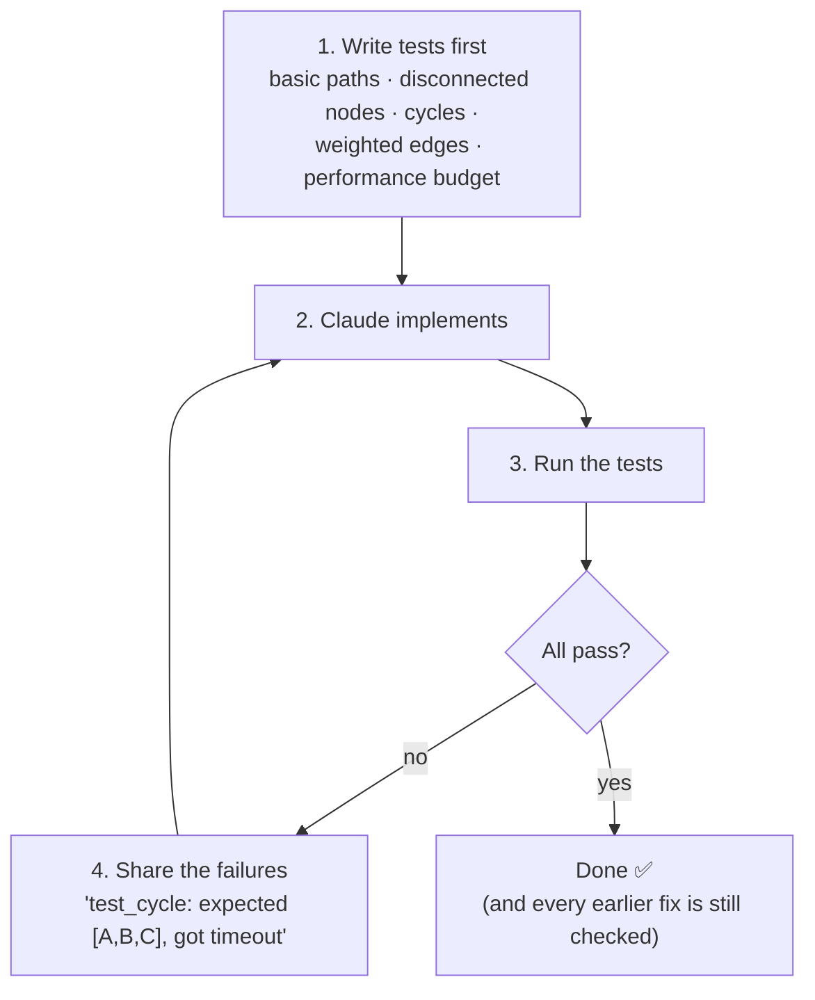

# Q55 — Iterating on a complex algorithm: write the tests first, share the failures

**Domain / lesson:** D3 › 3.5 Iterative Refinement
**Scenario:** Claude Code for a development team (same as [Q52](../Q52-posttooluse-hook-runs-formatter/question.md), [Q53](../Q53-direct-execution-for-clear-small-change/question.md))
**Follows:** [Q53](../Q53-direct-execution-for-clear-small-change/question.md) (extended thinking isn't the answer to a workflow question) · [Q49](../Q49-instructive-error-messages/question.md) (feedback must say exactly what went wrong) · [Q52](../Q52-posttooluse-hook-runs-formatter/question.md) (a deterministic check beats relying on someone to notice)

## Question

You are using Claude Code to accelerate software development. Your team uses it for code generation, refactoring, debugging, and documentation. You need to integrate it into your development workflow with custom slash commands, CLAUDE.md configurations, and understand when to use plan mode vs direct execution.

You're implementing a complex graph traversal algorithm with specific performance requirements and edge cases to handle (disconnected nodes, cycles, weighted edges). You want to structure your workflow for efficient iterative refinement with Claude. What approach will most effectively enable progressive improvement across multiple iterations?

- **A.** Have Claude extensively research the algorithm and create a detailed implementation plan using extended thinking, then implement the complete solution based on that plan.
- **B.** Provide Claude with a reference implementation from documentation, then ask it to rewrite the code to match your codebase style and add the required edge case handling, comparing outputs against the reference.
- **C.** Provide Claude with a detailed natural language specification of the algorithm, including all requirements and edge cases. Review each output manually and provide descriptive feedback on what behavior needs to change.
- **D.** Write a test suite covering expected behavior, edge cases, and performance requirements before implementation. Ask Claude to write code that passes the tests, then iterate by sharing test failures with each refinement request.

## Answer: **D**

## Diagram

**Progress you can measure:**

| Iteration | Tests passing | What the failures said |
|---|---|---|
| 1 | 7 / 12 | Cycles loop forever; a disconnected node is missing from the result |
| 2 | 10 / 12 | Wrong path when edge weights are equal; 2.4 s on the 100k-node graph (budget 1 s) |
| 3 | 12 / 12 | — |

## Concept

**Iterating needs a fixed bar to measure each version against.** "Progressive improvement across multiple iterations" means every round must (1) say exactly what's still wrong and (2) prove that nothing that worked before broke. A test suite does both, every time, in seconds.

**Each failure is feedback with only one meaning.** Guide 3.5: *"Each failure is concrete, unambiguous feedback: "Expected X, got Y" has a single meaning."* Compare *"the cycle handling still seems off"* (what does Claude change?) with *"test_cycle: expected [A, B, C], got timeout after 5 s"*.

**The tests cover what the task asks for:**

| Requirement | Test |
|---|---|
| Disconnected nodes | A graph with an isolated node: is it in (or correctly excluded from) the result? |
| Cycles | A → B → C → A: does it terminate and visit each node once? |
| Weighted edges | Known graph, known shortest path, including equal weights |
| Performance | A 100k-node graph within the time budget |

A person reviewing output can't check the last row by eye. A test can.

**Claude can run the tests itself.** Claude Code docs, *Best practices*: *"If you give it something that comes back pass or fail, Claude can close that loop itself. It makes the change, runs the check, and if something broke it reads the output and fixes it before running the check again."* The prompt can be as short as *"run the graph tests after each change and keep going until they pass."*

**Where this fits among the 3.5 techniques:**

| Situation | Technique |
|---|---|
| Complex logic with edge cases and measurable requirements | **Tests first, share the failures** (Q55) |
| Claude keeps misreading a transformation you already know | **2–3 concrete input/output examples** |
| Unfamiliar domain: you don't know what you're missing | **Interview pattern**: Claude asks questions before implementing |

## Why the others are wrong

| Option | Why not |
|---|---|
| **A** Research + extended-thinking plan, then implement the complete solution | **One big attempt, with no way to measure it.** The question is about iterating, and A has no feedback loop: after "implement the complete solution", how do you know whether cycles, isolated nodes or the time budget are handled? More thinking improves one pass; it doesn't tell you what's still wrong. Same family as Q53 D (extended thinking as an all-purpose fix). |
| **B** Rewrite a reference implementation, compare outputs against it | **The reference can't check what you're adding.** The edge cases and the performance budget are *your* requirements, which the reference doesn't have. Where your version *correctly* handles a cycle differently, "matches the reference" says it's wrong. Comparing outputs only checks the parts you copied. |
| **C** Detailed natural-language spec + manual review with descriptive feedback | **Prose is read differently each time, and you become the test suite.** Guide 3.5: *"More precise prose still relies on interpretation."* Docs: without a check to run, *"that makes you the test suite, and every mistake sits there until you happen to notice it."* Manual review is slow, can't measure performance, and misses regressions: if the cycle fix breaks disconnected nodes, nobody notices unless they re-check everything every round. |

## Pattern to remember

> **Iterating on complex logic → write the tests first, then share each round's failures.** "Expected X, got Y" has one meaning; every iteration is measured against the same bar, and earlier fixes stay checked. A prose spec plus manual review makes *you* the test suite.

**Exam signals:**
- *"Progressive improvement across multiple iterations"*, *"edge cases"*, *"performance requirements"*, *"complex transformation"* → **test-driven iteration**.
- Options that add **more prose** ("detailed specification", "descriptive feedback"), **more thinking** (extended thinking, research) or a **reference to copy** don't give each iteration an objective pass/fail.

### Where this comes from

**Guide D3 › 3.5 Iterative Refinement:**
- *"Write the tests first."* *"The tests define the expected behaviour."* *"Then the developer shares the failures with Claude Code."*
- *"Each failure is concrete, unambiguous feedback: "Expected X, got Y" has a single meaning."*
- *"Test-driven iteration (most effective for complex transformations)."*
- Concrete examples: *"The model generalises from examples more reliably than from any prose description."* *"More precise prose still relies on interpretation, so more prose will not fix this problem."* (**C**)
- Interview pattern: *"In a domain where you lack expertise, have Claude ask questions before implementing."*

**Claude Code docs, *Best practices* › Give Claude a check to run** (code.claude.com, checked 2026-10-31):
- *"Claude stops when the work looks done. If it has nothing to run that tells it whether the work actually is done, "looks done" is all it has to go on. In practice that makes you the test suite."*
- *"Give Claude something it can run that comes back pass or fail. Once it has that, it can keep going on its own and you don't have to watch."*
- Ask for evidence: *"the command it ran and its output"*. *"All tests pass" on its own tells you very little.*

## How this connects to earlier questions

| Question | Link |
|---|---|
| [Q49](../Q49-instructive-error-messages/question.md) | Same principle: feedback that says exactly what went wrong ("Expected X, got Y"; "Order not found, try get_customer") lets Claude fix the right thing instead of guessing |
| [Q52](../Q52-posttooluse-hook-runs-formatter/question.md) | A deterministic check beats hoping someone notices. A Stop hook can even refuse to end the turn until the tests pass |
| [Q53](../Q53-direct-execution-for-clear-small-change/question.md) | Extended thinking was a distractor there too: more reasoning doesn't replace the right workflow |
| [Q51](../Q51-stop-reason-controls-loop/question.md) | A loop needs an objective signal to continue or stop: `stop_reason` there, pass/fail here |

## Check question

**Iteration 3: Claude's fix makes `test_cycle` pass, but now `test_disconnected_nodes` and `test_performance_100k` fail, and both passed before. Do you send both failures in one message, or one at a time? Why?**

*My answer:* "One at a time, to make it easier to process and change only one thing at a time." ❌ **Not here.** "One change at a time" is the right rule for **independent** issues. These two aren't independent:

**The clue:** both broke **at the same moment**, **after one fix**, and both **passed before**. So they almost certainly share a cause: the cycle fix. For example, the fix might have:
- tracked visited nodes in a **list**, so each lookup scans the list. That's O(n²) on 100k nodes, so `test_performance_100k` fails;
- started the traversal only from the first node, so isolated nodes are never reached and `test_disconnected_nodes` fails.

**What goes wrong one at a time:**

| Round | You send | Claude sees | Result |
|---|---|---|---|
| 4 | Disconnected nodes only | One constraint | Fixes it with a loop over all start nodes, which makes the slow list lookups run even more often |
| 5 | Performance only | One constraint | Rewrites the visited check, and the cycle test breaks again |
| 6 | Cycle again… | | Ping-pong: each fix undoes another |

**Batched, Claude sees every constraint together** and can make one coherent change: a visited **set** (fast lookups, still stops cycles) **and** an outer loop over every unvisited node (reaches disconnected nodes).

Guide 3.5:
- *"Single message (batch) when fixes interact with each other."* *"The model needs to see all the interacting constraints at once to produce a coherent fix."*
- *"Sequential iteration when issues are independent."* *"Batching independent issues can confuse the model about which feedback applies to which part of the code."*
- Exam trap: sending interacting fixes one at a time. *"Fixes that interact need to be seen together."*

**A good batched message:**
> *"Your cycle fix made test_cycle pass but broke two tests that passed before: test_disconnected_nodes (expected [A, B, C, X], got [A, B, C]) and test_performance_100k (3.8 s, budget 1 s). Fix both without breaking test_cycle. Run the whole suite and show the output."*

It names **what broke**, **what caused it** and **what must stay green**, and asks for **evidence** (the output).

**When your instinct *is* right:** two unrelated issues, e.g. a wrong error message for an empty graph and a missing docstring. Send those one at a time, so each piece of feedback clearly belongs to one part of the code.

> **Several failures from one cause interact: send them in one message, with what must stay passing. Unrelated issues: one at a time. Clue: did they break together after one change?**

## Glossary

- **Test-driven iteration:** write tests that define the expected behaviour first, then let Claude implement and refine against the failures.
- **Regression:** something that worked before breaks after a change. A test suite run every iteration catches it at once.
- **Reference implementation:** an existing, known-good version of an algorithm (e.g. from documentation), used as a model or for comparison.
- **Interview pattern:** Claude asks you questions before implementing, to surface considerations you'd miss in an unfamiliar domain.

## Related course lessons

*Lecture lengths aren't recorded in the study-map files, so the watch times below are estimates from each course's average lecture length.*

### Udemy A (primary): Claude Certified Architect (CCAR-F) - 2026 Exam Prep
| # | Lecture | Part | Why |
|---|---|---|---|
| **79** | **Iterating on a Plan — Approve, Edit, Re-Plan** | 3C | ⭐ Iterating with Claude Code |
| 68 | Writing Instructions Claude Follows | 3B | Why prose alone is open to interpretation (C) |
| Quiz 9, Quiz 10 | 3B and 3C quizzes | | Self-test |

**▶ Watch in this order (~15 min, est.):** #68 → #79, then do **Quiz 9** and **Quiz 10**.
Udemy A only partly covers 3.5. Udemy B #82 is the key lecture for this question.

### Udemy B: Claude Certified Architect Foundations: Complete Course (Voroniuk)
| # | Lecture | Section | Why |
|---|---|---|---|
| **82** | **Refinement: Examples and Tests** | S8 Claude Code Setup | ⭐ Exactly option D (and examples vs prose, C) |
| 83 | Interviews and Issue Batching | S8 Claude Code Setup | The other 3.5 techniques |
| 89 | Claude Code Case: Plan and Iterate | S8 Claude Code Setup | A worked case of iterating *(also in Q53)* |
| Quiz 8 | Claude Code Setup quiz | S8 | Self-test |

**▶ Watch in this order (~15 min, est.):** #82 → #83 → #89, then do **Quiz 8**.

### CBT Nuggets: CCA-F course
| Skill | Why |
|---|---|
| 15. Evaluate Prompts with Test Datasets | The same idea for prompts (D4): measure each version against fixed test cases |

CBT has no lesson on iterative refinement (3.5). Use the guide lesson and Udemy B #82.
