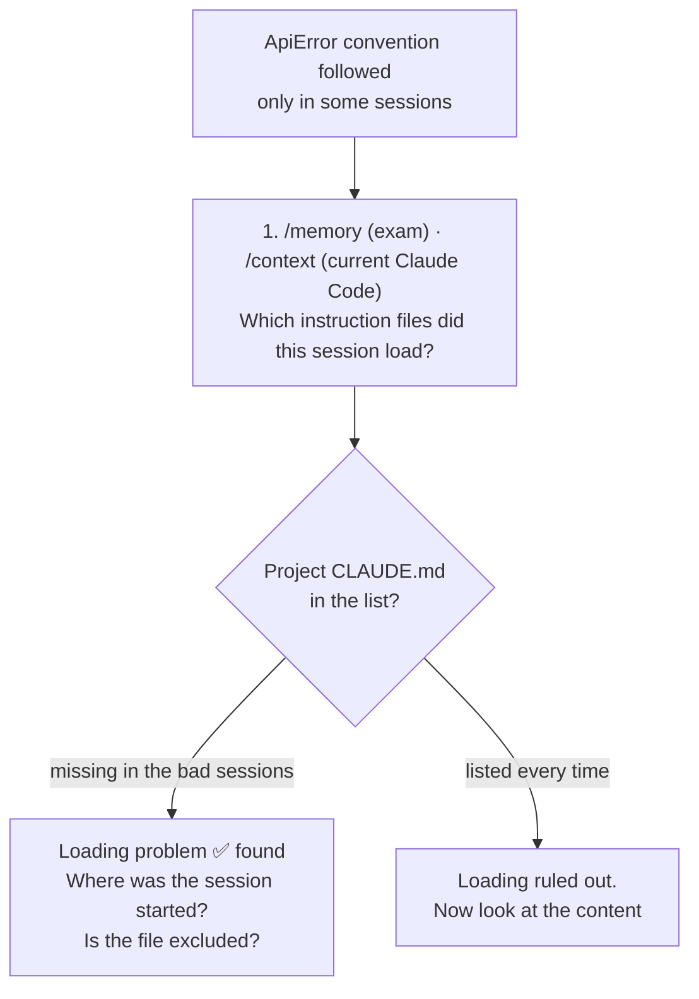

# Q56 — Convention followed only sometimes: first check which files are loaded (`/memory`)

**Domain / lesson:** D3 › 3.1 CLAUDE.md Hierarchy (diagnostic commands)
**Scenario:** Claude Code for a development team (same as [Q52](../Q52-posttooluse-hook-runs-formatter/question.md)–[Q55](../Q55-tests-first-share-failures/question.md))
**Follows:** [Q46](../Q46-stateless-api-pass-full-history/question.md) (agent "forgets" → first check it's actually in context) · [Q54](../Q54-path-scoped-rules-load-by-file-type/question.md) (path rules fix *what* loads, not this) · [Q52](../Q52-posttooluse-hook-runs-formatter/question.md) (CLAUDE.md is guidance)

## Question

You are using Claude Code to accelerate software development. Your team uses it for code generation, refactoring, debugging, and documentation. You need to integrate it into your development workflow with custom slash commands, CLAUDE.md configurations, and understand when to use plan mode vs direct execution.

You've documented API error handling conventions in a CLAUDE.md file at your project root, specifying that endpoint handlers should use a custom ApiError class. After several sessions, you notice Claude Code sometimes follows these conventions and sometimes uses generic try/catch blocks with string messages. The inconsistency appears random across different coding sessions. What's the most efficient first diagnostic step?

- **A.** Add a more detailed code examples to your CLAUDE.md showing the exact ApiError usage pattern for different endpoint types.
- **B.** Run /memory to check which memory files are loaded and verify your CLAUDE.md is included.
- **C.** Search for conflicting instructions in ~/.claude/CLAUDE.md or ~/.claude/rules/ that might override your project conventions.
- **D.** Create path-specific rules in .claude/rules/handlers.md with YAML frontmatter scoping the error handling instructions to your API handler files.

## Answer: **B**

## Diagram



**Diagnose before you fix.** A, C and D all change or search something based on a guess about the cause. B checks the most basic fact first: can Claude see the file at all?

## Concept

**If Claude can't see the file, nothing in it matters.** Every other fix (better examples, removing conflicts, path rules) assumes the CLAUDE.md is in context. *"Sometimes yes, sometimes no, across sessions"* is exactly what you'd see if some sessions load it and others don't.

**How a session can miss the project CLAUDE.md:**
- **It was started somewhere else.** Claude Code docs: *"CLAUDE.md and CLAUDE.local.md files in the directory hierarchy above the working directory are loaded at launch."* A session started outside the project tree (a different clone, a sibling git worktree, a parent folder) doesn't load the project's root file.
- **It was excluded by settings,** e.g. `claudeMdExcludes`, or `--setting-sources` without `project`.

**The check takes seconds and changes nothing.** That's what makes it the most efficient *first* step: one command rules a whole class of causes in or out. It also shows every other file that loaded, including your user-level `~/.claude/CLAUDE.md`, so it tells you whether C's search is even worth doing.

**`/memory` vs `/context`, exam vs real use.** Guide 3.1: *"The exam guide (v1.0) is older than the split between the two commands."* It *"treats `/memory` as the command that shows which files are loaded."* Today, *"`/memory` lists your CLAUDE.md, CLAUDE.local.md and auto-memory locations, and opens any of them in your editor"* and *"`/context` reports what loaded at launch, under **Memory files**."* Guide's advice: *"Give `/memory` as the right answer. In real use, run `/context`."*

**Neither command *loads* anything.** *"Neither command loads anything. They show which files are already loaded."* *"Use these commands to diagnose, not to activate."* If the file is missing, you fix *where* it is or *how the session starts*, not by running a command.

## Why the others are wrong

| Option | Why not |
|---|---|
| **A** Add more detailed code examples to CLAUDE.md | **A fix, not a diagnosis, and it assumes the file is loaded.** If the bad sessions never load the CLAUDE.md, better examples in it change nothing. Clearer instructions do help (docs: *"Make instructions more specific"*), but only after you've confirmed Claude can see them. |
| **C** Search `~/.claude/CLAUDE.md` and `~/.claude/rules/` for conflicts that "override" the project | **A narrower guess, built on a wrong idea.** Files don't override each other: *"All discovered files are concatenated into context rather than overriding each other"*, and on a conflict *"Claude may pick one arbitrarily."* Guide 3.1: watch for options claiming *"user-level overrides project-level"*; *"The official docs say neither."* Checking for conflicts is a valid *later* step, and `/memory` first shows whether a user-level file is even loaded. You'd also only be searching **your own** `~/.claude/`, not your teammates'. |
| **D** Move the rules into `.claude/rules/handlers.md` with `paths` | **A fix for a different problem.** Path rules control *when* guidance loads to save tokens (Q54). They don't explain why a loaded rule is followed only sometimes, and they're still guidance (Q52). If a session isn't loading the project's files, `.claude/rules/` in the same project won't load either. |

## Pattern to remember

> **"Claude follows my CLAUDE.md only sometimes" → first check which instruction files are loaded (`/memory` on the exam, `/context` in today's Claude Code).** Diagnose before you fix. Better examples, conflict hunts and path rules all assume the file is in context.

**Exam signals:**
- *"Most efficient **first diagnostic** step"* → the cheap check that rules out a whole class of causes, without changing anything.
- Options that **rewrite** CLAUDE.md, **add** rules or **search** for one specific cause are fixes or guesses. They come later.
- *"New team member"* + *"inconsistent behaviour"* → the conventions are in someone's **user-level** file, not the project's (guide 3.1).
- *"Override"*, *"more specific scope wins"* → wrong. Files are concatenated; conflicts are resolved arbitrarily.

### Where this comes from

**Guide D3 › 3.1 CLAUDE.md Hierarchy:**
- *"When behaviour differs between sessions or developers, check which memory files each session loaded."*
- Key concept: *"Neither command loads anything. They show which files are already loaded."* *"Configuration loads automatically, based on its level and its location."* *"Use these commands to diagnose, not to activate."*
- *"Give `/memory` as the right answer. In real use, run `/context`."*
- *"All discovered files are concatenated into context rather than overriding each other"*. *"If two rules contradict each other, Claude may pick one arbitrarily."* Watch for *"more specific scope wins"* or *"user-level overrides project-level"*: *"The official docs say neither."* (**C**)
- *"There's no guarantee of strict compliance."* *"Treat CLAUDE.md as guidance that the model usually follows."*

**Claude Code docs, *How Claude remembers your project* › Claude isn't following my CLAUDE.md** (code.claude.com, checked 2026-10-31). The debug list, in this order:
1. *"Run `/context` and check the list under **Memory files** to verify the CLAUDE.md and CLAUDE.local.md files that should load at launch. If one is missing there, Claude can't see it."* (**B**)
2. *"Check that the relevant CLAUDE.md is in a location that gets loaded for your session."*
3. *"Make instructions more specific."* (**A**, later)
4. *"Look for conflicting instructions across CLAUDE.md files."* (**C**, later)

## How this connects to earlier questions

| Question | Link |
|---|---|
| [Q46](../Q46-stateless-api-pass-full-history/question.md) | Same instinct: when the agent "forgets", first check that the information actually reaches the model (history re-sent there, CLAUDE.md loaded here) before changing instructions |
| [Q54](../Q54-path-scoped-rules-load-by-file-type/question.md) | Path rules were the answer to "too much loads". Here the question is whether the file loads at all |
| [Q52](../Q52-posttooluse-hook-runs-formatter/question.md) | Even when loaded, CLAUDE.md is guidance. A convention that must always hold needs a deterministic check |

## Check question

**You run `/memory` (or `/context`) in several sessions, including ones where Claude used generic try/catch. The project CLAUDE.md is listed every time, and no other loaded file mentions error handling. What does that rule out, what explanation is left, and what are your next two steps?**

*My answer:* "That rules out CLAUDE.md not being loaded, and other files overruling it. It might suggest CLAUDE.md is not specific enough, or the usage examples should be enhanced." 🟡 **Both things ruled out are right, and making the instruction more specific is the right first step. One correction and one missing step:**

**Correction: files don't "overrule" each other.** What you ruled out is a **conflict**: two loaded files giving different guidance, so *"Claude may pick one arbitrarily."* No file wins or overrides; they're all concatenated.

**What's left:** the file *is* loaded and nothing contradicts it, yet Claude follows it only sometimes. That's how guidance behaves. Guide 3.1: *"There's no guarantee of strict compliance."* *"Treat CLAUDE.md as guidance that the model usually follows."* "Random across sessions" is exactly what probabilistic compliance looks like.

**Step 1 (your answer): make it specific, with an example.** Docs: *"Make instructions more specific."* Option A becomes the right move **now**, after the diagnosis:

```markdown
## API error handling (src/api/handlers/**)
- Throw `ApiError(status, code, message)` from `src/errors/ApiError.ts`.
- Never `throw new Error("...")`, and never return a plain string message.
- Example: `throw new ApiError(404, "ORDER_NOT_FOUND", "Order 123 not found");`
```

Moving it into a path-scoped rule for `src/api/handlers/**` (option D) can also help now: the rule loads right when Claude edits a handler, alongside less unrelated text (Q54). It's still guidance, though.

**Step 2 (missing): if the convention must always hold, enforce it with a check.** Step 1 raises the hit rate but can't make it 100%. Q52 is the proof: "IMPORTANT: MUST" only took violations from 30% to 15%. The docs: *"If the instruction is something that must run at a specific point… write it as a hook instead."*
- **A lint rule** that flags `throw new Error(...)` in handler files (e.g. ESLint `no-restricted-syntax`).
- **A PostToolUse hook** that runs the linter on each edited handler file and **exits 2** on failure, so Claude sees the error and fixes it in the same session. (ESLint exits 1, which hooks treat as a non-blocking error that Claude doesn't see. Hooks docs: *"If your hook is meant to enforce a policy, use `exit 2`."*)
- **CI** runs the same lint rule as the final safety net.

| Layer | What it does | Guarantee |
|---|---|---|
| Specific CLAUDE.md / path rule + example | Claude usually writes it right the first time | Probabilistic |
| Lint rule + PostToolUse hook (exit 2) | Every miss is caught and sent back to Claude to fix | Deterministic |
| CI | Nothing non-compliant gets merged | Deterministic |

> **Loaded and not contradicted, but still followed only sometimes → it's guidance doing what guidance does. First make it specific with an example; if it must always hold, add a deterministic check (lint + hook, CI).**

## Glossary

- **`/memory`:** lists your CLAUDE.md, CLAUDE.local.md and auto-memory locations and opens them for editing. The exam treats it as "show which files are loaded".
- **`/context`:** shows what's in the current context, including the **Memory files** loaded at launch. The real-world way to check which instruction files loaded.
- **Loaded at launch vs on demand:** root and ancestor CLAUDE.md files load when the session starts; subdirectory CLAUDE.md files and path-scoped rules load later, when Claude touches a matching file (a `Loaded` line appears in the terminal).
- **Concatenated:** all loaded instruction files are joined into context. None overrides another; if they conflict, Claude may follow either.

## Related course lessons

*Lecture lengths aren't recorded in the study-map files, so the watch times below are estimates from each course's average lecture length.*

### Udemy A (primary): Claude Certified Architect (CCAR-F) - 2026 Exam Prep
| # | Lecture | Part | Why |
|---|---|---|---|
| **64** | **Load Order and Conflict Resolution** | 3B | ⭐ What loads, in what order, and why nothing "overrides" (B, C) |
| 63 | The Three-Level CLAUDE.md Hierarchy | 3B | Which file each session sees *(also in Q54)* |
| 68 | Writing Instructions Claude Follows | 3B | The later step: making instructions specific (A) *(also in Q55)* |
| Quiz 9 | 3B quiz | | Self-test |

**▶ Watch in this order (~20 min, est.):** #63 → #64 → #68, then do **Quiz 9**.

### Udemy B: Claude Certified Architect Foundations: Complete Course (Voroniuk)
| # | Lecture | Section | Why |
|---|---|---|---|
| **71** | **CLAUDE.md Levels: Who Gets What** | S8 Claude Code Setup | ⭐ Which files load for whom *(also in Q54)* |
| **88** | **Claude Code Case: Team Setup** | S8 Claude Code Setup | ⭐ Diagnosing config that works for one session or developer but not another |
| 72 | @import and the Rules Folder | S8 Claude Code Setup | Why D doesn't diagnose anything *(also in Q52, Q54)* |
| Quiz 8 | Claude Code Setup quiz | S8 | Self-test |

**▶ Watch in this order (~15 min, est.):** #71 → #88 → #72, then do **Quiz 8**.

### CBT Nuggets: CCA-F course
| Skill | Why |
|---|---|
| **1. Set Up Claude Code and Configure Projects** | ⭐ CLAUDE.md levels and project setup (3.1) |
