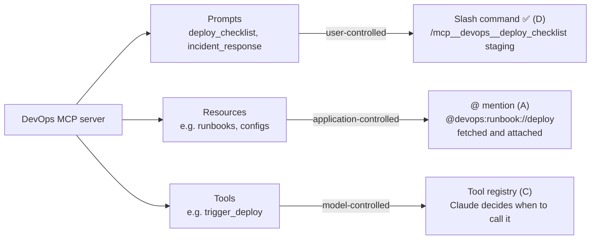
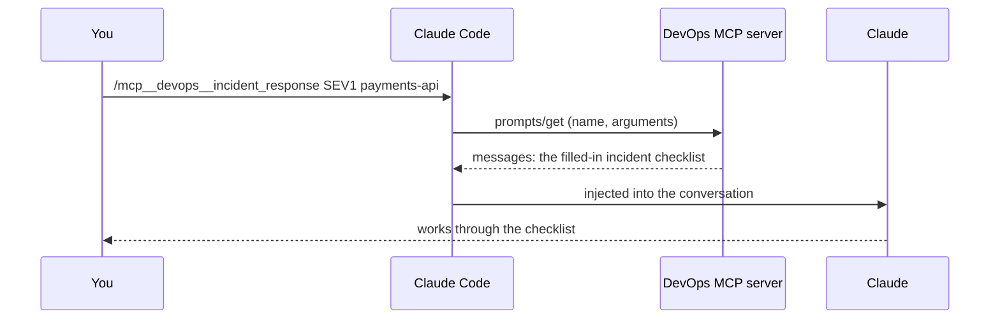

# Q57 — MCP prompts in Claude Code: slash commands that *you* run

**Domain / lesson (closest fit):** D2 › 2.4 MCP Server Integration (the guide covers MCP tools and resources, not prompts)
**Also touches:** D3 › 3.2 Slash Commands & Skills
**Scenario:** Claude Code for a development team, with a custom DevOps MCP server
**Follows:** [Q33](../Q33-mcp-iserror-result/question.md) (MCP tools and their results) · [Q23](../Q23-expand-minimal-tool-descriptions/question.md) (the model picks tools from their descriptions)

## Question

You are using Claude Code to accelerate software development. Your team uses it for code generation, refactoring, debugging, and documentation. You need to integrate it into your development workflow with custom slash commands, CLAUDE.md configurations, and understand when to use plan mode vs direct execution.

Your team has connected a custom MCP server that provides DevOps workflow templates. The server exposes several MCP prompts (such as deploy_checklist and incident_response) in addition to tools. How do these MCP prompts become accessible within Claude Code?

- **A.** They are surfaced as @ -mentionable resources alongside files, fetched and attached to your message when referenced.
- **B.** They are automatically prepended to every conversation as additional system-level context, influencing Claude's behavior throughout the session.
- **C.** They are added to Claude Code's tool registry alongside the server's tools, invoked automatically by the model when relevant to the task.
- **D.** They appear as slash commands (e.g., mcp_servername_deploy_checklist) that you can invoke, with arguments passed after the command name.

## Answer: **D**

## Diagram

### One MCP server, three kinds of thing, three ways in

### What happens when you run one

## Concept

**MCP servers offer three kinds of thing, and each is controlled by someone different.** MCP specification, *Server features*:

| Primitive | Control | Description (spec) | In Claude Code |
|---|---|---|---|
| **Prompts** | **User**-controlled | *"Interactive templates invoked by user choice"*. Example: *"Slash commands, menu options"* | **Slash commands** (D) |
| **Resources** | **Application**-controlled | *"Contextual data attached and managed by the client"* | **@ mentions** (A) |
| **Tools** | **Model**-controlled | *"Functions exposed to the LLM to take actions"* | **Tool registry**, called by Claude (C) |

**Prompts are templates *you* choose to run.** MCP spec, *Prompts*: *"Prompts are designed to be user-controlled, meaning they are exposed from servers to clients with the intention of the user being able to explicitly select them for use."* *"Typically, prompts would be triggered through user-initiated commands… For example, as slash commands."* So `deploy_checklist` is a reusable starting message the server wrote, with blanks (arguments) for you to fill in.

**In Claude Code** (docs, *Connect Claude Code to tools via MCP › Use MCP prompts as commands*):
- *"MCP servers can expose prompts that become available as commands in Claude Code."*
- **Find them:** type `/`. *"Claude Code lists each MCP prompt as `/servername:promptname (MCP)`. Typing `/mcp__servername__promptname` also runs it."*
- **Arguments:** *"Pass them space-separated after the command."* e.g. `/mcp__devops__deploy_checklist staging`. *"Claude Code splits the arguments on whitespace, so each argument is a single token."*
- **What happens:** *"Prompt results are injected directly into the conversation."* Only when you run it.
- They're discovered automatically from the connected server; no setup per prompt.

**Option D's example name is approximate.** The real form uses **double** underscores (`/mcp__servername__deploy_checklist`), and the `/` menu shows `/servername:deploy_checklist (MCP)`. The mechanism (a slash command with arguments after the name) is what makes D right.

## Why the others are wrong

| Option | Why not |
|---|---|
| **A** @-mentionable resources, fetched and attached | **That's how *resources* work, not prompts.** Docs: *"MCP servers can expose resources that you can reference using @ mentions, similar to how you reference files."* *"Resources are automatically fetched and included as attachments when referenced."* Resources are **data** (a runbook, a schema); prompts are **instructions to run** (a checklist workflow). The tempting one, because it's accurate for the other primitive. |
| **B** Automatically prepended to every conversation | **Nothing about prompts is automatic.** A prompt's content enters the conversation only when you run it (*"injected directly into the conversation"*, on invocation). Always-loaded context is what CLAUDE.md does (Q54, Q56), and putting every DevOps template into every session would waste tokens for the same reason Q54's 500-line file did. |
| **C** Added to the tool registry, invoked by the model | **That's how *tools* work.** Tools are *model-controlled* (*"Functions exposed to the LLM to take actions"*); prompts are *user-controlled*. The model doesn't see prompts as callable functions and doesn't run them on its own. The server's tools (e.g. `trigger_deploy`) are what Claude calls, chosen from their descriptions (Q23). |

## Pattern to remember

> **MCP prompts → slash commands you run (`/mcp__server__prompt arg1 arg2`). Resources → `@` mentions. Tools → the model calls them.** Match each primitive to who controls it: user, application, model.

**Exam signals:**
- *"How do MCP **prompts** become accessible?"* → **slash commands** with arguments.
- *"How do MCP **resources** …?"* → **`@server:protocol://path`** mentions, fetched and attached.
- *"How does Claude **use** the server's **tools**?"* → discovered at connection, in the tool registry, chosen by the model from descriptions.
- *"Automatically prepended to every conversation"* → that's CLAUDE.md, not any MCP primitive.

### Where this comes from

**MCP specification (2025-06-18), *Server features*** (modelcontextprotocol.io, checked 2026-10-31):
- Prompts: *"User-controlled"*, *"Interactive templates invoked by user choice"*, example *"Slash commands, menu options"*.
- Resources: *"Application-controlled"*, *"Contextual data attached and managed by the client"*.
- Tools: *"Model-controlled"*, *"Functions exposed to the LLM to take actions"*.

**MCP specification, *Prompts*:** *"Prompts are designed to be **user-controlled**… with the intention of the user being able to explicitly select them for use."* *"For example, as slash commands."* Clients *"provide arguments to customize them."*

**Claude Code docs, *Connect Claude Code to tools via MCP*** (code.claude.com, checked 2026-10-31):
- *"MCP servers can expose prompts that become available as commands in Claude Code."* *"Typing `/mcp__servername__promptname` also runs it."* *"Pass them space-separated after the command."* *"Prompt results are injected directly into the conversation."*
- *"MCP servers can expose resources that you can reference using @ mentions, similar to how you reference files."* Format: `@server:protocol://resource/path`. *"Resources are automatically fetched and included as attachments when referenced."* (**A**)

**Guide D2 › 2.4 MCP Server Integration** (covers resources and tools only):
- *"Claude Code shows resources through `@server:resource` mentions and a resource-listing tool."*
- *"All tools from all configured servers, project and user level, are discovered at connection time and available simultaneously."* *"The agent reads tool descriptions when choosing."* (**C** describes tools)

## How this connects to earlier questions

| Question | Link |
|---|---|
| [Q23](../Q23-expand-minimal-tool-descriptions/question.md) | Tools are the primitive the **model** picks, from their descriptions. Prompts never enter that choice |
| [Q33](../Q33-mcp-iserror-result/question.md) | Another MCP primitive question: tool results and `isError`. Same server, different primitive |
| [Q54](../Q54-path-scoped-rules-load-by-file-type/question.md) / [Q56](../Q56-memory-check-loaded-files-first/question.md) | "Loaded into every session" is CLAUDE.md's job (option B), with the token cost Q54 was about |

## Check question

**Your team wants Claude to follow the `incident_response` steps automatically whenever someone describes an outage in plain words, without anyone typing a command. Will the MCP prompt do that? If not, what would you use instead?**

## Glossary

- **MCP prompt:** a reusable message template that an MCP server offers, with optional arguments. User-controlled: in Claude Code you run it as a slash command.
- **MCP resource:** data an MCP server offers (a file, a record, a schema). In Claude Code you reference it with `@server:protocol://path`, and it's attached to your message.
- **MCP tool:** a function an MCP server offers for the model to call. Claude decides when to use it.
- **`prompts/get`:** the MCP request Claude Code sends to fetch a prompt's filled-in messages when you run the command.

## Related course lessons

*Lecture lengths aren't recorded in the study-map files, so the watch times below are estimates from each course's average lecture length.*

### Udemy A (primary): Claude Certified Architect (CCAR-F) - 2026 Exam Prep
| # | Lecture | Part | Why |
|---|---|---|---|
| **44** | **Tools, Resources, and Prompts — The Three MCP Primitives** | 2B | ⭐ Exactly this question: which primitive surfaces how |
| 45–49 | Server, tools, resources, prompts, clients (titles not in the study map) | 2B | The prompts and resources lectures cover D vs A in depth |
| 71 | Creating and Structuring Custom Slash Commands | 3C | Slash commands in Claude Code (where MCP prompts appear) |
| Quiz 6, Quiz 10 | 2B and 3C quizzes | | Self-test |

**▶ Watch in this order (~25 min, est.):** #44 → the prompts and resources lectures in #45–49 → #71, then do **Quiz 6** and **Quiz 10**.

### Udemy B: Claude Certified Architect Foundations: Complete Course (Voroniuk)
| # | Lecture | Section | Why |
|---|---|---|---|
| **46** | **MCP: Servers, Tools and Resources** | S5 Tools & MCP | ⭐ The primitives (A and C) |
| 74 | Where Commands and Skills Live | S8 Claude Code Setup | Slash commands in Claude Code (D) |
| 91 | Dev Agent Case: MCP Servers | S8 Claude Code Setup | MCP servers in a Claude Code setup |
| Quiz 5, Quiz 8 | Tools & MCP and Claude Code Setup quizzes | S5, S8 | Self-test |

**▶ Watch in this order (~15 min, est.):** #46 → #74 → #91, then do **Quiz 5** and **Quiz 8**.
Udemy B's titles don't mention MCP prompts. CBT skill 34 is the most direct coverage.

### CBT Nuggets: CCA-F course
| Skill | Why |
|---|---|
| **34. Build MCP Tools Resources and Prompts** | ⭐ All three primitives, built hands-on |
| 5. Extend Claude Code with MCP Servers | Connecting a server to Claude Code |
| 4. Create Custom Commands for Repeatable Workflows | Slash commands with arguments |
