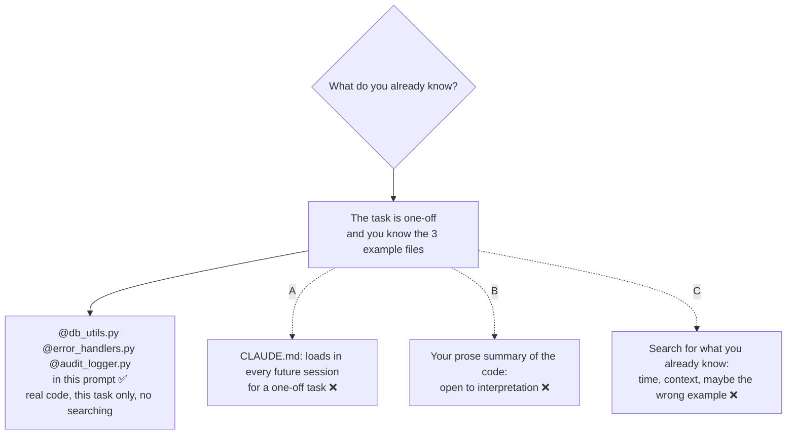

# Q58 — One-off task, known example files: `@`-reference them in the prompt

**Domain / lesson (closest fit):** D3 › 3.5 Iterative Refinement (concrete examples beat prose descriptions)
**Also touches:** D3 › 3.1 CLAUDE.md Hierarchy (what belongs in CLAUDE.md) · D5 › 5.4 Codebase Exploration (exploring costs context)
**Scenario:** Claude Code for a development team (same as [Q52](../Q52-posttooluse-hook-runs-formatter/question.md)–[Q57](../Q57-mcp-prompts-become-slash-commands/question.md))
**Follows:** [Q55](../Q55-tests-first-share-failures/question.md) (give Claude something concrete) · [Q54](../Q54-path-scoped-rules-load-by-file-type/question.md) (CLAUDE.md loads every session) · [Q53](../Q53-direct-execution-for-clear-small-change/question.md) (don't add steps a clear task doesn't need)

## Question

You are using Claude Code to accelerate software development. Your team uses it for code generation, refactoring, debugging, and documentation. You need to integrate it into your development workflow with custom slash commands, CLAUDE.md configurations, and understand when to use plan mode vs direct execution.

You're implementing a new payment processing module that must follow your project's established patterns for database transactions, error handling, and audit logging. You've identified three existing modules that exemplify these patterns: db_utils.py, error_handlers.py, and audit_logger.py. This is a one-off integration task – these patterns are well-documented in your team wiki and don't need additional project-level documentation. What's the most effective approach?

- **A.** Add documentation of each pattern to your CLAUDE.md file, establishing them as project conventions that Claude will apply automatically.
- **B.** Describe the patterns from the three modules in natural language in your prompt, explaining the transaction handling approach, error format, and logging conventions Claude should follow.
- **C.** Ask Claude to explore your codebase to find and understand the transaction, error handling, and logging patterns before generating the new module.
- **D.** Use @ references to include the three modules directly in your prompt, giving Claude concrete code examples of the patterns to follow.

## Answer: **D**

## Diagram



**The prompt:**

```text
Create payments/processor.py for the new payment flow.
Follow the patterns in these modules exactly:
- transactions: @db_utils.py
- error format: @error_handlers.py
- audit logging: @audit_logger.py
Reuse their helpers; don't write new ones where these exist.
```

## Concept

**The question hands you three facts, and each one rules out an option:**

| Fact in the question | What it means | Rules out |
|---|---|---|
| *"You've identified three existing modules"* | You know exactly where the patterns are | **C** (no need to search) |
| *"Exemplify these patterns"* | The real code is the best description of the pattern | **B** (a prose summary loses detail) |
| *"One-off integration task… don't need additional project-level documentation"* | Nothing needs to persist past this task | **A** (CLAUDE.md is for every session) |

**`@` puts the real files into this conversation.** Claude Code docs: *"Use @ to quickly include files or directories without waiting for Claude to read them."* The file's content is included *"when it fits the Read tool's token limit, 25,000 tokens by default."* You can reference several files in one message.

**Real code beats a description of it.** Guide 3.5: *"The model generalises from examples more reliably than from any prose description."* The three modules *are* the examples: the exact transaction context manager, the exact error class and fields, the exact audit log call. Claude copies the pattern instead of reconstructing it from your summary.

**It's scoped to this task.** The files are in context for this conversation only. Next week's sessions don't carry them, which is right for a one-off task.

## Why the others are wrong

| Option | Why not |
|---|---|
| **A** Document the patterns in CLAUDE.md | **Permanent context for a one-off task.** Root CLAUDE.md *"loads for every session, whichever files you edit"* (guide 3.3), so every future session would pay for payment-module notes it doesn't need (Q54). The question also says the patterns are already documented and *"don't need additional project-level documentation."* Guide 3.2 lists putting task-specific workflows in CLAUDE.md as a trap. And it would still be a *description*, not the code. |
| **B** Describe the patterns in natural language | **Your summary of code is less precise than the code.** Guide 3.5: *"More precise prose still relies on interpretation."* "Wrap writes in a transaction and log an audit event" leaves open which helper, which fields, what order, how rollback works. The tempting one, because it's targeted and one-off. But why describe code you can simply show? |
| **C** Ask Claude to explore the codebase for the patterns | **Searching for something you've already found.** It costs time and context: *"Exploring a large codebase is one of the most context-intensive tasks"*, and *"each exploration step produces verbose output"* (guide 5.4). It can also land on the wrong examples, e.g. an older module that still uses a legacy pattern. You'd be swapping a certain answer for a guess. |

## Pattern to remember

> **You know which files show the pattern, and the task is one-off → `@`-reference those files in the prompt.** Real code beats a prose description (3.5); no search needed; nothing added to CLAUDE.md that every future session would load.

**Exam signals:**
- *"You've identified"* / *"these three files"* → you already know where → **`@` references**, not exploration.
- *"One-off"*, *"don't need project-level documentation"* → **not** CLAUDE.md.
- *"Describe in natural language"* when the real code is available → prose loses to examples.

### Where this comes from

**Claude Code docs, *Common workflows* › Reference files and directories** (code.claude.com, checked 2026-10-31):
- *"Use @ to quickly include files or directories without waiting for Claude to read them."*
- *"This includes the content of the file in the conversation when it fits the Read tool's token limit, 25,000 tokens by default."*
- Tips: *"You can reference multiple files in a single message"*. *"@ file references add `CLAUDE.md` in the file's directory and parent directories to context."* *"Directory references show file listings, not contents."*

**Guide D3 › 3.5 Iterative Refinement:**
- *"The model generalises from examples more reliably than from any prose description."*
- *"More precise prose still relies on interpretation, so more prose will not fix this problem."* (**B**)

**Guide D3 › 3.1 / 3.2 / 3.3:**
- *"Root CLAUDE.md loads for every session, whichever files you edit."* (3.3, **A**)
- 3.2 exam traps include putting task-specific workflows in CLAUDE.md (**A**).

**Guide D5 › 5.4 Codebase Exploration:**
- *"Exploring a large codebase is one of the most context-intensive tasks that a Claude-based agent performs."* *"Each exploration step produces verbose output: file contents, search results, directory listings."* (**C**)

## How this connects to earlier questions

| Question | Link |
|---|---|
| [Q55](../Q55-tests-first-share-failures/question.md) | Same 3.5 idea: give Claude something concrete (tests there, real example code here) instead of more prose |
| [Q54](../Q54-path-scoped-rules-load-by-file-type/question.md) | CLAUDE.md loads in every session. Don't put things there that only one task needs |
| [Q57](../Q57-mcp-prompts-become-slash-commands/question.md) | `@` again: `@file` includes a file, `@server:protocol://path` includes an MCP resource |
| [Q53](../Q53-direct-execution-for-clear-small-change/question.md) | When the task already tells you what you need, don't add steps (plan mode there, exploration here) |

## Check question

**A teammate has to build a similar module in a different service of the same codebase, but has no idea which modules show the right transaction, error and logging patterns. Is option C right for them? How should they run it so the search doesn't clutter their main session?**

## Glossary

- **`@` file reference:** typing `@path/to/file` in a Claude Code prompt includes that file's content in the conversation (up to the Read tool's token limit). `@folder` shows a file listing.
- **Exemplar file:** an existing file that shows the pattern you want copied.
- **One-off task:** a task whose context doesn't need to persist into future sessions.

## Related course lessons

*Lecture lengths aren't recorded in the study-map files, so the watch times below are estimates from each course's average lecture length.*

### Udemy A (primary): Claude Certified Architect (CCAR-F) - 2026 Exam Prep
| # | Lecture | Part | Why |
|---|---|---|---|
| **68** | **Writing Instructions Claude Follows** | 3B | ⭐ Concrete examples vs prose (D vs B) *(also in Q55, Q56)* |
| 69 | Common CLAUDE.md Patterns for Real Teams | 3B | What belongs in CLAUDE.md and what doesn't (A) *(also in Q52)* |
| 59 | The Tool System — Reads, Bash, Edits, and Web Search | 3A | How Claude reads and searches files (C) |
| Quiz 8, Quiz 9 | 3A and 3B quizzes | | Self-test |

**▶ Watch in this order (~20 min, est.):** #68 → #69 → #59, then do **Quiz 9** and **Quiz 8**.

### Udemy B: Claude Certified Architect Foundations: Complete Course (Voroniuk)
| # | Lecture | Section | Why |
|---|---|---|---|
| **82** | **Refinement: Examples and Tests** | S8 Claude Code Setup | ⭐ Why examples beat prose (D vs B) *(also in Q55)* |
| 71 | CLAUDE.md Levels: Who Gets What | S8 Claude Code Setup | What loads in every session (A) *(also in Q54, Q56)* |
| 80 | Exploring a Codebase Step by Step | S8 Claude Code Setup | When exploring is worth it (C) |
| Quiz 8 | Claude Code Setup quiz | S8 | Self-test |

**▶ Watch in this order (~15 min, est.):** #82 → #71 → #80, then do **Quiz 8**.

### CBT Nuggets: CCA-F course
| Skill | Why |
|---|---|
| 2. Define Claude Code and Coding Assistants | How Claude Code works with your files (general intro) |
| 1. Set Up Claude Code and Configure Projects | What CLAUDE.md is for (A) |

CBT doesn't cover 3.5 or 5.4. Use the guide lessons and Udemy B #82.
