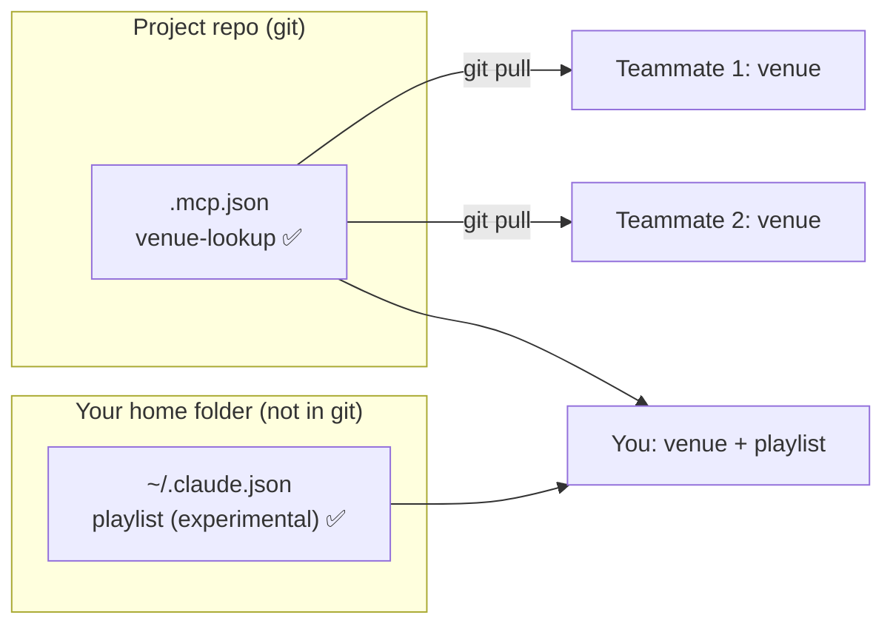

# Q59 — MCP server scopes: team server in `.mcp.json`, personal server in `~/.claude.json`

**Domain / lesson:** D2 › 2.4 MCP Server Integration
**Scenario:** Claude Code for a development team (same as [Q52](../Q52-posttooluse-hook-runs-formatter/question.md)–[Q58](../Q58-at-reference-example-files/question.md))
**Follows:** [Q56](../Q56-memory-check-loaded-files-first/question.md) (user-level files aren't shared) · [Q57](../Q57-mcp-prompts-become-slash-commands/question.md) (MCP servers in Claude Code) · [Q54](../Q54-path-scoped-rules-load-by-file-type/question.md) (shared vs personal configuration)

## Question

You are using Claude Code to accelerate software development. Your team uses it for code generation, refactoring, debugging, and documentation. You need to integrate it into your development workflow with custom slash commands, CLAUDE.md configurations, and understand when to use plan mode vs direct execution.

Your team is configuring MCP servers in Claude Code. You want to add a shared venue lookup server that all team members should have access to, and you personally want to add an experimental music playlist server that only you are testing. Which configuration approach correctly applies MCP server scopes?

- **A.** Add both servers to your local ~/.claude.json
- **B.** Add venue server to ~/.claude.json and playlist server to .mcp.json
- **C.** Add venue server to .mcp.json and playlist server to ~/.claude.json.
- **D.** Add both servers to the project-level .mcp.json file

## Answer: **C**

## Diagram



## Concept

**Two questions decide where an MCP server goes: who should get it, and should it be in version control?**

| Server | Who needs it | File | Why |
|---|---|---|---|
| **Venue lookup** | Whole team | **`.mcp.json`** in the project root | Committed to git, so every teammate gets it on the next pull |
| **Playlist** (experimental) | Only you | **`~/.claude.json`** in your home folder | Never in git, so nobody else sees it, and you can change or remove it freely |

Guide 2.4 key concept: *"Project-level `.mcp.json` is version-controlled and shared. User-level `~/.claude.json` is personal."* The guide gives *"a Jira integration, GitHub tools, internal API connectors"* as `.mcp.json` examples, and *"experimental servers, personal integrations"* as `~/.claude.json` examples. Q59 is the textbook case of each.

**Claude Code actually has three scopes, and two of them live in `~/.claude.json`:**

| Scope | Loads in | Shared with team | Stored in | Command |
|---|---|---|---|---|
| **Local** (default) | This project only | No | `~/.claude.json`, under this project's path | `claude mcp add playlist …` |
| **Project** | This project only | **Yes, via git** | `.mcp.json` in the project root | `claude mcp add venue-lookup --scope project …` |
| **User** | All your projects | No | `~/.claude.json` | `claude mcp add playlist --scope user …` |

So "playlist in `~/.claude.json`" is right whether you pick **local** (test it in this project only, the default) or **user** (use it in every project). Claude Code docs: local scope is for *"personal development servers, experimental configurations, or servers with credentials you don't want in version control."*

**Good to know:**
- **Teammates approve it once.** *"Claude Code prompts for approval in interactive sessions before using project-scoped servers from `.mcp.json` files."* A shared file can't silently add servers to everyone's session.
- **If the same name is in several scopes, one definition wins:** local, then project, then user. *"Fields are not merged across scopes."*

## Why the others are wrong

| Option | Why not |
|---|---|
| **A** Both in `~/.claude.json` | **The team never gets the venue server.** `~/.claude.json` is in your home folder: guide 2.4, *"not version-controlled and not shared with teammates."* It works on your machine only, and every teammate would have to set it up by hand (and might set it up differently). |
| **B** Venue in `~/.claude.json`, playlist in `.mcp.json` | **Exactly backwards.** The team server stays on your machine, and your experiment is pushed to everyone. |
| **D** Both in `.mcp.json` | **Your experiment goes to the whole team.** Every teammate gets a playlist server they didn't ask for: an approval prompt, extra tools in their sessions, and whatever happens when your experiment breaks. Personal things don't belong in shared configuration (same idea as Q56's user-level vs project-level CLAUDE.md, in reverse). |

## Pattern to remember

> **Whole team → `.mcp.json` in the project root (committed). Just you → `~/.claude.json` (local scope for one project, user scope for all your projects).** Ask: who should get it, and should it be in git?

**Exam signals:**
- *"All team members"*, *"shared"*, *"everyone gets the same tools"* → **`.mcp.json`** (project scope).
- *"Only you"*, *"experimental"*, *"personal"* → **`~/.claude.json`** (local or user scope).
- *"New teammate doesn't have the server"* → it was configured in someone's `~/.claude.json`. Same pattern as guide 3.1's *"new team member + inconsistent behaviour"* for CLAUDE.md.

### Where this comes from

**Guide D2 › 2.4 MCP Server Integration:**
- Project scope: *"The file is in the project repository root and is version-controlled."* Examples: *"a Jira integration, GitHub tools, internal API connectors."*
- User scope: *"The file is in the user's home directory and is personal."* It *"is not version-controlled and not shared with teammates."* Examples: *"experimental servers, personal integrations."*
- Key concept: *"Project-level `.mcp.json` is version-controlled and shared. User-level `~/.claude.json` is personal."*
- Exam trap: *"~/.claude.json is user-level and personal, so it is not version-controlled or shared."* (**A**, **B**)
- The current docs list three scopes, *"`local` (the default), `project` and `user`."*

**Claude Code docs, *Connect Claude Code to tools via MCP* › MCP installation scopes** (code.claude.com, checked 2026-10-31):
- Local: *"Local scope is the default. A local-scoped server loads only in the project where you added it and stays private to you. Claude Code stores it in `~/.claude.json` under that project's path."*
- Project: *"Check `.mcp.json` into version control so everyone on your team gets the same MCP tools and services."*
- User: *"available across all projects on your machine while remaining private to your user account."*

## How this connects to earlier questions

| Question | Link |
|---|---|
| [Q56](../Q56-memory-check-loaded-files-first/question.md) | Same split for CLAUDE.md: project-level files are shared through git, user-level ones (`~/.claude/`) are personal. "New teammate doesn't get it" → it's in someone's home folder |
| [Q57](../Q57-mcp-prompts-become-slash-commands/question.md) | Once the venue server is in `.mcp.json`, every teammate also gets its prompts as slash commands |
| [Q54](../Q54-path-scoped-rules-load-by-file-type/question.md) | Choosing where configuration lives decides who gets it and when it loads |

## Check question

**The venue server needs an API key. A teammate suggests putting `"Authorization": "Bearer sk-live-abc123"` straight into `.mcp.json`, because "the repo is private anyway." What's wrong with that, and what should `.mcp.json` contain instead?**

*My answer:* "`.mcp.json` should contain a placeholder or template variable. The approach is wrong because if the repo becomes public, the key gets exposed." 🟡 **The fix is right. The risk is bigger than "if it becomes public": the key is exposed the moment it's committed.**

**Why "private" doesn't protect it.** Guide 2.4: *"A private repository is not a secret store; every clone and fork carries the token in its history."*
- **Everyone with repo access has the key**: current staff, contractors, CI systems, anyone given read access later.
- **Every clone and fork keeps a copy**, on laptops and build servers you don't control.
- **Git history keeps it forever.** Deleting the line in a later commit doesn't remove it from history. Once committed, the only real fix is to **revoke and rotate** the key.
- **One shared key for everyone**: you can't tell who used it, or cut off one person without breaking everyone.

Guide exam trap: *"Committing credentials directly in .mcp.json is a security risk the exam penalises."*

**What `.mcp.json` should contain: a variable reference, not the value.**

```json
{
  "mcpServers": {
    "venue-lookup": {
      "type": "http",
      "url": "https://venues.internal.example.com/mcp",
      "headers": { "Authorization": "Bearer ${VENUE_API_KEY}" }
    }
  }
}
```

- Claude Code replaces `${VENUE_API_KEY}` with the value from the environment when it loads the config. Guide 2.4: *"The file references variable names, not values."* *"This syntax keeps credentials out of version control whilst the server configuration stays shared."*
- **Each developer sets their own key** locally: *"in a shell profile, a `.env` file or a secrets manager"* (guide 2.4). The variable must be set in the environment Claude Code starts in.
- `${VAR:-default}` gives a fallback, e.g. for a URL. Don't use it for secrets.

**Watch out: a missing key doesn't fail loudly.** If `VENUE_API_KEY` isn't set, Claude Code shows a missing-variable warning in `claude mcp list` and uses the literal text `${VENUE_API_KEY}`. Guide 2.4: *"Claude Code warns and continues, so do not rely on a missing token to cause a visible failure."*

> **Never commit a secret, not even to a private repo: clones, forks and git history keep it forever. Commit `${VAR}` in `.mcp.json`; each developer sets the value locally. If a key was ever committed, rotate it.**

## Glossary

- **`.mcp.json`:** the project-scoped MCP configuration file in the repository root. Committed to git and shared with the team.
- **`~/.claude.json`:** your personal Claude Code configuration file in your home folder. Holds your local-scope and user-scope MCP servers. Not in git.
- **Local scope:** the default MCP scope. Private to you, loads only in the project where you added it.
- **User scope:** private to you, loads in all your projects.
- **Project scope:** shared through `.mcp.json`; teammates approve it once before it's used.

## Related course lessons

*Lecture lengths aren't recorded in the study-map files, so the watch times below are estimates from each course's average lecture length.*

### Udemy A (primary): Claude Certified Architect (CCAR-F) - 2026 Exam Prep
| # | Lecture | Part | Why |
|---|---|---|---|
| **55** | **MCP in Production** | 2C | ⭐ Configuring servers for a team |
| 54 | Tool Boundaries, Access Scoping, and Least Privilege | 2C | Who should get which server |
| 43 | What MCP Is | 2B | The basics, if MCP is still new |
| Quiz 7 | 2C quiz | | Self-test |

**▶ Watch in this order (~20 min, est.):** #55 → #54 (→ #43 if needed), then do **Quiz 7**.

### Udemy B: Claude Certified Architect Foundations: Complete Course (Voroniuk)
| # | Lecture | Section | Why |
|---|---|---|---|
| **77** | **Sharing MCP Servers Safely** | S8 Claude Code Setup | ⭐ Exactly this question: `.mcp.json` vs `~/.claude.json` |
| 91 | Dev Agent Case: MCP Servers | S8 Claude Code Setup | A worked team setup *(also in Q57)* |
| 46 | MCP: Servers, Tools and Resources | S5 Tools & MCP | The basics *(also in Q57)* |
| Quiz 8 | Claude Code Setup quiz | S8 | Self-test |

**▶ Watch in this order (~15 min, est.):** #77 → #91, then do **Quiz 8**.

### CBT Nuggets: CCA-F course
| Skill | Why |
|---|---|
| **5. Extend Claude Code with MCP Servers** | ⭐ Adding servers to Claude Code, and where the configuration goes *(also in Q57)* |
