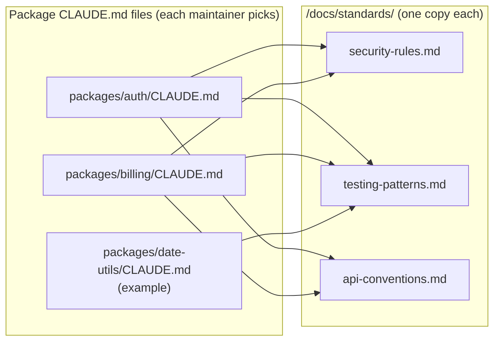

# Q60

**Scenario:** Claude Code in a monorepo with 15 packages (same team setup as [Q52](../Q52-posttooluse-hook-runs-formatter/question.md)–[Q59](../Q59-mcp-scopes-project-vs-user/question.md))

## Question

You are using Claude Code to accelerate software development. Your team uses it for code generation, refactoring, debugging, and documentation. You need to integrate it into your development workflow with custom slash commands, CLAUDE.md configurations, and understand when to use plan mode vs direct execution.

Your monorepo contains shared coding standards in /docs/standards/ : security-rules.md (for services handling user data), testing-petterns.md (for all packages), and api-conventions.md (for API-facing services). Your 15 packages are organized by feature domain ( /packages/auth/, /packages/billing/, /packages/notifications/ , etc.) without naming conventions indicating which handle user data or expose APIs. Package maintainers are expected to configure their own local development settings, as they understand their package's domain requirements. Currently, all package CLAUDE.md files duplicate all three standards, applying irrelevant guidance. What's the most effective approach?

- **A.** Create .claude/rules/ files for each standard with YAML frontmatter paths listing every package directory where that standard should apply.
- **B.** Put all standards in the root CLAUDE.md with override instructions like "ignore security-rules.md when working in packages that don't handle user data."
- **C.** Create a shared-stendards.md that uses @imports to combine all three standards, then have each package's CLAUDE.md import that combined file.
- **D.** Use @imports in each package's CLAUDE.md to reference only the specific standard files relevant to that package, based on the maintainer's domain knowledge.

<details>
<summary><b>Show answer and explanation</b></summary>

**Topic:** Monorepo standards with no naming pattern: each package `@`-imports only what applies
**Domain / lesson:** D3 › 3.1 CLAUDE.md Hierarchy (`@path` imports, per-package CLAUDE.md)
**Also touches:** D3 › 3.3 Path-Specific Rules (why globs don't fit here)
**Follows:** [Q54](../Q54-path-scoped-rules-load-by-file-type/question.md) (path rules when a glob matches the files; imports don't shrink context) · [Q56](../Q56-memory-check-loaded-files-first/question.md) (files don't override each other)

## Answer: **D**

## Diagram



**What a package CLAUDE.md looks like** (illustrative: the maintainer decides):

```markdown
<!-- packages/date-utils/CLAUDE.md : no user data, no API -->
# date-utils
@../../docs/standards/testing-patterns.md
```

```markdown
<!-- packages/billing/CLAUDE.md : user data + public API -->
# billing
@../../docs/standards/security-rules.md
@../../docs/standards/testing-patterns.md
@../../docs/standards/api-conventions.md
```

## Concept

**Three facts in the question decide it:**

| Fact | What it means | Points to |
|---|---|---|
| *"Without naming conventions indicating which handle user data or expose APIs"* | No glob can pick out the right packages. You'd have to list them by hand | Against **A** |
| *"Package maintainers… understand their package's domain requirements"* | The person who knows what applies is each package's maintainer, not a central file | For **D** |
| *"All package CLAUDE.md files duplicate all three standards, applying irrelevant guidance"* | Two problems: **duplicated text** and **irrelevant guidance** | D fixes both; **C** fixes only the first |

**`@` imports give one copy of each standard and a per-package choice.** Guide 3.1: *"Per-package CLAUDE.md files can import only the standards that apply to them."* *"No standard is duplicated."* Each standard lives once in `/docs/standards/`; editing it updates every package that imports it.

**And it only loads where it applies.** A package's CLAUDE.md loads when Claude works in that package. Claude Code docs: subdirectory CLAUDE.md files load *"once Claude reads, writes, or edits another file in that subdirectory"*, and the files they import load with them. So `date-utils` work never loads the security rules.

**Mechanics:** *"Relative paths resolve relative to the file containing the import, not the working directory."* From `packages/billing/CLAUDE.md`, the standards folder is `../../docs/standards/`. Imports can be nested up to four levels deep.

**Why D beats path rules here, when path rules won Q54:** path rules shine when **a pattern describes the set** (`terraform/**/*`, `**/*.tf`), so new matching files are covered automatically. Here there's no pattern, only a judgement per package. A would turn that judgement into hand-maintained lists in a central file, owned by someone other than the people who know the packages.

## Why the others are wrong

| Option | Why not |
|---|---|
| **A** `.claude/rules/` per standard, `paths` listing every package directory | **The tempting one: it does scope the loading.** But with no naming pattern, the `paths` become a hand-written list (`packages/auth/**`, `packages/billing/**`, …) in central rule files. That takes the decision away from the maintainers who are *"expected to configure their own"* settings and *"understand their package's domain requirements"*. Every new or changed package means someone editing three central lists, and forgetting to means a user-data package silently gets no security rules. Path rules earn their keep when a glob captures the set; here it can't. |
| **B** Everything in root CLAUDE.md + "ignore security-rules.md when…" instructions | **Loads everything everywhere, then asks Claude to unsee it.** Root CLAUDE.md *"loads for every session, whichever files you edit"* (guide 3.3), so all three standards are always in context. An "ignore this when the package doesn't handle user data" note doesn't remove text; it asks Claude to judge which packages handle user data, which the question says even the names don't reveal. Contradictory instructions are followed unreliably: *"Claude may pick one arbitrarily"* (Q56). |
| **C** One combined `shared-standards.md`, imported by every package | **Fixes the duplication, not the irrelevance.** The source is no longer copied 15 times, but every package still loads all three standards. Guide 3.1: imports make *"the source nicer to work in. But the context stays the same size."* This is today's problem with tidier files. |

## Pattern to remember

> **Different packages need different subsets of shared standards, and only the maintainers know which → each package's CLAUDE.md `@`-imports just the standards it needs.** One copy of each standard; each package loads only its own picks. Use `.claude/rules/` `paths` instead when a **glob** can describe the set.

**Exam signals:**
- *"Without naming conventions"* → globs can't select → not path rules.
- *"Maintainers configure their own"*, *"understand their package's domain"* → the decision belongs in the package's own CLAUDE.md.
- *"Duplicate"* + *"irrelevant guidance"* → you need **both** single-source (imports) **and** selectivity (per package). A combined import (C) fixes only the first.
- *"Ignore X when…"* instructions → loads it anyway and adds a conflict.

### Where this comes from

**Guide D3 › 3.1 CLAUDE.md Hierarchy:**
- *"Per-package CLAUDE.md files can import only the standards that apply to them."* *"The API package imports API conventions and the frontend package imports component rules."* *"No standard is duplicated."* (**D**)
- *"At load time, the file that each `@<path>` line names is inlined into the CLAUDE.md."* *"There is no `@import` keyword"*; the directive is `@` followed by a path.
- *"Splitting a 600-line CLAUDE.md into six 100-line imports makes the source nicer to work in. But the context stays the same size."* (**C**)
- *"If two rules contradict each other, Claude may pick one arbitrarily."* (**B**)

**Guide D3 › 3.3 Path-Specific Rules:**
- *"In a glob, `**` matches across directory levels."* *"So `**/*.test.tsx` matches every test file in the codebase, wherever it is."* Path rules work by **pattern**. (why **A** doesn't fit without naming conventions)
- *"Root CLAUDE.md loads for every session, whichever files you edit."* (**B**)

**Claude Code docs, *How Claude remembers your project*** (code.claude.com, checked 2026-10-31):
- *"Relative paths resolve relative to the file containing the import, not the working directory. Imported files can recursively import other files, with a maximum depth of four hops."*
- Subdirectory CLAUDE.md files load *"once Claude reads, writes, or edits another file in that subdirectory"*, together with *"the files they import with `@path`."*

## How this connects to earlier questions

| Question | Link |
|---|---|
| [Q54](../Q54-path-scoped-rules-load-by-file-type/question.md) | The mirror image. There, `terraform/**/*` described the files, so path rules won and imports lost. Here no pattern exists, so per-package imports win |
| [Q56](../Q56-memory-check-loaded-files-first/question.md) | Files are concatenated, not overridden. "Ignore X" instructions (B) create the conflicts Q56 warned about |
| [Q59](../Q59-mcp-scopes-project-vs-user/question.md) | Same question of who owns which configuration: put it where the people who know the answer maintain it |

## Check question

**Testing patterns apply to every package, and test files follow a naming convention (`*.test.ts`). Under D, all 15 packages import `testing-patterns.md`. Is there a better home for that one standard? Where, and why?**

*My answer:* "Root CLAUDE.md?" 🟡 **Better than 15 imports, but not the best home.** Root gets you one place and every package covered. But it **loads in every session**, including ones where nobody touches a test (editing a config, fixing docs, changing an API handler).

**Apply Q54's test:** *"Would it matter whatever file Claude is editing?"* Testing patterns apply to every **package**, but only to **test files**. "Every package" isn't "every file".

**And the question hands you a glob: `*.test.ts`.** That's exactly when path rules win (Q54, and guide 3.3's own example: *"`**/*.test.tsx` matches every test file in the codebase, wherever it is"*).

**Best home: a path-scoped rule.**

```markdown
<!-- .claude/rules/testing-patterns.md -->
---
paths:
  - "**/*.test.ts"
---
# Testing patterns
...the standard's text (move it here so there's still one copy)...
```

| Home | Loads when | Verdict |
|---|---|---|
| Imported by all 15 package CLAUDE.md files (D as written) | Any work in any package | Works, but 15 import lines to keep in sync, and a new package must remember to add it |
| Root CLAUDE.md | **Every session** | One place, but loads even when no test is involved |
| **`.claude/rules/` with `paths: ["**/*.test.ts"]`** | **Only when Claude works on a test file** | ✅ One place, loads only when relevant, and **new packages are covered automatically** |

Guide 3.3: *"Path-scoped rules are more token-efficient than root CLAUDE.md because they load only when you edit matching files."*

**So the full answer to Q60 mixes two tools, one per kind of standard:**
- **Security and API standards**: no pattern, a judgement per package → **per-package `@` imports**, chosen by the maintainer.
- **Testing standard**: a file pattern exists → **one path-scoped rule**.

> **Put each standard where its selection rule lives: a file pattern → path rule; a per-package judgement → that package's imports; truly every file → root. "Every package" isn't "every file".**

## Glossary

- **`@path` import:** a line in a CLAUDE.md that inlines another file's content when the CLAUDE.md loads. Relative paths are resolved from the importing file.
- **Per-package CLAUDE.md:** a CLAUDE.md inside a package folder. Loads when Claude works with files in that package.
- **Single source of truth:** each standard exists in one file; everything else references it instead of copying it.
- **Monorepo:** one repository holding many packages or services.

## Related course lessons

*Lecture lengths aren't recorded in the study-map files, so the watch times below are estimates from each course's average lecture length.*

### Udemy A (primary): Claude Certified Architect (CCAR-F) - 2026 Exam Prep
| # | Lecture | Part | Why |
|---|---|---|---|
| **65** | **Subdirectory CLAUDE.md Files** | 3B | ⭐ Per-package CLAUDE.md files (D) *(also in Q54)* |
| **69** | **Common CLAUDE.md Patterns for Real Teams** | 3B | ⭐ Team patterns, including splitting standards across files *(also in Q52, Q58)* |
| 67 | Path-Scoped Rules for Conventions | 3B | When path rules fit, and why they don't here (A) *(also in Q54)* |
| Quiz 9 | 3B quiz | | Self-test |

**▶ Watch in this order (~20 min, est.):** #65 → #69 → #67, then do **Quiz 9**.

### Udemy B: Claude Certified Architect Foundations: Complete Course (Voroniuk)
| # | Lecture | Section | Why |
|---|---|---|---|
| **72** | **@import and the Rules Folder** | S8 Claude Code Setup | ⭐ Imports vs path rules: exactly D vs A *(also in Q52, Q54, Q56)* |
| 88 | Claude Code Case: Team Setup | S8 Claude Code Setup | A worked team configuration *(also in Q56)* |
| 73 | Path-Scoped Rules with Globs | S8 Claude Code Setup | Globs need a pattern (A) *(also in Q54)* |
| Quiz 8 | Claude Code Setup quiz | S8 | Self-test |

**▶ Watch in this order (~15 min, est.):** #72 → #88 → #73, then do **Quiz 8**.

### CBT Nuggets: CCA-F course
| Skill | Why |
|---|---|
| 1. Set Up Claude Code and Configure Projects | CLAUDE.md files and project setup (3.1) |

</details>
