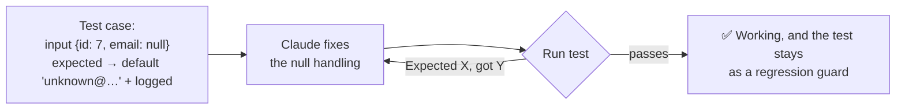

# Q63 — Migration script mishandles nulls: give a test case (input with nulls + expected output)

**Domain / lesson:** D3 › 3.5 Iterative Refinement (concrete input/output examples and tests beat prose)
**Also touches:** D4 › 4.2 Few-Shot (examples generalise better than descriptions)
**Scenario:** Claude Code for software development (code generation, refactoring, debugging, docs)
**Follows:** [Q64](../Q64-interview-pattern-unfamiliar-domain/question.md) (interview pattern for unfamiliar domains) · [Q58](../Q58-at-reference-example-files/question.md) (point at example files)

## Question

You are using Claude Code to accelerate software development. Your team uses it for code generation, refactoring, debugging, and documentation. You need to integrate it into your development workflow with custom slash commands, CLAUDE.md configurations, and understand when to use plan mode vs direct execution.

You've asked Claude to write a data migration script, but the initial output doesn't correctly handle records with null values in required fields. What's the most effective way to iterate toward a working solution?

- **A.** Manually edit the generated code to fix the null handling, then continue working with Claude on other parts.
- **B.** Add "think harder about edge cases" to your prompt and request a complete rewrite of the migration logic.
- **C.** Describe the null value problem in detail and ask Claude to regenerate the entire script with improved edge case handling.
- **D.** Provide a test case with example input containing null values and the expected output, then ask Claude to fix it.

## Answer: **D**

## Diagram

## Concept

**The problem is an edge case, and the fastest way to pin down an edge case is an example.** A test case says, without interpretation: *for this input, I expect exactly this output.*

Guide 3.5:
- *"The model generalises from examples more reliably than from any prose description."*
- *"More precise prose still relies on interpretation, so more prose will not fix this problem."*
- *"If the model handles the standard case but misses edge cases, add examples specifically showing edge case handling."*
- *"Each failure is concrete, unambiguous feedback: 'Expected X, got Y' has a single meaning."*

**Why D also answers a hidden question:** "handle nulls" is ambiguous. Skip the record? Use a default? Fail the migration? Log and continue? Only **your expected output** says which. Prose leaves Claude to guess; the example decides it.

**And it's a targeted fix**, not a rewrite: the parts that already work stay as they are. The test stays as a **regression guard** for later changes.

## Why the others are wrong

| Option | Why not |
|---|---|
| **A** Fix it by hand, move on | **Not iterating with Claude.** It fixes this one spot, but Claude never learns the rule, so the same mistake can reappear in the other parts it writes next (and in other nullable fields). No test is left behind to catch a regression. |
| **B** "Think harder about edge cases" + complete rewrite | **Vague + wasteful.** "Think harder" doesn't say *which* edge case or *what* the right behaviour is (4.1: vague instructions don't improve precision). A full rewrite throws away the working parts and can introduce new bugs. |
| **C** Describe the problem in detail, regenerate everything | **Better than B, still prose.** *"More precise prose still relies on interpretation."* And regenerating the **entire** script for one edge case risks breaking what worked. |

## Pattern to remember

> **Output misses an edge case → give a concrete example (input + expected output) or a failing test, and ask for a targeted fix.** "Expected X, got Y" has one meaning; prose doesn't.

**Exam signals:**
- "doesn't correctly handle [specific case]" + "iterate" → **test case / input-output example**.
- Reject: manual fixes outside the loop (A), "think harder" (B), longer prose + full regeneration (C).

**Which iterative technique (3.5)?**

| Situation | Technique | Q |
|---|---|---|
| You know the exact behaviour you want; output misses a case | **Concrete examples / test cases** | **Q63** |
| Unfamiliar domain; you might not know what to consider | **Interview pattern**: Claude asks you questions first | Q64 |
| Several problems that **interact** | One detailed message covering them together | 3.5 |
| Several **independent** problems | Fix them one at a time | 3.5 |

### Where this comes from

**Guide D3 › 3.5 Iterative Refinement** (checked 2026-11-03):
- *"The model generalises from examples more reliably than from any prose description."*
- *"More precise prose still relies on interpretation, so more prose will not fix this problem."*
- *"Two or three well-chosen examples that cover the standard case and the main edge case are enough."*
- *"If the model handles the standard case but misses edge cases, add examples specifically showing edge case handling."*
- *"Each failure is concrete, unambiguous feedback: 'Expected X, got Y' has a single meaning."*
- *"The interview pattern is for unfamiliar domains, where the developer might miss considerations."*
- Trap: *"Using the interview pattern when the developer already knows the exact transformation"*
- *"Put interacting problems in a single detailed message, and fix independent ones sequentially."*

## How this connects to earlier questions

| Question | Link |
|---|---|
| [Q64](../Q64-interview-pattern-unfamiliar-domain/question.md) | The other 3.5 technique: interview when the domain is unfamiliar |
| [Q121](../Q121-few-shot-acceptable-vs-genuine-findings/question.md) | Examples beat rules in prompts too (4.2) |
| [Q124](../Q124-claude-md-testing-standards-fixtures/question.md) | Behavioural tests with exact expected values vs trivial ones |
| [Q122](../Q122-explicit-report-vs-skip-criteria/question.md) | Vague instructions ("think harder", "be conservative") don't improve precision |

## Check question

**(1) "Handle nulls" can mean several different things. Name two different behaviours a null-handling fix could have, and explain why only the expected output in a test case settles which one is right. (2) When would the interview pattern (Q64) be better than giving a test case?**

*(Your answer and feedback will be recorded here.)*

## Glossary

- **Test case:** a concrete input plus the exact output expected for it.
- **Edge case:** an unusual input (null, empty, boundary value) that ordinary logic may mishandle.
- **Targeted fix:** changing only the code that's wrong, not regenerating everything.
- **Regression guard:** a test kept around so a future change can't silently reintroduce the bug.
- **Interview pattern:** Claude asks you questions before implementing, to surface considerations you might miss.

## Related course lessons

*Lecture lengths aren't recorded in the study-map files, so the watch times below are estimates.*

### Udemy A (primary): Claude Certified Architect (CCAR-F) - 2026 Exam Prep
| # | Lecture | Part | Why |
|---|---|---|---|
| **68** | **Writing Instructions Claude Follows** | 3B | ⭐ Concrete over vague instructions (partial cover of 3.5) |
| 79 | Iterating on a Plan — Approve, Edit, Re-Plan | 3C | Iterating with Claude Code |
| Quiz 9, Quiz 10 | 3B and 3C quizzes | | Self-test |

**▶ Watch in this order (~10 min, est.):** #68 → #79, then do **Quiz 9** and **Quiz 10**. *(Udemy A covers 3.5 only partially; Udemy B #82 is the better lecture.)*

### Udemy B: Claude Certified Architect Foundations: Complete Course (Voroniuk)
| # | Lecture | Section | Why |
|---|---|---|---|
| **82** | **Refinement: Examples and Tests** | S8 Claude Code Setup | ⭐ Exactly this question |
| **83** | **Interviews and Issue Batching** | S8 Claude Code Setup | ⭐ When to interview instead (check question part 2) *(also in Q64)* |
| Quiz 8 | Claude Code Setup quiz | S8 | Self-test |

**▶ Watch in this order (~10 min, est.):** #82 → #83, then do **Quiz 8**.

### CBT Nuggets: CCA-F course

*CBT doesn't cover 3.5 (see the study map). Use the guide and Udemy B #82.*
