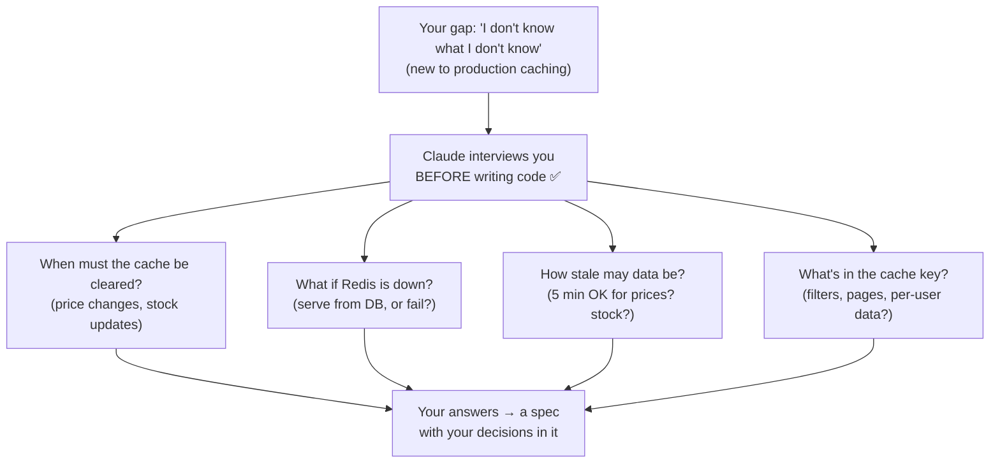

# Q64

**Scenario:** Claude Code for a development team (same as [Q52](../Q52-posttooluse-hook-runs-formatter/question.md)–[Q60](../Q60-per-package-selective-imports/question.md))

## Question

You are using Claude Code to accelerate software development. Your team uses it for code generation, refactoring, debugging, and documentation. You need to integrate it into your development workflow with custom slash commands, CLAUDE.md configurations, and understand when to use plan mode vs direct execution.

You're implementing a caching layer for API responses to speed up the /products endpoint. You have a rough idea–Redis with a 5-minute TTL–but you're new to production caching and aren't sure what other considerations a robust implementation requires. What's the most effective way to start your iterative workflow?

- **A.** Start with a minimal request: "Add Redis caching to /products with 5-minute TTL." Add features and fix issues through follow-up prompts as problems surface during testing.
- **B.** Write a specification with your known requirements and "TBD" markers for uncertain areas, having Claude propose solutions for each TBD as it implements.
- **C.** Ask Claude to interview you about the caching requirements before implementing, surfacing considerations like invalidation strategies, cache layers, consistency guarantees, and failure modes.
- **D.** Use plan mode to analyze the current/products endpoint implementation, then provide your caching requirements once Claude explains how the existing code is structured.

<b>Show answer and explanation</b>

**Topic:** New to production caching: have Claude interview you before it implements
**Domain / lesson:** D3 › 3.5 Iterative Refinement (the interview pattern)
**Follows:** [Q55](../Q55-tests-first-share-failures/question.md) (the other 3.5 techniques: tests, examples) · [Q37](../Q37-state-assumptions-not-interrogate/question.md) (when asking is worth it) · [Q53](../Q53-direct-execution-for-clear-small-change/question.md) (plan mode is for ambiguity in the code)
*Q61–Q63 are a gap: question text not available.*

## Answer: **C**

## Diagram

## Concept

**The clue: *"you're new to production caching and aren't sure what other considerations a robust implementation requires."*** The gap isn't in the code, and it isn't a known transformation Claude keeps misreading. It's in **your knowledge of the domain**. You can't list what you don't know exists.

**The interview pattern fills exactly that gap.** Guide 3.5: *"In a domain where you lack expertise, have Claude ask questions before implementing."* *"The questions reveal considerations that you would otherwise miss."* *"An expert would know to address these topics, and the developer might overlook them."* The guide's own example is caching: Claude *"might ask about cache invalidation strategies, TTL (time to live) policies"*, consistency and failure modes.

**What a caching interview typically surfaces:**

| Topic | The question you hadn't thought to ask | Why it matters |
|---|---|---|
| **Invalidation** | When a price changes, wait up to 5 minutes, or clear the cache on update? | A customer may see an old price at checkout |
| **Consistency** | How stale may each field be? Prices vs stock levels? | "5 minutes" may be fine for descriptions, not for "in stock" |
| **Failure modes** | If Redis is down, serve straight from the database, or return an error? | Otherwise the cache becomes a new way for `/products` to fail |
| **Cache key** | Do filters, sorting, page number or user-specific data change the response? | A wrong key serves one user's results to another |
| **Load** | What happens when a popular entry expires and 1,000 requests miss at once? | A "cache stampede" can hit the database harder than no cache |

**You make the decisions; Claude brings the checklist.** Many of these are business choices (how stale may a price be?), not technical ones. The interview puts each one in front of you before any code exists.

**How to ask:** guide 3.5: *"Before implementing, ask me questions about the requirements, edge cases, and constraints I should consider."* Claude Code docs, *Best practices* › Brainstorm with Claude first: *"When you don't know exactly what you want yet, you don't have to work it all out before you prompt. Ask Claude to interview you instead."*

## Why the others are wrong

| Option | Why not |
|---|---|
| **A** Minimal request, fix problems as they surface in testing | **You only test for what you know about.** Stale prices after an update, a stampede under load, `/products` failing when Redis restarts: these don't show up in a quick local test. They show up in production. Each late discovery means reworking code that's already built (Q53: *"Do not wait for surprises"*). |
| **B** Spec with "TBD" markers; Claude fills each TBD while implementing | **The tempting one: it admits uncertainty.** But you can only mark TBDs for gaps you **know** about; the problem here is the ones you don't. And Claude would settle each TBD **silently, mid-implementation**: the consistency and failure-mode choices are made for you, and you find out by reading code. The interview asks *before*, and you decide. |
| **D** Plan mode to analyse the current `/products` code first | **Solves a different gap.** Plan mode explores the **codebase** (Q53: for when the code or approach is unclear). Your gap is **caching knowledge**: reading the endpoint won't tell you to think about invalidation or stampedes. And D still ends with you supplying "your caching requirements", which is exactly what you can't fully do yet. Useful *later*, once you know what to build. |

## Pattern to remember

> **New to the domain and "not sure what else to consider" → have Claude interview you before it implements.** The questions surface what an expert would think of; you make the decisions. Not a minimal start (discover late), not TBDs (only known unknowns, decided silently), not plan mode (that explores code, not your knowledge).

**Which 3.5 technique?**

| Your situation | Technique |
|---|---|
| Unfamiliar domain: you don't know what you're missing | **Interview pattern** (Q64) |
| Known transformation that Claude keeps misreading | **2–3 concrete input/output examples** |
| Complex logic with edge cases you can state | **Tests first, share failures** (Q55) |

**Exam signals:**
- *"New to…"*, *"not sure what other considerations"*, *"unfamiliar"* → **interview pattern**.
- *"Already knows the exact output"* → **not** the interview: guide trap, *"here there are none to reveal."* Use examples.

### Where this comes from

**Guide D3 › 3.5 Iterative Refinement:**
- *"In a domain where you lack expertise, have Claude ask questions before implementing."*
- *"The questions reveal considerations that you would otherwise miss."* *"An expert would know to address these topics, and the developer might overlook them."*
- Caching example: Claude *"might ask about cache invalidation strategies, TTL (time to live) policies"*.
- Example prompt: *"Before implementing, ask me questions about the requirements, edge cases, and constraints I should consider."*
- Key concept: *"The interview pattern is for unfamiliar domains, where the developer might miss considerations."*
- *"Do not confuse the two techniques. They solve different problems."* Trap: using the interview when the developer already knows the exact transformation: *"Interview questions reveal considerations the developer has not anticipated, and here there are none to reveal."*

**Claude Code docs, *Best practices* › Brainstorm with Claude first** (code.claude.com, checked 2026-10-31):
- *"When you don't know exactly what you want yet, you don't have to work it all out before you prompt. Ask Claude to interview you instead."*

## How this connects to earlier questions

| Question | Link |
|---|---|
| [Q55](../Q55-tests-first-share-failures/question.md) | The sibling 3.5 technique. Tests need you to know the requirements; the interview is how you find them |
| [Q37](../Q37-state-assumptions-not-interrogate/question.md) | The reverse direction: there, the *agent* asking a customer too many questions cost sales. Asking pays off when the asker lacks knowledge that matters and is costly to get wrong |
| [Q53](../Q53-direct-execution-for-clear-small-change/question.md) | Plan mode handles ambiguity in the code (D); the interview handles ambiguity in the requirements |

## Check question

**The interview is done and your answers are written up in SPEC.md (invalidate on price update, fall back to the database if Redis is down, never cache user-specific responses). What should you do next, before Claude writes the caching code? Use what you learned in Q55.**

*My answer:* "Ask for a testing plan?" 🟡 **Right direction: the tests come before the caching code. But a plan is still prose. The Q55 step is to write the tests themselves from SPEC.md, and see them fail before anything is implemented.**

**Why a plan isn't enough.** A test plan says *"we should check the Redis fallback"*. A test fails with *"expected 200, got 500 ConnectionError"*. Only a test comes back pass or fail, so only a test lets Claude check its own work. With just a plan, you're the test suite again (Q55 C). Guide 3.5: *"Write the tests first. The tests define the expected behaviour."*

**Each SPEC.md decision becomes a test:**

| SPEC.md decision | Test (fails until the cache is built correctly) |
|---|---|
| Invalidate on price update | GET `/products` (now cached) → update a price → GET again returns the **new** price |
| Fall back to the database if Redis is down | Redis unavailable → GET `/products` still returns 200 with data from the database |
| Never cache user-specific responses | Request as user A, then as user B → B never gets A's response; nothing user-specific is written to Redis |
| 5-minute TTL | The cached entry expires after 300 s; the next request reads from the database |

**The order:**
1. **Start a fresh session and write only the tests.** Claude can draft them from SPEC.md, but you check that each test matches a decision you made in the interview. Run them: they should **fail**, because there's no cache yet. A test that already passes isn't testing anything.
2. **Then the implementation:** *"Implement the cache from SPEC.md. Don't change the tests. Run them after each change and keep going until they pass; show me the output."*
3. **Share the failures** as they come ("Expected X, got Y"). Send the ones that broke together in one message (Q55 check).
4. Optional: a subagent reviews the diff against SPEC.md. Docs example: *"check every requirement is implemented and the listed edge cases have tests"*.

Claude Code docs, *Best practices* (code.claude.com, checked 2026-11-01):
- *"Once `SPEC.md` exists, start a fresh session to build from it, so the build begins with a clean context and a written definition of done."*
- *"Give Claude something it can run that comes back pass or fail. Once it has that, it can keep going on its own and you don't have to watch."*

> **Interview → SPEC.md → a test for each decision, failing first → Claude implements until the tests pass. A test plan is still prose; a failing test is a check Claude can run.**

## Glossary

- **Interview pattern:** asking Claude to question you about requirements, edge cases and constraints before it implements, so you find the considerations you'd otherwise miss.
- **TTL (time to live):** how long a cached entry stays valid before it expires.
- **Cache invalidation:** removing or updating a cached entry when the underlying data changes.
- **Cache stampede:** many requests miss the cache at the same moment (e.g. right after a popular entry expires) and all hit the database at once.
- **Known vs unknown unknowns:** gaps you know you have (you can mark them TBD) vs gaps you don't know exist (someone has to ask).

## Related course lessons

*Lecture lengths aren't recorded in the study-map files, so the watch times below are estimates from each course's average lecture length.*

### Udemy A (primary): Claude Certified Architect (CCAR-F) - 2026 Exam Prep
| # | Lecture | Part | Why |
|---|---|---|---|
| **79** | **Iterating on a Plan — Approve, Edit, Re-Plan** | 3C | ⭐ Starting an iterative workflow with Claude Code *(also in Q55)* |
| 68 | Writing Instructions Claude Follows | 3B | What a minimal prompt leaves out (A) *(also in Q55, Q56, Q58)* |
| 78 | Plan Mode — When and Why to Plan First | 3C | What plan mode is for, and why it doesn't fill this gap (D) *(also in Q53)* |
| Quiz 9, Quiz 10 | 3B and 3C quizzes | | Self-test |

**▶ Watch in this order (~20 min, est.):** #79 → #68 → #78, then do **Quiz 10** and **Quiz 9**.
Udemy A only partly covers 3.5. Udemy B #83 is the key lecture for this question.

### Udemy B: Claude Certified Architect Foundations: Complete Course (Voroniuk)
| # | Lecture | Section | Why |
|---|---|---|---|
| **83** | **Interviews and Issue Batching** | S8 Claude Code Setup | ⭐ Exactly option C *(also in Q55)* |
| 82 | Refinement: Examples and Tests | S8 Claude Code Setup | The other 3.5 techniques, and when they fit instead *(also in Q55, Q58)* |
| Quiz 8 | Claude Code Setup quiz | S8 | Self-test |

**▶ Watch in this order (~10 min, est.):** #83 → #82, then do **Quiz 8**.

### CBT Nuggets: CCA-F course
CBT has no lesson on iterative refinement (3.5). Use the guide lesson and Udemy B #83.

