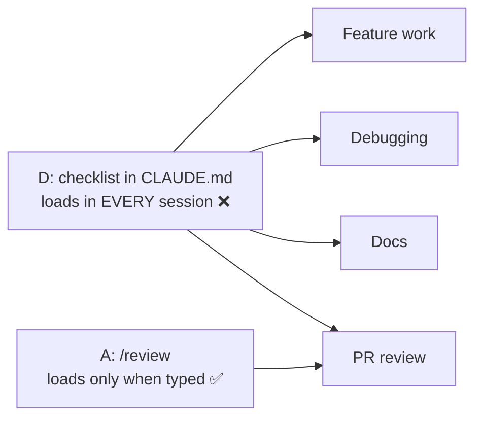

# Q65 — A checklist pasted at every review: make it a `/review` slash command

**Domain / lesson:** D3 › 3.2 Custom Slash Commands and Skills
**Scenario:** Claude Code for a development team (same as [Q52](../Q52-posttooluse-hook-runs-formatter/question.md)–[Q64](../Q64-interview-pattern-unfamiliar-domain/question.md))
**Follows:** [Q57](../Q57-mcp-prompts-become-slash-commands/question.md) (slash commands, skills vs MCP prompts) · [Q54](../Q54-path-scoped-rules-load-by-file-type/question.md) (CLAUDE.md loads in every session) · [Q58](../Q58-at-reference-example-files/question.md) (task-specific material doesn't go in CLAUDE.md)

## Question

You are using Claude Code to accelerate software development. Your team uses it for code generation, refactoring, debugging, and documentation. You need to integrate it into your development workflow with custom slash commands, CLAUDE.md configurations, and understand when to use plan mode vs direct execution.

Your team wants Claude to follow a detailed code review checklist (8 items covering API changes, test coverage, documentation, security, etc.) when reviewing pull requests. The team also uses Claude extensively for other tasks: writing new features, debugging production issues, and generating documentation. Currently, developers paste the checklist at the start of each review session. Which approach best addresses this workflow need?

- **A.** Create a /review slash command containing the checklist, invoked when starting reviews.
- **B.** Create a dedicated review subagent with the checklist embedded in its configuration.
- **C.** Configure plan mode as the default for code review sessions.
- **D.** Add the checklist to the project's CLAUDE.md file under a "Code Review" section.

## Answer: **A**

## Diagram



**The command file** (committed to the repo, so every developer gets `/review`):

`.claude/commands/review.md`
```markdown
---
description: Review a pull request against the team checklist
argument-hint: "[PR number]"
---
Review PR #$ARGUMENTS (use `gh pr diff $ARGUMENTS`) against our team checklist:
1. API changes: breaking changes flagged and versioned
2. Test coverage: new and changed functions have tests
3. Documentation: docs updated for changed behaviour
4. Security: input validation, auth checks, no hardcoded secrets
5. Error handling follows the team pattern
6. Performance: no N+1 queries or unbounded loops
7. Database migrations are reversible
8. Logging: no personal data in logs
Report each item as pass / warning / fail, with file:line.
```

*(The 8 items are illustrative.)* A developer types `/review 1234` and the whole checklist is in the conversation, with no pasting.

## Concept

**The question gives you two facts, and together they point to one answer:**

| Fact in the question | What it means | Rules out |
|---|---|---|
| *"Developers paste the checklist at the start of each review session"* | The same instructions, every time, for **one kind of task**: a reusable prompt | Nothing yet; it says what to build |
| *"The team also uses Claude extensively for other tasks"* | The checklist must **not** be there when writing features, debugging or writing docs | **D** (CLAUDE.md loads in every session) |

**A slash command is a saved prompt you run on demand.** Guide 3.2: *"A skill is a named, reusable set of instructions that Claude Code loads on demand."* *"CLAUDE.md is different: it loads in every session, while a skill's instructions enter the conversation only when the skill runs."* The Claude Code docs describe this exact situation: *"Create a skill when you keep pasting the same instructions, checklist, or multi-step procedure into chat."*

**The guide's own example is a `/review` command with a team checklist:** *".claude/commands/review.md — creates /review"*, starting *"Review the staged changes against our team checklist"*.

**Where it goes: project scope, so the whole team gets it.**

| File | Creates | Notes |
|---|---|---|
| `.claude/commands/review.md` | `/review` | Flat file; the filename becomes the command name. The guide's example |
| `.claude/skills/review/SKILL.md` | `/review` | The canonical location. Adds a folder for supporting files (e.g. a longer checklist), and Claude can load it itself when you ask for a review |

Both are committed to git. Guide 3.2: *"Every developer who clones or pulls the repository gets these commands automatically."* Don't put it in `~/.claude/commands/`, which is personal (guide exam trap).

## Why the others are wrong

| Option | Why not |
|---|---|
| **B** Review subagent with the checklist in its configuration | **It solves a problem the team doesn't have.** Subagents are for work you want *isolated*: verbose output you don't need in the main conversation, or tighter tool restrictions. The need here is only "stop pasting the checklist". A subagent also returns just its results, so discussing a finding with Claude is harder. Docs: *"Consider Skills instead when you want reusable prompts or workflows that run in the main conversation context rather than isolated subagent context."* *(Real life: a review subagent is a valid pattern, and the docs' own subagent example is a code-reviewer. It's worth it when you want a reviewer that never saw the conversation that wrote the code. That's not what this question asks.)* |
| **C** Plan mode as the default for reviews | **Plan mode changes *how* Claude works, not *what instructions* it has.** It makes Claude explore and propose before editing anything. The developers would still have to paste the checklist. Guide 3.4: plan mode is for ambiguity in a change (*"The choice of mode depends on ambiguity, not difficulty"*), and a review doesn't make changes anyway. |
| **D** Checklist in CLAUDE.md under "Code Review" | **The tempting one: it's shared and automatic.** But CLAUDE.md loads in **every** session, so feature, debugging and docs sessions all carry eight review items they don't need (the same cost as Q54). Guide 3.2 exam trap: *"Putting task-specific workflows in CLAUDE.md"*. *"Task-specific procedures (code review workflows, analysis routines, brainstorming templates) belong in skills that are invoked on demand."* |

## Pattern to remember

> **The same instructions pasted for one kind of task → a slash command (or skill) in the project's `.claude/`.** It loads only when invoked and is shared through git. Not CLAUDE.md (every session), not a subagent (isolation the task doesn't need), not plan mode (that's a working mode, not instructions).

**Where do instructions go?**

| The instructions are… | Put them in |
|---|---|
| For **one kind of task**, run on demand (review checklist, release steps) | **Slash command / skill**: `.claude/commands/` or `.claude/skills/` (Q65) |
| Conventions for **every edit** | Root CLAUDE.md (Q54) |
| Conventions for **some files** | `.claude/rules/` with `paths` (Q54) |
| **Verbose, self-contained** work that should come back as a summary | Subagent, or a skill with `context: fork` |
| For **one task only**, with known example files | `@` references in the prompt (Q58) |

**Exam signals:**
- *"Paste … at the start of each session"*, *"repeatable workflow"*, *"invoked when…"* → **slash command / skill**.
- *"Also uses Claude for other tasks"* → **not** CLAUDE.md.
- *"Verbose output clutters the main conversation"* → **`context: fork`** or a subagent.

### Where this comes from

**Guide D3 › 3.2 Custom Slash Commands and Skills:**
- *"A skill is a named, reusable set of instructions that Claude Code loads on demand."* *"CLAUDE.md is different: it loads in every session, while a skill's instructions enter the conversation only when the skill runs."*
- *".claude/commands/deploy.md creates /deploy. It is a flat Markdown file, and the filename becomes the command name."* *".claude/skills/deploy/SKILL.md also creates /deploy."*
- *"Project scope means .claude/skills/ (canonical) or .claude/commands/ (alias) inside your repository. Both are version-controlled and shared via git."* *"Use project scope for team-wide workflows."*
- *"So do not put task-specific procedures in CLAUDE.md, where they would load in every session."*
- *"The core distinction here is on-demand workflow versus persistent configuration."*
- Exam trap: *"Putting task-specific workflows in CLAUDE.md"*. *"Task-specific procedures (code review workflows, analysis routines, brainstorming templates) belong in skills that are invoked on demand."* (**D**)

**Claude Code docs, *Extend Claude with skills*** (code.claude.com, checked 2026-11-01):
- *"Create a skill when you keep pasting the same instructions, checklist, or multi-step procedure into chat, or when a section of CLAUDE.md has grown into a procedure rather than a fact."*
- *"Unlike CLAUDE.md content, a skill's body loads only when it's used, so long reference material costs almost nothing until you need it."*
- *"Custom commands have been merged into skills."* *"Your existing `.claude/commands/` files keep working."*

**Claude Code docs, *Create custom subagents*** (code.claude.com, checked 2026-11-01):
- Subagents fit when *"The task produces verbose output you don't need in your main context"*, *"You want to enforce specific tool restrictions or permissions"*, *"The work is self-contained and can return a summary"*.
- *"Consider Skills instead when you want reusable prompts or workflows that run in the main conversation context rather than isolated subagent context."* (**B**)

**Guide D3 › 3.4:** *"The choice of mode depends on ambiguity, not difficulty."* (**C**)

## How this connects to earlier questions

| Question | Link |
|---|---|
| [Q57](../Q57-mcp-prompts-become-slash-commands/question.md) | Another source of slash commands: MCP prompts. Skill vs MCP prompt: a skill lives in the repo and Claude can also start it; `disable-model-invocation: true` makes it user-only |
| [Q54](../Q54-path-scoped-rules-load-by-file-type/question.md) | Root CLAUDE.md loads in every session, so only put there what every session needs |
| [Q58](../Q58-at-reference-example-files/question.md) | Same trap (D): task-specific material in CLAUDE.md. There the task was one-off (`@` references); here it repeats (a command) |
| [Q53](../Q53-direct-execution-for-clear-small-change/question.md) | Plan mode is about ambiguity in a change (C) |
| [Q36](../Q36-coordinator-missing-task-tool/question.md) | Subagents in the Agent SDK: when delegation adds something |

## Check question

**Item 1 of the checklist is "every new or changed endpoint has an entry in `openapi.yaml`". Reviews keep flagging it: Claude writes new endpoints without the entry, and only `/review` catches the gap afterwards. What should change, and does the item stay in `/review`?**

## Glossary

- **Slash command:** a saved prompt you run by typing `/name`. In Claude Code, `.claude/commands/<name>.md` (flat file) or `.claude/skills/<name>/SKILL.md` (directory) both create `/name`.
- **Skill:** a reusable set of instructions with optional frontmatter and supporting files. It loads when you invoke it, or when Claude matches your request to its `description`.
- **Project scope / user scope:** `.claude/` in the repo (shared through git) vs `~/.claude/` in your home folder (personal).
- **`$ARGUMENTS`:** the text typed after the command (`/review 1234` → `1234`).
- **Subagent:** a separate Claude instance with its own context window, system prompt and tools. It does the work and returns its results to the main conversation.

## Related course lessons

*Lecture lengths aren't recorded in the study-map files, so the watch times below are estimates from each course's average lecture length.*

### Udemy A (primary): Claude Certified Architect (CCAR-F) - 2026 Exam Prep
| # | Lecture | Part | Why |
|---|---|---|---|
| **72** | **Command Design Patterns and Team Distribution** | 3C | ⭐ Exactly option A: a team command shared through the repo |
| 71 | Creating and Structuring Custom Slash Commands | 3C | Where command files live and how they're built *(also in Q57)* |
| 69 | Common CLAUDE.md Patterns for Real Teams | 3B | What belongs in CLAUDE.md and what doesn't (D) *(also in Q52, Q58)* |
| 75 | Creating and Configuring Custom Subagents | 3C | What a subagent adds, and why it isn't needed here (B) *(also in Q36)* |
| Quiz 10, Quiz 9 | 3C and 3B quizzes | | Self-test |

**▶ Watch in this order (~25 min, est.):** #72 → #71 → #69 → #75, then do **Quiz 10** and **Quiz 9**.

### Udemy B: Claude Certified Architect Foundations: Complete Course (Voroniuk)
| # | Lecture | Section | Why |
|---|---|---|---|
| **74** | **Where Commands and Skills Live** | S8 Claude Code Setup | ⭐ Project vs user scope for commands *(also in Q57)* |
| 76 | Practice: Claude Code Hands-On - CLAUDE.md, Rules and a Skill | S8 Claude Code Setup | Build CLAUDE.md, a rule and a skill side by side (A vs D) |
| 71 | CLAUDE.md Levels: Who Gets What | S8 Claude Code Setup | What loads in every session (D) *(also in Q54, Q56, Q58)* |
| Quiz 8 | Claude Code Setup quiz | S8 | Self-test |

**▶ Watch in this order (~15 min, est.):** #74 → #76 → #71, then do **Quiz 8**.

### CBT Nuggets: CCA-F course
| Skill | Why |
|---|---|
| **4. Create Custom Commands for Repeatable Workflows** | ⭐ Exactly option A |
| 37. Create Reusable Agent Skills | Skills, the canonical form of a command |
