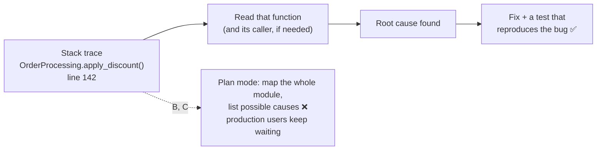

# Q66

**Scenario:** Claude Code for a development team (same as [Q52](../Q52-posttooluse-hook-runs-formatter/question.md)–[Q65](../Q65-review-checklist-as-slash-command/question.md))

## Question

You are using Claude Code to accelerate software development. Your team uses it for code generation, refactoring, debugging, and documentation. You need to integrate it into your development workflow with custom slash commands, CLAUDE.md configurations, and understand when to use plan mode vs direct execution.

A critical bug is affecting production users. Error logs show exceptions in the OrderProcessing module with a clear stack trace pointing to a specific function. You haven't worked with this module before. What's the most effective approach?

- **A.** Start with direct execution to gather initial information, then switch to plan mode to design a comprehensive solution before implementing any changes.
- **B.** Enter plan mode to explore the module's architecture and dependencies before attempting any fixes.
- **C.** Use plan mode to analyze the error in context of the module's design, enumerate potential root causes, and prioritize fixes systematically.
- **D.** Use direct execution to examine the stack trace, read the relevant code, and implement a fix once you identify the root cause.

<details>
<summary><b>Show answer and explanation</b></summary>

**Topic:** Production bug, clear stack trace, unfamiliar module: still direct execution
**Domain / lesson:** D3 › 3.4 Plan Mode vs Direct Execution
**Follows:** [Q53](../Q53-direct-execution-for-clear-small-change/question.md) (clear change → direct execution) · [Q64](../Q64-interview-pattern-unfamiliar-domain/question.md) (a different kind of "unfamiliar") · [Q55](../Q55-tests-first-share-failures/question.md) (a failing test as the check)

## Answer: **D**

## Diagram



*(Function name and line are illustrative.)*

## Concept

**The question has three phrases; only one of them decides the mode:**

| Phrase | What it is | Effect on the mode |
|---|---|---|
| *"Clear stack trace pointing to a specific function"* | **Where** the problem is: known | ✅ **Decides it: direct execution** |
| *"You haven't worked with this module before"* | **Difficulty for you**, not ambiguity in the task | The bait for B and C |
| *"Critical bug affecting production users"* | Urgency | Makes planning overhead costly, but isn't the rule itself |

**Ambiguity decides the mode, not difficulty.** Guide 3.4 key concept: *"The choice of mode depends on ambiguity, not difficulty. A difficult but well-defined bug fix (clear stack trace, single function, known cause) suits direct execution."* The guide's decision table has this row exactly: *"Single-file bug fix with clear stack trace → Direct execution"*.

**Unfamiliar code isn't ambiguous code.** The stack trace is a map: it names the function, the line and the call path that led there. You don't need to understand the whole module to fix one function; you need to read that function. Plan mode's *"Codebase exploration is necessary"* means you don't yet know where to change or how parts depend on each other (*"map the existing structure before changing anything"*). Here, the trace has already done that.

**Direct execution doesn't mean editing blind.** Option D is *read → find the root cause → fix*. Claude reads the trace and the code first, in the same session, and only edits once it knows the cause. A good prompt also gives Claude a check (Q55). The Claude Code docs' own example of a specific prompt: *"users report login fails after the session times out. look at token refresh in src/auth/, write a failing test that reproduces it, then fix it"*.

```text
Production error: <paste the stack trace>.
Read OrderProcessing.apply_discount and find the root cause.
Write a failing test that reproduces it, then fix it. Run the module's tests and show the output.
```

## Why the others are wrong

| Option | Why not |
|---|---|
| **A** Direct execution to gather information, then plan mode to design a comprehensive solution | **A planning phase whatever the code shows.** The guide's hybrid is the other way round: *"plan mode to investigate, then direct execution to implement"*, used for big multi-file work like a library migration. A investigates first, then plans a *"comprehensive solution"* for a bug the trace has already pinned to one function. That's extra overhead and a bigger change than needed during a production incident. |
| **B** Plan mode to explore the module's architecture and dependencies | **The tempting one**, because "you haven't worked with this module before" sounds like *"Codebase exploration is necessary"*. But the trace already says where to look. Mapping the whole module first is exploration the task doesn't need, while production users wait. Guide 3.4 exam trap: *"Using plan mode for a single-file bug fix with a clear stack trace."* |
| **C** Plan mode to enumerate potential root causes and prioritise fixes | **Guessing causes instead of reading them.** The trace points to the line, and the code at that line shows the actual cause. Listing possible causes in the abstract comes before looking at the evidence. "Prioritise fixes" assumes several problems that the question never mentions (the same family as Q53 B: inventing complexity). Guide 3.4: *"Plan mode adds unnecessary overhead when the problem, location, and solution are all clear."* |

## Pattern to remember

> **A clear stack trace to a specific function → direct execution, even in code you've never seen.** Unfamiliar is difficulty, not ambiguity. The trace tells you *where*; reading the code tells you *why*. Plan mode is for when you don't know where or how to change things.

**Which "unfamiliar"?**

| Unfamiliar… | and… | Do |
|---|---|---|
| **Domain** (production caching) | You don't know what to consider | **Interview pattern** (Q64) |
| **Code** | A stack trace points to the function | **Direct execution**: read it, fix it (Q66) |
| **Code** | You don't know where the change goes, many files, several designs | **Plan mode** (+ Explore subagent) (3.4) |

**Exam signals:**
- *"Clear stack trace"*, *"specific function"*, *"single file"* → **direct execution**, whatever else the question adds (unfamiliar, critical, difficult).
- Options that add *"explore the architecture"*, *"enumerate potential causes"*, *"design a comprehensive solution"* to a pinpointed bug → overhead.

### Where this comes from

**Guide D3 › 3.4 Plan Mode vs Direct Execution:**
- *"Direct execution is for well-understood changes with clear, limited scope."* *"The change is well-scoped. A single-file bug fix with a clear stack trace."*
- Key concept: *"The choice of mode depends on ambiguity, not difficulty. A difficult but well-defined bug fix (clear stack trace, single function, known cause) suits direct execution."*
- Decision table: *"Single-file bug fix with clear stack trace"* → *"Direct execution"*.
- Exam trap: *"Using plan mode for a single-file bug fix with a clear stack trace"*. *"A single-function fix with a known cause and clear stack trace is the clearest case for direct execution. Plan mode adds unnecessary overhead when the problem, location, and solution are all clear."* (**B**, **C**)
- Plan mode criterion: *"Codebase exploration is necessary. You need to understand dependencies, trace data flows or map the existing structure before changing anything."* (not needed when the trace gives the location)
- Hybrid: *"A common combination is plan mode to investigate, then direct execution to implement."* (**A** is the reverse)

**Claude Code docs, *Best practices* › Write a specific prompt** (code.claude.com, checked 2026-11-01):
- *"If you name the file, describe the symptom, and say what "fixed" looks like up front, you usually save yourself a round of corrections later."*
- Example: *"users report login fails after the session times out. look at token refresh in src/auth/, write a failing test that reproduces it, then fix it"*.

## How this connects to earlier questions

| Question | Link |
|---|---|
| [Q53](../Q53-direct-execution-for-clear-small-change/question.md) | Same rule, harder bait. Q53's bait was "important"; Q66's is "unfamiliar" and "critical". Neither creates ambiguity |
| [Q64](../Q64-interview-pattern-unfamiliar-domain/question.md) | "Unfamiliar" there meant the *domain*: you didn't know what to ask → interview. Here it's the *code*, and the trace tells you where to look |
| [Q55](../Q55-tests-first-share-failures/question.md) | A failing test that reproduces the bug is the check Claude runs before and after the fix |
| [Q58](../Q58-at-reference-example-files/question.md) | When you *don't* know where to look, explore in a subagent. Here you do |

## Check question

**You follow D. Reading `apply_discount()`, Claude finds that the real cause is upstream: OrderProcessing receives prices from three services that each round differently. A proper fix means deciding where rounding should live, across three services, and production is still failing. What do you do now? And is switching to plan mode at this point the "late switch" trap from guide 3.4?**

*My answer:* "Now it's ambiguity: which service? Plan mode might help here." 🟡 **The core is right: the evidence has created ambiguity, so plan mode now fits. Two parts are missing: is this the late-switch trap (no), and production is still failing (stop the errors first).**

**Why plan mode fits now.** The question has changed from "fix this function" to "where should rounding live?". That's more than *which* service: there are several valid designs (round in each service, in a shared library, or define it in the price contract between services), and the choice affects three services. Guide 3.4 plan-mode criteria: *"Multiple valid approaches exist."* *"Architectural decisions are required. Service boundaries, module dependencies and API contracts have consequences for later work."* Switch with Shift+Tab, or start the prompt with `/plan`.

**Not the late-switch trap.** The trap is ignoring complexity that the task **already stated**:

| | The trap (guide 3.4) | This case |
|---|---|---|
| When could you know it was complex? | From the start: it's in the requirements (*"restructure the monolith"*) | Only after reading the code: the evidence showed it |
| Right move | Plan mode **upfront** | Direct execution first, **switch when the evidence shows** the ambiguity |

Guide 3.4: *"When complexity is already stated in the requirements (e.g., monolith restructuring), plan mode should be chosen upfront. The complexity is known, not speculative."* Here, at the start, it *was* speculative: the trace pointed to one function. This is also what separates it from Q66's option A, which planned a "comprehensive solution" whatever the code showed. Here the switch is triggered by what Claude found.

**Production is still failing: stop the errors first, then plan the proper fix.** *(This is incident practice, not guide wording.)*

| Track | Mode | What |
|---|---|---|
| **Now** | Direct execution | If a small, safe fix exists, ship it: e.g. normalise incoming prices to 2 decimals where OrderProcessing receives them, plus the test that reproduces the bug |
| **Next** | Plan mode | The proper fix: where rounding should live, which services change, in what order, and how to roll it out |

> **Plan mode is for ambiguity, whenever it appears. If the task states it upfront, plan from the start. If the evidence reveals it mid-fix, switch then; that isn't the late-switch trap. With production down, stop the errors with a small fix first, then plan the proper one.**

## Glossary

- **Stack trace:** the list of function calls that were active when an error happened, from the failing line back to the entry point. It tells you where the error occurred and how execution got there.
- **Root cause:** the underlying reason for a failure, as opposed to where the symptom shows up.
- **Direct execution:** Claude reads what it needs and makes the change straight away, without a separate planning phase.
- **Plan mode:** Claude explores and proposes an approach without modifying files until you approve it.

## Related course lessons

*Lecture lengths aren't recorded in the study-map files, so the watch times below are estimates from each course's average lecture length.*

### Udemy A (primary): Claude Certified Architect (CCAR-F) - 2026 Exam Prep
| # | Lecture | Part | Why |
|---|---|---|---|
| **78** | **Plan Mode — When and Why to Plan First** | 3C | ⭐ Exactly this decision *(also in Q53, Q64)* |
| 62 | Claude Code Permission Modes | 3A | Where plan mode sits among the modes *(also in Q53)* |
| Quiz 10, Quiz 8 | 3C and 3A quizzes | | Self-test |

**▶ Watch in this order (~15 min, est.):** #78 → #62, then do **Quiz 10** and **Quiz 8**.

### Udemy B: Claude Certified Architect Foundations: Complete Course (Voroniuk)
| # | Lecture | Section | Why |
|---|---|---|---|
| **78** | **Plan Mode or Direct Execution** | S8 Claude Code Setup | ⭐ Exactly this decision *(also in Q53)* |
| 89 | Claude Code Case: Plan and Iterate | S8 Claude Code Setup | A worked case where planning *is* needed (contrast) *(also in Q53, Q55)* |
| Quiz 8 | Claude Code Setup quiz | S8 | Self-test |

**▶ Watch in this order (~10 min, est.):** #78 → #89, then do **Quiz 8**.

### CBT Nuggets: CCA-F course
| Skill | Why |
|---|---|
| **3. Apply Planning to Guide Code Changes** | ⭐ When planning pays off, and when it doesn't *(also in Q53)* |

</details>
