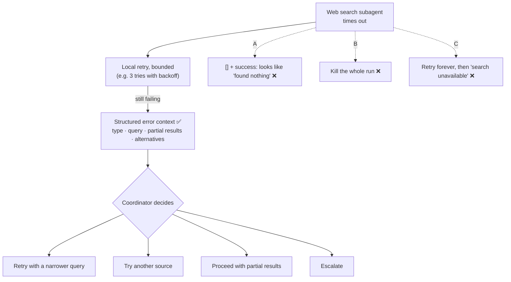

# Q67 — Subagent times out: return structured error context to the coordinator

**Domain / lesson:** D5 › 5.3 Error Propagation in Multi-Agent Systems
**Also touches:** D2 › 2.2 Structured Error Responses (failure types, retryable) · D1 › 1.2 Multi-Agent Orchestration (the coordinator decides recovery)
**Scenario:** Multi-agent research system: a coordinator with a web search subagent (as in [Q05](../Q05-goals-not-procedures-delegation/question.md), [Q06](../Q06-coordinator-gap-loop/question.md))
**Follows:** [Q22](../Q22-empty-result-is-not-error/question.md) (empty result ≠ error, the mirror image of A) · [Q24](../Q24-structured-errors-not-exceptions/question.md) (structured errors, not exceptions) · [Q34](../Q34-business-errors-not-retryable/question.md) (retry transient errors locally) · [Q41](../Q41-partial-success-honest-next-step/question.md) (partial results are still useful)

## Question

In a coordinator-subagent research system, a web search subagent times out while attempting to retrieve information on a complex topic. How should this failure be propagated back to the coordinator agent?

- **A.** The subagent should catch the timeout and return an empty JSON array [] marked as successful so the workflow continues smoothly.
- **B.** Propagate the timeout exception directly to a top-level handler to immediately terminate the entire research workflow.
- **C.** Implement automatic retry logic indefinitely within the subagent, returning a generic search unavailable status if it ultimately fails.
- **D.** Return structured error context to the coordinator, including the failure type, the attempted query, any partial results, and potential alternative approaches.

*(Option A's "[]" appears as "L]" in the source text; it means an empty array.)*

## Answer: **D**

## Diagram



## Concept

**The coordinator can only recover from what the subagent tells it.** Guide 5.3: *"A failing subagent must return structured error context with four elements. This is because the coordinator can only make an intelligent decision about recovery from what the subagent tells it."*

**The four elements, for this timeout:**

| Element | Example | What it lets the coordinator do |
|---|---|---|
| **Failure type** | `transient` (a timeout) | Know a retry may work. A permission error wouldn't be retried |
| **What was attempted** | Query, date range, target | Adjust the query: *"The coordinator cannot adjust a query it cannot see."* |
| **Partial results** | 4 sources found before the timeout | Use them instead of losing them |
| **Alternative approaches** | Narrower query, split into subtopics, another source | Choose a recovery strategy |

```json
{
  "status": "partial_failure",
  "failureType": "transient",
  "attemptedAction": {
    "tool": "web_search",
    "query": "solid-state battery recycling methods",
    "dateRange": "2022-2025"
  },
  "partialResults": [
    { "title": "Recycling of solid-state electrolytes (review)", "url": "https://…", "retrieved": true }
  ],
  "alternativeApproaches": [
    "Split into subtopics: 'cathode recovery', 'electrolyte recovery'",
    "Narrow the date range to 2024-2025",
    "Search the academic database subagent instead"
  ]
}
```

*(Topic and fields are illustrative, modelled on the guide's example.)* *"A complex topic"* is a hint: a narrower or split query is a natural alternative.

**Retrying is still right, but bounded and local.** Guide 5.3: *"Subagents should recover locally from transient failures (retry logic, fallback sources, lower-quality responses) before propagating errors. Only propagate errors the subagent cannot resolve locally, and always include what the subagent attempted and any partial results."* So the full picture is: retry a few times inside the subagent, then return D's structured context. Web search is read-only, so retrying is safe (unlike Q26's side-effecting notification).

## Why the others are wrong

| Option | Why not |
|---|---|
| **A** Catch it, return `[]` marked successful | **Silent suppression, *"the worst anti-pattern"*.** The coordinator *"believes the search ran and found nothing, so it will not retry or try alternatives"*, and the report *"silently omits an entire area"*. It looks complete, and nobody can see the gap. It mixes up an **access failure** (the search never ran) with a **valid empty result** (it ran and found nothing). That's the mirror image of Q22. |
| **B** Exception to a top-level handler, terminate everything | **Workflow termination: a disproportionate response.** The other subagents' completed work is discarded, and there's no chance to recover. Guide: *"One subagent times out and the whole pipeline crashes. The other four completed successfully, but their results are discarded."* An exception also carries none of the context the coordinator needs (Q24). |
| **C** Retry indefinitely, then a generic "search unavailable" | **Two flaws. The tempting one, because local retry *is* recommended.** (1) **Indefinitely:** no limit, so the coordinator may wait forever. The guide's retry is bounded (*"up to 3 times"* with exponential backoff). (2) **Generic status:** a guide exam trap. *"Generic errors hide the query, partial results, and alternative approaches from the coordinator."* After all that retrying, the coordinator still can't decide anything. |

## Pattern to remember

> **Subagent fails → retry transient errors locally (bounded) → then return structured error context: failure type, attempted query, partial results, alternatives. The coordinator decides the recovery.** Never fake success (A), never kill the whole run (B), never send a generic error (C).

**Exam signals:**
- *"Subagent times out"* + *"how should the failure be propagated"* → **structured error context** (guide: *"When a question describes a subagent timeout, the right answer has the subagent return structured error context."*)
- *"Empty results marked as successful"*, *"so the workflow continues smoothly"* → silent suppression.
- *"Terminate the entire workflow"* → workflow termination.
- *"Generic 'unavailable' status"*, *"retry indefinitely"* → hides context, no bound.

### Where this comes from

**Guide D5 › 5.3 Error Propagation in Multi-Agent Systems:**
- *"A failing subagent must return structured error context with four elements."* Failure type, what was attempted, *"Partial results gathered before failure"*, *"Potential alternative approaches"*.
- *"After a subagent timeout, this structure gives the coordinator what it needs to decide: retry the same query, try an alternative, proceed with partial results or escalate."*
- Silent suppression: *"This is the worst anti-pattern."* *"The output looks complete but is missing critical content."* (**A**)
- Workflow termination: *"This disproportionate response wastes completed work and gives no way to recover."* (**B**)
- Exam trap: *"Returning a generic 'search unavailable' status after retry exhaustion"*. *"Structured error context enables informed recovery; generic statuses prevent it."* (**C**)
- Local recovery: *"Subagents should recover locally from transient failures (retry logic, fallback sources, lower-quality responses) before propagating errors."*
- The lesson's practice scenario is this question: *"A web search subagent in a multi-agent research system times out while researching a complex topic."*

## How this connects to earlier questions

| Question | Link |
|---|---|
| [Q22](../Q22-empty-result-is-not-error/question.md) | Mirror image. Q22: a real "found nothing" was wrongly treated as an error. Q67 A: a real error disguised as "found nothing". Access failure ≠ valid empty result, in both directions |
| [Q24](../Q24-structured-errors-not-exceptions/question.md) | Same reason B fails: a raised exception gives the model (or coordinator) nothing to reason with |
| [Q26](../Q26-timeout-unknown-status-no-retry/question.md) | When a timeout should *not* be retried: side-effecting actions. Web search is read-only, so local retry is safe here |
| [Q34](../Q34-business-errors-not-retryable/question.md) | Failure types decide retry: transient → retry locally; business → don't |
| [Q41](../Q41-partial-success-honest-next-step/question.md) | Partial results are still useful, and honesty about what failed. The same rules for a single agent |
| [Q06](../Q06-coordinator-gap-loop/question.md) | The coordinator owns gaps in coverage and decides how to fill them |

## Check question

**The coordinator retries with a narrower query, and that times out too. The report has to ship now, using the other four subagents' findings plus the partial results. What should the final report do about this topic, and why?**

## Glossary

- **Structured error context:** an error returned as data with fixed fields (failure type, attempted action, partial results, alternatives) that the coordinator can act on.
- **Silent suppression:** hiding a failure by returning an empty or default result marked as success.
- **Workflow termination:** stopping the whole multi-agent run because one part failed.
- **Access failure vs valid empty result:** the tool couldn't reach the data (consider retrying) vs it searched and found nothing (that's the answer, don't retry).
- **Transient failure:** a temporary failure (timeout, rate limit) that may succeed on retry.
- **Exponential backoff:** waiting longer between each retry (e.g. 1 s, 2 s, 4 s).

## Related course lessons

*Lecture lengths aren't recorded in the study-map files, so the watch times below are estimates from each course's average lecture length.*

### Udemy A (primary): Claude Certified Architect (CCAR-F) - 2026 Exam Prep
| # | Lecture | Part | Why |
|---|---|---|---|
| **117** | **Designing the Propagation Contract** | 5B | ⭐ Exactly option D: what an error must carry to the coordinator *(also in Q32, Q41)* |
| 116 | Where to Catch the Error | 5B | Catch it in the subagent and return it, don't throw it (B) *(also in Q22, Q32, Q33, Q49)* |
| 38 | Tool Retry Logic and Partial Success Patterns | 2A | Bounded retries + keeping partial results (C) *(also in Q24, Q32, Q34, Q41)* |
| 27 | Fallback Chains and Graceful Degradation | 1D | Continue with what works instead of stopping (B) *(also in Q24, Q26, Q27, Q34, Q41)* |
| Quiz 16, Quiz 5, Quiz 4 | 5B, 2A and 1D quizzes | | Self-test |

**▶ Watch in this order (~25 min, est.):** #117 → #116 → #38 → #27, then do **Quiz 16**, **Quiz 5** and **Quiz 4**.

### Udemy B: Claude Certified Architect Foundations: Complete Course (Voroniuk)
| # | Lecture | Section | Why |
|---|---|---|---|
| **66** | **Failure Handling Across Agents** | S7 Multi-Agent Systems | ⭐ Exactly this question: propagating a subagent failure *(also in Q06, Q11, Q22, Q26, Q32, Q41)* |
| 43 | Structured Tool Errors | S5 Tools & MCP | Failure types and retryable flags *(also in Q22, Q24, Q25, Q27, Q32–Q34, Q49)* |
| 44 | Customer Messages and Empty Results | S5 Tools & MCP | Empty result vs error (A) *(also in Q22, Q24, Q25, Q27, Q33, Q34, Q41)* |
| Quiz 7, Quiz 5 | Multi-Agent and Tools & MCP quizzes | S7, S5 | Self-test |

**▶ Watch in this order (~15 min, est.):** #66 → #43 → #44, then do **Quiz 7** and **Quiz 5**.

### CBT Nuggets: CCA-F course
| Skill | Why |
|---|---|
| **40. Build an Agentic Multimedia Article System: Part 2** | ⭐ Error propagation in a working multi-agent system *(also in Q22, Q39, Q41)* |
| 20. Handle Tool Calls and Tool Results | Getting a failure back as an error result *(also in Q41)* |

*CBT covers 5.3 only partially. Use the guide lesson and Udemy B #66.*
