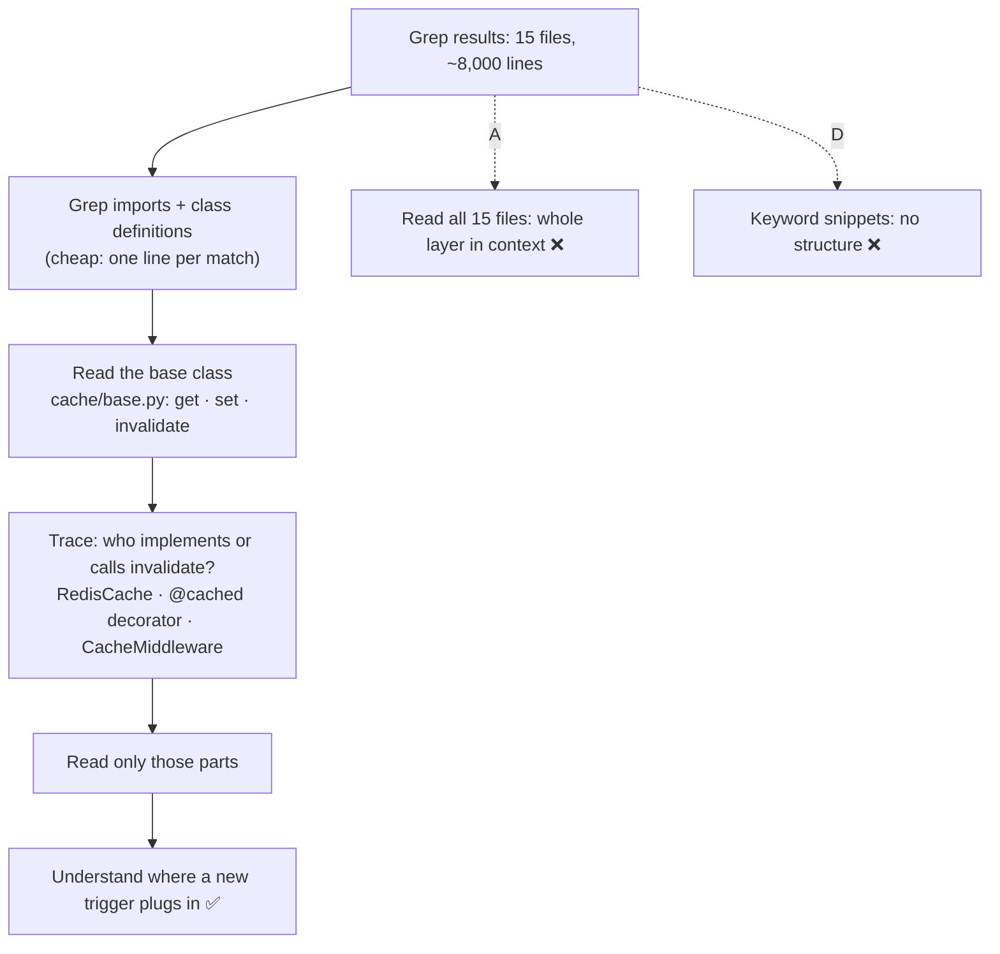

# Q68 — 15 caching files, ~8,000 lines: find the base class, read its interface, then trace

**Domain / lesson:** D2 › 2.5 Built-in Tools (incremental codebase understanding)
**Also touches:** D5 › 5.4 Codebase Exploration & Context Degradation (why reading everything hurts)
**Scenario:** Developer productivity tools built with the Claude Agent SDK (built-in tools + MCP servers)
**Follows:** [Q58](../Q58-at-reference-example-files/question.md) (exploring costs context; explore only what you don't know) · [Q66](../Q66-clear-stack-trace-direct-execution/question.md) (a stack trace as a map into unfamiliar code) · [Q03](../Q03-crash-recovery-state-manifest/question.md) (state outside the context)

## Question

You are building developer productivity tools using the Claude Agent SDK. The agent helps engineers explore unfamiliar codebases, understand legacy systems, generate boilerplate code, and automate repetitive tasks. It uses the built-in tools (Read, Write, Bash, Grep, Glob) and integrates with Model Context Protocol (MCP) servers.

An engineer asks the agent to understand how the caching layer works before adding a new cache invalidation trigger. After initial Grep searches, the agent has identified that caching logic spans 15 files including decorators, middleware, and service classes (~8,000 lines total). What's the most effective next step for building understanding while managing context constraints?

- **A.** Use the Read tool to sequentially load all 15 files, building complete understanding across the full caching implementation.
- **B.** Use Glob to find files matching common caching patterns (cache.py, caching/), prioritize the largest files by reading them first, then check smaller files for gaps.
- **C.** Analyze imports and class hierarchies to identify the base cache class, Read that file to understand the interface, then trace specific invalidation implementations.
- **D.** Use Grep to search for "invalidate" and "expire" patterns across all files, then Read only those specific line ranges with minimal surrounding context.

## Answer: **C**

## Diagram



*(File and class names are illustrative.)*

## Concept

**Understand the structure first, then read only what the structure points to.** The engineer needs to know *how the caching layer works* so a new invalidation trigger fits in. A cache layer is usually built around one abstraction: a base class or interface (`get`, `set`, `invalidate`) that backends, decorators and middleware use. Read that one file, and the other 14 become a map: each implements, wraps or calls that interface.

**C is the guide's incremental discovery, step by step:**

| Guide 2.5 step | In C |
|---|---|
| *"Grep to find entry points."* | Already done: 15 files found |
| (cheap structure search) | Grep the imports and `class X(BaseCache)` lines to find the base class. Each match is one line, not a whole file |
| *"Read to follow imports and trace flows."* | Read the base class: the interface every other file uses |
| *"Read only what you need. Justify each file you read by what you found in the previous step."* | Trace the invalidation implementations: the backend's `invalidate`, the decorator, the middleware. Read those parts, not all 8,000 lines |

```text
Grep: "^class \w+\(.*Cache"          → RedisCache(BaseCache), MemoryCache(BaseCache)
Grep: "from .*cache.* import"        → base.py is imported by all 15 files
Read: cache/base.py                  → interface: get · set · invalidate(key) · invalidate_pattern(prefix)
Grep: "invalidate"                   → who calls it, now that you know what it means
Read: the callers that matter        → where existing triggers live, so the new one fits the same way
```

**Why context matters here.** Guide 5.4: *"Exploring a large codebase is one of the most context-intensive tasks that a Claude-based agent performs."* Every Read adds the whole file to the conversation, and *"the model loses its grip on earlier findings as the context fills with verbose discovery output."* The aim is the most understanding for the fewest tokens: *"This approach uses as little context as possible for as much understanding as possible."*

## Why the others are wrong

| Option | Why not |
|---|---|
| **A** Read all 15 files in sequence | **The guide's exam trap: *"Reading all source files upfront before understanding what is relevant."*** About 8,000 lines go into context, most of them unrelated to invalidation. Guide 2.5: *"Reading every file upfront, before you know what you need, is the most costly mistake in exploring a codebase."* And more context is not more understanding: the files read first get pushed back by the later ones (5.4 context degradation). |
| **B** Glob for caching filenames, read the largest first | **The wrong tool and the wrong order.** Glob matches **file paths**. The 15 relevant files are already known from Grep, and names like `cache.py` would miss decorators and middleware that sit elsewhere. "Largest first" sorts by size, not relevance: it spends the most context first, and the biggest file is rarely the interface. "Check smaller files for gaps" has no way of knowing what a gap is. |
| **D** Grep "invalidate"/"expire", read only those lines with minimal context | **The tempting one: it's the most context-efficient.** But it gives you fragments, not *how the caching layer works*. Lines that call `invalidate` don't show what it does, how keys are built, or how decorators and middleware hook in, which is exactly what you need before adding a trigger. The keywords are also guessed before you know the code, so they may miss parts of the layer. Grep is a good **second** step, *after* the interface tells you what to search for. |

## Pattern to remember

> **Understanding a large area of code under context limits → find the core abstraction (base class / interface), read it, then trace from it to the specific implementations.** Read in order of relevance, each Read justified by the previous step. Not everything (A), not by file size (B), not keyword fragments without the structure (D).

**Exam signals:**
- *"Spans N files"*, *"~8,000 lines"*, *"managing context constraints"* → **incremental**: Grep → Read the key file → trace.
- *"Load all files"*, *"complete understanding"* → the upfront-reading trap.
- *"Minimal surrounding context"* when the task is to *understand how something works* → too narrow.
- Long exploration across many steps → also **scratchpad files** and **subagents** (5.4).

**Which option fits which goal?**

| Goal | Best first move |
|---|---|
| Understand how a whole layer works | Find and read the **core abstraction**, then trace (Q68) |
| Find every caller of one function | **Grep** the name, then Grep any wrapper names (2.5) |
| Find files by name or type (tests, configs) | **Glob** (2.5) |
| A broad search whose details you won't need | **Subagent** that returns a summary (Q58 check, 5.4) |

### Where this comes from

**Guide D2 › 2.5 Built-in Tools › Incremental Codebase Understanding:**
- *"Reading every file upfront, before you know what you need, is the most costly mistake in exploring a codebase."*
- *"Incremental discovery reads a few files first and reads more only when it needs them."*
- *"Grep to find entry points."* *"Read to follow imports and trace flows. Read the files that matter to understand the code structure. Follow their import statements to discover related files."*
- *"Read only what you need. Justify each file you read by what you found in the previous step."*
- *"This approach uses as little context as possible for as much understanding as possible."*
- Exam trap: *"Reading all source files upfront before understanding what is relevant"*. *"The correct approach is incremental: Grep to find entry points, then Read to trace flows from those specific entry points."* (**A**)
- *"Glob matches file paths by naming patterns."* *"Grep finds what is inside files. Glob finds files by their names."* (**B**)

**Guide D5 › 5.4 Codebase Exploration & Context Degradation:**
- *"Exploring a large codebase is one of the most context-intensive tasks that a Claude-based agent performs."*
- *"The model loses its grip on earlier findings as the context fills with verbose discovery output."*

## How this connects to earlier questions

| Question | Link |
|---|---|
| [Q58](../Q58-at-reference-example-files/question.md) | Exploration costs context: there you skipped it because you already knew the files. Here you must explore, so you do it in the cheapest order |
| [Q66](../Q66-clear-stack-trace-direct-execution/question.md) | Same idea: start from the thing that tells you where to look (the stack trace there, the base class here), not from the whole module |
| [Q03](../Q03-crash-recovery-state-manifest/question.md) | For long explorations, keep findings outside the context (manifest, scratchpad) |
| [Q42](../Q42-trim-tool-outputs-relevant-fields/question.md) | The same budget logic for tool outputs: keep only what the next step needs |

## Check question

**The agent reads `cache/base.py` and learns that `invalidate(key)` is the method to call. But it also finds that most services never call `invalidate` directly: they use a `@bust_cache("products")` decorator defined in `decorators/cache.py`, which calls `invalidate` inside it. The agent's first Grep was for `invalidate`. What does that mean for finding all the existing invalidation triggers, and what should the agent do next?**

## Glossary

- **Incremental discovery:** reading a few files first and reading more only when the previous step shows they matter.
- **Core abstraction / base class:** the class or interface that other parts of a layer implement or call (e.g. `BaseCache` with `get`, `set`, `invalidate`).
- **Cache invalidation trigger:** the event or code path that removes or refreshes cached data (e.g. after a product update).
- **Decorator:** in Python, a function that wraps another function to add behaviour, written as `@name` above it.
- **Middleware:** code that runs around every request (e.g. checks the cache before the handler runs).
- **Context degradation:** the model using earlier findings less precisely as verbose output piles up in the context (5.4).

## Related course lessons

*Lecture lengths aren't recorded in the study-map files, so the watch times below are estimates from each course's average lecture length.*

### Udemy A (primary): Claude Certified Architect (CCAR-F) - 2026 Exam Prep
| # | Lecture | Part | Why |
|---|---|---|---|
| **59** | **The Tool System — Reads, Bash, Edits, and Web Search** | 3A | ⭐ What each Read costs and how to search before reading *(also in Q58)* |
| 56 | The Built-in Toolset | 2C | Grep vs Glob vs Read (B and D) |
| 122 | Why Delegate Discovery to a Subagent | 5C | When exploration should leave the main context (5.4) |
| Quiz 8, Quiz 7, Quiz 17 | 3A, 2C and 5C quizzes | | Self-test |

**▶ Watch in this order (~20 min, est.):** #59 → #56 → #122, then do **Quiz 8**, **Quiz 7** and **Quiz 17**.
Udemy A has no lecture dedicated to incremental exploration. Udemy B #80 is the key lecture for this question.

### Udemy B: Claude Certified Architect Foundations: Complete Course (Voroniuk)
| # | Lecture | Section | Why |
|---|---|---|---|
| **80** | **Exploring a Codebase Step by Step** | S8 Claude Code Setup | ⭐ Exactly option C: incremental exploration *(also in Q58)* |
| **79** | **Built-in Tools: Grep, Glob, Read, Write and Edit** | S8 Claude Code Setup | ⭐ Which tool for which step (B, D) |
| 90 | Dev Agent Case: Exploring Code | S8 Claude Code Setup | A worked case in this same scenario |
| Quiz 8 | Claude Code Setup quiz | S8 | Self-test |

**▶ Watch in this order (~15 min, est.):** #80 → #79 → #90, then do **Quiz 8**.

### CBT Nuggets: CCA-F course
| Skill | Why |
|---|---|
| **23. Apply Built In Tools Safely** | ⭐ Using Read, Grep and Glob deliberately |

CBT has no lesson on codebase exploration (5.4). Use the guide lessons and Udemy B #80.
