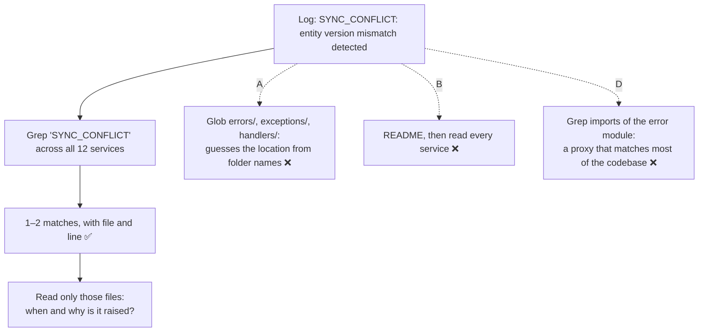

# Q69 — Unknown error in production: Grep for its distinctive text

**Domain / lesson:** D2 › 2.5 Built-in Tools (Grep vs Glob, incremental discovery)
**Also touches:** D5 › 5.4 Codebase Exploration (don't read what you don't need)
**Scenario:** Developer productivity tools built with the Claude Agent SDK (same as [Q68](../Q68-trace-from-base-class-incremental-reading/question.md))
**Follows:** [Q68](../Q68-trace-from-base-class-incremental-reading/question.md) (incremental reading; Grep again for new names) · [Q66](../Q66-clear-stack-trace-direct-execution/question.md) (start from the evidence you have)

## Question

You are building developer productivity tools using the Claude Agent SDK. The agent helps engineers explore unfamiliar codebases, understand legacy systems, generate boilerplate code, and automate repetitive tasks. It uses the built-in tools (Read, Write, Bash, Grep, Glob) and integrates with Model Context Protocol (MCP) servers.

An engineer sees an unfamiliar error message "SYNC_CONFLICT: entity version mismatch detected" in production logs but doesn't know which of the 12 services in the codebase generates it. They ask the agent to help locate the source code. What exploration approach will most efficiently find the responsible code?

- **A.** Use Glob to find files in directories commonly associated with error handling (such as errors/, exceptions/, or handlers/) across all services, then Read each matching file.
- **B.** Read the project's README and service configuration files to understand the architecture, then systematically Read source files in each service directory.
- **C.** Use Grep to search for distinctive text from the error message (like "SYNC_CONFLICT" or "entity version mismatch"), then Read the matching files to understand context.
- **D.** Use Grep to find all files that import the project's error handling module, then Read those files to locate custom error definitions.

## Answer: **C**

## Diagram



## Concept

**You already hold the best search key: the error's own text.** An error message is a string literal somewhere in the code. A distinctive one like `SYNC_CONFLICT` probably appears in very few files, possibly just one. Grep searches **inside** files, so it goes straight there across all 12 services, and returns file names and line numbers without loading any file.

Guide 2.5: *"Grep searches file contents for patterns. Use it to find function callers, error messages, import statements and variable assignments."* And the first step of incremental discovery: *"Grep to find entry points. Search for the function name, class name or error message that starts your investigation."* The guide's own example is this question in miniature: *"a refund bug starts from an error message. The developer Greps for the message, reads the file that the Grep result shows, then follows the imports."*

**Pick the most distinctive, most fixed piece of the message.** That's why C gives two options:

| Search for | Why |
|---|---|
| `SYNC_CONFLICT` | An error code: unusual, and almost certainly written exactly like this in the code |
| `entity version mismatch` | A fixed phrase, if the code isn't found |
| ~~the full message~~ | Parts of a message are often built at runtime (`f"{code}: {entity} version mismatch"`), so the full text may never appear in the source |

**Then Read only what matched.** *"Read only what you need. Justify each file you read by what you found in the previous step."* One or two files, not 12 services.

## Why the others are wrong

| Option | Why not |
|---|---|
| **A** Glob for `errors/`, `exceptions/`, `handlers/`, then Read each file | **Glob finds files by name, not by what's in them.** Guide 2.5: *"Glob matches file paths by naming patterns"*, and *"a file's path contains no information about what the file calls"*. A is a guess that the message lives in a folder with a typical name. A sync conflict is more likely raised in the sync or persistence code. Even if the guess is right, reading every error file in 12 services is costly. |
| **B** README + config, then read source files service by service | **Reading upfront: the guide's exam trap.** *"Reading all source files upfront before understanding what is relevant."* Understanding the architecture first sounds thorough, but you don't need it to find one string. Twelve services' worth of files would also fill the context (5.4). |
| **D** Grep files that import the error module, then Read them | **The tempting one: it uses Grep.** But it searches for a **stand-in** (who uses error handling) instead of the text you actually have. Most of the codebase probably imports the error module, so you'd still read dozens of files. And the message may not even come from that module. Right tool, wrong search term. |

## Pattern to remember

> **You have a distinctive string from the code (error message, error code, log line) → Grep for it across the whole codebase, then Read only the matches.** Glob is for file names, not contents. Don't read upfront, and don't search for a stand-in when you hold the real text.

**Grep or Glob?**

| You have | It's in… | Tool |
|---|---|---|
| An error message, function name, import, variable | The **contents** of files | **Grep** |
| A file name or path pattern (test files, configs, a folder) | The **paths** of files | **Glob** |

**Exam signals:**
- *"Error message"*, *"string"*, *"function callers"*, *"where is X used"* → **Grep**.
- *"Test files"*, *"config files"*, *"all .tsx files"* → **Glob**.
- *"Read the README, then systematically read…"* → upfront reading, wrong.

### Where this comes from

**Guide D2 › 2.5 Built-in Tools:**
- *"Grep searches file contents for patterns. Use it to find function callers, error messages, import statements and variable assignments."*
- *"Glob matches file paths by naming patterns: name, extension or directory structure."* *"Grep finds what is inside files. Glob finds files by their names."* (**A**)
- *"Grep to find entry points. Search for the function name, class name or error message that starts your investigation."*
- *"At the sports shop, a refund bug starts from an error message. The developer Greps for the message, reads the file that the Grep result shows, then follows the imports."*
- Exam trap: *"Reading all source files upfront before understanding what is relevant"*. (**B**)
- *"Read only what you need. Justify each file you read by what you found in the previous step."*

## How this connects to earlier questions

| Question | Link |
|---|---|
| [Q68](../Q68-trace-from-base-class-incremental-reading/question.md) | Same method, different starting point. There the goal was to understand a layer (start from its core class); here it's to find one string (start from the string) |
| [Q66](../Q66-clear-stack-trace-direct-execution/question.md) | Start from the evidence you have: a stack trace there, an error text here |
| [Q58](../Q58-at-reference-example-files/question.md) | Exploration costs context: search precisely so you read less |

## Check question

**The Grep for `SYNC_CONFLICT` finds just one file: `shared/errors/codes.py`, a shared library that all 12 services use, with the line `SYNC_CONFLICT = ErrorCode("SYNC_CONFLICT", "entity version mismatch detected")`. That's where the error is *defined*, not where it's *raised*. How does the agent find which service actually raised it?**

*My answer:* "Grep for calls of that library?" 🟡 **Right move: Grep again, for where it's used (Q68's lesson). But the search term is too broad. "Calls of that library" would match all 12 services, since they all use it: that's Q69's option D again. Search for the one name that raises *this* error.**

**The clue is in the result: only one file matched.** If any service wrote `SYNC_CONFLICT` in its code, the first Grep would have found it. So no service uses that name directly. They must use it through **something else defined in `codes.py`**, for example:

```python
# shared/errors/codes.py
SYNC_CONFLICT = ErrorCode("SYNC_CONFLICT", "entity version mismatch detected")

class VersionConflictError(AppError):
    code = SYNC_CONFLICT
```

```python
# services/inventory/stock.py: never mentions SYNC_CONFLICT
raise VersionConflictError(entity_id)
```

This is Q68's wrapper case again: the first name leads to a second name, and the callers use the second.

| Grep for | Matches | Useful? |
|---|---|---|
| Imports of `shared/errors` ("calls of that library") | All 12 services | ❌ Too broad: every service uses it |
| `SYNC_CONFLICT` | Only `codes.py` (the definition) | Shows where it's defined |
| `VersionConflictError` (found by reading `codes.py`) | The 1–2 places that **raise** it | ✅ The answer |

**Next steps:**
1. **Read `codes.py` around the match**: which class or helper wraps `SYNC_CONFLICT`?
2. **Grep that name across all 12 services** to find where it's raised.
3. **If several services raise it, use the log entry itself.** Production logs usually carry a service name, a trace ID or a stack trace. Checking the full log line first may name the service at once, with no code search at all. *(Practical tip, not guide wording.)*

> **Only the definition matches → the code uses it under another name. Read the definition, find the name that wraps it, and Grep for that. Search for the narrowest term that identifies this error, not for everything that uses the library.**

## Glossary

- **Grep:** searches the **contents** of files for a text pattern and returns matching files and lines.
- **Glob:** matches file **paths** by name pattern (e.g. `**/*.test.tsx`, `errors/**`).
- **Error code:** a fixed identifier for an error type (e.g. `SYNC_CONFLICT`), usually defined once and reused.
- **Entity version mismatch:** a typical optimistic-locking conflict, where an update is based on an older version of a record than the one now stored.

## Related course lessons

*Lecture lengths aren't recorded in the study-map files, so the watch times below are estimates from each course's average lecture length.*

### Udemy A (primary): Claude Certified Architect (CCAR-F) - 2026 Exam Prep
| # | Lecture | Part | Why |
|---|---|---|---|
| **56** | **The Built-in Toolset** | 2C | ⭐ Grep vs Glob vs Read: exactly C vs A *(also in Q68)* |
| 59 | The Tool System — Reads, Bash, Edits, and Web Search | 3A | Search before you read (B) *(also in Q58, Q68)* |
| Quiz 7, Quiz 8 | 2C and 3A quizzes | | Self-test |

**▶ Watch in this order (~15 min, est.):** #56 → #59, then do **Quiz 7** and **Quiz 8**.

### Udemy B: Claude Certified Architect Foundations: Complete Course (Voroniuk)
| # | Lecture | Section | Why |
|---|---|---|---|
| **79** | **Built-in Tools: Grep, Glob, Read, Write and Edit** | S8 Claude Code Setup | ⭐ Exactly this question: Grep for contents, Glob for paths *(also in Q68)* |
| 80 | Exploring a Codebase Step by Step | S8 Claude Code Setup | Grep for the entry point, then read *(also in Q58, Q68)* |
| 90 | Dev Agent Case: Exploring Code | S8 Claude Code Setup | A worked case in this same scenario *(also in Q68)* |
| Quiz 8 | Claude Code Setup quiz | S8 | Self-test |

**▶ Watch in this order (~15 min, est.):** #79 → #80 → #90, then do **Quiz 8**.

### CBT Nuggets: CCA-F course
| Skill | Why |
|---|---|
| **23. Apply Built In Tools Safely** | ⭐ Choosing Grep, Glob and Read deliberately *(also in Q68)* |
