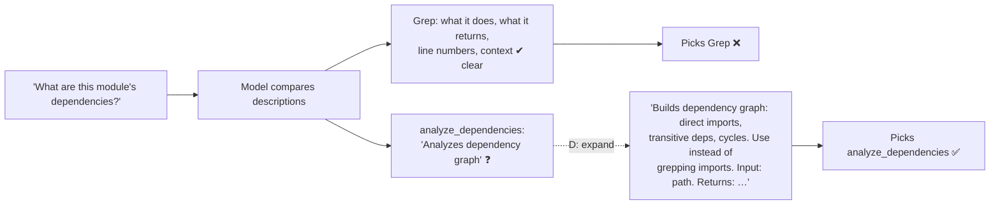

# Q70 — Agent greps imports instead of calling `analyze_dependencies`: expand the MCP tool description

**Domain / lesson:** D2 › 2.4 MCP Server Integration (sparse MCP descriptions lose to detailed built-ins)
**Also touches:** D2 › 2.1 Tool Interface Design (descriptions drive selection; when splitting is right)
**Scenario:** Developer productivity tools with the Claude Agent SDK (built-ins + MCP servers)
**Follows:** [Q74](../Q74-mcp-descriptions-compete-with-built-ins/question.md) (same problem: refactoring tools vs Write/sed) · [Q23](../Q23-expand-minimal-tool-descriptions/question.md) (expand minimal descriptions) · [Q17](../Q17-split-unified-tool/question.md) / [Q30](../Q30-split-generic-analyze-document/question.md) (when splitting *is* right)

## Question

After integrating a local MCP server providing code analysis tools (analyze_dependencies, find_dead_code, calculate_complexity), you verify the server is healthy and tools appear in the tools/list response. However, you observe that the agent consistently uses Grep to search for import statements instead of calling analyze_dependencies – even when users explicitly ask about "code dependencies."

Examining tool definitions reveals:
- MCP: analyze_dependencies – "Analyzes dependency graph"
- Built-in: Grep – "Search file contents for a pattern using regular expressions. Returns matching lines with line numbers and surrounding context."

What's the most effective approach to improve the agent's selection of MCP tools?

- **A.** Add routing instructions to the system prompt specifying that dependency-related questions should use MCP tools rather than Grep.
- **B.** Remove Grep from available tools when the MCP server is connected to eliminate functional overlap.
- **C.** Split analyze_dependencies into granular tools (list_imports, resolve_transitive_deps, detect_circular_deps) so each has a focused purpose less likely to overlap with Grep.
- **D.** Expand MCP tool descriptions to detail capabilities and outputs – e.g., "Builds dependency graph showing direct imports, transitive dependencies, and cycles."

## Answer: **D**

## Diagram



## Concept

**Rule out the plumbing first:** the server is *"healthy"* and the tools are in `tools/list`. The agent **sees** `analyze_dependencies` and **chooses** Grep anyway. That's a **selection** problem, and selection runs on descriptions.

**Compare the two descriptions side by side.** Grep's says **what it does** and **what it returns**. `analyze_dependencies` says three vague words. Faced with "code dependencies", the model picks the tool it **understands**: grep the imports.

Guide 2.4: *"The agent reads tool descriptions when choosing, and it prefers built-in tools to MCP tools with sparse descriptions."*

**D fixes the cause:** describe the capability (direct imports, **transitive** dependencies, **cycles**: things Grep can't do), the input and the output. Better still, say **when to prefer it over Grep**:

```text
analyze_dependencies(path): Builds the dependency graph for a module or package:
direct imports, transitive dependencies (what your imports import), and import cycles.
Resolves aliases and re-exports, which grepping for "import" misses.
Use this instead of Grep for any question about what code depends on.
Returns: {direct: [...], transitive: [...], cycles: [[a, b, a], ...]}
```

## Why the others are wrong

| Option | Why not |
|---|---|
| **A** Routing rules in the system prompt | **Treats the symptom, not the cause.** The description stays vague; every new dependency-ish phrasing needs another rule. Guide 2.4: *"The model does not always follow prompt rules."* Fix the description, which the model reads at the moment of choice. |
| **B** Remove Grep when the MCP server is connected | **Breaks everything else.** Grep is still needed for all other content searches (Q134: `eval(`, error messages, config keys). Guide 2.4: *"removing built-in tools breaks work they still do."* |
| **C** Split into `list_imports`, `resolve_transitive_deps`, `detect_circular_deps` | **Doesn't fix the cause, and can make it worse.** Three tools with **equally minimal** descriptions are still vague, and `list_imports` overlaps with Grep **even more** directly. Splitting is right when one tool does **different jobs with different inputs/outputs** (Q17, Q30); here the problem is a description that's too short. |

## Pattern to remember

> **MCP tool visible but ignored in favour of a built-in → its description is too sparse. Expand it: what it does, inputs, outputs, and when to prefer it over the built-in.**

**Exam signals:**
- "server healthy, tools listed" + "agent uses Grep/sed/Write instead" + a one-line MCP description → **expand descriptions**.
- Reject: prompt routing rules (A), removing built-ins (B), splitting a tool whose problem is its description (C).

**Split vs describe (2.1):**

| Problem | Fix | Q |
|---|---|---|
| One tool doing **different jobs** (different inputs or outputs) | **Split** it | Q17, Q30 |
| Tool fine, **description too short** to win selection | **Expand** the description | Q23, Q70, Q74 |

### Where this comes from

**Guide D2 › 2.4 MCP Server Integration** (checked 2026-11-03):
- *"The agent reads tool descriptions when choosing, and it prefers built-in tools to MCP tools with sparse descriptions."*
- *"If a server is configured and reachable, its tools appear in the agent's toolkit."*
- Trap: *"The model does not always follow prompt rules, and removing built-in tools breaks work they still do."*

**Guide D2 › 2.1 Tool Interface Design** (as recorded in [Q74](../Q74-mcp-descriptions-compete-with-built-ins/question.md)):
- *"Tool descriptions are the primary mechanism LLMs use for tool selection."*

## How this connects to earlier questions

| Question | Link |
|---|---|
| [Q74](../Q74-mcp-descriptions-compete-with-built-ins/question.md) | Same problem with refactoring tools vs Write/sed |
| [Q23](../Q23-expand-minimal-tool-descriptions/question.md) | Expand minimal descriptions to fix misrouting |
| [Q17](../Q17-split-unified-tool/question.md) / [Q30](../Q30-split-generic-analyze-document/question.md) | When splitting **is** the right fix (vs C) |
| [Q134](../Q134-grep-for-content-search/question.md) | Why Grep must stay (vs B) |
| [Q133](../Q133-mcp-resources-content-catalogs/question.md) | Another way MCP servers help the agent: resources |

## Check question

**(1) In Q17 and Q30 splitting a tool was the right fix. Why is it the wrong fix here? (2) Name one thing `analyze_dependencies` can do that grepping for `import` cannot, and say why that belongs in its description.**

*My answer:* "1) There is nothing to split here, it's just a bad description of the existing tool. 2) Resolving transitive dependencies (or detecting dependency cycles)." Numbered, both addressed. (1) ✅; (2) capability ✅, the *why* missing.

**(1) ✅ Exactly.** `analyze_dependencies` does **one job** with one input (a path) and one output (the graph). Q17/Q30 split tools that did **different jobs with different inputs or outputs**. Here, nothing about the tool is wrong, only its description.

**(2) ✅ Transitive dependencies / cycles: right.** Why it must be **in the description**: the model picks Grep because, from what it can read, **Grep looks good enough** ("dependencies = grep the imports"). Grep only finds **direct** `import` lines in files you search. It can't tell you that A depends on C through B, or that A → B → A is a cycle. Saying so in the description gives the model the **reason to choose differently**: the description must state what the MCP tool does **that the built-in can't**.

> **A description wins selection by showing the difference.** "Analyzes dependency graph" doesn't; "transitive dependencies and cycles, which grepping imports misses" does.

## Glossary

- **`tools/list`:** the MCP request a client sends to discover a server's tools; returns names, descriptions, input schemas.
- **Sparse description:** a few vague words that don't say what a tool does, takes or returns.
- **Transitive dependency:** something your dependency depends on (A imports B, B imports C → A depends on C).
- **Dependency cycle:** modules importing each other in a loop (A → B → A).
- **Functional overlap:** two tools that can partly do the same job; resolved by clear descriptions, not removal.

## Related course lessons

*Lecture lengths aren't recorded in the study-map files, so the watch times below are estimates.*

### Udemy A (primary): Claude Certified Architect (CCAR-F) - 2026 Exam Prep
| # | Lecture | Part | Why |
|---|---|---|---|
| **33** | **Writing Tool Descriptions That Route Correctly** | 2A | ⭐ Exactly D *(also in Q17, Q19, Q20, Q23, Q30, Q48, Q74)* |
| **32** | **How Claude Selects Tools** | 2A | ⭐ Why the model picks the tool it understands *(also in Q23, Q74)* |
| 55 | MCP in Production | 2C | MCP tools next to built-ins *(also in Q74, Q131, Q133)* |
| Quiz 5, Quiz 7 | 2A and 2C quizzes | | Self-test |

**▶ Watch in this order (~20 min, est.):** #32 → #33 → #55, then do **Quiz 5** and **Quiz 7**.

### Udemy B: Claude Certified Architect Foundations: Complete Course (Voroniuk)
| # | Lecture | Section | Why |
|---|---|---|---|
| **41** | **How Claude Chooses a Tool** | S5 Tools & MCP | ⭐ Descriptions decide the choice *(also in Q23, Q74)* |
| **42** | **Renaming, Splitting and Keyword Triggers** | S5 Tools & MCP | ⭐ When to split vs describe (C) *(also in Q17, Q30, Q74)* |
| 91 | Dev Agent Case: MCP Servers | S8 Claude Code Setup | Same dev-agent scenario *(also in Q74, Q131, Q133)* |
| Quiz 5, Quiz 8 | Tools & MCP and Claude Code Setup quizzes | S5, S8 | Self-test |

**▶ Watch in this order (~15 min, est.):** #41 → #42 → #91, then do **Quiz 5** and **Quiz 8**.

### CBT Nuggets: CCA-F course
| Skill | Why |
|---|---|
| **34. Build MCP Tools Resources and Prompts** | ⭐ Writing MCP tool descriptions *(also in Q74, Q133)* |
| 22. Route Requests Across Multiple Tools | How the model chooses between tools *(also in Q74)* |
